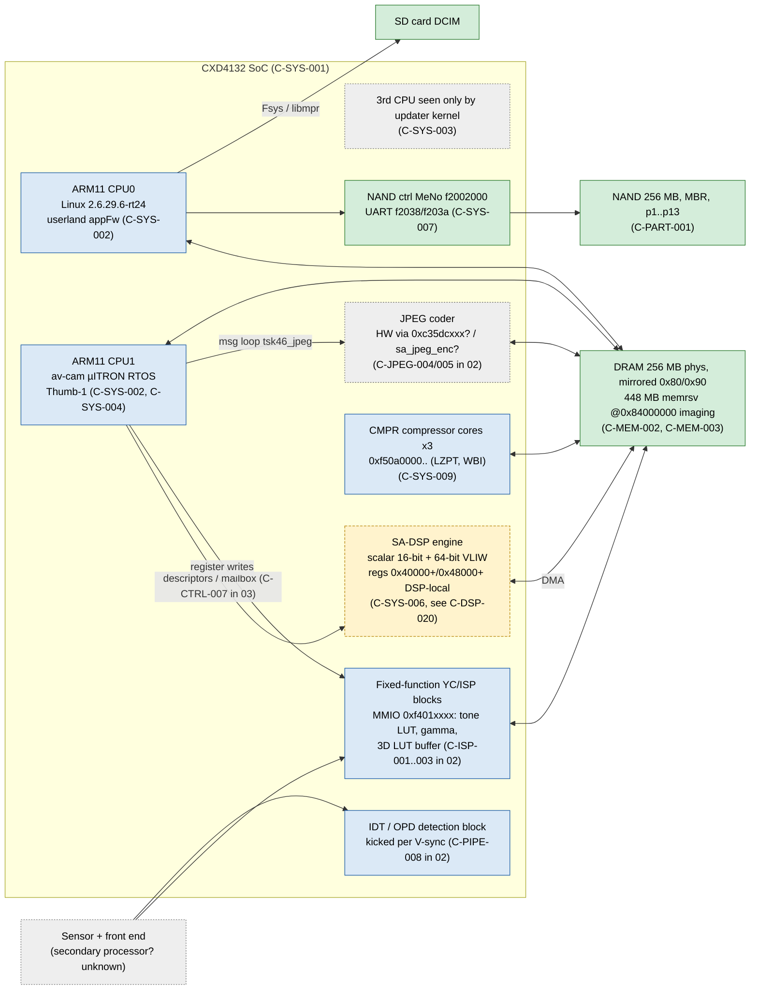
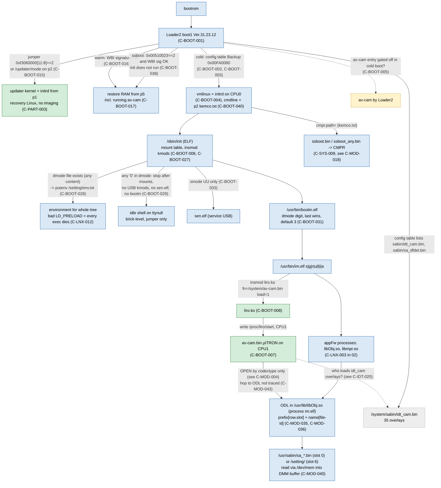

# 01 — System map: cores, chips, partitions, files, load chain

Scope: hardware blocks of the NEX-3N (CXD4132, fw 1.00), NAND partitions p1…p13, who loads whom.
Schema and status meaning: `00-index.md`. Addresses: av-cam VA (base `0xc3441000`) unless prefixed.
Areas on this page: `SYS`, `PART`, `BOOT`, `MEM`. DLV/SAFE/TOOL/MOD/DSP/IDT claims are owned by
`04`/`05` and cited here by their temporary IDs, e.g. `(see C-DLV-008)`, `(see C-MOD-006)`.

## Sources (aliases used in `source:`)

| alias | path |
|---|---|
| SB | `WorkPersonal/reference/nex3n-safe-test-boot.md` |
| FH | `WorkPersonal/reference/nex3n-firmware-hacking.md` |
| FA | `notes/firmware-architecture.md` |
| LM | `notes/live-memory-and-delivery.md` |
| GH | `notes/grain-hook.md` |
| DG | `notes/dsp-grain-campaign.md` |
| ST | memory `nex3n-firmware-hack-status.md` |
| LR | `atlas/_extract/L-linux-grain-recon.md` (offline recon 2026-10-09) |
| WR | `atlas/_extract/E-web-research.md` (public sources 2026-10-09) |
| SIA | `WorkPersonal/reference/nex3n-sa-interface.md` |
| P09 | atlas-editor pass 2026-10-09: direct read of `~/nex3n-dump/safeboot/out3n/` (directory listings, `strings`, ELF `.data` of `/sbin/init`) |
| F | `atlas/_extract/F-q5-dmode-safety.md` (static, 2026-10-09: init/bootin/sonyld/Loader2/updater) |
| G | `atlas/_extract/G-q2-module-resolver.md` (static, 2026-10-09: ODL in libObj) |
| H | `atlas/_extract/H-q31-yknr-dataflow.md` (offline scalar emulation, 2026-10-09) |
| R | `atlas/_extract/R-fable-review.md` (independent review, 2026-10-09) |
| X09 | atlas-editor pass 2026-10-09 (integration): cross-body comparison in `~/nex3n-dump/sonygen/` (`bk_6000.txt`, `bk_7m2.txt`, `sabin_nex6/`, `sabin_7M2V401/`) |

## 1. Hardware block diagram

Legend (all diagrams in the atlas): green = verified-hw, blue = verified-code, yellow dashed =
hypothesis, grey dashed = unknown.

## 2. Partition map

Sizes from `/proc/partitions` (1 KiB blocks, C-PART-002). Mount points from the hard-coded table in
`/sbin/init` (C-PART-011). "write" = how it has actually been written on this camera.

| part | size | mount (init table) | format | contents | ro/rw at runtime | how it is written | claims |
|---|---|---|---|---|---|---|---|
| p1 | 4096 K | — (Loader2 reads it) | FAT-like | `boot/vmlinux`, `boot/initrd.img`, `loadaddr.txt`, `dat2`, `dat3`, `p1chksum` (updater kernel) | — | never written | C-PART-003 |
| p2 | 3072 K | `/setting` vfat | vfat | `Backup.bin`, `Backup.bak`, `DmmConfig.bin`, `kemco.txt`, `mode/` (dmode, cmode), `updater/` (comp, dat4), `gps`, `appfw_infra`, `facedmy.bin`, `ulogio.bin`; `env.txt` read by init whenever `mode/dmode` exists (any content); NEVER-TOUCH: `kemco.txt` (kernel cmdline), `mode/dmode` except `"3\n"` | rw | senser FileControl, updater shell file ops, `bk w` (Backup) | C-PART-004, C-BOOT-028, C-BOOT-029, C-BOOT-040 |
| p3 | 10240 K | `/system` vfat via `/dev/dnflasha3` (fallback `/dev/nflasha3`) | LZPT (`TPZL`) over FAT | `av-cam.bin` (inner off `0x8e00`), `vmlinux.bin`, `initrd.img`, `lensbin_lensproperty/`, `sabin/` = `idt_cam.bin` (inner off `0x980e00`), `sa_dfdet.bin`, `ssboot.bin`, `ssboot_any.bin` | ro (FileControl error 130) | raw `writeFile('/dev/nflasha3')` in updater shell, 38-sector partial or full | C-PART-005, C-PART-006, C-PART-015 |
| p4 | 6144 K | not in init table | ? | ? | ? | never | C-PART-012 |
| p5 | 40960 K | — | WBI (`WBI1` magic) | RAM snapshot for warm start | — | sector 0 zeroed after every p3 flash | C-PART-010 |
| p6 | 5120 K | `/log` (one of 5 fallbacks) | vfat? | ? | ? | never | C-PART-011, C-PART-012 |
| p7 | 35840 K | `/tmp` vfat (also a `/log` fallback) | vfat | `config.spec`, `images/`, `kikilog.dat` | rw (presumed) | never by us | C-PART-011, C-PART-018 |
| p8 | 46080 K | `/usr` via `/dev/dnflasha8` ext2 (fallbacks cramfs, vfat on nflasha8) | LZPT over ext2 | `bin/` (`im.elf`, `bootin.elf`), `lib/` (`libObj.so`, `libmpr.so`, `viewUnified*.so`), `share/app/string_*.uxc`, `sabin/` = 32 `sa_*.bin` + 20 `spica_*_tap_*.bin` | ro (error 130) | never confirmed on hardware (see C-DLV-012) | C-PART-007, C-PART-008 |
| p9 | not in `/proc/partitions` | `/usr/upgrade` vfat | — | — | — | — | C-PART-011 |
| p10 | 2816 K | `/lens` vfat | vfat | lens data (presumed by mount name) | ? | never | C-PART-011 |
| p12 | 1024 K | `/log` (fallback) | vfat? | ? | ? | never | C-PART-011 |
| p13 | not in `/proc/partitions` | `/log` (fallback) | — | — | — | — | C-PART-011 |

Writable as a file: only p2 (C-PART-013). Everything else: raw block write from the updater shell
(see C-DLV-007, A-DLV-008).

## 3. Load chain

## 4. Claims — SYS

### C-SYS-001: The NEX-3N SoC is Sony CXD4132 running Linux 2.6.29.6-rt24 (ARMv6 SMP); the normal kernel reports 2 processors
- status: verified-code
- evidence: vmlinux strings `SMP: Total of %d processors activated`, `CPU%u: Booted secondary processor`; CXD4132 in `NEX-3N.hdr`/`CXD4132.dat`; LR §4 re-read `Linux version 2.6.29.6-rt24-alp_nl` in `vmlinux.bin` (built 2013-01-26)
- source: SB §1; FA "CPUs and DRAM"; FH "Платформа"; LR §4
- date: 2026-10-09
- relates: conflicts C-SYS-003

### C-SYS-002: CPU0 runs Linux and userland; CPU1 runs the av-cam µITRON RTOS, started by `liro.ko`
- status: verified-code
- evidence: liro strings `resume_cpu`, `bind task_resume to cpu%d`, `cpu %d is offline`; imports `acre_tsk/act_tsk`, `osal_snd_sync_msg`; WR B1 (a6000): liro spawns a kernel thread pinned to a core
- source: SB §1, "Офлайн-дериск liro.ko"; FA; WR B1
- date: 2026-10-06
- relates: supports C-BOOT-007

### C-SYS-003: The updater kernel (`2.6.29.6-rt24-alp_nl SMP PREEMPT RT`, 2012-09-26) reports 3 ARMv6 CPUs
- status: verified-hw
- evidence: uname/cpuinfo in updater shell (E-0023); OpenMemories hardware page calls CXD4132 "3x ARM11 MPCore" (WR A4)
- source: SB "Live-разведка окружения апдейтера"; WR A4
- date: 2026-10-06
- relates: conflicts C-SYS-001 (2 processors activated by the main kernel); open question Q-21 in 07

### C-SYS-004: The av-cam CPU executes Thumb-1 only (no movw/movt/usat/b.w); conditional branches reach ±256 B, far jumps use `ldr r3,[pc,#4]; bx r3`
- status: verified-hw
- evidence: av-cam constants built with `movs`+`adds`/shifts; hook code built under this constraint ran on the camera (marker `0xdeadbeef`, E-0040)
- source: FA; GH §1; SB §4b
- date: 2026-10-06
- relates: —

### C-SYS-005: `av-cam.bin` = ARM header (`e28ff028`), signature `ORIL`/`LIRO`, scatter table `0x3c..0xc0`, Thumb body from `0xd4`; size 6554072 (`0x6401d8`), base `0xc3441000`
- status: verified-code
- evidence: file header; liro prints `ram %p+%p / bss / tail / limit`; WR B1 gives a matching a6000 header model `{unk0, magic, version, preEntry, entry, memMap*}` (not checked against 3N)
- source: SB §7(c,d); WR B1
- date: 2026-10-04
- relates: supports C-BOOT-014

### C-SYS-006: SA-DSP engine registers (`0x40000+`, local `0x48000+`) are DSP-local and not mapped into ARM physical memory
- status: hypothesis
- evidence: no SA MMIO in updater `/proc/iomem` (updater has SA off, so not proof); no explicit failed ARM read of `0x40000` recorded
- source: FA; SB "Вывод по маршрутам стенда"; ST
- date: 2026-10-06
- relates: supported by C-SYS-007; see C-DSP-020

### C-SYS-007: Updater-kernel iomem: MeNo (NAND) `f2002000`, UARTs `f2038/f203a`, uio0 `f5060000` "gpe"; no SA engine range
- status: verified-hw
- evidence: `/proc/iomem` (E-0023)
- source: SB "Live-разведка"
- date: 2026-10-06
- relates: supports C-SYS-006

### C-SYS-008: The SA-DSP core is integrated in the BIONZ SoC, shares memory with the ARM cores and executes "sabin" programs (32-bit, 16 registers, custom ISA)
- status: hypothesis
- evidence: public statement on openmemories.readthedocs.io/hardware.html (WR A4); consistent with DMA-based module model (see C-DSP-020)
- source: WR A4
- date: 2026-10-09
- relates: —

### C-SYS-009: CXD4132 has three firmware-driven CMPR compressor cores (common blocks `0xf50a0000/0xf50b0000/0xf50c0000`, clock/reset `0xf50000b0..0xf5000330`) that handle LZPT (`TPZL`); the kernel loads their programs from `cmpr.path=/system/sabin/ssboot.bin cmpr.path2=/system/sabin/ssboot_any.bin`
- status: verified-code
- evidence: GPL kernel `arch/arm/mach-cxd4132/cmpr.c`, `include/mach/cmpr.h`: compressor blocks `0xf50a0000/0xf50b0000/0xf50c0000`, clock/reset `0xf50000b0..0xf5000330` (start: `CMN_IPC`, `COR_MBX(0..3)`, `IMSR/IENR`, `CKEN/XRST`); `kemco.txt` line `cmpr.path=...` read in P09
- source: WR A1; P09 (`nflasha2_unpacked/kemco.txt`)
- date: 2026-10-09
- relates: see C-MOD-018, B-MOD-019; template for the SA-DSP start protocol (Q-17)

## 5. Claims — PART

### C-PART-001: The NAND is one MBR device; partitions appear as `/dev/nflasha0pN` (major 252) and `/dev/nflashaN`
- status: verified-hw
- evidence: updater `/proc/partitions`; `/dev/nflasha3`, `/dev/nflasha5` used for raw I/O (E-0023, E-0037)
- source: FA "Flash partitions"; LM
- date: 2026-10-06
- relates: —

### C-PART-002: Partition sizes (1 KiB blocks): p1 4096, p2 3072, p3 10240, p4 6144, p5 40960, p6 5120, p7 35840, p8 46080, p10 2816, p12 1024; full dump 256 MB
- status: verified-hw
- evidence: `/proc/partitions` (E-0037); dump `nex3n_v100_nflasha.bin` (E-0001)
- source: FA; FH
- date: 2026-10-06
- relates: —

### C-PART-003: p1 holds the updater boot area: `boot/vmlinux`, `boot/initrd.img`, `boot/loadaddr.txt`, `dat2`, `dat3`, `p1chksum`
- status: verified-code
- evidence: P09 listing of `nflasha1_unpacked/` (was hypothesis from Loader2 strings `\boot\vmlinux`, `\boot\initrd.img`)
- source: P09; FA; SB §1
- date: 2026-10-09
- relates: supersedes A-PART-003 (hypothesis); relevant to SAFE (see C-SAFE-006)

### C-PART-004: p2 = `/setting` (vfat, rw) holds `Backup.bin`, `Backup.bak`, `DmmConfig.bin`, `kemco.txt`, `mode/` (dmode, cmode; `sen/smode` per notes), `updater/` (comp, dat4), `gps`, `appfw_infra`, `facedmy.bin`, `ulogio.bin`; it is the only filesystem writable as a file
- status: verified-hw
- evidence: updater shell mounts nflasha2 vfat rw (E-0037); senser `writeFile('/setting/gtest.bin')` MATCH (E-0034, E-0036); listing P09
- source: FA; LM; SB §4d; P09
- date: 2026-10-09
- relates: C-PART-013

### C-PART-005: p3 = `/system` is a raw LZPT image (10485760 B) over a FAT image (~14.4 MB) holding `av-cam.bin`, `vmlinux.bin`, `initrd.img`, `lensbin_lensproperty/`, `sabin/` (`idt_cam.bin`, `sa_dfdet.bin`, `ssboot.bin`, `ssboot_any.bin`); `kemco.txt` is on p2, not p3
- status: verified-code
- evidence: fwtool/lzpt unpack; `lzpt_write.py` reproduces p3 byte-for-byte; P09 listing (no `kemco.txt` in p3, present in p2)
- source: FA "LZPT"; SB §1; DG §3; P09
- date: 2026-10-09
- relates: supersedes A-PART-005 (listed `kemco.txt` in p3, omitted `ssboot_any.bin`, `lensbin_lensproperty`)

### C-PART-006: In the p3 inner image `av-cam.bin` is contiguous at offset `0x8e00` (6554072 B) and `idt_cam.bin` starts at `0x980e00` (200384 B)
- status: verified-hw
- evidence: patched images at these offsets booted and acted (E-0022, E-0038, E-0052..E-0065)
- source: FA; LM; DG §4
- date: 2026-10-07
- relates: —

### C-PART-007: p8 = `/usr` is a raw LZPT image (45 MB) over ext2: `im.elf`, `bootin.elf`, `libObj.so`, `libSysDef.so`, `libmpr.so`, `viewUnified*.so`, `share/app/string_*.uxc`, `sabin/`
- status: verified-code
- evidence: unpacked p8 dump lists `im.elf`, `bootin.elf`, `libObj.so`, `libSysDef.so`, `libmpr.so`; init mounts `/dev/dnflasha8` ext2 (P09)
- source: FA; FH; SB §1, §3; LR §1
- date: 2026-10-09
- relates: —

### C-PART-008: p8 `/usr/sabin` holds 52 files: 32 `sa_*.bin` modules (16 processing, 16 codec) and 20 raw `spica_*_tap_step*.bin` tables; p3 `/system/sabin` holds 4 files; `sa_dfdet.bin` is identical in both
- status: verified-code
- evidence: directory listings + md5 (see C-PART-008)
- source: B-extract §1.2; correction 2026-10-09
- date: 2026-10-09
- relates: supersedes A-PART-008 ("~30 modules"); supersedes C-PART-009

### C-PART-009: p3 `sabin/` is the only module set; the 3N has no separate NR / JPEG / Soft-Focus SA modules, so the whole stills develop pipeline is `idt_cam.bin`
- status: refuted
- evidence: C-PART-008; av-cam opens codectypes 0x1c (yknr), 0x0f (kknr), 0x18 (sftfcs) … (see C-MOD-003, B-MOD-012)
- source: DG §3; ST (07.10)
- date: 2026-10-09
- relates: superseded by C-PART-008

### C-PART-010: p5 = WBI, 40 MB, magic `WBI1` at offset 0 — RAM snapshot for fast start
- status: verified-code
- evidence: dump of nflasha5; Loader2 `Check Signature of WBI` @0xa01f12ec
- source: FA; SB §2
- date: 2026-10-06
- relates: C-BOOT-016

### C-PART-011: `/sbin/init` has a hard-coded mount table: nflasha2 → `/setting` vfat; dnflasha3 → `/system` vfat (fallback nflasha3); nflasha7 → `/tmp` vfat; nflasha8 → `/usr` cramfs, dnflasha8 → `/usr` ext2, nflasha8 → `/usr` vfat; nflasha9 → `/usr/upgrade` vfat; `/log` ← nflasha12 | nflasha13 | nflasha6 | ms1 | nflasha7; nflasha10 → `/lens` vfat
- status: verified-code
- evidence: P09: pointer table in `.data` of `nflasha3_unpacked_unpacked/initrd.img_unpacked/sbin/init` at VA `0x12358..0x12464` (triples dev/mountpoint/fstype); LR §3 found the same table
- source: P09; LR §3
- date: 2026-10-09
- relates: supersedes A-PART-011 for p7, p10 (and partially p6, p12); `/dev/dnflashaN` supports C-PART-015

### C-PART-012: Roles of p4, p6, p12 (beyond being `/log` candidates), and of the `/android`, `/info` mounts seen in senser errors are not established; p9 and p13 are named by init but absent from `/proc/partitions`
- status: unknown
- evidence: FA role column empty; `/android`, `/info` not in the init table (P09); senser error 130 on them (E-0036)
- source: FA; LM; P09
- date: 2026-10-09
- relates: C-PART-011

### C-PART-013: Through senser FileControl `/system`, `/usr`, `/android`, `/info` are read-only (error 130); only `/setting` is writable
- status: verified-hw
- evidence: E-0034, E-0036
- source: LM; SB §4d; GH §3
- date: 2026-10-06
- relates: —

### C-PART-014: `mount -t vfat /dev/nflasha3` fails with "Invalid argument" in the updater shell because the raw device holds LZPT
- status: verified-hw
- evidence: E-0037 (three variants)
- source: LM
- date: 2026-10-06
- relates: C-PART-015

### C-PART-015: LZPT = table of contents + 64 KiB input blocks, each 16 × 4 KiB LZ77 sub-streams; at runtime the decompressed FAT/ext2 is exposed through block devices `/dev/dnflasha3` / `/dev/dnflasha8`
- status: verified-code
- evidence: byte-exact `code/lzpt/lzpt_write.py`; ma1co `fwtool/archive/lzpt.py`; `dnflasha3/dnflasha8` in init mount table (P09); CMPR driver handles `TPZL` (WR A1). That `dnflashaN` is the decompressing driver is hypothesis
- source: FA "LZPT"; P09; WR A1
- date: 2026-10-09
- relates: supersedes A-PART-014 "axfs-style layer" wording

### C-PART-016: A complete flash dump `nex3n_v100_nflasha.bin` (fw 1.00, region CX76201_CE) plus `boot/boot1` and `boot/bootrom` exist in `~/nex3n-dump/`
- status: verified-code
- evidence: `~/nex3n-dump/nex3n_v100_nflasha.bin`, `boot/boot1`, `boot/bootrom` present; SHA1SUMS (E-0001, E-0007)
- source: FH; SB
- date: 2026-10-04
- relates: —

### C-PART-017: Sony released no firmware update for the NEX-3N (only 1.00)
- status: hypothesis
- evidence: note-only; fwtool `devices.yml` has `NEX-3N 0x31030022` without `apps` (WR D1) but that does not prove absence of updates
- source: FH "Где что лежит"
- date: 2026-10-04
- relates: —

### C-PART-018: p7 contains `config.spec`, `images/`, `kikilog.dat`
- status: verified-code
- evidence: P09 unpack listing `nflasha7_unpacked/`: `config.spec` (components incl. `SADriver-OnDemandLoader_131H`, read by `libObj.so`), `images/`, `kikilog.dat`
- source: P09
- date: 2026-10-09
- relates: C-PART-011

## 6. Claims — BOOT

### C-BOOT-001: Loader2 = `boot/boot1` Ver.31.23.12 (Thumb, VA = file + 0xa01e9000); BOOT branch @0xa01ee3b0: `Init DDR` → DGU → `Run Configurator` @0xa01ee67c → parser `normal_load` @0xa01f18a6
- status: verified-code
- evidence: boot1 disassembly/strings
- source: SB §1; FH "Восстановление"
- date: 2026-10-04
- relates: —

### C-BOOT-002: Loader2 reads its load list from Backup `0x00FA0080` (64 × 144 B); 6 non-empty: `\sabin\idt_cam.bin`, `\sabin\sa_dfdet.bin`, `\av-cam.bin`, `\kemco.txt`, `\initrd.img`, `\vmlinux.bin`
- status: verified-code
- evidence: decode of `0x00FA0080`; WR B1 (a6000) describes the same block as "table referencing av-cam.bin"
- source: SB §1; FA; WR B1
- date: 2026-10-04
- relates: C-BOOT-003

### C-BOOT-003: Config record: `+0` attr, `+4` start VA, `+8` end VA, `+0xc` flags (bits 23:20 boot-mode mask, 27:24 CPU id), `+0x10` name; `\av-cam.bin` `0x83441000..0x83cf1fff`; `\vmlinux.bin` start `0x80018000`
- status: verified-code
- evidence: records + `normal_load` loop (`CFG: Wake up cpu` @0xa01f1e56)
- source: SB §1
- date: 2026-10-04
- relates: Q-25 (cache alias vs flush, see C-MEM-004)

### C-BOOT-004: Loader2 loads `vmlinux` + `initrd` on CPU0
- status: verified-code
- evidence: Loader2 string literal `LDR: Load vmlinux and initrd`; config entries
- source: SB §1; FA
- date: 2026-10-04
- relates: —

### C-BOOT-005: In a normal cold boot the av-cam config entry is gated off and av-cam is loaded by Linux instead
- status: hypothesis
- evidence: per-entry mask bits not decoded one by one (SB marks [HYP]; FA states as fact). Consistent with C-BOOT-007
- source: FA; SB §1, "Открытые проверки"
- date: 2026-10-04
- relates: Q-22

### C-BOOT-006: Cold-boot chain: Loader2 → vmlinux+initrd → `/sbin/init` (ELF) → `/usr/bin/bootin.elf` → `/usr/bin/im.elf` → `insmod liro.ko fn=/system/av-cam.bin load=1 [debug=1]`
- status: verified-code
- evidence: init main @0x90ad (mounts, `check_mode_file`, `set_oreore_env`, `run_bg_process("/usr/bin/bootin.elf")`, `sen.elf`); `im.elf` string at file 0x33c8, command builder @0xb324
- source: SB §0, §1; FA; LR §3
- date: 2026-10-09
- relates: C-BOOT-007; refined by C-BOOT-033 (init starts `sen.elf` only when `/setting/sen/smode` = "UU") and C-BOOT-029 (a `'0'` in dmode stops init before bootin)

### C-BOOT-007: liro.ko is the runtime loader of av-cam: changing `/system/av-cam.bin` in p3 + zeroing WBI + reboot runs the changed image
- status: verified-hw
- evidence: E-0022, E-0038 (trampoline read back live), E-0040 (marker), E-0052..E-0066
- source: LM; SB §4f; GH §1
- date: 2026-10-09
- relates: see C-DLV-009

### C-BOOT-008: liro.ko parameters `fn`, `adr`/`adrs`, `load`, `debug`, `delay`, `resume_cpu`, `liro_resume_async`, `os_thread_bind`; firmware starts on write to `/proc/liro/start`; checks `Magic unmatched` / `version unmatched`
- status: verified-code
- evidence: strings + pyelftools imports of `kmod/liro.ko`; WR B1: load address readable at `/sys/module/liro/parameters/adr` (a6000)
- source: SB §1, "Офлайн-дериск"; WR B1
- date: 2026-10-06
- relates: `adr` vs `adrs` naming not reconciled

### C-BOOT-009: liro.ko cannot write p3/p8: storage imports are only `Backup_write*/Backup_sync*` and `filp_open/filp_close/vfs_read`
- status: verified-code
- evidence: `liro.ko` import list: only `Backup_write*/Backup_sync*`, `filp_open/filp_close/vfs_read`
- source: SB "Офлайн-дериск"
- date: 2026-10-06
- relates: —

### C-BOOT-010: `insmod liro.ko` in the updater kernel fails (`Unknown symbol Backup_nread` …); `Backup_write`, `acre_tsk`, `osal_snd_sync_msg`, `buddy_init_pool`, `loc_cpu`, `os_this_cpu` absent from kallsyms
- status: verified-hw
- evidence: E-0024
- source: SB "Пункт 2 проверен на железе"
- date: 2026-10-06
- relates: refutes C-BOOT-011

### C-BOOT-011: Zero-flash test route: from the updater shell `insmod liro.ko fn=/setting/av-cam.bin`
- status: refuted
- evidence: C-BOOT-010
- source: SB §3, §6, §8
- date: 2026-10-06
- relates: refuted by C-BOOT-010

### C-BOOT-012: `bootin.elf` reads `/setting/mode/dmode`: 0 = kernel only, 2 = LIRO, 3 = full appFw (default); starts `im.elf <s|g|r|u|l|i|a> &`
- status: verified-code
- evidence: bootin strings/disassembly
- source: SB §1
- date: 2026-10-04
- relates: refined by C-BOOT-023, C-BOOT-031 (bootin stage 0 still starts `im.elf s`; a file containing `'0'` never reaches bootin, C-BOOT-029)
- scope: nex3n-fw1.00

### C-BOOT-013: Debug hooks: `im.elf` accepts `boot=`, `bootall`, `target=`, `cipa`, `qemu`, `usbj`, `test`, `debug/nodebug`, `trace`, `dummy_susres`, `imdb`, `imssi`; `bootin.elf` accepts `file=`, `dmode=`, `amode=`, `sim`, `target=`, `gdb`/`gdbs`, `lt`/`wfree`; Loader2 has `CFG: Wait for trigger from ICE`, `qemu`, `cipa`
- status: verified-code
- evidence: strings (im.elf file off 0x41e0+)
- source: SB §6
- date: 2026-10-04
- relates: whether any of these swap the av-cam path is unknown (Q-10)

### C-BOOT-014: Any av-cam edit must keep liro's header checks (`Magic`, `version`) and the 4-entry load-region table at file `0x612268`
- status: verified-code
- evidence: liro strings; region table; edits to curve region and code cave passed liro (E-0022, E-0038)
- source: SB §7(c)
- date: 2026-10-04
- relates: —

### C-BOOT-015: Loader2 enters the updater only via hardware jumpers (`0xf3060000[11:8]==2`) or the file `\updater\mode` on p2; no button combination, no SD boot; `0x0051000f` is a boot-mode log
- status: verified-code
- evidence: boot1 disassembly: jumper read `0xf3060000[11:8]==2`, boot-mode log `0x0051000f`
- source: FH "Восстановление"; SB §6
- date: 2026-10-04
- relates: confirmed by C-BOOT-035 (existence only, `comp` not read, first check); E-0021 no longer counts against it (C-BOOT-036); Q-39
- scope: nex3n-fw1.00

### C-BOOT-016: Warm-boot path: `Check boot_is_warmboot` @0xa01efe8a → Backup `0x5100xx` → `Check Signature of WBI` @0xa01f12ec → HW reset / LSI crash / RestReq / date checks → RAM restore from p5
- status: verified-code
- evidence: boot1 strings/disassembly
- source: SB §2
- date: 2026-10-04
- relates: refined by C-BOOT-038 (`0x00510023` = 1 warm boot, = 2 ssboot)

### C-BOOT-017: liro participates in the WBI snapshot (`liro suspend (WBI)`, `liro resume (WBI)`), so the running av-cam is part of the RAM snapshot
- status: verified-code
- evidence: liro strings; `Backup_write*` imports
- source: SB §2
- date: 2026-10-06
- relates: —

### C-BOOT-018: First cold boot reads `/system/av-cam.bin`; later warm boots restore RAM from p5 without re-reading the file
- status: hypothesis
- evidence: consistent with every flash (WBI zeroed → new image ran); no control run without zeroing
- source: FA; SB §0, §2
- date: 2026-10-06
- relates: see C-DLV-009; supported by C-BOOT-038 (ssboot restores RAM before init); Q-19

### C-BOOT-019: A WBI snapshot is taken at power-off (`/sys/power/state` = warm/mem, `WARM(warm_count=%d)`, counter Backup `0x00940004/5`), probably gated by Backup `0x00510023` (0x02 on 3N, read in `im.elf` @0xb712)
- status: hypothesis
- evidence: `im.elf` @0xa918 writes `/sys/power/state`; only `upm.ko` and `im.elf` read `0x00510023`; kernel cmdline `warm.mode=2`, `warm.tmo=50000` (P09 kemco.txt)
- source: SB §2; P09
- date: 2026-10-09
- relates: refined by C-BOOT-038 (`0x00510023` selects the snapshot flavour in Loader2, not only a gate); Q-19

### C-BOOT-020: An LSI crash / watchdog leads to a cold start on the next boot (WBI not taken)
- status: hypothesis
- evidence: Loader2 `LSI crash`/`RestReq`/`HW reset` checks; kernel `warm.errmode`/`warm.cancel`; cmdline `exception.reboot=1`, `softlockup_panic=1`, `wdt.timeout=500` (P09)
- source: SB §4; P09
- date: 2026-10-09
- relates: —

### C-BOOT-021: The Loader2 config table Backup `0x00FA0080` can be written with `bk` but is bootloader data; never attempted
- status: hypothesis
- evidence: `bk w` works on other blocks; this one only read
- source: GH §3; SB §4d
- date: 2026-10-06
- relates: see A-SAFE-*

### C-BOOT-022: `/sbin/init` `check_mode_file()` (0x8c61) byte-scans `/setting/mode/dmode`: byte `'0'` sets the flag that makes `main()` call `set_oreore_env()` (0x9c5d) before forking `bootin.elf`; `set_oreore_env` mmaps `/setting/env.txt` and `putenv()`s every `KEY=VALUE` line (`#` comments skipped); letters `k/g/d/e` set `LD_PRELOAD` to `/usr/tool/libkmcsup.so.2.0.0`, `libduma.so`, `libsonyefence.so`
- status: refuted
- evidence: F §1.1: the env gate is flag+0 (`str r6,[r7]` at 0x8ca8, set whenever `open()` succeeds, before the length test); `'0'` sets flag+4, which makes `main` jump to 0x922e and skip drivers2, sen.elf and bootin (C-BOOT-029); letter map is `k` libkmcsup, `e` libsonyefence, `d` libduma, `g` foreground bootin (C-BOOT-030). The putenv/env.txt part stands (C-BOOT-034)
- source: LR §3; SB §6; F §1.1
- date: 2026-10-09
- relates: superseded by C-BOOT-028, C-BOOT-029, C-BOOT-030, C-BOOT-034
- scope: nex3n-fw1.00

### C-BOOT-023: `bootin.elf` re-reads `dmode` with its own scanner (0x9004..0x92c2): each digit `0..3` overwrites the boot-stage pointer (last digit wins); `l/L`, `w/W`, `s/S` OR into a flag mask
- status: verified-code
- evidence: `bootin.elf` disassembly; dmode scanner `0x9004..0x92c2`
- source: LR §3
- date: 2026-10-09
- relates: refines C-BOOT-012; confirmed by C-BOOT-031
- scope: nex3n-fw1.00

### C-BOOT-024: `dmode = "03"` gives init's env.txt parse ('0' present) and a normal full boot ('3' last), i.e. arbitrary environment incl. `LD_PRELOAD` for the whole tree with a p2-only write
- status: refuted
- evidence: F §0, §1.1: any `'0'` in dmode stops init after the mounts (no USB gadget kmods, no sen.elf, no bootin), so `"03"` = kernel + idle shell with no USB; the `'3'` is never acted upon. Never run on the camera
- source: LR §3, §5; F §0
- date: 2026-10-09
- relates: refuted by C-BOOT-029; replaced by C-BOOT-032 / C-SAFE-015 (`"3\n"`); Q-1, Q-5; see C-LNX-011
- scope: nex3n-fw1.00

### C-BOOT-025: `kemco.txt` on p2 is a kernel command line (`rw noatime … lpj=622592`, `exception.reboot=1`, `softlockup_panic=1`, `wdt.timeout=500`, `warm.mode=2`, `console=ttynull`, `cmpr.path=…`) and is the `\kemco.txt` entry of the Loader2 table
- status: verified-code
- evidence: content read (P09); kernel `setup.c` strings `"kemco"`, `"cmdline override at %p"`, `"invalid cmdline override … Using default cmdline"` and the file framing `kemco\n … *\n` (F §1.5, C-BOOT-040); Loader2 load-list entry `\kemco.txt` (C-BOOT-002). Whether the updater kernel also receives it is unknown
- source: P09; SB §1; F §1.5
- date: 2026-10-09
- relates: upgraded by C-BOOT-040; Q-16 (answered); NEVER-TOUCH (C-SAFE-015 note)
- scope: nex3n-fw1.00

### C-BOOT-026: av-cam.bin is mapped by liro into kernel memory and run by a kernel thread pinned to one core; its load address is exported as a module parameter
- status: hypothesis
- evidence: a6000 / a7R II description (Sony-PMCA-RE #597); 3N `insmod … fn=` idiom matches
- source: WR B1
- date: 2026-10-09
- relates: C-SYS-002

### C-BOOT-027: init insmods `/kmod/{unidrv1,unidrv2,usb_portMonitor,usbg_sen,usb_extcmd,kikilog,dmm,upm,hdmi,cec,accel,mag,compass,mcmn_drv,ms_drv,mmc_drv,sata_drv,msen_drv}.ko`; `liro.ko` is not in this list (it is loaded by `im.elf`)
- status: verified-code
- evidence: P09 `.data` pointer table VA `0x122a0..0x12328` of init
- source: P09
- date: 2026-10-09
- relates: C-BOOT-006

### C-BOOT-028: init parses `/setting/env.txt` whenever `/setting/mode/dmode` can be opened, with any content including an empty file; the env gate is the presence of the file, not the byte `'0'`
- status: verified-code
- evidence: init `check_mode_file` 0x8ca8 `str r6,[r7]` (flag+0 = 1 right after a successful `open()`, before the length test); `main` 0x9184..0x918a (`flag+0` → `bl set_oreore_env`)
- source: F §1.1 (F-BOOT-001)
- date: 2026-10-09
- relates: supersedes the gate part of C-BOOT-022 and C-DLV-014; Q-1
- scope: nex3n-fw1.00

### C-BOOT-029: a `'0'` byte anywhere in `dmode` makes init skip drivers2 (all 17 kmods incl. every USB gadget module, dmm, upm, mcmn_drv), `sen.elf`, the tool preloads and `bootin.elf`; the boot ends at an idle `/bin/ash` on the console, and the console is `ttynull` (kemco), so no USB function and no software recovery path exist
- status: verified-code
- evidence: `main` 0x918e `ldr r0,[r4,#4]; bne 0x922e`; drivers2 table 0x122a8 (0x11 entries); 0x922e mounts `/sys`, `putenv("LD_PRELOAD=")`, fork → `execv(/bin/ash --login)` loop; kemco `console=ttynull`
- source: F §1.1 (F-BOOT-002)
- date: 2026-10-09
- relates: refutes C-BOOT-024, C-DLV-015; refines C-BOOT-012, C-BOOT-023 (bootin never sees a file containing `'0'`); answers C-SAFE-013 for stage 0
- scope: nex3n-fw1.00

### C-BOOT-030: init letter hooks in `dmode`: `k`/`K` → `LD_PRELOAD=/usr/tool/libkmcsup.so.2.0.0`, `e`/`E` → `libsonyefence.so`, `d`/`D` → `libduma.so` + `DUMA_*` + `max_map_count`, `g`/`G` → bootin run in the foreground; p8 `/usr/tool` holds only `LeakCheck`, `LeakTracer.so`, `libsonyefence.so`, so `k` and `d` name missing files
- status: verified-code
- evidence: `main` 0x91a0..0x9208 (strings @0x94ec, 0x9514, 0x953c, 0x95f4); p8 `tool/` listing
- source: F §1.1 (F-BOOT-003)
- date: 2026-10-09
- relates: corrects C-BOOT-022 ("g/d → libduma"); with C-LNX-012, `k` and `d` are brick-level
- scope: nex3n-fw1.00

### C-BOOT-031: bootin reads ≤30 bytes of `dmode`; digits `0..3`, last wins, default `"3"` when the file is missing, empty or digit-free; `l/w/g/s` set LeakTracer / wfree / gdb / gdbserver; stage → im.elf targets 0 `s`, 1 `s g r`, 2 `s g r u l`, 3 `s g r u l i a`; `g` runs `gdb --args im.elf` and p8 has no gdb
- status: verified-code
- evidence: bootin 0x9016..0x90a4, mapping 0x92ca..0x9328, `.data` 0x1239c → `"3 "`, 0x8c9a
- source: F §1.2 (F-BOOT-004)
- date: 2026-10-09
- relates: confirms C-BOOT-023; refines C-BOOT-012
- scope: nex3n-fw1.00

### C-BOOT-032: Sony's own `/usr/bin/change_mode.sh 3` writes `"3\n"` (`33 0a`) to `/setting/mode/dmode`; it documents stages 0 kernel, 1 + global infra, 2 + LIRO, 3 + appFw (default) and variants `1n/2n/3n`, `3L`, `3w`, `3k`, `3g`, `3s`, `3d`, `3e`
- status: verified-code
- evidence: p8 `bin/change_mode.sh`; writes byte literal `33 0a` ("3\n") to `/setting/mode/dmode`
- source: F §1.2 (F-BOOT-005)
- date: 2026-10-09
- relates: replaces the `"03"` recipe of C-BOOT-024 / C-DLV-015; reference content for C-SAFE-015
- scope: nex3n-fw1.00

### C-BOOT-033: in a normal boot init does not start `sen.elf`; it starts it only when `/setting/sen/smode` begins with `"UU"` (written by libObj on a service-mode request) and `/proc/dump_bootmode` ≠ `"BIS"`; `im.elf` has its own smode check and a `"sen.elf &"` string
- status: verified-code (init, strings); hypothesis (the im.elf path)
- evidence: init `check_oreore3` 0x8da1 (`strncmp(buf,"UU",2)`); libObj string `mkdir -p /setting/sen; echo UU > /setting/sen/smode`; im.elf 0xa726; stock p2 has no `/setting/sen/`
- source: F §1.1 (F-BOOT-006); R self-check (`sen.elf` links `libsencore.so` with FileControl/MemoryDump/AdjustControl)
- date: 2026-10-09
- relates: refines C-BOOT-006; C-DLV-001, C-DLV-002; answers C-SAFE-013 (senser is not an independent net)
- scope: nex3n-fw1.00

### C-BOOT-034: `env.txt` grammar: tokens split on any ctype whitespace, `#` comment to end of line, `KEY=VAL` → `putenv`, a token without `=` → `unsetenv` (so `KEY=a b` sets `KEY=a` and unsets `b`), ≤1024 B per token; missing file, size 0 or mmap failure → no-op; init itself cannot crash in the parser
- status: verified-code
- evidence: init `parse_and_set_env` 0x9955, `set_oreore_env` 0x9c5d
- source: F §1.1 (F-BOOT-007)
- date: 2026-10-09
- relates: C-BOOT-022 (putenv part), C-DLV-016, C-LNX-012
- scope: nex3n-fw1.00

### C-BOOT-035: Loader2 enters the updater when the jumper is set (`[0xa0010024]==4 && (0xf3060000>>8 & 0xf)==2`) or when `\updater\mode` on p2 can be opened (existence only); `comp` is not read; this is the first check of `boot_init_mode`, before cmode/hotboot/warm/ssboot
- status: verified-code
- evidence: boot1 0xa01efe50..0xa01efe88 (`fat_mount(2)`, FAT open of `\updater\mode`), 0xa01f00fe; FAT open 0xa01f28d0 not decoded to the end
- source: F §1.4 (F-BOOT-008)
- date: 2026-10-09
- relates: confirms C-BOOT-015; contests the conclusion of C-SAFE-004 / E-0021 (C-BOOT-036); Q-39
- scope: nex3n-fw1.00

### C-BOOT-036: `/setting/updater/mode*` has two consumers: the updater's `execute_ufp.sh` (deletes `mode*` when `comp` exists) and the main firmware (`libObj.so` `rm -f /setting/updater/mode*`); E-0021 therefore does not show that Loader2 ignores the file
- status: verified-code (scripts, strings); hypothesis (which explanation of E-0021 holds: updater started, consumed and rebooted, or the FAT open failed on an empty file)
- evidence: p1 initrd `root/execute_ufp.sh`; libObj strings
- source: F §1.4, §2 (F-BOOT-009)
- date: 2026-10-09
- relates: conflicts C-SAFE-004 (conclusion part); E-0021; C-SAFE-005; Q-39
- scope: nex3n-fw1.00

### C-BOOT-037: the updater boot does not depend on `dmode`, `env.txt` or `smode`: Loader2 loads p1 `\boot\vmlinux` + `\boot\initrd.img`; the updater init is a shell script that reads only `/setting/updater/mode{1,2,3,6}`, `uincomp`, `debug`
- status: verified-code — whether the updater kernel also receives `kemco.txt` is unknown (configurator 0xa01f1d12 not decoded)
- evidence: boot1 0xa01ee2f0..0xa01ee380; p1 initrd `sbin/init`, `UdtrMain.sh`
- source: F §1.4 (F-BOOT-010)
- date: 2026-10-09
- relates: C-SAFE-006, C-DLV-019; makes the updater a valid rollback path for p2 files as long as it can be entered (C-BOOT-035)
- scope: nex3n-fw1.00

### C-BOOT-038: Backup `0x00510023` selects the snapshot flavour in Loader2 (1 = warmboot, mode 0xa; 2 = ssboot, mode 0xb); the 3N holds `0x02`, so every power-on with a valid p5 signature and RestReq `0x00510029` = 0 restores RAM from p5; that init does not run on such a boot is inferred
- status: verified-code (Loader2 checks; Backup values `0x00510023=02`, `0x00510029=00`, `0x00510028=01` in the dump and all snapshots); hypothesis ("init does not run on ssboot")
- evidence: boot1 0xa01efe94 (warm, ==1), 0xa01f0630 (ssboot, ==2), 0xa01f0660 (RestReq)
- source: F §1.4 (F-BOOT-011)
- date: 2026-10-09
- relates: refines C-BOOT-016, C-BOOT-019; supports C-BOOT-018, C-DLV-009; Q-19
- scope: nex3n-fw1.00

### C-BOOT-039: a bad `dmode`/`env.txt` acts only on a boot without a valid WBI, so it can stay dormant and brick the camera at a later crash-induced, flash-induced or WBI-zero cold boot; a deliberate test must invalidate the WBI or it observes nothing
- status: hypothesis
- evidence: derived from C-BOOT-029 and C-BOOT-038
- source: F §0 (F-BOOT-012)
- date: 2026-10-09
- relates: C-SAFE-013, C-SAFE-015; Q-1, Q-19
- scope: nex3n-fw1.00

### C-BOOT-040: `kemco.txt` (p2) is the kernel command line override: the kernel accepts the RAM copy only if it starts with `kemco`, else uses a built-in default (only fragments `root=`, `mem=`, `console=` found); Loader2 does not read `dmode`, but reads `\mode\cmode` (`"CC"` → boot_is_adjust, mode 5)
- status: verified-code (kernel strings, file framing, Loader2); hypothesis (that the default cmdline cannot boot the camera: memrsv/wbimem/cmpr params are only in kemco)
- evidence: `vmlinux.bin` 0x17dcb1.. (`setup.c`), `kemco.txt` `kemco\n … *\n`; boot1 0xa01f0054
- source: F §1.5 (F-BOOT-013)
- date: 2026-10-09
- relates: upgrades C-BOOT-025; NEVER-TOUCH; Q-16
- scope: nex3n-fw1.00

## 7. Claims — MEM

### C-MEM-001: av-cam lives at virtual `0xc3441000`, physical `0x83441000` (phys = virt − 0x40000000); a live read matches the file ~99.5 %, the rest is runtime tables
- status: verified-hw
- evidence: E-0029
- source: FA; LM; SB §4a
- date: 2026-10-06
- relates: —

### C-MEM-002: DRAM: cmdline `mem=512M@0x80000000`, 256 MB physical mirrored (`0x80xxxxxx` = `0x90xxxxxx`)
- status: verified-hw
- evidence: updater cmdline; identical paired `/dev/mem` dumps (E-0025); the `0x90000000` mirror is also reachable from CPU1 av-cam as virtual `0xD0000000+` (= bus|`0xD0000000`): MAPPED and writable, no data abort over ~0.6M stores (E-0071)
- source: FA; SB "DRAM-remanence"
- date: 2026-10-06
- relates: av-cam alias math C-MEM-004 (virt = bus|`0xc0000000`; the `0xD…` mirror alias = bus|`0xd0000000`, E-0071)

### C-MEM-003: 448 MB at `0x84000000` and 19 MB at `0x82D90000` are reserved for imaging; `DmmConfig.bin` (77 KB, `/setting`) is the DMM pool map (bases `0x84b80000`, `0x84c00000`, `0x85000000`, `0x85380000`, `0x86000000`, `0x86800000`, `0x8f800000` …)
- status: verified-code
- evidence: `memrsv` in cmdline (hw read, E-0023); `DmmConfig.bin` decoded
- source: SB "Live-разведка", "ПЛАН: прошивка дампера"
- date: 2026-10-06
- relates: —

### C-MEM-004: Buffer pointers in av-cam structures are bus addresses (bit 31 clear): av-cam virt = bus | 0xc0000000, ARM phys = bus | 0x80000000
- status: verified-hw
- evidence: `session[+0x4c0] = 0x0e000000` read at virt `0xce000000` = JPEG SOI (E-0041)
- source: FA; GH §1; SB §4f
- date: 2026-10-06
- relates: Q-25 (SB calls `0xc3441000` a non-cacheable alias yet requires D-cache flush)

### C-MEM-005: The developed full canvas `DMM_HANDLE_YCC_FULL` is YUYV 4:2:2, width 4912, stride `0x2660` (9824 B = 4912 × 2), ~32 MB; base allocated per shot (`0x8a000000` one shot, `0x85900000` the previous)
- status: verified-hw
- evidence: E-0031 (row autocorrelation min 0.49 at w=4912; base appears 37× in descriptor tables `0x83dcc9xx/0x83dce2xx`)
- source: FA; GH §2; SB §4a
- date: 2026-10-06
- relates: supersedes LM wording "width 4928, stride 0x2660" (0x2660/2 = 4912); per-stage session copies are 4928 wide (C-MEM-009) — two geometries

### C-MEM-006: `session[+0x4c0]` holds the finished JPEG output pointer (`0x0e000000`, SOI `ffd8ffe1`)
- status: verified-hw
- evidence: E-0041
- source: GH §1; SB §4f
- date: 2026-10-06
- relates: C-JPEG-001 (02)

### C-MEM-007: `session[+0x5e4]` (`0x0d000200`) is a YUYV 4:2:2 buffer 4928 wide that is live DMA only around the Soft Focus stage and is overwritten later; it is not what the JPEG encoder reads
- status: verified-hw
- evidence: E-0041 (dump), E-0049 (6 MB zero marker at rec40 → 0 % black in JPEG), E-0045..E-0048 (amplitude-independent HP-std)
- source: GH §1; DG §1
- date: 2026-10-07
- relates: supersedes C-MEM-008

### C-MEM-008: `session[+0x5e4]` is the encode-input YC buffer, so writing it grains the SOOC JPEG
- status: refuted
- evidence: E-0049; E-0045..E-0048
- source: GH §1-2 (before banner); ST (06.10)
- date: 2026-10-07
- relates: superseded by C-MEM-007, C-PIPE-001

### C-MEM-009: Other session buffers: bus `0x0be00000` (+0x1f24), `0x0b010000` (+0x24e8), `0x0a0a0100` (+0x3858) are YUYV 4928 wide (luma ~127); `0x08010400` (+0x150) / `0x08020000` (+0x1ea0) have rowdiff 64 (RAW/Bayer-like); session object address changes per frame (`0x83b24f44`, `0x83b2de54`)
- status: verified-hw
- evidence: E-0041 (`cand_*.bin`, `session_obj.bin`); RAW identification is statistical
- source: SB §4f; GH §2
- date: 2026-10-06
- relates: stage mapping unknown (Q-20)

### C-MEM-010: A raster buffer at `0x85900000` (~6 MB, stride 1280 B) shows the scene and the camera's USB-mode screen; the sharp / soft-focus pair `sf_input_sharp.bin` / `sf_output_softfocus.bin` was captured there
- status: verified-hw
- evidence: E-0028 (dump diff), E-0030 (writes to the strip flicker the display)
- source: SB "ВЕХА", "Пара op3 снята"
- date: 2026-10-06
- relates: same base as C-MEM-005 in another shot — bases are dynamic, so both stand; it is a display/preview-size buffer, not YC_FULL

### C-MEM-011: `session[+0x3e24]` is a small handle id (`0x1df`), not a buffer address; writing 8 MB through it crashed the camera
- status: verified-hw
- evidence: E-0039 (crash), E-0040 (scratch dump `0x1df`)
- source: GH §3; SB §4f; DG §2
- date: 2026-10-06
- relates: refutes SB §4a/§4b assumption

### C-MEM-012: Accessors `0xc36045fc(r4,&a,&b)` (a = u16 `[r4+0x39e2]`, b = u32 `[r4+0x3e24]`) and `0xc36046ac` do not yield the encode-input buffer; handle → DRAM resolution is an IPC round-trip, not a pointer-walk
- status: verified-code
- evidence: disassembly of accessors `0xc36045fc`/`0xc36046ac` (failed use, E-0039); handle→DRAM dead-ends because resolution is an IPC round-trip, not a pointer-walk: accessor `0xc36045fc` (off `0x1c35fc`, const `0x39e0` → `[sess+0x39e2]` / `[sess+0x3e24]`); resolver `0xc3606ba0` (off `0x1c5ba0`) → worker `0xc3771cee` (off `0x330cee`) builds an IPC msg (selector `0x55`, send `0xc36769e2`/`0xc3770c38`)
- source: GH §2-4; SB §4; Phase-0 opus RE 2026-10-09 (Q-40)
- date: 2026-10-09
- relates: C-MEM-019, C-MEM-020, C-JPEG-002, C-PIPE-024; Q-20, Q-40
- scope: nex3n-fw1.00

### C-MEM-013: DRAM survives a warm switch into the updater (reserved 448 MB not written by the updater kernel)
- status: verified-hw
- evidence: E-0025
- source: SB "DRAM-remanence"
- date: 2026-10-06
- relates: —

### C-MEM-014: Transient frame buffers are overwritten by live view within ~30-60 s, before pmca brings up the updater; remanence capture of the Soft Focus pair failed twice
- status: verified-hw
- evidence: E-0025, E-0026 (coarse sweeps; R-12: a still pool may have been missed)
- source: SB "DRAM-remanence", "Повтор remanence"
- date: 2026-10-06
- relates: —

### C-MEM-015: A shot taken without power-cycle (USB unplug, shoot, replug) leaves capture buffers readable by senser; before/after diff localises them (clusters `0x86800000..0x88700000`, `0x8b*`, `0x8c*`)
- status: verified-hw
- evidence: E-0028, E-0031
- source: SB "Разметка живой imaging-DRAM", "ВЕХА"
- date: 2026-10-06
- relates: —

### C-MEM-016: Code caves in av-cam: `0xc3a011bd` (3442 B, used from `0xc3a011c0`) and `0xc397d4f0` (1280 B)
- status: verified-hw
- evidence: zero-run scan; first cave executed hooks (E-0038, E-0040, E-0042)
- source: GH §2; SB §4b-c
- date: 2026-10-06
- relates: —

### C-MEM-017: The live `/system/av-cam.bin` differs from stock only in `0x5b006a..0x5b0869` (1093 B, owner's film curve k0)
- status: verified-hw
- evidence: E-0034 (senser readFile vs stock)
- source: SB §4d; LM
- date: 2026-10-06
- relates: C-TONE-022 (02)

### C-MEM-018: The scratch buffer C (job[8]) of `sa_yknr` holds seven 1/8-scale maps: mw = W/8 + 1, mh = H/8 + 1, row stride = (mw + 10) rounded up to 8, plane = stride × (mh + 10) rounded up to 128; order P0, P1, P2, P3 (2 units), P4 (2 units), P5, P6; for 4912 × 3264: stride 632, unit 0x40a80, P5 at +0x1c4980, P6 at +0x205400, end 0x245e80 (~2.4 MB)
- status: verified-code
- evidence: yknr y0 derive code 0x3c8..0x4aa; four geometries emulated (`t11.py`)
- source: H §5 (H-MEM-001)
- date: 2026-10-09
- relates: C-MOD-047, C-MOD-048, C-DSP-022
- scope: CXD4132 (module byte-identical in NEX-6 v1.03, md5 `54acf298…`; absent on CXD90014: no `sa_yknr.bin` in `sabin_7M2V401`, `sabin_6000V321`)

### C-MEM-019: In the one live dump of E-0031 the per-frame `DMM_HANDLE_YCC_FULL` base appears 37 times at offset +0 of 0x3c-byte entries in descriptor tables at `0x83dcc9xx` / `0x83dce2xx`; whether such an entry is still valid at a late (post-develop, pre-encode) hook point is not known
- status: verified-hw (observation + region arithmetic, one frame); hypothesis (address-fixedness / validity at a late hook site)
- evidence: E-0031 (SB §4a); R 3-A; region arithmetic — the table `0x83dcc9xx` is ABOVE the loaded av-cam image (> `0x83cf1fff`), OUTSIDE the file (file-off `0x98b900` > size `0x6401d8`), inside the FIXED 19 MB imaging reserve `0x82D90000..0x84090000` (not the 448 MB dynamic pool); no static pointer to it at the encode site; the base value is per-frame; which of the 37 entries is the live encode-input at post-develop/pre-encode is not statically determinable
- source: SB §4a; R finding 2, 3-A; Phase-0 opus RE 2026-10-09 (Q-40)
- date: 2026-10-09
- relates: C-MEM-005, C-MEM-012 (the accessor route fails; this table route does not need the handle resolver), C-MEM-020; C-PIPE-024; Q-20, Q-40
- scope: nex3n-fw1.00

### C-MEM-020: Even the develop-core `0xc37e9688` does not expose a plain `YCC_FULL` base — it reaches the canvas through the same accessors + IPC resolver as the encode path, so no ARM point (develop or encode) holds the YCC_FULL address
- status: verified-code
- evidence: develop core `0xc37e9688` uses accessors `0xc36045fc`/`0xc36046ac` (@`0xc37e96f4`/`0xc37e9716`) and IPC resolver `0xc3606ba0` (@`0xc37e973e`); canvas pixel writes are DSP/HW, not ARM; therefore neither the develop core nor the encode handler holds a plain `YCC_FULL` address
- source: Phase-0 opus RE 2026-10-09 (Q-40)
- date: 2026-10-09
- relates: C-MEM-005, C-JPEG-002, C-MEM-012, C-MEM-019, C-PIPE-024, C-PIPE-026; Q-40; NARROWED by C-MEM-021 (the develop-core doesn't expose it, but the DistEncodeFULL descriptor DOES hold the plain base)
- scope: nex3n-fw1.00

### C-MEM-021: At the `DistEncodeFULL` prologue the encode-job descriptor (arg1 → r4) holds a plain base at `[r4+0x14]` that is marshalled into the encode IPC — BUT an ARM write to its `0xC…` alias does NOT reach the SOOC JPEG (REFUTED-hw, E-0070)
- status: verified-code (static) / REFUTED-hw (FULL — wrong buffer)
- hw-refutation: E-0070 + E-0071 (2026-10-10). E-0070: EXP-5 wrote ±16 white noise to `[r4+0x14]`'s `(base&0x3FFFFFFF)|0xC0000000` alias at `0xc37ed0ee`; cave ran (no crash, E-0069) but the JPEG was clean. E-0071: EXP-6 two-band probe — ±64 via the cached `0xC…` alias (rows 0–119) AND ±64 via the uncached `0x90000000`-mirror `0xD…` alias (rows 120–239); NEITHER band appeared and no crash. This kills BOTH escape hatches: not amplitude (±16 and ±64 both nil) and not a D-cache-flush issue (the uncached-mirror write also failed). So `[r4+0x14]` is NOT the pixel buffer the encoder reads — most likely a handle/id or secondary descriptor field that is merely marshalled into the encode-acquire IPC `bl 0xc3701f08` (id `0x560013`), consistent with the canvas being handle-only on ARM and resolved DSP-side (C-JPEG-002, C-MEM-020, C-PIPE-024). The DistEncodeFULL-descriptor site is DEAD for ARM grain injection. Lever moves to the YKNR-dispatch site (C-PIPE-021), the one ARM point holding the plain canvas base `DRAM_A+off`.
- evidence: `DistEncodeFULL` prologue `0xc37ed060` (file `0x3ac060`) `mov r4,r1` @`0xc37ed068`; `0xc37ed0ee` (file `0x3ac0ee`) `ldr r0,[r4,#0x14]` → r0 = base, then `str r0,[sp,#0x80]` (`0xc37ed0f2`) into the encode-job descriptor that is submitted to the encoder (id `0x560013` @literal `0xc37ed3f8`, acquire `bl 0xc3701f08` @`0xc37ed13a`); secondary planes `[r4+0x18/0x1c/0x20]`, geometry halfwords `[r4+0x04..0x0c]` (runtime width `0x1330`=4912 / stride `0x2660`). Verified on `av3n.bin` and byte-identical on the clean film-curve `sys_avcam.bin`.
- source: EXP-4 pointer-leak design, fable 2026-10-10
- date: 2026-10-10
- relates: narrows C-MEM-020 (base IS register-available at the DistEncodeFULL hook); C-MEM-005, C-MEM-012, C-JPEG-002, C-PIPE-024; enables Q-40 grain-at-site; leak-patch site `0xc37ed0ee`, cave `0xc3441500`, scratch `0xc3c8ea00` (EXP-4)
- scope: nex3n-fw1.00

## 8. Trace table (temporary ID → final ID)

| temp | final | note |
|---|---|---|
| A-SYS-001 | C-SYS-001 | + LR §4 |
| A-SYS-002 | C-SYS-002 | + WR B1 |
| A-SYS-003 | C-SYS-003 | + WR A4 |
| A-SYS-004 | C-SYS-004 | upgraded to verified-hw (E-0040) |
| A-SYS-005 | C-SYS-005 | |
| A-SYS-006 | C-SYS-006 | |
| A-SYS-007 | C-SYS-007 | |
| E A4 (web) | C-SYS-008 | |
| E A1 (web) + kemco | C-SYS-009 | |
| A-PART-001..002 | C-PART-001..002 | |
| A-PART-003 | C-PART-003 | upgraded hypothesis → verified-code |
| A-PART-004 | C-PART-004 | + P09 listing |
| A-PART-005 | C-PART-005 | corrected (kemco.txt on p2) |
| A-PART-006 | C-PART-006 | |
| A-PART-007 | C-PART-007 | |
| A-PART-008, B-MOD-001 | C-PART-008 | merged |
| A-PART-009 | C-PART-009 | refuted |
| A-PART-010 | C-PART-010 | |
| A-PART-011 | C-PART-011 (new), C-PART-012 | split: resolved part / unknown part |
| A-PART-012 | C-PART-013 | |
| A-PART-013 | C-PART-014 | |
| A-PART-014 | C-PART-015 | |
| A-PART-015 | C-PART-016 | |
| A-PART-016 | C-PART-017 | |
| — (P09) | C-PART-018 | new |
| A-BOOT-001..021 | C-BOOT-001..021 | 1:1 |
| L §3 init | C-BOOT-022 | |
| L §3 bootin | C-BOOT-023 | |
| L §3 "03" trick | C-BOOT-024 | |
| — (P09 kemco) | C-BOOT-025 | new |
| E B1 (web) | C-BOOT-026 | |
| — (P09 init kmods) | C-BOOT-027 | new |
| A-MEM-001..017 | C-MEM-001..017 | 1:1; C-MEM-005/010 conflict resolved (dynamic bases, two geometries) |
| F-BOOT-001 | C-BOOT-028 | refutes gate part of C-BOOT-022 |
| F-BOOT-002 | C-BOOT-029 | refutes C-BOOT-024 |
| F-BOOT-003 | C-BOOT-030 | |
| F-BOOT-004 | C-BOOT-031 | |
| F-BOOT-005 | C-BOOT-032 | |
| F-BOOT-006 | C-BOOT-033 | |
| F-BOOT-007 | C-BOOT-034 | |
| F-BOOT-008 | C-BOOT-035 | |
| F-BOOT-009 | C-BOOT-036 | |
| F-BOOT-010 | C-BOOT-037 | |
| F-BOOT-011 | C-BOOT-038 | |
| F-BOOT-012 | C-BOOT-039 | |
| F-BOOT-013 | C-BOOT-040 | upgrades C-BOOT-025 |
| H-MEM-001 | C-MEM-018 | |
| R finding 2 / 3-A | C-MEM-019 | |
