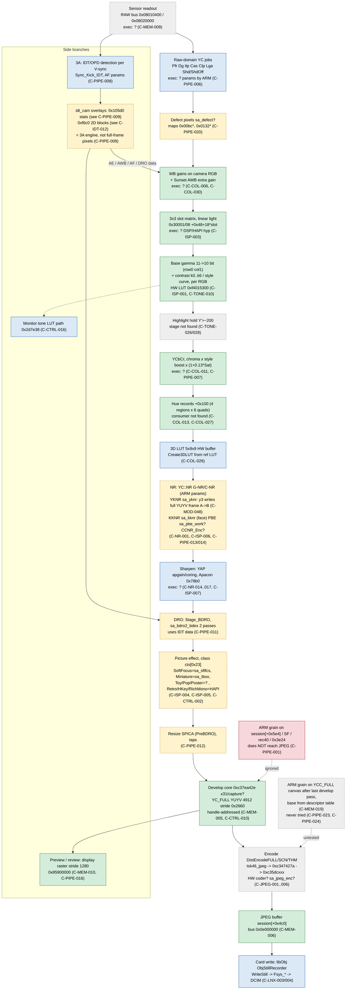

# 02 — Capture pipeline: path of a still frame

Scope: one still JPEG from sensor to card. For every stage: executor, buffers/format, parameters,
status. Main message of this page: **the colour/tone chain is measured well, the executors are
## ⚫ STILL-CAPTURE PIPELINE OVERVIEW (2026-10-17 capstone — DeepSeek synthesis on the verified facts)

Two compute blocks share memory: **3× ARM11** (`av-cam.bin`, VA base 0xc3441000 = the camera app, a runtime
state machine) + an **SA-DSP VLIW engine** (runs `sabin` modules, where per-pixel math lives). DSP stage order
(each reads luma=port24/chroma=port31, writes op5 channels → OUT-DMA → the YUYV YC canvas):

| # | stage | domain | kind (editability) |
|---|---|---|---|
| 1 | dfdet | Bayer | DSP-VLIW (editable) — defect DETECT |
| 2 | defect + bdro2_bdex | Bayer | DSP-VLIW — defect REPAIR |
| 3 | **apollo4** | raw→develop front-end | DSP-VLIW — biggest, OPEN'd first |
| 4 | **spica** | demosaic + develop/resize | DSP-VLIW — ALWAYS-ON, writes YC canvas (develop wrapper BL-called 29×) |
| 5 | **pbe_work** | chroma | DSP-VLIW — chroma proc, luma as edge guide |
| 6 | frc2 | chroma | DSP-VLIW — false-colour fix |
| 7 | **yknr** | luma | DSP-VLIW — late luma NR, ISO-gated |
| 8 | kknr | chroma/skin | DSP-VLIW — skin NR, face-gated |
| 9 | tbox \| sftfcs | effect | DSP-VLIW — Miniature \| Soft Focus, effect-gated |
| 10 | star | resize | DSP-VLIW — conditional |
| 11 | JPEG encode | YC canvas | **HW (opaque)** |

**Film look = PROGRAMMED params, not per-pixel code (mostly):** per-style 3×3 colour matrix + 3D LUT (chroma-by-
luma) + tone LUT @0xf4015300 (built by av-cam tone_lut_build) — all from Backup, reversible, no flash. Tone LUT =
fixed HW. The 3×3-matrix / 3D-LUT **application point** (which of apollo4/spica/pbe, or HW) is NOT yet mapped.
**Reachable for editing beyond Backup = only DSP VLIW output stores:** pbe chan3 (chroma), yknr op5 a7→chan3
(luma), spica YC-canvas write (always-on ISO-independent luma candidate).

**Top-3 remaining unknowns for a "complete" map (DeepSeek-ranked):** (1) the COLOUR application point (op5 store/
channel maps + VLIW windows of apollo4/spica/pbe); (2) exact per-pixel grain injection addresses (spica store
listing + PBE/yknr channel encodings — op5/two-bank, camera-gated); (3) the control mapping (the 29× develop
dispatch table + the Backup layout around 0x3004a / colour fields). Gaps (1)+(3) need either IDA-level av-cam RE
(capstone gives raw disasm only) or camera probes. See `04-dsp-modules.md` (module roles), `full-atlas-build.md`.

mostly unknown; one DSP pixel stage with scalar-controlled tiles is now mapped (`sa_yknr` y3,
C-MOD-048), and the post-develop canvas `YCC_FULL` has never been written by an ARM hook (C-PIPE-023).**
(revised 2026-10-09 after extracts F/G/H and review R)

Schema: `00-index.md`. Areas here: `PIPE`, `ISP`, `JPEG`, `COL`, `TONE`, `NR`, `FX`, `LNX`.
Control path (who sets the parameters) is in `03-control-flow.md`; modules in `04`; experiments in `06`.
Addresses: av-cam VA `0xc3441000+` when written in full, otherwise av-cam **file offsets** in
`COL/TONE/NR/FX` claims (VA = offset + `0xc3441000`), as in the source notes.

## Sources (aliases)

| alias | path |
|---|---|
| BP | `WorkPersonal/reference/nex3n-backup-params.md` |
| HT | `WorkPersonal/reference/nex3n-hue-tables.md` |
| TC | `WorkPersonal/reference/nex3n-tone-curve.md` |
| V6 | `WorkPersonal/reference/nex3n-colour-v6.md` |
| SIM | `WorkPersonal/reference/nex3n-simulator.md` |
| HS / HSR | `WorkPersonal/reference/nex3n-hidden-styles.md` / `nex3n-hidden-styles-render.md` |
| OQ | `WorkPersonal/reference/nex3n-open-questions.md` |
| NE | `WorkPersonal/reference/nex3n-night-extra.md` |
| FXP | `WorkPersonal/reference/nex3n-film-effects-plan.md` |
| MOR | `WorkPersonal/reference/nex3n-morning-2026-10-06.md` |
| SYM | `WorkPersonal/reference/nex3n-symbols-and-names.md` |
| SIA | `WorkPersonal/reference/nex3n-sa-interface.md` |
| SE / FPP | `notes/style-and-effect.md` / `notes/film-presets-plan.md` |
| GH / DG | `notes/grain-hook.md` / `notes/dsp-grain-campaign.md` |
| RD / REC | `README.md` / `WorkPersonal/nex-3n-film-recipes.md` |
| ST | memory `nex3n-firmware-hack-status.md` |
| LR | `atlas/_extract/L-linux-grain-recon.md` |
| WR | `atlas/_extract/E-web-research.md` |
| P09 | atlas-editor pass 2026-10-09: `strings` of `safeboot/out3n/nflasha3_unpacked_unpacked/av-cam.bin` |
| F / G / H / R | `atlas/_extract/F-q5-dmode-safety.md`, `G-q2-module-resolver.md`, `H-q31-yknr-dataflow.md`, `R-fable-review.md` (2026-10-09) |

## 1. Pipeline at a glance

Order note: the measured part (WB → matrix → gamma/curve → YCbCr/chroma → hue) is fixed by
RAW+JPEG fits (C-PIPE-007); where NR, sharpening, DRO, effects and resize sit relative to it is
**not measured** — the drawn order follows stage names and data dependencies only.

## 2. Stage table

| # | stage | executor | buffers / format | parameters (Backup / code) | status | claims |
|---|---|---|---|---|---|---|
| 0 | sensor readout, RAW | unknown | RAW-like bus `0x08010400`, `0x08020000` (rowdiff 64) | — | hypothesis | C-MEM-009 |
| 1 | raw-domain YC jobs Pfr, Dg, Itp, Cas, Clp (OB clamp), Lga (LightLvAdj), Shd/ShdOff | unknown (ARM computes params, `job_YC_ModeMain`) | unknown | calib `0x30036..38`, `0x30042/43` (never touch), gate `0x30033+0`, Toy curve `0x30040+0xA2` | names verified-code | C-PIPE-006, C-NR-021, C-NR-023, C-ISP-008 |
| 2 | defect pixel correction | `sa_defect` (no OPEN site; own manager per note) | unknown | maps `0x00bc*`, `0x0132*` | hypothesis | C-PIPE-020 |
| 3 | white balance (+ Sunset extra per-channel gain under AWB) | unknown | camera RGB, linear | WB from AWB / menu; per-unit cal `0x30002`; Sunset gain location unknown | verified-hw (effect) | C-COL-006, C-COL-008, C-COL-029..031 |
| 4 | colour matrix 3×3 per style slot | unknown; DSP/HAPI suspected | WB-balanced camera RGB, linear | `0x30001`/`0x30008` `+0x48+18*slot` | verified-hw (effect) | C-COL-002, C-COL-006, C-ISP-003 |
| 5 | base gamma (11→10 bit) + contrast curve k0..k6 or style curve, per R,G,B | fixed-function HW LUT, programmed by ARM `tone_lut_build` | 10-bit encoded | curves in p3 av-cam `0x5b006a+0x800k`; base table `0xc3cb6788`; debug `0x3007a` | verified-code (exec) + verified-hw (effect) | C-ISP-001, C-TONE-001..013 |
| 6 | highlight hold above Y′≈200 | unknown | — | none found | hypothesis | C-TONE-026, C-TONE-028 |
| 7 | YCbCr, style chroma boost, Saturation slider | unknown | YC | slider ×(1+0.13 s) | verified-hw (effect) | C-COL-011, C-COL-012 |
| 8 | hue/sat records | unknown (consumer not found) | YC / CbCr | `0x30001 +0x100+24*slot` | verified-hw (effect) | C-COL-013..C-COL-027 |
| 9 | 3D LUT 5×9×9 | HW buffer filled by ARM `Create3DLUT` | YCbCr | reference LUT `[obj+0xa0]` (source unknown), Level 1..7 | verified-code | C-COL-026 |
| 10 | NR: G-NR/C-NR (YC::NR) | unknown (ARM assembles `nr_gnr`) | — | `0x3001b` flags, `0x30010+0xC`, hi_gain tables, debug `0x30056` | verified-code (params) | C-NR-001..006 |
| 10b | NR: YKNR | `sa_yknr` opened (0x1c); 4 images y0..y3; y3 reads job[0] (A) and writes every 128×8 YUYV tile to job[4] (B) (verified-code); that it runs on stills and that B feeds the encoder: hypothesis | A, B frame YUYV stride 2×W; C scratch 7 maps 1/8 scale (C-MEM-018) | `0x3004c`, window `0x3004a` | verified-code (data flow) / hypothesis (on stills) | C-NR-007, C-ISP-006, C-MOD-047, C-MOD-048, C-NR-024 |
| 10c | NR: KKNR (face skin) | `sa_kknr` (0x0f), `HapiKKNR`, `Start_Face_Nr` | — | `0x30024`, `0x3004a+0xE7..`, `0x3004b` | hypothesis | C-NR-008, C-ISP-006 |
| 10d | PBE (NR/detail) | `sa_pbe_work` (0x19) | — | `PBEH` params (not Backup-mapped) | hypothesis | C-PIPE-013 |
| 10e | CCNR at encode | unknown | — | `pCCNR_ParamAdr` | unknown | C-PIPE-014 |
| 11 | sharpening YAP / coring / Apacon | unknown (ARM writes tables/regs) | — | `0x3000c/0x300b0`, `0x3000d/0x300b1`, `0x30106` ladders | verified-code (params) | C-NR-014..019, C-ISP-007 |
| 12 | DRO (BDRO) | `sa_bdro2_bdex` (0x10), two SA passes | — | IDT data via `SetBdroIdtData` | hypothesis | C-PIPE-011 |
| 13 | picture effect | class `ctx[0x23]` 0..4; SF = `sa_sftfcs`; Miniature = `sa_tbox`; others ISP/HAPI (hyp) | SF param block at `bus+0x80` | `0x3010a` (SF), `0x30109` (Miniature), `0x30040` (Toy vignette) | mixed | C-ISP-004, C-ISP-005, C-FX-012..C-FX-022, C-CTRL-002 |
| 14 | resize (SPICA) | `sa_spica` (0x16) + tap tables | — | `/usr/sabin/spica_*_tap_*.bin` | hypothesis | C-PIPE-012 |
| 15 | develop / YC canvas | develop core `0xc37ea42e` (ARM side), DSP/HW writes | `DMM_HANDLE_YCC_FULL` YUYV 4912, stride `0x2660`; per-stage copies 4928 wide | handle `session[+0x3e24]` | verified-hw (buffer) | C-MEM-005, C-MEM-007, C-MEM-011, C-PIPE-015 |
| 16 | JPEG encode (full, screennail, thumbnail) | `tsk46_jpeg` → `0xc347427a` → `0xc35dcxxx`; HW coder vs `sa_jpeg_enc_*` unknown | YC by handle → JPEG | qtables in av-cam (see C-DSP-023) | unknown (exec) | C-JPEG-001..006 |
| 17 | write to card + EXIF | userland `libObj` `ObjStillRecorder`, `Fsys_*`; makernote by av-cam CC | JPEG `session[+0x4c0]` | — | verified-code (names) | C-LNX-003, C-LNX-004, C-MEM-006 |
| S1 | 3A (AE/AWB/AF) statistics | IDT/OPD block kicked per V-sync; idt_cam overlays | lines DMA'd into DSP-local double buffers; 5 accumulators + 64 B out | — | verified-code (names) / hypothesis (role) | C-PIPE-008, C-PIPE-009 |
| S2 | preview / review | display path | raster stride 1280 (~6 MB) | monitor tone path | verified-hw | C-PIPE-016, C-MEM-010 |

## 3. Holes (ranked by what blocks grain / film look)

1. No stage is known to write the final luma that the encoder reads (C-JPEG-002). ARM writes into session fields / rec40 / handle `0x3e24` were ignored (C-PIPE-001), but the post-develop canvas `YCC_FULL` was never written (C-PIPE-023); `sa_yknr` y3 is a full-frame DSP pixel stage (C-MOD-048) whose place before the encoder is not measured (C-PIPE-021); idt_cam looks like 3A (C-PIPE-009).
2. Executors of matrix, YCbCr/chroma, hue records, NR, sharpening, Toy/Pop/Posterization are unknown (C-ISP-003, C-ISP-005, C-ISP-007, C-COL-027).
3. JPEG encoder identity (HW via `0xc35dcxxx` vs `sa_jpeg_enc_*`) and the handle → address hand-off (C-JPEG-004/005, C-MEM-012).
4. Highlight hold above Y′≈200 limits a film shoulder (C-TONE-026; one frame, C-TONE-024). Chroma-by-luminance: the hue records have no L dependence (C-COL-021), but the HW 3D LUT has 5 Y nodes and is a candidate lever (C-COL-046, Q-7) — not a blocking hole.
5. Order of NR / sharpen / DRO / effects relative to the measured colour chain is not measured (C-PIPE-007).

## 4. Claims — PIPE

### C-PIPE-001: ARM-side grain written into `session[+0x5e4]` (wrapper on the 8 Soft Focus sites, or at rec40), the other session sub-buffers `+0x1f24/+0x24e8/+0x3858`, or through the handle `session[+0x3e24]` does not reach the SOOC JPEG: luma HP-std 0.7-1.8 in every build, independent of amplitude; a 6 MB zero marker in `session[+0x5e4]` at rec40 gave 0 % black
- status: verified-hw
- evidence: E-0038..E-0049 (R-5, R-6 caveats: frame labelling off by one in E-0049, so the marker result is the weakest link); R self-check: `build_multibuf.py` grains only `OFFS=[0x5e4,0x1f24,0x24e8,0x3858]`. Narrowed 2026-10-09: this record does NOT cover the post-develop canvas `YCC_FULL` (C-PIPE-023)
- source: DG §1; GH header; ST (07.10); R 1-A
- date: 2026-10-09
- relates: supersedes C-PIPE-002; supports C-CTRL-007 (03); the wider reading "ARM path closed entirely" is split off as C-PIPE-023 (hypothesis); alternative explanation of the amplitude independence: C-PIPE-025
- scope: nex3n-fw1.00

### C-PIPE-002: The ARM hook gives working film grain in saved JPEGs (06.10)
- status: refuted
- evidence: E-0042 bottom patch = race artefact (R-4); "iso800 proven visible DSC09527" is a mislabel of the ±31 sfwrap frame; C-PIPE-001
- source: GH status (06.10); SB §4g; ST; `filmgrain/README.md`
- date: 2026-10-07
- relates: refuted by C-PIPE-001

### C-PIPE-003: The wrapper hook executes: 8 `bl Stage_SoftFocus` sites redirected to a wrapper at cave `0xc3a011c0` keep develop → SF → encode working; replacing Stage_SoftFocus wholesale crashes after preview; skipping SF from the wrapper removes the blur
- status: verified-hw
- evidence: E-0039 (crash), E-0040 (marker `0xdeadbeef`), E-0042 (SF kept, frame saved), E-0046 (no blur when SF skipped)
- source: GH §1, §3; SB §4f-g
- date: 2026-10-07
- relates: —

### C-PIPE-004: No native film-grain generator exists: mono effects are contrast-amplified sensor noise (HC Mono HP-std 2.7-3.4, chroma 0); code sweeps found only subtractive NR, AAC LCG, audio PNS and an unused H.264 SEI film-grain validator
- status: hypothesis
- evidence: E-0047 (HC Mono control, verified-hw part); PRNG/LCG sweep over av-cam and p3 modules (DG, ST); the scalar code of all 32 p8 modules is now swept too (C-NR-025: no classic PRNG in picture modules); VLIW bundles and MMIO noise sources are not covered; "HC Mono grain = amplified sensor noise" rests on one EXIF mismatch (R 3-B)
- source: DG §6; FPP "Native grain"; FH "Зерно"; ST; H §7
- date: 2026-10-09
- relates: merges A-PIPE-004 and C-FX-024; Q-26 (closed for scalar code by C-NR-025); does not rule out reusing native texture (C-NR-010..013, R 3-B)
- scope: nex3n-fw1.00

### C-PIPE-005: av-cam names its capture stages: source files `Stage_{Adjust,Apollo,AutoFraming,BDRO,CaComm,CCNR_Enc,Common,Decomp,Develop,DevLater,DualRec,ExpRead,Face,Notify,Orientation,Panorama,PBE,Prelight,PreReview,Raw,SACC,SPICA,StillDate}.cpp`, `Stage_SortJPEG`; methods `Camera::Capture::Stage_{Bdex,BFNR,DistEncodeDistOnly,DistEncodeFULL,DistEncodeSCN,DistEncodeTHM,DistResizeHV_PreBDRO_SPICA,DistResizeHV_RawPlay,MkOpenWait,NotifyDrawReview,SoftFocus,TBOX}`; HAPI `Start_{Addition_NR,Art_Effect,Clone,ContrastPlus,CreateStream,Destruct,Develop,Dist_Correct,Extract,Face_Nr,HDR,Insert,Miniature,Parse,Ref_Sequence,Richtone_Monochrome,SoftFocus,Super_Resolution,Tar_Sequence}`, `Hapi{CONTP,KKNR,MiniImageContrastPlus,SFTFCS,TBOX}`
- status: verified-code
- evidence: P09 `strings av-cam.bin`; descriptors are runtime so stage order cannot be read statically (C-CTRL-008)
- source: P09
- date: 2026-10-09
- relates: C-PIPE-011..015

### C-PIPE-006: The capture YC job is `Camera::YC::job_YC_ModeMain(CommonRam, Pfr, Dg, Itp, Cas, Clp, Nr, Yap, Shd, ShdOff, Adj, Mov, Lga, Gra)`; Clp = OB black clamp, Lga = LightLvAdj calibration, Shd = lens shading; which jobs are ISP and which DSP is not stated anywhere
- status: verified-code
- evidence: signature string (re-seen in P09); `PBEH:clp_*`, `lga_ave_*`, `[YC-CLP ERROR]opbData`
- source: OQ 2.2; NE 1.2; P09
- date: 2026-10-09
- relates: C-ISP-007, C-ISP-008, C-TONE-028

### C-PIPE-007: Measured order: raw → WB coefficients (SR2 RGGB) → 3×3 slot matrix in linear light → base gamma (row 0 col 1) → contrast and/or style curve per R,G,B → YCbCr 601 chroma × style boost × (1+0.13·Sat) → residual hue/sat stage → 8-bit; colour stage before or after the curve is indistinguishable (2.60 vs 2.61)
- status: verified-hw
- evidence: RAW+JPEG chart pairs DSC09416..09510 (sessions E-0010..E-0022); matrix-before-tone, per-channel curves, Sat factor measured; hue-stage position and boost are model fits (hypothesis part)
- source: SIM 2, 3
- date: 2026-10-05
- relates: C-COL-006, C-TONE-009, C-TONE-011

### C-PIPE-008: av-cam drives an IDT/OPD detection block per vertical sync: `Sync_Kick_IDT: %dV #%d`, `SyncResMgr::Get IDT_OPD failure`, `idt_opdtop_sync_opd_acquire`, `pbl_iib_aopen CAM2IDT`, `[IDT]r0..w0 [FOPD]… [PRC]…`, `[IDT_OPD]: AVIP:AF param…`, `cap arc/rc/valid 0size`, `4cmap`, `backImgData.adrs`; CC log `SetBdroIdtData()`
- status: verified-code
- evidence: P09 `strings av-cam.bin | grep -E 'IDT|OPD'`
- source: P09
- date: 2026-10-09
- relates: supports C-PIPE-009, C-PIPE-011

### C-PIPE-009: `idt_cam.bin` is the program of the IDT/OPD detection side (AE/AWB/AF statistics, live-view sync) and does not produce the full-frame pixels of the still; it is not the grain target
- status: hypothesis
- evidence: strong but indirect: overlay `0x105d0` = statistics loop, no pixel write-back (see C-PIPE-009, verified-code); `0xf6c0` writes 2D blocks (see C-IDT-012); NOP/skip symptoms are AE-like (live view 1/4000 f/16, over-exposure) and non-specific (see C-IDT-011, B-IDT-014; E-0060, E-0063..E-0065); IDT is kicked per V-sync with OPD/AF logs (C-PIPE-008); file name `idt_cam` matches `IDT`. Not shown: that no overlay writes pixels (see C-IDT-015)
- source: DG §7; ST (09.10); P09
- date: 2026-10-09
- relates: supersedes C-PART-009 premise and the Campaign A grain target (see C-IDT-009, R-1, R-2); Q-3

### C-PIPE-010: The Soft Focus effect class bypasses rec40 (native blur kept when only rec40 is hooked); High-Contrast Mono frames carry EXIF Creative Style/Color Mode "Standard" while the picture is B&W
- status: verified-hw
- evidence: E-0048 (SF frames HP-std 0.43 with blur), E-0047 (DSC09545 EXIF)
- source: DG §1; ST
- date: 2026-10-07
- relates: C-CTRL-002 (03), C-FX-014

### C-PIPE-011: DRO is a capture stage `Stage_BDRO.cpp` running two SA passes (`tc_BDRO_SA1st`, `tc_BDRO_SA2nd`, `sa open`, `start_error SaErr`) with module `sa_bdro2_bdex` (codectype 0x10, wrapper `sa_func_BDEX_*`, `Stage_Bdex`) and takes detection data from IDT (`SetBdroIdtData`)
- status: hypothesis
- evidence: strings verified-code (P09; OPEN 0x10 see C-MOD-012); the BDRO ↔ bdro2_bdex ↔ IDT linkage is inferred from names
- source: P09; B-extract catalog
- date: 2026-10-09
- relates: C-PIPE-008; see C-MOD-028

### C-PIPE-012: A resize stage `Stage_DistResizeHV_PreBDRO_SPICA` scales the image with `sa_spica` (codectype 0x16) and the `spica_*_tap_*` tables before DRO
- status: hypothesis
- evidence: stage name (P09); SPICA OPEN site and hard-coded tap paths (see C-MOD-017)
- source: P09; SIA §5
- date: 2026-10-09
- relates: —

### C-PIPE-013: `Stage_PBE` runs `sa_pbe_work` (images PBE_MID/PBE_HIGH, params `nr_ihm.*`, `PBEM_BDRO` in `PBEH`) as a noise/detail stage, not an art effect
- status: hypothesis
- evidence: names only (see C-MOD-025); `PBEH:width=%x` log (P09)
- source: sony-dsp-generations.md; P09
- date: 2026-10-09
- relates: C-NR-001

### C-PIPE-014: A chroma-NR step is tied to encoding (`Stage_CCNR_Enc.cpp`, `pCCNR_ParamAdr`); executor and parameters unknown
- status: unknown
- evidence: strings only (P09)
- source: P09
- date: 2026-10-09
- relates: —

### C-PIPE-015: Develop entry points are `Camera::HAPI::Start_Develop`, `ExecCamCoreDevelopStart`, `ExecTanzCamCoreDevelop(ForApl)`, log task `job_YC_CaptureDevelopResizeSftfcs`; which hardware does the develop arithmetic is unknown
- status: verified-code
- evidence: P09 strings; FXP 3.1 log task name
- source: P09; FXP
- date: 2026-10-09
- relates: C-CTRL-010 (03)

### C-PIPE-016: Preview/review uses a display-size raster (stride 1280 B, ~6 MB, e.g. `0x85900000`, `0x85b00000`) that is redrawn continuously; review stages `Stage_PreReview`, `Stage_NotifyDrawReview`
- status: verified-hw
- evidence: E-0028, E-0030 (writes flicker the screen, overwritten by redraw); stage names P09
- source: SB "ВЕХА"; P09
- date: 2026-10-09
- relates: C-MEM-010

### C-PIPE-017: `Stage_SACC` (`SetSACCParam`, `SetSACCSaEndParam`, `WriteSACCMakerNote`) is an SA-based stage that writes makernote data; its function is unknown
- status: unknown
- evidence: P09 strings
- source: P09
- date: 2026-10-09
- relates: —

### C-PIPE-018: The JPEG path outputs three products: full image, screennail and thumbnail (`Stage_DistEncodeFULL/SCN/THM`, `DistEncode_Base`)
- status: verified-code
- evidence: P09 strings
- source: P09; GH §2 (`DistEncodeFULL`)
- date: 2026-10-09
- relates: C-JPEG-006

### C-PIPE-019: The develop core `0xc37ea42e` runs per tile/band and writes the YC canvas after the effect stage, so a write before it survives only on tiles finished later (explains the bottom-left noise patch of E-0042/E-0044)
- status: hypothesis
- evidence: fitted to E-0042, E-0044, E-0049; not observed directly (see C-CTRL-010)
- source: DG §1
- date: 2026-10-07
- relates: C-PIPE-001

### C-PIPE-020: Defect-pixel correction uses `sa_defect` (codectype 0x14, hard-coded engine params) with per-unit maps `0x00bc0000/0002`, `0x01320000`
- status: hypothesis
- evidence: module name and no OPEN site (see C-PIPE-020, B-MOD-027); maps named as defect maps in BP
- source: BP "НЕ ТРОГАТЬ"; SIA §5
- date: 2026-10-09
- relates: —

### C-PIPE-021: On stills ARM passes YKNR job[0](A) == job[4](B) (in-place): `Camera::Capture::YKNR` writes the same DRAM_A+off to both slots; C(job[8]) is a separate DMM scratch; YKNR's output is the shared YC canvas that `Stage_DistEncodeFULL` reads
- status: verified-code
- evidence: filler = `Camera::Capture::YKNR` file `0x3aae60` (VA `0xc37ebe60`); verbatim `0x4372da str r0,[r4]` + `0x4372dc str r0,[r4,#4]` write the same r0 (= DRAM_A+off) to job[0] and job[4] → A==B in-place (YKNR runs in place on stills); C(job[8]) is a separate DMM scratch (unit `0x241`, alloc `0x3aae9a`). Output = shared YC canvas (handle table `OBJ+0x39e0`, input `[OBJ+0x39e2]`) read by `Stage_DistEncodeFULL` `0x3ac736` (VA `0xc37ed736`): `0x3ac7ce ldr r0,=0x39e0`. Residual: whether a conditional resize stage (STAR `0x3aa5` / SPICA `0x3a8` / DistResize) overwrites B before encode is data-driven (closed only by MSDump, Q-10)
- source: H §5 (H-PIPE-001); Phase-0 opus RE 2026-10-09 (Q-38)
- date: 2026-10-09
- relates: supersedes the earlier "ARM may pass A=B" hypothesis — now A==B is a verified-code fact; C-PIPE-001, C-PIPE-007, C-ISP-006, C-NR-007, C-MOD-048, C-JPEG-002; Q-38, Q-10
- scope: nex3n-fw1.00

### C-PIPE-022: A scalar in-place per-pixel noise loop in `sa_yknr` y3 is INFEASIBLE: the y3 "slot" between engine-pass and write-chain operates on DMA descriptors, not pixels; the shared buffer is the engine DMA aperture `0xf81400`, not the scalar-addressable 2 KB tile buffers
- status: refuted (partial — the descriptor-pairing observation is confirmed; the scalar-loop core is refuted)
- evidence: descriptor pairing confirmed (B-write `w1=80f81400`, A-read `w1=00f81400`, shared low-24 `0xf81400`), BUT the 2 KB tile buffers at `0x5000/0xa000/0xd000/0x10000/0x13000` are never touched by the scalar core — 0 byte/halfword pixel accesses in the whole y3 run (write-span `0x6f78..0x48238`); the `0x868`→`0x86c` slot operates on DMA descriptors, not pixels. Conclusion: a scalar in-place per-pixel loop in y3 is infeasible (Q-42); a DMA-roundtrip workaround breaks DMA-identity and costs ×38..×65 (not the earlier ~×10 estimate). SCOPE of "infeasible": this is a saemu scalar-emulation result — saemu does not execute VLIW or move DMA bytes (see C-DSP-020 caveat) — so it refutes the SCALAR in-place route only; a VLIW noise term (Q-17) is not addressed by this finding
- source: H §5, §6 (H-PIPE-002); Phase-0 opus RE 2026-10-09 (Q-42)
- date: 2026-10-09
- relates: refutes the scalar-loop core of the earlier C-PIPE-022; C-MOD-048, C-DSP-015, C-DSP-020, C-DSP-036, C-MOD-044 (delivery), C-NR-007 (ISO window); Q-42
- scope: CXD4132 (`sa_yknr.bin` byte-identical in NEX-6 v1.03; no `sa_yknr` on CXD90014 bodies)

### C-PIPE-023: "The ARM path is closed": no ARM-side write in av-cam can reach the SOOC JPEG
- status: hypothesis (downgraded 2026-10-09; was drawn as CLOSED in 07 §1 v1)
- evidence: only `session[+0x5e4]`, session sub-buffers `+0x1f24/+0x24e8/+0x3858`, rec40 and handle `+0x3e24` were ever written (C-PIPE-001; `build_multibuf.py` `OFFS` list); the developed canvas `DMM_HANDLE_YCC_FULL` (YUYV 4912, stride 0x2660, C-MEM-005), located live in E-0031, was never written by any build; the proof frame set of E-0049 is mislabelled (R-6). Not refuted either: no ARM write has ever reached the file
- source: R 1-A, finding 1, 3
- date: 2026-10-09
- relates: narrowed from C-PIPE-001; open test C-PIPE-024 (Q-40); C-MEM-019
- scope: nex3n-fw1.00

### C-PIPE-024: Grain added to the Y plane of `YCC_FULL` after the last `0xc37ea42e` develop pass and before `DistEncodeFULL` (base read from the descriptor table of C-MEM-019, stride 0x2660, width 4912) reaches the SOOC JPEG
- status: hypothesis (untested; branch 1 of 07 §1)
- evidence: design from R 3-A/5-B; the grain-injection SITE = `DistEncodeFULL` entry @ `0xc37ed13a` (off `0x3ac13a`, immediately before acquire+marshal `bl 0xc3701f08`) is offline-checkable; BUT the earlier wording "valid table entry … both checkable offline" is WRONG — the `YCC_FULL` base is handle-only on ARM (C-JPEG-002), and its only plain address lives in DMM descriptor tables in DRAM reachable only via an IPC round-trip, which dead-ends offline (same cause as C-MEM-012). So: SITE offline-checkable (yes); BASE recovery / table-validity requires a LIVE dump (Q-10 MSDump). Geometry 4912/`0x2660` (C-MEM-005), not the 4928-wide per-stage copies (C-MEM-009, R 4-F)
- source: R 3-A, 5-B; Phase-0 opus RE 2026-10-09 (Q-40)
- date: 2026-10-09
- relates: C-PIPE-023, C-MEM-005, C-MEM-012, C-MEM-019, C-MEM-020, C-JPEG-002, C-PIPE-025, C-PIPE-026; Q-40, Q-10
- scope: nex3n-fw1.00

### C-PIPE-025: The late full-frame luma-NR that smooths white noise before encode is identified = `Camera::Capture::YKNR` (`0xc37ebe60`, sa_yknr codectype 0x1c): on the class-0 path it sits in the NR slot and writes the YC canvas the encoder reads. Because the Q-40 encode site (`0xc37ed13a`) is AFTER YKNR with no further full-frame luma-NR, grain injected THERE can be white (no correlation needed); grain injected BEFORE YKNR must be spatially correlated (ACF lag-1 ≳ 0.5, 2×2/3×3) and amplitude ≥ native (HP-std ≳ 2.5) to survive
- status: verified-code (the late NR stage = YKNR, and its position before the encode site); hypothesis (that NR smoothing — not "buffer discarded" — produced the flat HP-std; E-0045..E-0048 cannot separate the two because those injections went into `session[+0x5e4]`, not YCC_FULL)
- evidence: YKNR wrapper off `0x3ab57c`→impl `0xc37ebe60` (off `0x3aae60`), pretty-str `0xc3a0eafc`; YKNR writes B==A in-place (`0x4372da`/`0x4372dc`, C-MOD-048/C-PIPE-021), B = canvas read by `Stage_DistEncodeFULL` via handle `OBJ+0x39e0`; step-table off `0x1e8a04+`, thunk cluster off `0x1e6fc0..0x1e7aa4` (normal path = [resize-prep]×k → YKNR); encode `0xc37ed13a` only acquires/marshals the handle (`bl 0xc3701f08`, id `0x560013`); `CCNR_Enc` = chroma (C-PIPE-014); E-0047 native HC Mono survives (HP-std 2.7-3.4, ACF lag-1 0.58). VLIW kernel not executed (C-DSP-020) → the survival threshold is an estimate; YKNR off at NR level 0 / outside the ISO window (C-NR-007) is a bypass lane
- source: R 2-B; Phase-0 opus RE 2026-10-09 (C-PIPE-025 late-NR map)
- date: 2026-10-09
- relates: alternative to the reading of C-PIPE-001 / R-5; C-PIPE-024 (confirms the Q-40 site is after the last luma-NR); C-MOD-048, C-PIPE-021; Q-41 deprioritized (rec40 is the wrong buffer → cannot separate the hypotheses; go to Q-10)
- scope: nex3n-fw1.00

### C-PIPE-027: The capture-dispatch thunk cluster (file 0x1e6fc0..0x1e7aa4, VA 0xc3627fc0) BL-calls the stage impls in sequence; call counts: develop/SPICA wrapper **0xc37ea42e = 29×** (= the ~31 develop passes, confirms C-PIPE-026), 0xc37ec57c = 24× (frequent helper — resize-prep/post-pass?), 0xc37e8ac4 = 8×, 0xc37ea898 = 8×, 0xc37e010c = 8×, 0xc37edf7e = 4×, 0xc37eb900 = 1×. CONFIRMS develop/SPICA is the dominant dispatched stage. Tool: capstone ARM-Thumb (VA=file+0xc3441000).
- status: verified-code (BL targets + counts); the non-develop impls (0xc37ec57c/8ac4/a898/010c/df7e) are not yet named (their __PRETTY_FUNCTION__ string is referenced deeper than the prologue; naming them = the next av-cam step).
- date: 2026-10-17
- evidence: capstone disasm of the thunk cluster; impl 0xc37ea42e = develop (C-PIPE-026), 0xc37ec57c = file 0x3ab57c (yknr-wrapper-adjacent, C-PIPE-025). relates: C-PIPE-026, C-MOD-003 (OPEN sites), the module-role synthesis in 04-dsp-modules
- scope: nex3n-fw1.00

### C-PIPE-026: The capture pipeline is a runtime-dispatched state machine (not a linear fall-through): stage wrappers `0xc361fxxx` (`push{r4,r5,r6,lr}; ldr r4,[r0]` = session) call impl `0xc37edxxx`; the encode stage (DistEncodeFULL) is a sibling handler [correction 2026-10-09: the function `0xc37e9688` earlier called a "develop core" carries `__PRETTY_FUNCTION__` = `Camera::Capture::SPICA` (str `0xc3a0e986`) — it is a SPICA/resize stage, not develop; the 31 `0xc37ea42e` "develop" slots dispatch the SPICA/resize wrapper, and the real develop is HAPI `Start_Develop` merged into the resize job (C-PIPE-015). Post-develop stages are selected by a step-table (off `0x1e8a04+`, pairs {descriptor `0xc3bf15a8+0x14k`, thunk}) + the picture-effect class `[ctx+0x23]`; thunk cluster off `0x1e6fc0..0x1e7aa4`]
- status: verified-code
- evidence: stage wrappers `0xc361fxxx` (`push{r4,r5,r6,lr}; ldr r4,[r0]` = session) → impl `0xc37edxxx`; develop = 31 passes via wrapper `0xc37ea42e` (off `0x3a942e` → core `0xc37e9688` off `0x3a8688`) from the BL cluster `0xc36283aa..0xc3628aa4` (last develop pass `0xc3628aa4`, off `0x1e7aa4`); the encode stage (`DistEncodeFULL`) is a sibling handler called from capture wrapper `0xc361f664` (`bl` @ `0xc361f68c`)
- source: Phase-0 opus RE 2026-10-09 (Q-40)
- date: 2026-10-09
- relates: C-PIPE-005, C-CTRL-008, C-PIPE-024, C-MEM-020; Q-40
- scope: nex3n-fw1.00

## 5. Claims — ISP

### C-ISP-001: Tone is a fixed-function HW LUT programmed by ARM: `tone_lut_build` (0x2d6996) computes 96 Y nodes and writes them to `0xf4015300` (0x180 B) with segment params `0xf4015494..+4b4` and gamma-block regs `0xf4015480/+484/+488/+4b8` (monitor, 0x37d6d8/0x37d6ec), or into a capture register image `[0xc3cbe0a4]+0x80` / buffer `[0xc3cbe09c]` (0x37ddb0/0x37ddc8, 0x180 B + 36 B) that flows with the YC job
- status: verified-code
- evidence: `tone_lut_build` `0x2d6996` writes HW LUT `0xf4015300` (segment/gamma regs `0xf4015494..`, `0xf4015480`); addresses in NE 1.3, OQ 2.2
- source: NE 1.3; OQ 2.2; TC 1
- date: 2026-10-05
- relates: merges C-ISP-002 and C-TONE-023 (extract C); C-TONE-021
- scope: nex3n-fw1.00

### C-ISP-002: A second HW tone LUT exists at `0xf401c700` (96 × u16) and `0xf401c800` (0xA0 B), filled instead of the normal one when `obj+0xC71 == 9` (paths 0x2d67ca, 0x2d7718, 0x2d7d86); mode 9 meaning unknown
- status: verified-code
- evidence: second HW tone LUT `0xf401c700`/`0xf401c800`, paths `0x2d67ca/0x2d7718/0x2d7d86` (NE 1.3)
- source: NE 1.3
- date: 2026-10-05
- relates: merges C-ISP-003 and C-TONE-022 (extract C)

### C-ISP-003: The colour-matrix stage is executed outside ARM (DSP/HAPI side): ARM only puts the block pointer and slot byte T[6] in the descriptor and never reads `+0x48`
- status: hypothesis
- evidence: negative result (no ARM access to `+0x48`); four builders pass pointer only (C-CTRL-015)
- source: SYM 2; SE; HSR 1.3
- date: 2026-10-05
- relates: merges C-ISP-004 and C-COL-028 (extract C); Q-3

### C-ISP-004: Soft Focus is executed by `sa_sftfcs` (codectype 0x18): ARM fills the param block (three buffer addresses, four kernel pointers, w/h/stride, three level bytes) and the kernels from `0x0003010a`; the DSP runs the 3×3 pair once and the 5×5 pair twice
- status: verified-code
- evidence: ARM side: 0x465cf8, OPEN 0x18 at 0x163604 (see C-MOD-020); DSP pass order and checks are from DSP disassembly (see C-MOD-021, B-MOD-022, hypothesis there)
- source: FXP 3.1, appendix; SIA §2.2
- date: 2026-10-06
- relates: C-FX-015..C-FX-018

### C-ISP-005: Effect → engine map: Soft Focus = `sa_sftfcs`, Miniature = `sa_tbox` (Backup `0x30109`); Retro Photo, Soft High-key, Rich-tone Mono, HDR Painting via HAPI `Start_Art_Effect`, `Start_Richtone_Monochrome`, `Start_HDR` without `sa_func_*`; Toy, Pop Color, Posterization, Partial Color, HC Mono have no SA module or wrapper (ISP/YC presumed); Watercolor/Illustration have PARAMIDs only
- status: hypothesis
- evidence: HAPI names verified-code (P09); "ISP" attribution is by absence (see C-ISP-005); case4 = multi-frame class
- source: FPP; BP 3; SIA §4
- date: 2026-10-09
- relates: merges C-ISP-008 (extract C) with B-MOD-030; Q-3

### C-ISP-006: av-cam opens `sa_yknr` (0x1c) and `sa_kknr` (0x0f) and has `HapiKKNR`, `Start_Face_Nr: KKNR %d`, `Start_Addition_NR`; that YKNR/KKNR are the stills NR executors consuming the ADF noise table is not shown
- status: hypothesis
- evidence: OPEN sites verified-code (see C-MOD-012); strings P09; ADF consumption from FPP wording only
- source: FPP "Native grain"; BP 1.1; P09
- date: 2026-10-09
- relates: upgrades C-ISP-009 (extract C) premise; C-NR-007, C-NR-008; data flow of the modules: C-MOD-047, C-MOD-048, C-MOD-050

### C-ISP-007: Sharpening: ARM writes Apacon regs `0x78b0..0x78bf` per style (`YC_SetModeDependent_*`) and evaluates YAP/coring tables per ISO (`job_apc_*_stl` 0xd4334, 0xd32ce) for the YC job `Yap`; the executing block is unknown
- status: verified-code
- evidence: ARM writes Apacon regs `0x78b0..0x78bf`; YAP/coring tables `0xd4334/0xd32ce` (BP 2; SYM 4); executor: unknown
- **RESOLVED 2026-10-17 (C-ISP-007b, `av-cam-executors.md`):** executor = **fixed-function HW YAP block, MMIO `0xf4015c00..0xcdf`** (apgain/vapgain/hapgain `c10/14/18`, coring `c30..4c`), ARM-written via still path `job_apc_gain_stl 0xc3515334` / `job_apc_coring_stl 0xc35142ce` + RAM shadow (handle id 0x2010). Caps: apgain ≤0x1FF, v/h ≤0x10, coring ≤0x1FF; `apgain=apgain·ladder>>6`. Apacon (`0xc38a5958`) only computes coeffs into a software style-DB (not MMIO). Same HW-opaque ceiling as tone.
- source: BP 2; SYM 4
- date: 2026-10-05
- relates: C-NR-014..C-NR-017; Q-3

### C-ISP-008: Lens shading: ARM computes gains (`CalcLensShdGain`, `CalcLensShdGainToy` 0x24a408, `GetShdTblData`) for `Camera::YC::SHD`/`ShdOff`; executing block unknown
- status: verified-code
- evidence: strings (re-seen P09)
- source: BP 3, 4
- date: 2026-10-05
- relates: C-NR-021, C-NR-023

### C-ISP-009: The offline simulator models only matrix, curves, chroma and hue tables; distortion, vignetting, NR/sharpening, DRO and auto-WB are not modelled, so it says nothing about spatial stages
- status: verified-code
- evidence: simulator source `~/nex3n-dump/sim/` (`fit.py`, `hue.py`, `emu3dlut.py`): only matrix/curve/chroma/hue stages coded, no spatial-stage code (SIM 6)
- source: SIM 6
- date: 2026-10-05
- relates: merges C-ISP-012 and C-NR-024 (extract C)

## 6. Claims — JPEG

### C-JPEG-001: Still JPEG encode runs in task `tsk46_jpeg` (`0xc344a790`), a message loop: `msg[0]` 0/2 → `0xc347427a` (stills), 1/3 → `0xc3474800`; a detour logger in `0xc347427a` fires several times per frame (`msg[0]=2`)
- status: verified-hw
- evidence: E-0050 (logger in `0xc3474800` never fired), E-0051 (marker `0xd1a6` in `0xc347427a`)
- source: GH §2; DG §2
- date: 2026-10-07
- relates: —

### C-JPEG-002: The still encode handler receives the YC buffer by handle, not as an ARM address: enc-config global `[0xc3ca0528]` is NULL at idle (qtable follows at `0xc3ca052c`), context singleton `0xc3bb7bc0` (from `0xc35dc8ba`) holds only state flags
- status: verified-code
- evidence: E-0051 (logger keeps only the last, cleanup call; absence-of-pointer evidence); `DistEncodeFULL` marshals YC by UnitHandle — acquire `0xc3701f08`/`0xc3701f64` (id `0x560013`), send `0xc3671804`/`0xc364a87a`; task handler `0xc347427a` handles only handles via `0xc35dc8ba`; no plain YC base on the ARM encode path
- source: DG §2; Phase-0 opus RE 2026-10-09 (Q-40)
- date: 2026-10-09
- relates: C-MEM-012, C-MEM-020, C-PIPE-024; Q-20, Q-40

### C-JPEG-003: JPEG is driven through the `0xc35dcxxx` subsystem (`0xc35dcde6`, `0xc35dc952`), not through `ExecuteCalcStartMSG` (`0xc37554de`, 24 SA callers, unreachable from `tsk46_jpeg`); guard string `JPEG_ENCODE_ERR: enc_param.address == 0`, source name `src/dgi_jpeg_qtable.c`
- status: verified-code
- evidence: call graph (xref tool); strings
- source: GH §2; SB §7(a)
- date: 2026-10-06
- relates: C-JPEG-004, C-JPEG-005

### C-JPEG-004: The still encoder is a hardware JPEG coder behind `0xc35dcxxx`; the zigzag/quant/Huffman tables live in av-cam
- status: hypothesis
- evidence: C-JPEG-003; tables at av-cam 0x5f0d8c / 0x54afb2 / 0x54aa41 and none in `sa_jpeg_*` (see C-DSP-023); SB §7(a) instead says "JPEG is done by the DSP (sa_jpeg_enc, zima cores)"
- source: GH §2; SB §7(a); ISA §4
- date: 2026-10-09
- relates: conflicts SB §7(a); Q-4

### C-JPEG-005: Whether `sa_jpeg_enc_1unit/_1core` (codectypes 0xe0/0xe1, one-two VLIW programs, no constant OPEN site) take part in still encoding — e.g. as the program that drives the HW coder — is unknown
- status: unknown
- evidence: see C-JPEG-005; no av-cam OPEN site for 0xe0/0xe1
- source: B-extract; DG §2
- date: 2026-10-09
- relates: C-JPEG-004 (both can be true); Q-4

### C-JPEG-006: Encoding is requested with messages `MSG_ID_SDF_ENCODE_JPEG`, `_REC`, `_WITH_WORK` (log `[SDF][ENCODE_JPEG_WITH_WORK] qParam`, `ResizeWorkArea is acquired from UnitHandle`) from stages `DistEncodeFULL/SCN/THM`
- status: verified-code
- evidence: P09 strings; strings have 0 literal-pool refs (indexed by message table, C-CTRL-008)
- source: P09; GH §2
- date: 2026-10-09
- relates: C-PIPE-018

## 7. Claims — COL (colour)

### C-COL-001: Colour block `0x00030001` (1536 B) is mirrored in `0x00030008`; both are written in every experiment
- status: verified-hw
- evidence: E-0010..E-0020
- source: HT; V6 §3; RD
- date: 2026-10-05
- relates: C-BK-006 (03)
- scope: nex3n-fw1.00 (a6000/A7 II Backup also has `0x00030001`, but the content differs from byte 0 — `bk_6000.txt` `e00005fd…` vs 3N `00000000…`; layout not compared, X09)

### C-COL-002: Per-slot colour matrix = 9 × int16 LE at `+0x48 + 18*slot`, 1024 = 1.0
- status: verified-hw
- evidence: E-0011 (tag matrices read back from ARW `SR2:ColorMatrix`)
- source: RD; SIM 0; HT
- date: 2026-10-05
- relates: C-COL-003, C-COL-007
- scope: nex3n-fw1.00 (a6000/A7 II Backup also has `0x00030001`, but the content differs from byte 0 — `bk_6000.txt` `e00005fd…` vs 3N `00000000…`; layout not compared, X09)

### C-COL-003: Slot map: Standard 0 (`+0x48`), Vivid 1 (`+0x5a`), Portrait 2 (`+0x6c`), Landscape 3 (`+0x7e`), Sunset 4 (`+0x90`); hue record r is bound to slot r
- status: verified-hw
- evidence: E-0011 (DSC09434-39), E-0015 (record ↔ slot binding)
- source: RD; HT; HSR 1.1
- date: 2026-10-05
- relates: conflicts mode index of C-COL-028 / C-CTRL-014 (03); Q-14
- scope: nex3n-fw1.00 (a6000/A7 II Backup also has `0x00030001`, but the content differs from byte 0 — `bk_6000.txt` `e00005fd…` vs 3N `00000000…`; layout not compared, X09)

### C-COL-004: The B&W slot is not identified (mono frame); "slot 5" is only by menu-order scheme
- status: unknown
- evidence: E-0011 caveat; HSR 2
- source: RD; HSR 2
- date: 2026-10-06
- relates: C-FX-010; Q-28

### C-COL-005: Stock matrices: slots 0 and 2 = `1292,-180,-88 / -44,1340,-272 / -24,-108,1156`; slot 1 G row `1400/-332`; slots 3, 4 = `1292,-220,-48 / -44,1360,-292 / -24,-108,1156`
- status: verified-code
- evidence: bytes of stock colour block `0x00030001` (`~/nex3n-dump/work/bk/00030001_orig.txt`)
- source: RD
- date: 2026-10-05
- relates: C-COL-002

### C-COL-006: The matrix acts on white-balanced camera RGB in linear light, with no intermediate space (error 4.1 vs 13.8 with WB after the matrix)
- status: verified-hw
- evidence: RAW+JPEG chart pairs (E-0010..E-0022 sessions), `pipeline.py`
- source: SIM 0, 2
- date: 2026-10-05
- relates: C-PIPE-007

### C-COL-007: ARW stores the slot matrix of the shot in SR2 `ColorMatrix` exactly — a free read-back for any matrix write
- status: verified-hw
- evidence: E-0011 (tag) and E-0010 (muted) frames
- source: SIM 0
- date: 2026-10-05
- relates: C-COL-002

### C-COL-008: Applied WB coefficients exist only in ARW (`SR2:WB_RGGBLevels`); `Sony:WB_RGBLevels` in JPEG is an AWB estimate
- status: verified-hw
- evidence: DSC09431-38 (Custom WB constant while `WB_RGBLevels` wander)
- source: SIM 0
- date: 2026-10-05
- relates: C-COL-031

### C-COL-009: Matrix rows summing to 1024 keep neutrals; other row sums tint greys
- status: verified-hw
- evidence: E-0010 (greys unchanged under muted matrices)
- source: RD; NE 3.1
- date: 2026-10-05
- relates: C-COL-032, C-COL-036

### C-COL-010: Uniform desaturation `S = kI + (1-k)·1·wᵀ` keeps grey and luma; the most muted native matrix halves mean chart chroma (43.7 → 21.7)
- status: verified-hw
- evidence: E-0010
- source: RD
- date: 2026-10-04
- relates: C-COL-009

### C-COL-011: Saturation slider = chroma multiplier 1 + 0.13·s in YCbCr (mean chroma 28.0 / 43.7 / 48.1 / 59.3 at −3 / 0 / +1 / +3)
- status: verified-hw
- evidence: chart frames, RAW+JPEG fit
- source: SIM 0; RD
- date: 2026-10-05
- relates: C-COL-012

### C-COL-012: Styles add their own chroma over the matrix; amounts disputed: RD Vivid +11 %, Landscape +14 %, Sunset +14 %, Portrait 0; SIM fit ×1.06 / Portrait ×1.11 / Landscape ×0.96 / Sunset ×1.07 after native Q1 differences
- status: hypothesis
- evidence: E-0012 (RD figures); `params.npz` fit
- source: RD; SIM 2
- date: 2026-10-05
- relates: —

### C-COL-013: Hue record for slot r = 24 × int8 at `+0x100 + 24*r` = 6 quads Q0..Q5 × 4 values; Sunset (slot 4) has `80 80 80 80` in Q1
- status: verified-hw
- evidence: E-0016 (DSC09478-81 vs 09483-86)
- source: HT; RD
- date: 2026-10-05
- relates: C-COL-014
- scope: nex3n-fw1.00 (a6000/A7 II Backup also has `0x00030001`, but the content differs from byte 0 — `bk_6000.txt` `e00005fd…` vs 3N `00000000…`; layout not compared, X09)

### C-COL-014: The 4 bytes of a quad = 4 hue regions: red/skin/magenta (~335..60°), orange/yellow/yellow-green (60..140°), cyan/sky (170..250°), blue/violet (250..335°)
- status: verified-hw
- evidence: E-0016 (one session); supersedes the "6 groups = 6 sectors" reading of E-0015 (R-9)
- source: HT
- date: 2026-10-05
- relates: C-COL-015

### C-COL-015: Q0 = hue rotation per region: −0.25 / +0.20 / −0.39 / +0.13 °/unit; neighbouring regions rotate in opposite directions
- status: verified-hw
- evidence: E-0016
- source: HT
- date: 2026-10-05
- relates: C-COL-018

### C-COL-016: Q1 and Q3 raise chroma in their region (Q1 b1 −36→+90: dC +12..+34, L +5..+10; Q3 b1 −9→+110 similar; Q5 b1 only +7..+8)
- status: verified-hw
- evidence: E-0018 (control noise dC ±8, dh ±5°)
- source: HT
- date: 2026-10-05
- relates: C-COL-017, C-COL-019

### C-COL-017: "Saturation" quads leak hue: Q1 b1 raise also rotates reds/skin to orange +14..+33°; Q0/Q1 may be two components of an ab-plane shift
- status: verified-hw
- evidence: E-0018 (leakage); ab-plane reading is hypothesis
- source: HT
- date: 2026-10-05
- relates: C-COL-016

### C-COL-018: Q2 alone acts like Q0 (Landscape Q2 b0 −6→+120: reds/dark skin −28..−34°); Q0 and Q2 add
- status: verified-hw
- evidence: E-0018; binary test E-0015 consistent with the sum
- source: HT
- date: 2026-10-05
- relates: C-COL-015

### C-COL-019: Pair (Q4, Q5) acts weaker than (Q0,Q1)/(Q2,Q3); criterion unknown (LutMode CAP/MOV/MON or a chroma band)
- status: unknown
- evidence: E-0018
- source: HT
- date: 2026-10-05
- relates: Q-18

### C-COL-020: The quads are three luminance bands (H4)
- status: refuted
- evidence: E-0018 (same response at L 24..75)
- source: HT
- date: 2026-10-05
- relates: C-COL-021

### C-COL-021: Hue records cannot suppress colour in shadows/highlights (no L dependence); no other mechanism for chroma-by-luminance is known
- status: verified-hw (first clause, hue records); the second clause ("no other mechanism") is withdrawn 2026-10-09
- evidence: E-0018 (same response at L 24..75). The second clause contradicted C-COL-026 on this page: the HW 3D LUT has a 5-node Y axis (R 1-B, 4-A); the lever is recorded as C-COL-046
- source: HT; R 1-B
- date: 2026-10-09
- relates: narrowed by C-COL-046; resolved conflict C-COL-021 vs C-COL-026 (07 §4); Q-7
- scope: nex3n-fw1.00

### C-COL-022: Zeroing a slot's hue record raises chroma ~+33 % and shifts greys green (a* −7..−11): stock values are a desaturating, anti-green trim
- status: verified-hw
- evidence: E-0014 (E1)
- source: RD; SIM 3
- date: 2026-10-05
- relates: C-COL-016

### C-COL-023: The camera responds to table edits up to 1.8× more than the per-unit model (slope red 0.97, yellow/green 1.47, cyan/sky 1.35, blue/violet 1.78); keep steps ≤10-20 units (v6 ≤5)
- status: verified-hw
- evidence: E-0019, E-0020 (`calib.py`)
- source: V6 §1; RD
- date: 2026-10-05
- relates: C-COL-045

### C-COL-024: In Sunset (slot 4) record edits do not follow the model: correlation −0.54 (v4), −0.19 (v5); v3→v4 all three signs opposite
- status: verified-hw
- evidence: E-0019, E-0020 (R-10: one frame each)
- source: V6 §1; NE 2.2
- date: 2026-10-05
- relates: C-COL-025, C-COL-041

### C-COL-025: The Sunset marker −128 in Q1 is a flag ("no saturation from this record"), not a minimum
- status: hypothesis
- evidence: Sunset chroma above Standard; three model variants fit equally
- source: HT v4; SIM 2
- date: 2026-10-05
- relates: C-COL-024

### C-COL-026: `Create3DLUT` (0x3d03c4) copies a reference 3D LUT (`[obj+0xa0]`) into a HW buffer and does not read the hue records: grid Y 0,64..256 (5) × Cb/Cr −128..128 step 32 (9×9), int8 deltas ±63, 7-bit packing, `Level` 1..7 scales by Level/8, flag `[p0+0x2d]=1` adds six sector luma values, `ConvSD` 601↔709
- status: verified-code
- evidence: unicorn emulation `emu3dlut.py`; strings `Create3DLUT … Level:%d ConvSD:%d`, `NullError RefAdr/BufAdr`; reference LUT source FOUND = Backup blocks `0x00030004` (prim) / `0x00030005` (var), `0x00030006`/`0x7` zero on 3N; geometry = 3 planes × 5 Y × 9×9 CbCr int8 = 1215 B inside the 1280-B block (not 5×9×9×2); node offset = `plane*405 + Ynode*81 + Cb_idx*9 + Cr_idx`, scale ×Level/8; LutMode CAP/MOV/MON detector `0x3d0e00`
- source: SIM 4 (supersedes HT "built from matrix and records"); Phase-0 opus RE 2026-10-09 (Q-7)
- date: 2026-10-09
- relates: C-COL-027, C-COL-046
- scope: nex3n-fw1.00

### C-COL-027: The consumer of the `+0x100` hue records is not in ARM code found so far; `Copy2DLUT` / `LutMode Change CAP/MOV/MON` (2-D LUT) is a candidate
- status: hypothesis
- evidence: `Create3DLUT` gets only the block pointer and never reads +0x100
- source: HT; SIM 4
- date: 2026-10-05
- relates: Q-18

### C-COL-028: The colour module `[CAMERA_MAIN_CC]` keeps its own style index `obj[0]+0x26` (15 values: Standard 0, Vivid 1, Neutral 2, Portrait 3, Landscape 4, BW 5, Clear 6, Deep 7, Light 8, Sunset 9, Night 10, Autumn 11, Real 12, Sepia 13, BW 14) and maps it to EXIF `ColorMode`
- status: verified-code
- evidence: jump table 0x3d6ea6, names 0x3d8fd2; readers 0x3cf214, 0x3d0e00; packer 0x3dbff4
- source: OQ 3.3
- date: 2026-10-05
- relates: index space differs from matrix slots (C-COL-003); Q-14

### C-COL-029: On Auto WB, Sunset greys are multiplied (linear, before the curve) by R ×1.40..1.44, G ×1.06..1.09, B ×0.60..0.64 relative to Standard, constant over 15 grey steps
- status: verified-hw
- evidence: DSC09418/09425 ramps (E-0009 frames) via inverse curves; includes Sunset's matrix/chroma gain
- source: OQ 3.1
- date: 2026-10-05
- relates: C-COL-030

### C-COL-030: Sunset warmth is not in the stored WB coefficients and is absent on fixed WB (Custom 5500 K); it is an extra per-channel gain after the AWB estimate, before the matrix (muted matrices also mute it)
- status: verified-hw
- evidence: makernotes DSC09416..; E-0012 (absent at Custom 5500); E-0010 (Sunset b* 7→2 under muted matrices)
- source: OQ 3.2; RD ("AWB target shift"); D-extract E-0010
- date: 2026-10-05
- relates: reconciles RD "AWB target shift" and OQ "multiplier" (same effect); C-COL-031

### C-COL-031: The place and Backup ID of the Sunset-AWB gain are not found (scan of `0x0003xx` for 13-15-entry tables gave 2186 false hits)
- status: unknown
- evidence: OQ 3.3; SYM 4 (no AWB strings; chain `fn_1feec`/0x2001a/0x2217a not walked)
- source: OQ 3.3; SYM 4
- date: 2026-10-05
- relates: C-CTRL-021 (03); Q-13

### C-COL-032: Warmth can be baked into a slot matrix as M′ = M·diag(r,1,b): Portra r 1.05 / b 0.95, UltraMax r 1.05 / b 0.92 (grey b* +3.7 / +5.6); r 1.08 gives pink greys
- status: hypothesis
- evidence: simulator; blob `00030001_v6_kodakwarm.hex` (14 bytes vs v6); not shot
- source: OQ 3.4; NE 3
- date: 2026-10-05
- relates: C-COL-036

### C-COL-033: Current colour on the camera: v5 = Vivid → Portra 400, Portrait → House, Landscape → UltraMax 400, Sunset → Phoenix II; Standard native
- status: verified-hw
- evidence: E-0020; later sessions wrote no colour (D-extract "prepared but not executed"; E-0066 state "v5 + k0")
- source: MOR; V6 §2; HT
- date: 2026-10-09
- relates: C-COL-034

### C-COL-034: v6 colour (79 bytes vs v5, edits ≤5 units) is designed with the simulator and not written
- status: hypothesis
- evidence: `00030001_looks_v6.hex`; predicted rms hue error Portra 10.0→8.0, House 4.1→3.1, UltraMax 10.7→7.9
- source: V6 0, 4, 5
- date: 2026-10-05
- relates: C-COL-033

### C-COL-035: `v6_phoenixsky` = v6 + byte `0x163` (r4 Q0 b3) fa→3a to push Sunset sky to violet; expected +4..+11°, but Sunset r4 edits gave ~0 or reversed sign before
- status: hypothesis
- evidence: simulator; not written
- source: NE 2
- date: 2026-10-05
- relates: C-COL-024

### C-COL-036: `v6_kodakwarm` raises row sums of slots 1 and 3 by +6..+9 % in R, so R clips ~0.1 EV earlier; greys warm on any WB
- status: hypothesis
- evidence: arithmetic on matrices
- source: NE 3.3
- date: 2026-10-05
- relates: C-COL-032

### C-COL-037: In `0x00030001` group 1 has 10 working matrices (slots 0-9): 6 and 7 equal Standard, 8 and 9 one blurred low-saturation matrix; slots ≥10 overlap the hue records; group 2 at `+0x400` has 7 (slot 6 = identity). There are no 7 distinct matrices for hidden styles ("17 matrices" counted overlaps)
- status: verified-code
- evidence: bytes of `Backup_post-revert.bin`
- source: HSR 0, 4
- date: 2026-10-06
- relates: supersedes BP 6 / HS 6.3 "17 matrices"; C-FX-009

### C-COL-038: Pairs of 8-byte records at `0x30001 +0x2aa..0x2e7` look like per-style corrections; purpose unknown
- status: unknown
- evidence: bytes only
- source: SYM 4
- date: 2026-10-05
- relates: C-COL-031

### C-COL-039: Simulator accuracy (ΔE76 patches/greys): RAW→JPEG train 2.6/0.9, hold-out 3.3/1.8, between styles 4.2 vs 7.7 null; chart repeat floor 4.7
- status: verified-hw
- evidence: measured ΔE76 vs camera RAW→JPEG; `~/nex3n-dump/sim/validate.py`, `cache/fit_report.txt`
- source: SIM 0
- date: 2026-10-05
- relates: C-COL-040

### C-COL-040: Hue tables are modelled empirically by 4 CbCr axes (100/172/268/342°; α −0.22/+0.22/−0.17/+0.22 °/unit; β 1.11/0.89/0.78/1.19 %/unit; r = α(Q0+1.03Q2+0.55Q4), ln s = β(Q1+0.62Q3+0.11Q5))
- status: hypothesis
- evidence: fit on 13 RAW + 12 JPEG pairs; chroma 5.6 vs 6.6 null at noise 4.7
- source: SIM 3
- date: 2026-10-05
- relates: C-COL-015

### C-COL-041: The simulator does not predict the Sunset slot and has excess error on Sunset greys (3.0) and permuted-matrix Sunset 9438 (5.4)
- status: verified-hw
- evidence: measured excess ΔE on Sunset slot; `~/nex3n-dump/sim/cache/validate.txt`
- source: SIM 5; V6 §1
- date: 2026-10-05
- relates: C-COL-024

### C-COL-042: Session drift is large (Standard day-to-day ΔE 10.5; House yellows/greens −12..−15 chroma between sessions with identical tables); every experiment needs a same-session baseline
- status: verified-hw
- evidence: E-0012, E-0017; V6 §1 repeat (|dh| 1.9°, |dC| 4.7)
- source: RD; V6 §1; FXP 5
- date: 2026-10-05
- relates: C-COL-043

### C-COL-043: Chart noise: ±2..5° hue, ±5..10 chroma (up to 15 between sessions)
- status: verified-hw
- evidence: repeats (E-0016 control, E-0018 control)
- source: V6 5
- date: 2026-10-05
- relates: C-COL-042

### C-COL-044: a7 IV Creative Look stores only slider values in Backup; no 3×3 matrices or int8 hue tables of the 3N format; character is computed in the IQ processor (`cpapp-b.bin`, `PQD_Gamma`)
- status: verified-code
- evidence: decrypted a7 IV fw (fwtool PR #52/#53 keys), `bkdump.py`; 3N matrix `1292,-180,-88` absent
- source: OQ 1
- date: 2026-10-05
- relates: —

### C-COL-045: v4 table edits (up to 34 units) overshot; v6 limits edits to ≤5
- status: verified-hw
- evidence: E-0019
- source: V6 §1, §3
- date: 2026-10-05
- relates: C-COL-023

### C-COL-046: The HW 3D LUT filled by `Create3DLUT` (Y nodes 0,64..256 × Cb/Cr 9×9, int8 deltas, Level/8 scale) is a chroma-by-luminance lever with its source FOUND: dispatcher `0x3d12f8` writes `obj+0xa0` = RAM copy of Backup block `0x00030004`; the lever is a Backup write, no code patch
- status: verified-hw (the stills/JPEG path consumes the CAP LUT, E-0067); verified-code (lever source = Backup 0x00030004/5)
- evidence: dispatcher av-cam `0x3d12f8` (VA `0xc38122f8`) writes `obj+0xa0` = RAM copy of a Backup block (`0x3812318 adds r1,#0xa0` → `0x381237a str r0,[r1]`, r0 = one of the RAM copies `0xc3ac3494`/`0xc3ac3994`/`0xc3ac3e94`/`0xc3ac4394`); Backup→RAM master table off `0x61d4b0` / ptrs `0x61d784`; index 4/5 → blocks `0x00030004` / `0x00030005` (ptrs[4]=`0xc3ac3494`, ptrs[5]=`0xc3ac3994`). `Create3DLUT` = off `0x3d03c4` (VA `0xc38113c4`) (grid/scaling from C-COL-026). Lever = Backup write of block `0x00030004` (1280 B, attr 08), no code patch, no p3 write. Confirmed on-camera by E-0067: a one-node +dCr Backup edit of `0x30004`/`0x30005` reddens the grey wedge with a triangular Δa* peaking at Y'≈128-136 in 5/6 styles (B&W pre a*=0 → post +18.5), b* flat; Sunset (Δa*≈0) selects a different block/variant (IDX≥2 / 2-D `0x30007`). The HW/DSP consumer address is still not statically traced, but the stills-path consumption is now proven
- **CONSUMER RESOLVED 2026-10-17 (C-COL-046b, `av-cam-executors.md`):** = **HW CamCore (ISP unit DEV) in Stage_Develop.** Chain: dispatcher `0xc38122f8` (picks RAM copy) → unpack `0xc3811968`/`Create3DLUT 0xc38113c4` → reg-image `0xc372e788` → `SetDevelopParam 0xc3729be8` → `0xc35087c8` → **writer `0xc34b4224`** copies the LUT into HW SRAM **`0xf4017000..0xf401787f` (8 banks, trilinear interleave by Y/row/col parity)**, control regs **`0xf4015d00..0xf4015d44`**; HW word = [22:16]plane0/[14:8]plane1/[6:0]plane2 (signed 7-bit). Gated by `[P+0x94]==1`. 2nd receiver = SA/DSP via `SetDualRecParam` (DualRec still-during-movie, codetypes 3/4, pLUT_TableAdr). SACC (codetype 0x1b) is NOT the applier. Live dump: copies `0xc3ac3494/3994` hold real data (signed −55..+37). Same HW-opaque executor family as tone (`0xf4015300`) / YAP (`0xf4015c00`). **Correction:** `0xc3bad724` is NOT a colour master — it is a single debug-log flag byte (`[0xc3bad71c+8]`, copied from `0xc3ac4e94[0]`); the "colour master 0xc3bad724" anchor in C-PIPE-029/C-FX-014 was a misread.

### C-COL-047: The develop COLOUR MATRIX (3×3 film-look) executor = HW CamCore DEV `0xf4015500` (2026-10-17, `av-cam-executors.md`). Writer `0xc3593e0c` stores 9×s16 (1.0=0x400) at `+0x0c..+0x2c`; CC chain `SetDevelopParam 0xc3729be8`→`0xc3508ad6`→`0xc35088c0`→`0xc3593e0c`. Matrix computed on ARM `0xc372e560` = base 3×3 (default identity `0xc39fdd60` / alt `0xc372ab18()+0x22` / RAM `0xc3ac3204`) + WB-derived gains (`[ctx+8]+0x140+0x40/44`, clamp 0x7ff, reciprocal `0x400000/g`). Live still-develop value = **identity** (`0xc3c156da`). Full develop = chain of HW CamCore ISP blocks (Dg 0xf4003200, Shd 0xf4003900, Cas 0xf4012000, Nr 0xf4014300, Itp 0xf4014500, Pfr 0xf4015000, matrix 0xf4015500, CC-chain, 3D-LUT 0xf4017000, Yap 0xf4015c00); Clp/Adj=ARM, Lga/Gra=no-op; none use DSP. 
- status: verified-code (capstone BL-trace depth 6 + live dump identity confirm); silicon semantics + non-identity matrix coeffs runtime-only
- lever: base 3×3 RAM `0xc3ac3204` / flash default `0xc39fdd60` = candidate colour lever (parallel to 3D-LUT 0x30004, C-COL-046); needs E-0067-style runtime test
- date: 2026-10-17
- relates: C-COL-046b (3D-LUT), C-ISP-001 (tone), av-cam-executors.md (full develop map)
- scope: nex3n-fw1.00
- source: R 1-B, 3-D, 5-D; SIM 4; Phase-0 opus RE 2026-10-09 (Q-7)
- date: 2026-10-09
- relates: resolves C-COL-021 vs C-COL-026 (C-COL-021 narrowed to hue records); C-COL-026; Q-7
- scope: nex3n-fw1.00

## 8. Claims — TONE

### C-TONE-001: 21 tone curves (1024 × u16, 10→10 bit, monotone) are constants in av-cam (p3) at file `0x5b006a + 0x800·k`; k3, k10, k20 are identity; no curve is in Backup
- status: verified-code
- evidence: av-cam bytes; scan of 180 `0x0003` blocks
- source: TC 0, 4
- date: 2026-10-05
- relates: C-TONE-005
- scope: nex3n-fw1.00

### C-TONE-002: Contrast −3..+3 = curves k0..k6 (k3 identity)
- status: verified-hw
- evidence: measured grey-wedge errors: c+3 → k6 error 4.1 vs 15.1; c−3 → k0/k1 2.4-4.5 vs 6.1
- source: TC 0
- date: 2026-10-05
- relates: C-TONE-005

### C-TONE-003: Vivid, Landscape, Sunset use style curve k14 (S-curve); Sunset may do more in blacks
- status: verified-hw
- evidence: measured wedge errors 1.2-2.8 vs 4.1-4.6 identity; Sunset grey excess 3.0
- source: TC 0; SIM 2, 5
- date: 2026-10-05
- relates: C-TONE-004

### C-TONE-004: Portrait measures like Contrast −2 (k1) at its shot settings, hard to reconcile with a stored Portrait default c+1 (= k4)
- status: verified-hw
- evidence: wedge 09500 error 2.0 vs 6.0; c+1 RAW frame cannot separate k1/k2. Settings of 09500 not recorded; Portrait c+1/s−1/sh−1 may be the owner's parked setting (C-FX-027)
- source: TC 0; SIM 2; HSR 1.4
- date: 2026-10-05
- relates: C-BK-012 (03); Q-30

### C-TONE-005: RW pointer table `0x634748` (VA 0xc3cb6868), 27 slots: +0x00 (0..6) contrast k0..k6; +0x1c (7..13) "density" family k7..k13 (k10 identity); +0x38 (14..26) style/effect curves; indices from runtime bytes `[r1+0x1b]`, `[r1+0x1d]`, `[obj+0xbe1]`
- status: verified-code
- evidence: table read
- source: TC 1
- date: 2026-10-05
- relates: C-TONE-006

### C-TONE-006: Style slots 14..27 = `k20, k14, k15, k16, k17, k18, k20, k19, k20×5`: style index 0 = k20 (identity), 1 = k14; k0 reachable only via contrast
- status: verified-code
- evidence: pointers in RW table
- source: SYM 7.1 (corrects TC 1 order)
- date: 2026-10-05
- relates: supersedes TC 1 slot list

### C-TONE-007: k15 stronger S, k16 threshold (posterize/HC mono), k17 raised black (Soft high-key), k18 soft, k19 very strong S; k7..k13 = density family (DRO or brightness)
- status: hypothesis
- evidence: curve shapes only
- source: TC 1; SYM 7.2
- date: 2026-10-05
- relates: C-FX-026

### C-TONE-008: Curves act in the encoded domain after base gamma (Y′_style = C_k(Y′_Standard) on grey wedges)
- status: verified-hw
- evidence: wedges match `tone_lut_build` design; E-0022
- source: TC 1
- date: 2026-10-05
- relates: C-TONE-002

### C-TONE-009: Contrast curves apply per R, G, B channel, not to Y (1.8 vs 3.7 ΔE)
- status: verified-hw
- evidence: measured on camera RAW+JPEG photo pairs (1.8 vs 3.7 ΔE)
- source: SIM 0
- date: 2026-10-05
- relates: supersedes TC 5 open item

### C-TONE-010: `tone_lut_build` (0x2d6996) selects by priority, not product: k7 family on → `contrast[k7fam[base(x)]]`; else contrast on → `contrast[base(x)]`; else style on → `style[base(x)]`; else `base(x)`. With any non-zero contrast slider the style curve is not applied
- status: verified-code
- evidence: branches 0x2d6a32..0x2d6b30
- source: SYM 7.1; OQ 2.2
- date: 2026-10-05
- relates: supersedes TC 1 product model; "Vivid at contrast ≠ 0 loses S-curve" untested

### C-TONE-011: Standard c−3 = `k0(base(0,1)[x])` (error 1.82 vs 6.76 base only), Standard c0 = base (2.90)
- status: verified-hw
- evidence: DSC09510, DSC09509 (E-0022)
- source: SYM 8.1
- date: 2026-10-05
- relates: C-TONE-010

### C-TONE-012: Base gamma table `0xc3cb6788` (file 0x634668): 28 rows × 2 columns, 24 non-empty; each curve 2048 × u16 (11→10 bit) + 13 u16 tail (9 segment params `2,2,3,4,4,4,4,3,3`, row, column flag)
- status: verified-code
- evidence: table read
- source: SYM 7.2, 8.1 (supersedes TC 1 "1024→1024")
- date: 2026-10-05
- relates: C-TONE-013

### C-TONE-013: Photo base gamma = row 0, column 1 (file `0x597dfa`), input scale ~2047, fit 0.92 Y′ on RAW DSC09419
- status: verified-hw
- evidence: one RAW grey wedge (DSC09419) vs 24 candidates
- source: SYM 8.1
- date: 2026-10-05
- relates: C-TONE-012

### C-TONE-014: 96 LUT X nodes: `x = (2(k+1)(seglen>>p) + segstart)·g/256 − 1`, seglen `8,8,16,…,1024`, segstart `0,16,…,2048`; at g=256 equals table 0xc39d8adc; g from `obj+0xbe4`
- status: verified-code
- evidence: 0x2d6ba8
- source: SYM 8.1
- date: 2026-10-05
- relates: C-TONE-015

### C-TONE-015: Backup `0x0003007a`: `+0x00..+0xBF` 96 × u16 (stock = (X+1)/2), `+0xC0..+0xD1` 9 × u16 segment params, `+0xD7` debug mode byte (stock 0); attr 08, one bank
- status: verified-code
- evidence: Backup `0x0003007a` layout (`+0x00..+0xBF`, `+0xC0..+0xD1`, `+0xD7`), element-wise comparison with X nodes
- source: SYM 3, 7.4, 8.1
- date: 2026-10-05
- relates: supersedes TC "sampling grid" reading
- scope: nex3n-fw1.00

### C-TONE-016: `+0xD7` modes: 1 = 96 LUT values overwritten by `0x3007a` u16[0..95] (whole chain incl. base gamma; also the error fallback); 2 = curve indices forced from Backup; 3 = HW LUT dumped to RAM
- status: verified-code
- evidence: 0x2d8644 (capture), 0x2d676e (monitor); byte copied to `obj+0xbe2`; never run on camera
- source: SYM 0, 3, 7
- date: 2026-10-05
- relates: Q-12

### C-TONE-017: Mode 2 bytes: `+0xD9` base row, `+0xE7` base column, `+0xDB` contrast k0..k6, `+0xDD` k7 family, `+0xDF` group (table 0xc3c10b9c), `+0xE5` style index; out-of-range = no override; stock `00,03,03,07,00,01` is not neutral; override is global and enables are only set
- status: verified-code
- evidence: 0x2d7e38 (monitor), 0x2d7f88 (capture)
- source: SYM 7.1, 7.2
- date: 2026-10-05
- relates: C-TONE-019

### C-TONE-018: Mode 1 freezes one base gamma for everything (ISO, DRO, contrast and style curves stop working) and acts on live view too
- status: verified-code
- evidence: SYM 8.2: mode-1 path on debug byte `0x0003007a+0xD7` bypasses ISO/DRO/contrast selection
- source: SYM 8.2
- date: 2026-10-05
- relates: C-TONE-016

### C-TONE-019: Planned T2-k0 (mode 2: `D7→02, D9→FF, DB→00, DD→FF, E5→FF, E7→FF`) puts film k0 on all styles at any contrast; blobs `3007a_mode1_film.hex`, `3007a_mode1_shoulder.hex`, `3007a_mode2_k0.hex` exist; none written
- status: hypothesis
- evidence: blobs in `~/nex3n-dump/work/fx/`; rollback `3007a_mode{1,2}_orig.hex`
- source: SYM 7.3, 8.2; NE 1.5; MOR
- date: 2026-10-05
- relates: Q-12

### C-TONE-020: Editing `0x3007a +0x00..0x3f` in mode 0 leaves the wedge unchanged
- status: hypothesis
- evidence: code reading only
- source: TC 3; SYM 3
- date: 2026-10-05
- relates: C-TONE-016

### C-TONE-021: `0x3007a +0xD2..+0xD5` (stock `00 00 00 01`) go to gamma-block HW registers (`0xf4015480/+484/+488/+4b8`); `+0xE2/+0xE3` (`04 04`) become nibble fields of `0xf401c304` (0x151d9c); semantics unknown — do not write blind
- status: verified-code
- evidence: 0x2d7dba → 0x37d6d8; 0x2d7a04 → 0x37ddb0
- source: NE 1.3; SYM 7.2
- date: 2026-10-05
- relates: C-ISP-001

### C-TONE-022: Film k0 curve (black 55, white 909 of 1023, knots `[55,139,243,362,487,612,730,832,909]`) is written in p3 sectors 8849-8886; read-back md5 `921f2345…`, p3 `d7cca446…`, rollback `186bf30f…`
- status: verified-hw
- evidence: E-0022 (R-13: no flash log survives; content confirmed by E-0034 live read)
- source: TC "ЗАПИСАНО"
- date: 2026-10-05
- relates: C-MEM-017

### C-TONE-023: The film k0 works: Standard c−3 follows `k0film(c0)` within ±1.5 Y′ up to Y′ 197 (black ~12/255)
- status: verified-hw
- evidence: E-0022 (DSC09509/09510)
- source: OQ 2.1(b); SYM 8.1
- date: 2026-10-05
- relates: C-TONE-024

### C-TONE-024: Above Y′≈200 (input ~511/2047, segment 5/6 boundary) the camera does not lower highlights below base − 3..8 Y′ even when the curve asks; curve weight falls 1.0 → 0.68 at 207 → 0.4..0.16
- status: verified-hw
- evidence: DSC09509/09510 vs RAW base (single frame; stock c−3 09420 shows no sharp threshold)
- source: OQ 2.1; NE 1.4
- date: 2026-10-05
- relates: C-TONE-026; Q-6

### C-TONE-025: Makernote field `0x9405a+0x68a` (11 × int16, states A/B) switches when a curve is on
- status: refuted
- evidence: A/B alternate independently in 67 frames 09416-09510; it is half of `ChromaticAberrationCorrParams`
- source: NE 1.1 (refutes OQ 2.3)
- date: 2026-10-05
- relates: C-TONE-024

### C-TONE-026: The stage holding highlights above Y′≈200 is not found and has no Backup control; model `out ≈ max(LUT, base − δ)`, δ 3..8 Y′; none of the 13 `job_YC_ModeMain` jobs is an obvious post-LUT candidate
- status: hypothesis
- evidence: strings `PBEH:clp_*`, `lga_ave_*`; model fit
- source: NE 0, 1.2, 1.4
- date: 2026-10-05
- relates: merges C-TONE-028 and C-ISP-006 (extract C); Q-6

### C-TONE-027: Design rule: build the film shoulder below Y′ 200; a diagnostic (Standard c−3 at +1/+2 EV, or the mode-1 shoulder blob) tells whether the floor depends on input (~511) or on level
- status: hypothesis
- evidence: plan
- source: OQ 2.5; NE 1.5
- date: 2026-10-05
- relates: Q-6

### C-TONE-028: All tested styles pivot at grey step 128 (Y′ ~114); wedge tops: Standard c0 191, v5 Standard 207, c−3 186, c+3 212
- status: verified-hw
- evidence: measured 21-step grey wedges (`~/nex3n-dump/work/ramp.py`)
- source: TC 2
- date: 2026-10-05
- relates: C-TONE-002

### C-TONE-029: Curve install options: replace k0/k1 (Contrast −3 = film in every style), replace k14 (Vivid/Landscape/Sunset), or append a curve and repoint one RW slot
- status: hypothesis
- evidence: plan
- source: TC 3
- date: 2026-10-05
- relates: C-TONE-022

### C-TONE-030: Owner's ref targets: black (1st pct Y′) ~0.050-0.063, white (99th) ~0.903-0.907; NEX Standard 0.04/0.92
- status: hypothesis
- evidence: refs measured by owner (not attached)
- source: TC 4
- date: 2026-10-05
- relates: C-TONE-022

## 9. Claims — NR (noise, sharpness, vignette)

### C-NR-001: Luma NR has three independent av-cam stages: YC::NR (G-NR + C-NR; `nr_gnr` 0x284544 from `nr_main` 0x286070, from 0x2b6cb4), YKNR (`Capture::YKNR`), KKNR
- status: verified-code
- evidence: log strings `NR:nr_gnr.*`, `NR:nr_main.*`
- source: BP 1.1
- date: 2026-10-05
- relates: C-NR-002, C-NR-007, C-NR-008

### C-NR-002: `nr_main` flag bytes per ISO range in `0x0003001b`: A (X≥0xE01) `+0xCE..D5`, B (0x901≤X<0xE01) `+0xD6..DD` = `01 01 00 00 01 00 02 01`, C (X<0x901) `+0xDE..E5`; order nr_on gnr_on ghnr_on glnr_on cnr_on sk_on cdmin_flg c2rb_gsel; thresholds `+0x6A/+0x6C`
- status: verified-code
- evidence: Backup `0x0003001b` bytes (`+0xCE..D5`/`+0xD6..DD`=`01 01 00 00 01 00 02 01`/`+0xDE..E5`, thresholds `+0x6A/+0x6C`) + code
- source: BP 1.1
- date: 2026-10-05
- relates: C-NR-003

### C-NR-003: GHNR/GLNR are forced on (0x28611c) when `0x00030010+0x0C ≠ 0`, shooting mode ∈ {1,0x13,0x1A,0x1F,0x20}, NR level ≠ 3, ISO not in range A; mode numbers undecoded
- status: verified-code
- evidence: 0x28611c (mode 1 = normal shot is hypothesis)
- source: BP 1.1
- date: 2026-10-05
- relates: C-NR-010

### C-NR-004: NR level (0..3) is runtime byte `CommonRam+0x15C`; its mapping to the High ISO NR menu is not established
- status: unknown
- evidence: set by code
- source: BP 1.1, 8
- date: 2026-10-05
- relates: C-CTRL-017 (03)

### C-NR-005: Level-dependent G-NR high-frequency params come from different tables (L0 `0x3011f`; L1 `0x30049`; L2 `0x30014..17`; L3 `0x30049/0x3004a`), 11-point ISO tables, clamp <0x20; recomputed from L2 tables if `[CommonRam+0x430] ≠ 0`
- status: verified-code
- evidence: BP table 1.1
- source: BP 1.1
- date: 2026-10-05
- relates: C-NR-006

### C-NR-006: For `picture_effect == 9` the hi params are forced (gainth 0x20, gain_cn = gain_eg = 0x10), so 0x10 likely = 1.0 (HF passes) and 8..F suppress HF to 50..94 %
- status: hypothesis
- evidence: forced values only
- source: BP 1.1, 1.5
- date: 2026-10-05
- relates: C-NR-011

### C-NR-007: YKNR: 13 tables × 11 B at `0x0003004c` (fields undecoded); enable 0xd5760: off at NR level 0; level 1 off in modes {1,5,0x13,0x1A,0x1F,0x20}; else only inside the ISO window of `0x3004a` (`+0xD2..+0xDC`, ~ISO 200..6400); axis `obj+0x5C6`; luma vs chroma unknown
- status: verified-code
- evidence: full enable logic decoded — predicate `0xd5760` (VA `0xc3516760`): NR level `[obj+0x15c]`==0 → off; at level 1 mode `[obj+0x1a0]`∈{1,5,0x13,0x1A,0x1F,0x20} → off; else ISO `[obj+0x5C6]` tested against 3 window pairs in RAM struct `0xc3acc59c` (in-RAM image of block `0x3004a +0xD2..`); window selected via `0xd5920` (mode-class) / `0xd52d0` (scenario) / jump-table `0xd5800`; extra gates `[obj+0x68]==0`, `[obj+0xb8]∈{5,6,7}`; capture-wrapper `0x2e176c` adds image-class `[OBJ+0x420]∈{2,3}` + debug-override `0xc3ac1fd4+0x18`; second anchor `0xd5854` = ISO-in-window-2 helper
- source: BP 1.1; FXP 1; Phase-0 opus RE 2026-10-09 (Q-38)
- date: 2026-10-09
- relates: C-ISP-006; see C-MOD-026; luma/chroma still open after the DMA read (C-NR-024); a grain host inside YKNR vanishes outside this window (C-PIPE-022, Q-38)
- scope: nex3n-fw1.00

### C-PIPE-028: The capture dispatch is a STEP-TABLE (file 0x1e8a04, VA 0xc3629a04) of {thunk_ptr, descriptor_ptr} pairs — thunks at 0x1e6ee5+ (cluster 0x1e6fc0), descriptors at 0xc3bf15a8+0x14k. The thunks BL-call 7 distinct stage impls in exec order: 0xc37ec57c, 0xc37eb900, 0xc37e8ac4, 0xc37ea898, **0xc37ea42e (develop → conditionally calls SPICA 0xc37e9688)**, 0xc37e010c, 0xc37edf7e. The stage impls are higher-level orchestrators that OPEN their DSP module DEEPER in the call chain (not a direct ExecuteOpenMSG in the impl prologue) — so naming each = following the call hierarchy (multi-level, next av-cam step). develop confirmed = SPICA via the wrapper `if cond: call 0xc37e9688(=Camera::Capture::SPICA)`.
- status: verified-code (step-table + thunk BL targets, capstone); stage-impl→module naming pending (deep call chain)
  — **CORRECTED/SUPERSEDED by C-PIPE-030**: the "step-table" is not statically walked; record order is {Thumb p0, ARM p1} (not {thunk, descriptor}); p1 is ARM config code, not a descriptor ptr. Component list (7 impls) stands.
- date: 2026-10-17
- relates: C-PIPE-026/027, C-MOD-003 (OPEN sites), the module-role synthesis (04)
- scope: nex3n-fw1.00

### C-PIPE-029: Full av-cam image unlocked — `av-cam-full.bin` (2026-10-17). sonygen's `av-cam.bin` is only the first 6.55 MB (0x6401d8, code) of the real image; the full image is `nflasha3_unpacked` (15 MB), and `av-cam.bin` = its slice from offset **0x8e00**. Everything above VA 0xc3a811d8 (ARM-mode region 0xc3bxxxxx, the C++ Stage registry/RTTI, colour master 0xc3bad724, RAM-copy images 0xc3ac3xxx) lives in `nflasha3_unpacked` but was never carved — that is why those VAs read "beyond file." Fix: `av-cam-full.bin = nflasha3_unpacked[0x8e00:]`, clean VA base 0xc3441000, covers 0xc3441000..0xc4298200 (file off = VA − base). **Use av-cam-full.bin for any VA ≥ 0xc3a811d8.**
- status: verified (byte-exact: av-cam.bin == full[0x8e00:0x8e00+len]); permanent tooling change
- date: 2026-10-17
- relates: C-COL-046 (colour tables now in-file), capture-orchestrator.md §0, full-atlas-build.md
- scope: nex3n-fw1.00

### C-PIPE-030: The capture dispatch is a C++ `Camera::Capture::Stage_*` registry, NOT a statically-walked step-table (capstone + DeepSeek, 2026-10-17). The table at **0xc362997c..0xc3629bec = 78 records × {p0 Thumb ptr @boundary, p1 ARM ptr @+4}**. **p0 thunks = picture-effect-class dispatchers**: each reads `ctx[0x23]` (same selector as C-CTRL-002) and picks a stage impl or returns 5 (=skip) — the full 78×class matrix was extracted (e.g. step19: class0→0xc37ec57c, class3→0xc37e8ac4=TBOX/Miniature, class5→GEN 0xc363faa0). **p1 = ARM-mode CONFIG code** (Body A tagged-list/flag RMW; Body B buffer geometry ×61→×488, ceil(n/32), SRAM caps 0xc000/0x1800 → writes ctx[0x18..0x24]); the 0x14 "stride" is pointer arithmetic, p1[5]=0xc3bf1620 lands mid-prologue ⇒ p1 is data, not a called routine. GEN's callee reads `ctx[0x18]` (what Body B wrote) and dispatches via a **C++ interface**: thunk bank 0xc3676858+ does `G=*(imagebase+0x14)=0xc34414d0; +0xc0; vtable slot +0x18/+0x1c/…; bx` (tail-call). RTTI record at 0xc3980abc = `{method-ptrs 0xc395f4a5/0x487, "Camera::Capture::Stage_NotifyDrawReview(Camera::Imaging::Image*)"}`. **Anomaly resolved**: nothing in the 15 MB image references the table base (no abs word, no MOVW #0x9a04/MOVT #0xc362, 0xc3629xxx page referenced nowhere, p0 thunks never BL'd) — expected for a registry whose only pointer lives in the runtime interface object 0xc34414d0+ (or a ctor via image-base-relative loads). ⇒ TWO-level "what loads when" (DeepSeek r4): **static** = per-stage effect-class **variant** selection (ctx[0x23]→impl, intra-stage polymorphism, fully enumerated); **runtime** = the stage ORDER + the enable/policy set + the table reach mechanism (object-held via 0xc34414d0+0xc0 vs cross-core). ctx[0x23] is NOT the top-level step selector.
- status: verified-code (capstone disasm + 4-round DeepSeek synthesis on av-cam-full.bin); runtime stage-ORDER = IDA/trace-gated
- date: 2026-10-17
- relates: C-PIPE-026/027/028 (components), C-CTRL-002 (ctx[0x23] effect class), C-MOD-003 (OPEN sites), capture-orchestrator.md
- scope: nex3n-fw1.00

### C-NR-029: YKNR enable-predicate 0xd5760 FULLY disassembled (capstone+DeepSeek, 2026-10-17): entry reads NR level `[obj+0x15c]` (==0 → OFF sink 0xc351684e); at level 1, mode `[obj+0x1a0]`∈{0x1a,1,5,0x13,0x1f,0x20} → OFF; else ISO `[obj+0x5c6]` tested against ONE of THREE window pairs in the RAM struct (image of Backup 0x3004a+0xD2): pair A (max +0x16 / min +0x18 → flag1), pair B (+0x12/+0x14 → flag2), pair C (+0x1a/+0x1c → flag3); the pair is selected by `0xc3516920(mode)` then by `0xc35162d0`'s result via a jump-table on `<0xf`. ON path 0xc3516848 = `movs r0,#1`, OFF sink 0xc351684e = `movs r0,#0`. (Note: window bounds are max-at-+0x16/min-at-+0x18, i.e. upper first — corrects the earlier reading.)
- status: verified-code (capstone disasm of 0xd5760-0xd5868)
- date: 2026-10-17
- evidence: ARM-Thumb disasm; ungate = force the predicate ON (see grain-roadmap). relates: C-NR-007 (supersedes its partial read), Q-31
- scope: nex3n-fw1.00

### C-NR-008: KKNR (`0x00030024`, modulation `0x3004a+0xE7..0xFE`, `0x3004b`) is face skin smoothing (Soft Skin), not general NR
- status: hypothesis
- evidence: names `kk_fm_fsize_*`, `kk_fm_fdist_*`; log `Start_Face_Nr: KKNR %d` (re-seen P09)
- source: BP 1.1; P09
- date: 2026-10-09
- relates: C-ISP-006

### C-NR-009: NR/sharpness tables are 11 points over ISO axis `0x1000,0xF00..0x700,0x600` (`0x3000c+0x06..0x1B`), high ISO first; probably 256·log2(ISO/3.125) (0x600 = ISO 200); tables reach ISO 204800
- status: hypothesis
- evidence: table extent verified-code; scale is hypothesis; Apacon/YKNR axis offset unresolved
- source: BP 0, 5, 8
- date: 2026-10-05
- relates: C-NR-007

### C-NR-010: NR-1 (designed): `0x30010`+`0x300b4` `+0x0C` 01→00 drops forced GHNR/GLNR (ISO ≤25600) → finer, more visible luma noise; success = σL* ×1.25 with σC* ≤×1.15 at ISO 1600/3200
- status: hypothesis
- evidence: plan, never written
- source: BP 1.2; FXP 1, 5.1
- date: 2026-10-05
- relates: Q-9

### C-NR-011: NR-2: `0x3001b`/`0x300be` `+0xD7` 01→00 turns G-NR luma off in range B only; NR-3 closes the YKNR window (`0x3004a` → 0); NR-4 sets hi_gain to 0x10 at ISO nodes 5..8
- status: hypothesis
- evidence: plan
- source: BP 1.3-1.5; FXP 1, 5.1
- date: 2026-10-05
- relates: Q-9

### C-NR-012: NR-4 is either a fine step after NR-1..3 (BP) or a dosed alternative to NR-1 (FXP; same GHNR)
- status: hypothesis
- evidence: reasoning
- source: BP 1.5; FXP 1
- date: 2026-10-05
- relates: Q-9

### C-NR-013: Free reference: High ISO NR = Low gives the σL* that NR-1 would; then NR-1 is unnecessary
- status: hypothesis
- evidence: FXP 5.1 A0
- source: FXP 5.1
- date: 2026-10-05
- relates: Q-9

### C-NR-014: YAP aperture: `job_apc_gain_stl` (0xd4334) `apgain = table_ISO·k1·k2·k3/2²¹` (clamp <0x200), table `0x3000c+0x1C..0x31` = 11 × `B0 00`; vap/hapgain `+0x86`/`+0x8B`; negative sharpness subtracts `0x3000f+0xD4..` / `+0xDC..`
- status: verified-code
- evidence: 0xd4334; bytes
- source: BP 2.1
- date: 2026-10-05
- relates: C-NR-015

### C-NR-015: Coring (`job_apc_coring_stl` 0xd32ce): `vcoring_p0` `0x3000c+0xCE..0xE3`, `hcoring_p0` `0x3000d+0x5E..0x73` = `4 4 4 4 5 5 6 7 8 A A` (less coring at high ISO); p1/p2 `0x3000d+0x3C/+0x42`, `+0xCC/+0xD2`; effect branches 1/4/5/9 at `0x3001e+0x44..0x58` undecoded
- status: verified-code
- evidence: 0xd32ce; bytes
- source: BP 2.1; FXP 2
- date: 2026-10-05
- relates: C-NR-016

### C-NR-016: SH-1 apgain B0→60 (FXP) or →40 (BP) on `0x3000c`+`0x300b0`; SH-2 coring ×3; apply after NR steps
- status: hypothesis
- evidence: plan
- source: BP 2.3-2.4; FXP 2, 5.1
- date: 2026-10-05
- relates: —

### C-NR-017: Apacon (0x464958): 5 coefficients = `ladder[step]·ISO_mult·2¹¹>>16` (clamp 0xFFF); step = `[obj+0xF2]`+4 (±view corrections); ladder `0x00030106+0xAC..0xBD` (`2 8 16 24 [32] 80 112 144 176`) and `+0xBE..0xCF`; ISO multiplier `+0x00..0x15`; only channel 0x78B0 has non-zero multipliers on 3N
- status: verified-code
- evidence: 0x464958; bytes
- source: BP 2.2
- date: 2026-10-05
- relates: C-NR-018, C-NR-019

### C-NR-018: Changing Apacon ladder step 5 (80→32) lowers Sunset saturation
- status: refuted
- evidence: E-0008 was confounded (different scenes); clean A/B E-0009 (DSC09418 vs 09425) shows no colour difference
- source: BP 2.2 (old); D-extract E-0009, R-8
- date: 2026-10-04
- relates: superseded by C-NR-019

### C-NR-019: `0x00030106` step 5 was restored to 80 on 04.10 and the clean A/B showed no colour effect; the ladder is sharpening by code reading only (no sharpness measured)
- status: verified-hw
- evidence: E-0009 (restore verified against `30106_orig`); `YC_SetModeDependent_Sunset` (0x464daa) writes `0x78b0..0x78bf` (verified-code)
- source: D-extract E-0009, R-8; SYM 4
- date: 2026-10-04
- relates: supersedes C-NR-018 and FH "Состояние на конец 04.10" (stale)

### C-NR-020: NR, YAP and coring branch on picture-effect numbers (9 special; 1/4/5/9 coring corrections; 8/0xC threshold `0x3000c+0xAA`); number → menu mapping unknown
- status: verified-code
- evidence: code branches on picture-effect number; threshold `0x3000c+0xAA` (mapping unknown)
- source: BP 3
- date: 2026-10-05
- relates: C-CTRL-019 (03)

### C-NR-021: Toy Camera vignette = radial gain (0x24a408 `CalcLensShdGainToy`), 32 u16 nodes at `0x00030040+0xA2..+0xE1` (0x2000 = 1.0; stock edge 0x3D7 ≈ −3.1 EV); `+0xE4` slope; alternate curves `+0x00..+0x7F` (zeros) mixed by a runtime byte
- status: verified-code
- evidence: 0x24a408; bytes
- source: BP 3; FXP 4
- date: 2026-10-05
- relates: C-NR-022

### C-NR-022: PE-1: quadratic Toy curve `g = 1 − 0.35(i/31)²` (edge −0.62 EV); runs only in Toy mode, which also brings Toy colour and tone
- status: hypothesis
- evidence: plan; blob `00030040_PE1.hex`
- source: BP 3; FXP 0, 4
- date: 2026-10-05
- relates: C-FX-026

### C-NR-023: Lens shading uses lens tables + per-unit trim (`0x30036..38`, `0x30042/43`, attr 0x0a); only master gate `0x00030033+0x00 = 01` (≠1 → shading mode 0 at 0x24999c); no "vignette strength" in Backup
- status: verified-code
- evidence: 0x24999c (side effects hypothesis)
- source: BP 4
- date: 2026-10-05
- relates: C-ISP-008

### C-NR-024: Whether `sa_yknr` filters luma, chroma or both is not decided by its DMA traffic: tiles are interleaved YUYV (2 B/px, 256 B per 128-px row), both byte lanes are read and written back; map resolution is one value per 8×8 luma px
- status: unknown
- evidence: yknr y3 tile descriptors (`w2=00ff0500`, 8 rows); P5/P6 map windows 24 B × 2 rows; names and engine constants are not evidence; closes with NR-3 (σL* vs σa*b*) or an `YKNR_Debug_MSDump` of A and B
- source: H §5 (H-NR-001)
- date: 2026-10-09
- relates: C-MOD-026, C-NR-007, C-NR-011, C-MOD-048; Q-31
- scope: CXD4132

### C-NR-025: No picture-processing module of the 32 in p8 contains a classic PRNG in its scalar code: 14 LCG/xorshift/LFSR constants at every byte offset, three xorshift shift triples with `eor` in a 40-byte window, and every multiplied scalar literal > 0xffff; the only hit is `sa_aaclcdec.bin` (Numerical Recipes pair `0x0019660d`, `0x3c6ef35f` at file 0xef18/0xef1c, audio)
- status: verified-code (scalar code, the constants listed); unknown (VLIW bundles, MMIO noise sources)
- evidence: `prng.py`, `prng2.py` in `~/nex3n-dump/work/q31/`; `LFSR32` hits sit in bundle/data regions at chance rate; `sa_defect` 0xfac "literal" is a decoding artefact
- source: H §7 (H-NR-002)
- date: 2026-10-09
- relates: C-PIPE-004, Q-26 (closed for scalar code)
- scope: CXD4132 (p8 module set of fw 1.00; 28 of 32 byte-identical in NEX-6, C-DSP-027)

## 10. Claims — FX (picture effects, creative styles)

### C-FX-001: The menu hides Creative Style IDs 6..12 (Neutral, Clear, Deep, Light, Night, Autumn, Sepia) by an unconditional loop in `lib/viewUnified2.so` (0x44374; table `{6..0xc}` at 0x65768; helper 0x442f0 → vfunc +0xa0 `setItemValid(false)`); no model/Backup/av-cam check
- status: verified-code
- evidence: `lib/viewUnified2.so` disassembly: loop `0x44374`, table `{6..0xc}` at `0x65768`, helper `0x442f0`
- source: HS 0, 1
- date: 2026-10-06
- relates: C-FX-002, C-FX-003

### C-FX-002: NEX-6 v1.03 has the same loop/table/13-item list; NEX-6 officially offers the same 6 styles
- status: verified-code
- evidence: NEX-6 `viewUnified2.so` 0x3158c, table 0x5fa98; identical `.uxc`
- source: HS 0, 2
- date: 2026-10-06
- relates: —

### C-FX-003: No runtime parameter decides the hiding: 18 `0x0107xxxx` flags set to NEX-6 values did not unlock styles
- status: verified-hw
- evidence: E-0003..E-0006 (+ code: nobody reads them)
- source: HS 0, 1; BP 6
- date: 2026-10-06
- relates: C-FX-001

### C-FX-004: Style Box, Watercolor, Illustration are not wired into any menu on 3N or NEX-6 (strings and PARAMIDs exist, no menu item references them)
- status: verified-code
- evidence: search of 32-bit IDs in all `lib/*.so`
- source: HS 4
- date: 2026-10-06
- relates: —

### C-FX-005: Menu item → style value (0x434e4): Standard 1, Vivid 2, Neutral 3, Portrait 4, Landscape 5, B&W 6, Clear 7, Deep 8, Light 9, Sunset 0xa, Night 0xb, Autumn 0xc, Sepia 0xe; item IDs 0..12 = Standard, Vivid, Portrait, Landscape, Sunset, B&W, Neutral, Clear, Deep, Light, Night, Autumn, Sepia
- status: verified-code
- evidence: data tables, function 0x434e4
- source: HS 1, 6.3; HSR 1.1
- date: 2026-10-06
- relates: C-CTRL-013 (03)

### C-FX-006: Selection call `requestModelExecute("model/CAMERA", 0x26, {0x17f: style, 0x182/0x185/0x188: sliders})` (0x448c8) → libObj `pvt_ColorModeParamApp2Obj` (0x94c51c) → `MSGID_SET_COLOR_MODE_CMD` in av-cam; hidden values would pass userland without model limits
- status: verified-code
- evidence: 0x44838, 0x448c8, 0x434e4 (av-cam behaviour for hidden values: hypothesis)
- source: HS 6.3
- date: 2026-10-06
- relates: C-CTRL-012 (03)

### C-FX-007: All visible entry paths open the same filtered view `view/CAMERA_CREATIVE_STYLE`; no `FNSET_CREATIVE_STYLE` view exists; the 15-item list in `viewUnified4.so` is probably only the value display
- status: verified-code
- evidence: `viewUnified4.so` addresses (HS 6.1-6.4); 15-item sublist purpose hypothesis
- source: HS 6.1-6.4
- date: 2026-10-06
- relates: C-FX-001

### C-FX-008: Greyout is separate from hiding: `model/INH_WRAPPER` codes 0xfa..0x108 → `DefInh::sm_refTbl` (0x43388), `Bkup_Read(0x01070316)` (0x4345c)
- status: verified-code
- evidence: `DefInh::sm_refTbl` `0x43388`, `Bkup_Read(0x01070316)` `0x4345c`
- source: HS 1, 6.3
- date: 2026-10-06
- relates: C-CTRL-020 (03)

### C-FX-009: Hidden styles have no dedicated parameters (`0x300af+0x70` = ff, no 7 distinct matrices, neutral sliders): forcing one most likely gives ~Standard
- status: hypothesis
- evidence: premises verified-code (C-BK-009, C-COL-037, C-BK-012); not tested on camera
- source: HSR 0, 2
- date: 2026-10-06
- relates: supersedes HS/BP "17 matrices exist for hidden styles"

### C-FX-010: Slot selection follows the menu item ID, not the style value (Standard 0 … Sunset 4 equal item IDs; `0x300af+0x70` uses the same index)
- status: hypothesis
- evidence: coincidence of measured slots and item IDs; conflicts with colour-mode path (value − 1)
- source: HSR 1.1; SE; SYM 3
- date: 2026-10-06
- relates: C-CTRL-014 (03); Q-14

### C-FX-011: Hidden-style renders (Neutral, Clear, Deep, Light, Night, Autumn, Sepia) are guesses from published character
- status: hypothesis
- evidence: `render_hidden.py`
- source: HSR 3
- date: 2026-10-06
- relates: —

### C-FX-012: Picture Effect list (`viewUnified2.so` 0x5aef4): Off, Toy Camera, Pop Color, Posterization Color/B&W, Retro Photo, Soft High-key, Partial Color ×4, HC Mono, Soft Focus, HDR Painting, Rich-tone Mono, Miniature
- status: verified-code
- evidence: item table
- source: HS 4
- date: 2026-10-06
- relates: C-ISP-005

### C-FX-013: Retro Photo, Soft High-key, Rich-tone Mono are HAPI filters (`Start_Art_Effect`, `Start_Richtone_Monochrome`) with parameters outside `0x0003`; mono effects have no grain code
- status: hypothesis
- evidence: names verified-code (P09); details not analysed
- source: BP 3; FPP
- date: 2026-10-09
- relates: C-ISP-005

### C-FX-014: Picture Effect vs Creative Style exclusion is imposed in userland; av-cam has no style/effect fork (colour runs with slot `[0xc3bad724]`, effect is a separate stage via `ctx[0x23]`)
- status: hypothesis
- evidence: static RE (no fork found); HC Mono EXIF shows Standard (C-PIPE-010)
- source: SE; FXP 0, 5.2; MOR
- date: 2026-10-07
- relates: Q-8

### C-FX-015: Soft Focus params in `0x0003010a`: level (`ImageParam+0x6C`) picks bytes (L0 `+6..+8`, L2 `+0..+2`, else `+3..+5`) into DSP param block `+0x28/+0x2C/+0x34`; kernels `+0x10`/`+0x30` (9 × u16) and `+0x50`/`+0x90` (25 × u16); SPICA zones `+0x42..47`, `+0x84..8B` not copied; preview path reads the same bytes
- status: verified-code
- evidence: 0x465cf8
- source: FXP 3.1
- date: 2026-10-05
- relates: C-ISP-004

### C-FX-016: Soft Focus kernels: 4 positive low-pass kernels each summing to 256 (K1 3×3 near-box, K2 `9 65 9/10 70 10/9 65 9`, K3 5×5 near-box, K4 5×5 zero edge columns); K1/K3 luma, K2/K4 chroma (4:2:2) is a guess
- status: verified-code
- evidence: kernel byte literals K1-K4 (K2 `9 65 9/10 70 10/9 65 9`), each sums to 256; luma/chroma split hypothesis
- source: FXP 3.1
- date: 2026-10-05
- relates: C-FX-017

### C-FX-017: Level bytes: L0 `06 16 10`, L1 `0E 18 08`, L2 `16 1A 00` (b0+b2 = 22); L0 = menu "Low" unconfirmed
- status: verified-code
- evidence: level byte literals L0 `06 16 10`, L1 `0E 18 08`, L2 `16 1A 00`; menu mapping hypothesis
- source: FXP 3.1, 3.4
- date: 2026-10-05
- relates: C-FX-019

### C-FX-018: Soft Focus DSP limits: each kernel sums to 256 else `0xeeee0008/09`; level bytes ≤64 each and sum ≤64 else `0xeeee0004`; designed blobs pass
- status: hypothesis
- evidence: from DSP disassembly in the ISA note (see C-MOD-021); not run
- source: FXP appendix
- date: 2026-10-05
- relates: see C-MOD-021, B-MOD-022

### C-FX-019: How level bytes mix blurred and sharp is undecided (H-A strength, H-B two weights, H-T luminance threshold; b1 = radius/passes/gain)
- status: hypothesis
- evidence: reasoning; tests proposed
- source: FXP 3.2, 3.3
- date: 2026-10-05
- relates: see C-MOD-023

### C-FX-020: Pro-Mist plan: probe `0003010a_SFprobe.hex` (three one-factor variants), then `promistA/B` replaces only Low (+0x06..+0x08)
- status: hypothesis
- evidence: plan, not written
- source: FXP 3.4, 5.2
- date: 2026-10-05
- relates: C-FX-019

### C-FX-021: Picture effects are one-of-N, so Soft Focus and Toy vignette cannot combine; global NR and sharpness act under all effects
- status: verified-code
- evidence: single effect-class selector: one class byte `ctx[0x23]` dispatched in C-CTRL-002 (`0xc362827e`); one Picture Effect menu item
- source: FXP 0
- date: 2026-10-05
- relates: C-FX-012

### C-FX-022: Miniature params live in `0x00030109`, Soft Focus in `0x0003010a`; both tunable via `bk w`
- status: hypothesis
- evidence: summary lines; Miniature ↔ `sa_tbox` ↔ `HapiTBOX` (see C-MOD-024)
- source: RD; SIA §3
- date: 2026-10-05
- relates: C-FX-015

### C-FX-023: Reliable grain needs DSP-side injection into idt_cam VLIW `0xe800..0x13000`
- status: refuted
- evidence: first half ("ARM hook does not reach JPEG") is C-PIPE-001 (verified-hw); the target is refuted (Campaign A map, see C-IDT-009; R-1, R-2) and idt_cam is likely 3A (C-PIPE-009)
- source: FPP banner (07.10); DG §4
- date: 2026-10-09
- relates: superseded by C-PIPE-001, C-PIPE-009

### C-FX-024: Colour + grain together: Plan C = film matrix into the slot forced under an effect (Standard); Plan B = force slot at builders (`movs rX,#slot` at 0xc3507b78, 0xc35084a8, 0xc3507128, 0xc35074ac; p3 flash); Plan B-gated = detour at 0xc3507b78 only when Soft Focus active
- status: hypothesis
- evidence: plan
- source: SE
- date: 2026-10-07
- relates: C-FX-014; Q-8

### C-FX-025: Two-menu model: Creative Style = clean film colours; each Picture Effect = film colour + grain; Soft Focus Low/Mid/High → three presets; menu renames in `string_*.uxc` on p8
- status: hypothesis
- evidence: plan
- source: FPP
- date: 2026-10-07
- relates: C-FX-024

### C-FX-026: Toy Camera colour is one of the `0x30001` slots and its tone one of k15..k19
- status: hypothesis
- evidence: reasoning; one tag-matrix frame would settle it
- source: BP 3; FXP 0
- date: 2026-10-05
- relates: Q-28

### C-FX-027: Owner's SOOC "warm film" recipe (before firmware work): Portrait, C+1, S−1, Sh−1, WB 6000 K A+2, DRO off, +0.3 EV
- status: verified-hw
- evidence: DSC09256-09264 (subjective)
- source: REC
- date: 2026-07-09
- relates: C-TONE-004

### C-FX-028: No Memory Recall; contrast/saturation/sharpness are remembered per style; WB, DRO, EV are global and sometimes reset
- status: hypothesis
- evidence: owner recollection only (REC, `nex-3n-film-recipes.md`); no logged experiment/frame/measurement. CAVEAT: downgraded verified-hw→hypothesis 2026-10-09, needs on-camera check (human/Fable review)
- source: REC
- date: 2026-07-09
- relates: C-BK-012 (03)

### C-FX-029: Whether a Picture Effect also disables the film matrix of the style is untested
- status: unknown
- evidence: listed in MOR / FXP B0
- source: MOR; FXP 5.2
- date: 2026-10-06
- relates: Q-8

## 11. Claims — LNX (Linux userland side of the still path)

### C-LNX-001: `/usr/lib/libmpr.so` exports `MprLib::DecodeStillOnMemory` (0x5d52bd), `DecodeStillOnMemoryToRegion` (0x5d5367), `EncodeStillOnMemory` (0x5d53f9); the API takes virtual addresses and sizes (logged fields `srcVirtAddr/srcSize/sizeX/sizeY`, `dstBufVirtAddr/dstBufSize`)
- status: verified-code
- evidence: `/usr/lib/libmpr.so` `.dynsym`: `MprLib::DecodeStillOnMemory` `0x5d52bd`, `...ToRegion` `0x5d5367`, `EncodeStillOnMemory` `0x5d53f9`; `.rodata` field names
- source: LR §1
- date: 2026-10-09
- relates: C-LNX-011

### C-LNX-002: `MprIfMcmd::{Decode,Encode}StillOnMemory` and `Set*SetSrc/SetDst` are handlers of the `MPR` text-command console, reachable from `testcmd.elf`/`sndcmd.elf` without new code
- status: hypothesis
- evidence: symbols verified-code; reachability not exercised
- source: LR §1
- date: 2026-10-09
- relates: —

### C-LNX-003: The still-recording state machine lives in `libObj.so` (`ObjStillRecorder`: `WriteStill`, `WriteStillCmp`, `FlushWriteStill(Cmp)`, `PreWriteStill`, `MakeStillRecInfo`); completion is an internal MPR/Fea callback (`MprIf::SetCallbackFunc` in `libmprctrl.so`), not a filesystem signal
- status: verified-code
- evidence: strings/DT_NEEDED; callback route is hypothesis
- source: LR §2
- date: 2026-10-09
- relates: C-LNX-004

### C-LNX-004: The card write goes through `libInfraFsys.so` `Fsys_Open/Write/Close` (backed by `mcmn_drv`/`mcmn_dmm`); DCF template `\DCIM\101MSDCF\DSC0%04ld.JPG` is in `libmpr.so`
- status: hypothesis
- evidence: exports and string verified-code; call site not traced
- source: LR §2
- date: 2026-10-09
- relates: C-LNX-011

### C-LNX-005: No checked userland binary imports `inotify_*` (`libInfraMediaMount`, `libObj`, `CameraOnDemandSaver`, `libJiritsu`, `im.elf`, `bootin.elf`); kernel inotify support unchecked
- status: verified-code
- evidence: import tables (absence)
- source: LR §2
- date: 2026-10-09
- relates: —

### C-LNX-006: Userland toolchain: GCC 4.3.3 "Sony CE Linux 6.0.0.4", EABI4/EABI5 mixed, proprietary `libsonyc.so`, `libsonystdc++.so.6.0.10`, `libsonypthread.so`, custom rtld `/lib/libsonyld.so` whose strings include `LD_PRELOAD`, `LD_LIBRARY_PATH`, `LD_BIND_NOW`, `LD_DEBUG`; ELF attributes ARM926EJ-S / ARMv5TE baseline, soft-float
- status: verified-code
- evidence: `.comment`, `.ARM.attributes`, `PT_INTERP`, strings
- source: LR §4
- date: 2026-10-09
- relates: C-BOOT-022 (01); a failed `LD_PRELOAD` is fatal in `libsonyld.so` (C-LNX-012)

### C-LNX-007: No init/bootin/im mechanism runs code from the SD card (the only `AUTORUN.INF` string is GPS-log related in `libObj.so`)
- status: verified-code
- evidence: only `AUTORUN.INF` string is in `libObj.so`, GPS-log context `/PRIVATE/SONY/GPS`; no SD-run code
- source: LR §3
- date: 2026-10-09
- relates: —

### C-LNX-008: Device nodes `/dev/ldec` (252,200), `/dev/dmac` (241,0), `/dev/mcmn` (249,18), `/dev/jet/adj_drv` (248,22) exist even in the updater; `ldec` may be a HW decoder exposed to Linux
- status: hypothesis
- evidence: node list verified-hw (E-0023); "HW decoder" is a name guess
- source: SB "Live-разведка"; LR §1
- date: 2026-10-09
- relates: C-LNX-009; Q-11

### C-LNX-009: Whether `MprLibCore::{Decode,Encode}StillOnMemory` use a software codec on CPU0 or a hardware block is unknown
- status: unknown
- evidence: call graph not resolved past `MemInfo::GetUnitInfo()`
- source: LR §1
- date: 2026-10-09
- relates: Q-11

### C-LNX-010: The updater Linux is a recovery build: only USB/storage/memstick + `dmm` + `mcmn_drv` (Backup works); imaging stack, SA engine, av-cam absent
- status: verified-hw
- evidence: E-0023, E-0024
- source: SB "Live-разведка"
- date: 2026-10-06
- relates: see C-LNX-010 (same fact, delivery view)

### C-LNX-011: Linux grain route: p2-only `dmode="03"` + `/setting/env.txt` with `LD_PRELOAD=/setting/<shim>.so`; the shim (raw-syscall, no libc) wraps `Fsys_Close`/`close` in the appFw process, and on a still JPEG runs `DecodeStillOnMemory` → grain on Y → `EncodeStillOnMemory` and rewrites the file
- status: hypothesis
- evidence: design; its `dmode="03"` premise is refuted (C-BOOT-024, C-BOOT-029: `"03"` = no USB, no userland); with `dmode="3\n"` env.txt is still parsed (C-BOOT-028); but any preload that fails to load or crashes kills bootin/sh/im.elf/sen.elf at every cold boot (C-LNX-012) and the only net is the jumper. Route FROZEN 2026-10-09 until a userland-independent recovery is proven (Q-39)
- source: LR §2, §3, "Recommended path"; F §4
- date: 2026-10-09
- relates: Q-1, Q-11; costs a JPEG generation loss (decode/re-encode); C-LNX-012, C-SAFE-015
- scope: nex3n-fw1.00

### C-LNX-012: `libsonyld.so` (NetBSD `ld.elf_so` derivative) treats a failed `LD_PRELOAD` load as fatal (`_rtld_preload` returns −1 → `_rtld_die`), so a missing or unloadable preload kills every dynamically linked program exec'd after init (bootin.elf, busybox `sh` of `system()`, im.elf, sen.elf); a preload that loads but crashes in its constructor kills the same set; an empty `LD_PRELOAD=` is harmless
- status: verified-code
- evidence: sonyld main 0x5ac8..0x5adc → 0x5d84 → `_rtld_die` 0x56a4; `_rtld_preload` 0x2554
- source: F §1.3 (F-LNX-001)
- date: 2026-10-09
- relates: refines C-DLV-016, C-LNX-006; makes Q-1 step 2 brick-level; C-LNX-011 frozen
- scope: nex3n-fw1.00

## 12. Trace table (temporary ID → final ID)

Left column: temporary IDs. `A-*` = `_extract/A-system-boot-delivery.md`, `B-*` = `_extract/B-dsp-modules.md`, `L §n` / `E xn` = Linux recon / web extracts; a bare `C-<AREA>-<NNN>` in the **left** column is the temporary ID from `_extract/C-backup-colour-tone.md` (same prefix as final IDs — read it as extract C).

| temp | final | note |
|---|---|---|
| A-PIPE-001 | C-PIPE-001 | |
| A-PIPE-002 | C-PIPE-002 | refuted |
| A-PIPE-003 | C-PIPE-003 | + E-0046 |
| A-PIPE-004, C-FX-024 | C-PIPE-004 | merged |
| — (P09) | C-PIPE-005 | new |
| C-ISP-001 | C-PIPE-006 | moved to PIPE |
| C-ISP-005 | C-PIPE-007 | moved to PIPE |
| — (P09) | C-PIPE-008 | new |
| DG §7 + B-IDT-009/013 | C-PIPE-009 | new consolidation |
| E-0047/E-0048 | C-PIPE-010 | |
| — (P09) | C-PIPE-011..C-PIPE-018 | new (C-PIPE-013 from B-MOD-025 context) |
| A-CTRL-012 | C-PIPE-019 | pipeline consequence; CTRL view in C-CTRL-010 |
| — (BP, B-MOD-013/027) | C-PIPE-020 | new |
| C-ISP-002, C-TONE-023 | C-ISP-001 | merged |
| C-ISP-003, C-TONE-022 | C-ISP-002 | merged |
| C-ISP-004, C-COL-028 | C-ISP-003 | merged |
| C-ISP-007 | C-ISP-004 | + B-MOD-020 |
| C-ISP-008 (+ B-MOD-030) | C-ISP-005 | |
| C-ISP-009 | C-ISP-006 | OPEN sites added |
| C-ISP-010 | C-ISP-007 | |
| C-ISP-011 | C-ISP-008 | |
| C-ISP-012, C-NR-024 | C-ISP-009 | merged |
| C-ISP-006 | C-TONE-026 | merged |
| A-CTRL-008 | C-JPEG-001 | |
| A-CTRL-009 | C-JPEG-002 | |
| A-CTRL-010 | C-JPEG-003 | |
| A-PIPE-005 | C-JPEG-004 | |
| B-MOD-029 (view) | C-JPEG-005 | |
| — (P09) | C-JPEG-006 | new |
| C-COL-001..027 | C-COL-001..027 | 1:1 |
| C-COL-028 | C-ISP-003 | merged |
| C-COL-029..046 | C-COL-028..045 | shifted by one |
| C-TONE-001..021 | C-TONE-001..021 | 1:1 |
| C-TONE-022 | C-ISP-002 | merged |
| C-TONE-023 | C-ISP-001 | merged |
| C-TONE-024..027 | C-TONE-022..025 | shifted |
| C-TONE-028 | C-TONE-026 | + C-ISP-006 |
| C-TONE-029..032 | C-TONE-027..030 | shifted |
| C-NR-001..017 | C-NR-001..017 | 1:1 |
| C-NR-018 | C-NR-018 | now refuted (E-0009) |
| C-NR-019 | C-NR-019 | resolved, verified-hw (E-0009) |
| C-NR-020..023 | C-NR-020..023 | 1:1 |
| C-NR-024 | C-ISP-009 | merged |
| C-FX-001..014 | C-FX-001..014 | 1:1 |
| C-FX-015 | C-CTRL-002 (03) | merged |
| C-FX-016..023 | C-FX-015..022 | shifted |
| C-FX-024 | C-PIPE-004 | merged |
| C-FX-025 | C-FX-023 | now refuted |
| C-FX-026..031 | C-FX-024..029 | shifted |
| L §1 | C-LNX-001, C-LNX-002, C-LNX-008, C-LNX-009 | |
| L §2 | C-LNX-003..C-LNX-005 | |
| L §3, §4 | C-LNX-006, C-LNX-007 | |
| A-DLV-017 (view) | C-LNX-010 | |
| L "Recommended path" | C-LNX-011 | |
| H-PIPE-001 | C-PIPE-021 | |
| H-PIPE-002 | C-PIPE-022 | |
| R 1-A, finding 1 | C-PIPE-023 | C-PIPE-001 narrowed |
| R 3-A, 5-B | C-PIPE-024 | |
| R 2-B | C-PIPE-025 | |
| R 1-B, 4-A, 5-D | C-COL-046 | C-COL-021 narrowed |
| H-NR-001 | C-NR-024 | |
| H-NR-002 | C-NR-025 | |
| F-LNX-001 | C-LNX-012 | |
