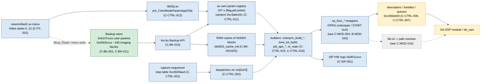
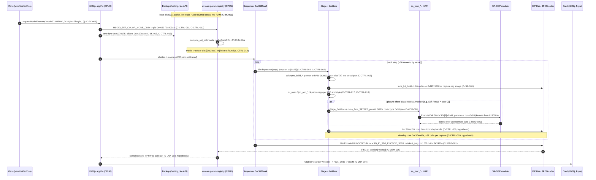

# 03 — Control flow: how parameters reach the hardware

Scope: menu/userland → Backup → av-cam (parameter registry, sequencer, dispatchers, builders,
`sa_func_*` wrappers) → descriptors / mailbox → DSP / ISP. Areas: `CTRL`, `BK`.
Schema: `00-index.md`. av-cam addresses: full VA `0xc3…`, or av-cam file offsets (VA = offset +
`0xc3441000`) where the source note used offsets (`BK` and most `CTRL-011+` claims).
Module-side claims (OPEN/START messages, `0x00bd` tables) are owned by `04`: cited as `(see B-MOD-…)`.

## Sources (aliases)

| alias | path |
|---|---|
| GH / DG | `notes/grain-hook.md` / `notes/dsp-grain-campaign.md` |
| SB | `WorkPersonal/reference/nex3n-safe-test-boot.md` |
| SYM | `WorkPersonal/reference/nex3n-symbols-and-names.md` |
| SE / FPP | `notes/style-and-effect.md` / `notes/film-presets-plan.md` |
| HS / HSR | `WorkPersonal/reference/nex3n-hidden-styles.md` / `nex3n-hidden-styles-render.md` |
| BP / FXP / MOR / RD | `nex3n-backup-params.md` / `nex3n-film-effects-plan.md` / `nex3n-morning-2026-10-06.md` / `README.md` |
| SIA | `WorkPersonal/reference/nex3n-sa-interface.md` |
| WR | `atlas/_extract/E-web-research.md` |
| IDX | `WorkPersonal/CLAUDE.md` index lines for nex3n notes |

## 1. Layers

## 2. One still frame (sequence)

Solid arrows are read in code or seen on the camera; notes in the diagram mark hypotheses.

## 3. Parameter routes per look control

| control | user surface | storage | av-cam consumer | hardware target | status | claims |
|---|---|---|---|---|---|---|
| Creative Style | menu (6 of 13 visible) | `0x01070175` byte 0 | `liro_read_creative_style` → pid 0x4039 → camprm | slot byte T[6], curve index `+0x4f` | verified-code, link gaps | C-CTRL-011, C-CTRL-014, C-CTRL-016 |
| style sliders | menu | `0x0107` triples per style | pid 0x403a/b/c | contrast curve, Sat factor, Apacon step | verified-code | C-CTRL-013, C-BK-011 |
| colour matrices + hue records | none (Backup only) | `0x00030001`/`0x00030008` | builders pass pointer | DSP/HAPI? | verified-hw (effect) | C-CTRL-015, C-BK-006 |
| tone curves | Contrast slider, style | p3 av-cam (not Backup); debug `0x0003007a` | `tone_lut_build` | HW LUT `0xf4015300` | verified-code | C-CTRL-016, C-ISP-001 |
| NR | High ISO NR menu (mapping unknown) | `0x3001b`, `0x30010`, `0x3004a/4c`, hi_gain | `nr_main`, YKNR enable, `CommonRam+0x15C` | unknown | verified-code (params) | C-CTRL-017 |
| sharpness | slider | `0x3000c/0d`, `0x30106` | `job_apc_*`, `YC_SetModeDependent_*` | Apacon regs `0x78b0..` | verified-code | C-CTRL-018 |
| Soft Focus | effect + level | `0x0003010a` | `Stage_SoftFocus` → `sa_func_SFTFCS_*` | `sa_sftfcs` | verified-code | C-ISP-004 |
| Miniature | effect | `0x00030109` | `Stage_TBOX` → `HapiTBOX` | `sa_tbox` | hypothesis | C-FX-022 |
| Toy vignette | effect | `0x00030040` | `CalcLensShdGainToy` | SHD job | verified-code | C-NR-021 |
| picture effect id | menu | runtime camprm (exact pid unknown) | class `ctx[0x23]` | — | unknown | C-CTRL-019 |
| Sunset AWB gain | style | not found | not found | — | unknown | C-CTRL-021 |

## 4. Claims — CTRL

### C-CTRL-001: The capture sequencer is a step table at `0xc3629aa4` (file `0x1e8aa4`): ~58 records of 8 B `{dispatcher_fn (Thumb), descriptor_ptr}`, called indirectly (`ldr fn,[tbl+step*8]; blx fn`); it is a state machine visited by mode, not a linear pipeline
- status: verified-code
- evidence: table decode; xref tool (30k targets / 168k call sites) finds no direct BL callers
- source: GH §2; SB §4
- date: 2026-10-06
- relates: C-CTRL-002

### C-CTRL-002: Each dispatcher jumps on the picture-effect class byte `ctx[0x23]` (0..4; ~14 effects collapse to 5 classes): record 1 `0xc362827e` → case0 `0xc37deb92`, case1 `0xc37dfca2`, case2 `0xc37ea898` (Stage_SoftFocus), case3 `0xc37df2c0`, case4 `0xc363faa0` (multi-frame, own 0x21-way sub-dispatcher `0xc35f8db4`), default `movs r0,#5`
- status: verified-code
- evidence: disassembly of record 1 dispatcher `0xc362827e` (cases `0xc37deb92/0xc37dfca2/0xc37ea898/0xc37df2c0/0xc363faa0`)
- source: GH §2; SB §4; SE; FPP "Effect stage class map"
- date: 2026-10-07
- relates: merges A-CTRL-002 and C-FX-015; C-PIPE-010 (02)

### C-CTRL-003: Stage_SoftFocus is called from 8 dispatcher `bl` sites (`0x1e72a2..0x1e776a`, VA `0xc36282a2..0xc362876a`); records 49, 53-57 call candidate `0xc3889760`; rec40 `0xc3628b18` dispatches class0 → `0xc37ee680`, class1 → `0xc37ecb06`
- status: verified-code
- evidence: xref listing; sites used by E-0042, E-0048
- source: GH §1; SB §4c; ST
- date: 2026-10-07
- relates: C-PIPE-003 (02)

### C-CTRL-004: Stages take `r0 = ctx`, `r4 = *ctx` (develop-session object); a family shares a prologue (gate on a session field; geometry `r4[0x1b8]<<16 | r4[0x3a98]&0xffff`; `movs r0,#2; bl 0xc366eb00`)
- status: verified-code
- evidence: disassembly of Stage_SoftFocus and `0xc3889760`; E-0040 read `[0x1b8]=0`, `[0x3a98]=0x10`, `[0x39e0]=0x14420000`
- source: GH §2
- date: 2026-10-06
- relates: C-CTRL-005

### C-CTRL-005: `0xc366eb00(2, packed_geometry)` locks/prepares the YC canvas
- status: refuted
- evidence: 07.10 re-reading: it is a command-send primitive
- source: GH §2 (old); DG §2
- date: 2026-10-07
- relates: superseded by C-CTRL-006

### C-CTRL-006: `0xc366eb00` posts command descriptors to DSP/HW through queues
- status: hypothesis
- evidence: DG §2 re-reading; not traced to the queue consumer
- source: DG §2
- date: 2026-10-07
- relates: C-CTRL-007

### C-CTRL-007: The capture pipeline is descriptor/handle-driven: av-cam assembles descriptors and posts them; pixel buffers are named by handle + geometry; the DSP/HW owns writes to the YC canvas and their scheduling
- status: hypothesis
- evidence: E-0049 (marker ignored), E-0051 (encode handler has no address), C-MEM-011 (`session[+0x3e24]` is a handle); no ARM instruction found in the "buffer finalised → encoder reads it" window; WR B3: a6000 uses a "processing ticket" model (HAPI/STM)
- source: DG §2; ST; WR B3
- date: 2026-10-09
- relates: supports C-PIPE-001 (02)

### C-CTRL-008: Descriptors (`0xc3bf17xx`, stride 0x14) are runtime addresses outside the image, so stage order cannot be derived statically; log strings (`DistEncodeFULL`, `CamCoreDevelopStart`, `ENCODE_JPEG`, `enc_param`, `DMM_HANDLE_YCC_FULL`) have 0 literal-pool refs (indexed through `MSG_ID_*` tables)
- status: verified-code
- evidence: xref/avgraph run
- source: GH §2; SB §4
- date: 2026-10-06
- relates: C-PIPE-005 (02)

### C-CTRL-009: Hook candidate `0xc3889760` (gate `r4[0x3c]` ∈ {1,2}) is an always-run encode-input stage
- status: unknown
- evidence: E-0035, E-0038 (no grain; gate/pointer both suspect, R-7); per-capture call count never measured
- source: GH §3; SB §4c
- date: 2026-10-06
- relates: —

### C-CTRL-010: Develop core `0xc37ea42e` is called ~31 times per capture and rewrites `session[+0x5e4]` after the Soft Focus stage
- status: hypothesis
- evidence: fitted to E-0042/E-0044/E-0049; not observed
- source: DG §1
- date: 2026-10-07
- relates: C-PIPE-019 (02)

### C-CTRL-011: Style selection chain: menu byte `0x01070175` → `liro_read_creative_style` (0x2a0f2a) → `menu_style_to_colormode` (0x29dd1a; mode = value − 1) → params `0x4039` (mode), `0x403a/b/c` (sliders) → handler 0x20fde → camprm `0xc3abe32c +4/+8/+9/+0xa`; registry `{flag,pid,setter}` × 207 at `0xc3968d08..0xc39696bc`, pid 0x4039 setter `camprm_set_colormode` `0xc3461fdf`
- status: verified-code
- evidence: menu byte `0x01070175` → `liro_read_creative_style` `0x2a0f2a` → camprm `0xc3abe32c`; registry `0xc3968d08`
- source: SYM 3; SE; FPP
- date: 2026-10-05
- relates: C-CTRL-014

### C-CTRL-012: Userland path of a style change: `requestModelExecute("model/CAMERA", 0x26, …)` (viewUnified2 0x448c8) → libObj `pvt_ColorModeParamApp2Obj` (0x94c51c, 15 values) → `MSGID_SET_COLOR_MODE_CMD` to av-cam
- status: verified-code
- evidence: addresses (C-FX-006); IPC transport not traced
- source: HS 6.3
- date: 2026-10-06
- relates: C-CTRL-011

### C-CTRL-013: `liro_read_creative_style` maps 13 style values to (contrast, saturation, sharpness) BKID triples (prefix `0x0107`): v1 0735/0742/074f, v2 0736/0743/0750, v3 073e/074b/0758, v4 073a/0747/0754, v5 073b/0748/0755, v6 073d/–/0757, v7 073f/074c/0759, v8 0740/074d/075a, v9 0741/074e/075b, v10 073c/0749/0756, v11 0737/0744/0751, v12 0738/0745/0752, v14 0739/–/0753
- status: verified-code
- evidence: jump table at 0x2a0f2a
- source: SYM 3; HSR 1.5
- date: 2026-10-05
- relates: merges C-CTRL-003 and C-BK-011 (mapping part); C-FX-005 (02)

### C-CTRL-014: All four colour builders read one global slot byte `[0xc3bad724]` → `T[6]` (capture 0xc3507b78, extract 0xc35084a8, monitor 0xc3507128 and 0xc35074ac); it is fed from pid 0x4039 via pointer tables `0xc381a6a4/0xc381aa54`; the writer and the mode → slot mapping are not found (mode = value − 1 gives Portrait 3, Landscape 4, Sunset 9, measured slots are 2, 3, 4)
- status: verified-code
- evidence: global slot byte `[0xc3bad724]`→`T[6]` read sites `0xc3507b78/0xc35084a8/0xc3507128/0xc35074ac`; writer: unknown
- source: SE; HSR 1.3; SYM 3
- date: 2026-10-05
- relates: conflicts C-COL-003 / C-FX-010 index spaces (02); Q-14

### C-CTRL-015: Each frame four builders (`colorprm_build_capmode` 0xc3507b13, `_extract` 0xc3508453 from `ExtractCaptureData`, `_A` 0xc35070c7, `_B` 0xc3507431; plus 18 per-mode handlers) put a pointer to the RAM copy of `0x30001` or `0x30008` into the colour descriptor; ARM never copies or multiplies the matrix
- status: verified-code
- evidence: SYM 2 (file 0xc60c6, 0xc6430, 0xc6b12, 0xc7452); SE names
- source: SYM 2; SE
- date: 2026-10-05
- relates: C-BK-006, C-ISP-003 (02)

### C-CTRL-016: Tone selection (partial): colour mode reaches param fields `+0x4f` (style curve idx), `+0x48` (enable), `+0x4c` contrast 0..6, `+0x4a` base, `+0x4d/+0x4e` k7 family; 0x2d7e38 (monitor) / 0x2d7f88 (capture) copy them to `obj+0xbe1/0xbd5/0xbdb/0xbd9`; `tone_lut_build` reads `0xc3cb68a0[idx]`; the link camprm → `+0x4f` is not found
- status: verified-code
- evidence: param fields `+0x4f/+0x48/+0x4c/+0x4a`; copy `0x2d7e38`(monitor)/`0x2d7f88`(capture); `tone_lut_build` reads `0xc3cb68a0[idx]`; link unknown
- source: SYM 0, 3
- date: 2026-10-05
- relates: C-TONE-006, C-TONE-010 (02)

### C-CTRL-017: NR level and NR mode are runtime bytes (`CommonRam+0x15C`), not Backup; G-NR uses ISO `obj+0x14E`, YKNR/Apacon `obj+0x5C6`
- status: verified-code
- evidence: runtime bytes `CommonRam+0x15C`; G-NR ISO `obj+0x14E`, YKNR/Apacon `obj+0x5C6` (BP 1.1, 8)
- source: BP
- date: 2026-10-05
- relates: C-NR-004 (02)

### C-CTRL-018: Sharpness registers: `YC_SetModeDependent_Sunset` (0x464daa) writes `0x78b0..0x78bf`; ARM sets Apacon per style from the `0x00030106` ladders (0x464958)
- status: verified-code
- evidence: 0x464daa, 0x464958
- source: SYM 4; BP 2.2
- date: 2026-10-05
- relates: C-NR-017, C-NR-019 (02)

### C-CTRL-019: The Picture-Effect parameter id is not pinned: the capture path carries only the class `ctx[0x23]`; binding per-effect behaviour needs a live dump of camprm `0xc3abe32c..0xc3abe370` while toggling the menu
- status: unknown
- evidence: no Picture-Effect literal found
- source: FPP "Per-effect vs per-style selector"
- date: 2026-10-07
- relates: C-NR-020 (02); Q-8

### C-CTRL-020: Userland reads Backup in the Creative Style view: `Bkup_Read(0x01070316)` (0x4345c) and another `Bkup_Read` at 0x449de; roles not examined
- status: verified-code
- evidence: `Bkup_Read(0x01070316)` `0x4345c`, second `Bkup_Read` `0x449de` (HS 1)
- source: HS 1
- date: 2026-10-06
- relates: C-FX-008 (02)

### C-CTRL-021: Where the Sunset AWB warmth enters is unknown; candidates: readers of camprm `0xc3abe32c` (`0x2001a` in `fn_1feec`, `0x2217a`); av-cam has no AWB strings (WB strings belong to panel/EVF)
- status: unknown
- evidence: SYM 4
- source: SYM 4
- date: 2026-10-05
- relates: C-COL-031 (02); Q-13

### C-CTRL-022: Some menu-made property changes go through an IPC path that serviceshell `bk w` does not replicate; certain settings need a power cycle with battery removal to apply
- status: hypothesis
- evidence: a6000 / a7R II report (Sony-PMCA-RE #597, example `0x01070C7B`); not observed on 3N
- source: WR B1
- date: 2026-10-09
- relates: C-BK-002, C-BK-003; Q-23

### C-CTRL-023: Parameters travel with the image buffer as a "processing ticket" through HAPI/STM stages
- status: hypothesis
- evidence: a6000 description (Sony-PMCA-RE #512); 3N av-cam has `Camera::HAPI::*`, `ImageParam_Capture` signatures (02, C-PIPE-005)
- source: WR B3
- date: 2026-10-09
- relates: C-CTRL-007

## 5. Claims — BK

### C-BK-001: Subsystem `0x0003` holds ~180 property blocks that av-cam caches in RAM at boot
- status: verified-code
- evidence: `bk0003_cache_init` 0x1819cc (from fn_7c18) registers `Backup_reg_cb` for all 180 IDs; ID list 0x61d1dc, alternate list 0x61d4b0, RAM address list 0x61d784; one `Backup_read_multi` at 0x18183e
- source: SYM 0, 2; RD
- date: 2026-10-05
- relates: C-BK-002
- scope: nex3n-fw1.00 (subsystem `0x0003` exists in a6000/A7 II/A7 III Backup dumps too, `sonygen/bk_*.txt`; caching code and block layouts read on 3N only)

### C-BK-002: A write to a cached `0x0003` ID is copied into the RAM copy at once (callback 0x1819a2 = memcpy); `0x181f4a` re-reads one ID on request; colour RAM copies `0xc3ac2b94` (0x30001), `0xc3ac4894` (0x30008)
- status: verified-code
- evidence: callback `0x1819a2`=memcpy, re-read `0x181f4a`; RAM copies `0xc3ac2b94`(0x30001)/`0xc3ac4894`(0x30008). Hardware cannot discriminate: every `bk w` session goes through updater mode, whose exit reboots the camera
- source: SYM 0, 2
- date: 2026-10-05
- relates: conflicts C-BK-003; Q-23

### C-BK-003: After `bk w … bk s` a reboot is needed before values take effect
- status: hypothesis
- evidence: stated rule; untested separately
- source: FXP 0
- date: 2026-10-05
- relates: conflicts C-BK-002; C-CTRL-022

### C-BK-004: Many blocks have a byte-identical "bank B" twin; which bank loads is a runtime flag (`[0xc3c9f2dc+0xc]==1 && [0xc3c9f2dc]!=0` → alternate list, 0x1819ee), so both are written; pairs `0x3000c..0x30018 ↔ 0x300b0..0x300bc`, `0x3001a/1b ↔ 0x300bd/be`, `0x3001e/1f ↔ 0x300c1/c2`, `0x30027..30 ↔ 0x300d0..d9`, `0x3003c ↔ 0x300e5`, `0x30044..47 ↔ 0x300ed..f0`, `0x3011f ↔ 0x30120`
- status: verified-code
- evidence: snapshot bytes; loader flag `[0xc3c9f2dc+0xc]==1 && [0xc3c9f2dc]!=0` → alternate list `0x1819ee`; flag value on this unit unknown
- source: BP; SYM 2; FXP 0
- date: 2026-10-05
- relates: Q-24

### C-BK-005: Blocks `0x30033`, `0x30040`, `0x30049`, `0x3004a`, `0x30106`, `0x3007a`, `0x3010a` have no bank B
- status: verified-code
- evidence: blocks `0x30033/0x30040/0x30049/0x3004a/0x30106/0x3007a/0x3010a` absent from the alternate list
- source: BP; FXP 0; SYM 7.1
- date: 2026-10-05
- relates: C-BK-004

### C-BK-006: `0x30001` and `0x30008` are two separate colour blocks (not a cache-bank pair); per-frame builders pick one by flag (`ctx[1]->+0x14 == 1` → 0x30008 in 0xc60c6, 0xc6430, 0xc7452; `[0xc3cab360+3]` in 0xc6b12); both identical in stock
- status: verified-code
- evidence: builder disassembly: `0x30001` vs `0x30008` picked by flag in `0xc60c6/0xc6430/0xc7452` (`[0xc3cab360+3]` in `0xc6b12`); flag meaning unknown
- source: SYM 2
- date: 2026-10-05
- relates: C-CTRL-015

### C-BK-007: Attribute 0x0a in `0x0003` marks per-unit calibration protected from reset; general tables carry 0x08
- status: verified-code
- evidence: attribute scan of `Backup_post-revert.bin`
- source: BP "НЕ ТРОГАТЬ"
- date: 2026-10-05
- relates: see C-SAFE-001

### C-BK-008: `0x00030056` is a shared debug block: `+0x0A=02` with `+0x04=X` substitutes ISO for the whole NR (0x2b6ce8); `+0x20` selects the logged module (3 NR, 4 YAP, 6 KKNR)
- status: verified-code
- evidence: av-cam 0x2b6ce8
- source: BP 1.6
- date: 2026-10-05
- relates: Q-10 (MSDump gate candidate, see C-MOD-033)

### C-BK-009: `0x000300af` (StaticSetInfo) holds two 13-entry style tables: `+0x70` = `00 01 02 03 04 05 ff…`, `+0xa0` = all ff; no colour/tone style table
- status: verified-code
- evidence: full scan; the literal occurs only in the BKID cache list
- source: HSR 1.2, 4
- date: 2026-10-06
- relates: C-BK-010

### C-BK-010: `0x300af+0x70` is the style → sharpness-slot map (hidden styles → ff)
- status: hypothesis
- evidence: no code read of +0x70 found
- source: HSR 0, 1.2
- date: 2026-10-06
- relates: C-FX-009 (02)

### C-BK-011: Per-style slider values live in BKIDs `0x0107xxxx` (triples per style, see C-CTRL-013)
- status: verified-code
- evidence: jump table 0x2a0f2a
- source: SYM 3; HSR 1.5
- date: 2026-10-05
- relates: C-CTRL-013

### C-BK-012: In the snapshot all 13 styles have sliders 0/0/0 except Portrait +1/−1/−1, which may be the owner's parked setting rather than a factory default
- status: verified-code
- evidence: bytes of `Backup_post-revert.bin`; REC says the owner parks exactly C+1/S−1/Sh−1 on Portrait
- source: HSR 1.5; REC
- date: 2026-10-06
- relates: C-TONE-004 (02); Q-30

### C-BK-013: `0x01070175` byte 0 = selected Creative Style item (currently 02)
- status: verified-code
- evidence: Backup `0x01070175` byte 0 read by `liro_read_creative_style` `0x2a0f2a`
- source: SYM 3
- date: 2026-10-05
- relates: C-CTRL-011

### C-BK-014: Userland has no PARAM_ID → BKID tables for `0x0003`; that subsystem lives only in av-cam; names in `bkid_names.txt` are the project's own
- status: verified-code
- evidence: search of libObj, libmprctrl, all .so
- source: SYM 0
- date: 2026-10-05
- relates: —

### C-BK-015: The literal `0x00030001` also occurs in av-cam as a message/parameter ID (e.g. `fn_29d134(0x30001, …)`); context-free literal searches mislead
- status: verified-code
- evidence: literal `0x00030001` also a message/param ID (`fn_29d134(0x30001,…)`), SYM 2 «Ложные ссылки»
- source: SYM 2
- date: 2026-10-05
- relates: —

### C-BK-016: Writing `0x0003` properties via the PMCA updater shell (`bk r/w/s`, readback) is safe and survives reboot; protected properties go through `bk patch` (whole Backup rewrite)
- status: verified-hw
- evidence: E-0002, E-0007, E-0010..E-0020 (see C-DLV-017)
- source: IDX; FXP 0; MOR; FH
- date: 2026-10-05
- relates: —
- scope: nex3n-fw1.00 (subsystem `0x0003` exists in a6000/A7 II/A7 III Backup dumps too, `sonygen/bk_*.txt`; caching code and block layouts read on 3N only)

### C-BK-017: After snapshot `Backup_post-revert.bin` (2026-10-04 20:11) the camera got only `0x30001/08` (tags, v1..v5) and `0x30106` step revert; every plan must `bk r` against `<id>_orig.hex` first
- status: verified-hw
- evidence: D-extract: last Backup log `live30.log` 05.10 21:48; E-0009 restore; no later Backup writes recorded
- source: FXP 0; D-extract
- date: 2026-10-09
- relates: upgrades C-BK-017 (extract, hypothesis)

### C-BK-018: `0x66xxxx`-class curves are display/video-out gamma and do not affect JPEG
- status: hypothesis
- evidence: README summary only
- source: RD
- date: undated
- relates: —

### C-BK-019: liro.ko exposes the Backup API (nread, read_setting_attr, get_datasize, get_attribute, read/_multi/_async, write/_vsize/_multi/_async, sync_subsystem/all, reg_cb/unreg_cb, reset*, check, read_4Byte); av-cam calls `Backup_read` 0xc3676ab3, `Backup_read_multi` 0xc3676af9, `Backup_reg_cb` 0xc3676bfb, `Backup_write` 0xc3676b8d (thunks; 1050 `Backup_read` calls)
- status: verified-code
- evidence: `liro.ko .rel.init.data` slot table; WR B1: thunk through an external address table (a6000)
- source: SYM 0, 1; WR B1
- date: 2026-10-05
- relates: C-BOOT-009 (01)

### C-BK-020: Backup.bin container (a6000-class template): header `{magic, cookie, revision[4], numSubsystems, dataOffset, dataSize, checksum, …, version[128], region[64]}`, subsystem table `{pteCount, pteStart}`, properties with 24-bit address, size, flags (`PF_ARRAY=0x80`, resetable mask), default value stored beside data; key = `(subsystem<<16)|property`; subsystem 0xBD = "mystery bin list"
- status: hypothesis
- evidence: 010 Editor template `ILCE-BK4.bt` (RomanHargrave gist); not validated on 3N `bkdump.py` layout
- source: WR B2
- date: 2026-10-09
- relates: see C-MOD-006..008 (0x00bd tables)

### C-BK-021: Each property keeps a reset value and a factory reset re-applies defaults, so a factory reset should restore stock `0x0003` colour tables
- status: hypothesis
- evidence: mungewell, Sony-PMCA-RE #249 (NEX-6 era); not tested on 3N
- source: WR B5
- date: 2026-10-09
- relates: Q-15

## 6. Trace table (temporary ID → final ID)

Left column: temporary IDs. `A-*` = `_extract/A-system-boot-delivery.md`, `B-*` = `_extract/B-dsp-modules.md`, `L §n` / `E xn` = Linux recon / web extracts; a bare `C-<AREA>-<NNN>` in the **left** column is the temporary ID from `_extract/C-backup-colour-tone.md` (same prefix as final IDs — read it as extract C).

| temp | final | note |
|---|---|---|
| A-CTRL-001 | C-CTRL-001 | |
| A-CTRL-002, C-FX-015 | C-CTRL-002 | merged |
| A-CTRL-003 | C-CTRL-003 | |
| A-CTRL-004 | C-CTRL-004 | + E-0040 |
| A-CTRL-005 | C-CTRL-005 | refuted |
| A-CTRL-005 (correction text) | C-CTRL-006 | split out |
| A-CTRL-006 | C-CTRL-007 | + WR B3 |
| A-CTRL-007 | C-CTRL-008 | |
| A-CTRL-008 | C-JPEG-001 (02) | |
| A-CTRL-009 | C-JPEG-002 (02) | |
| A-CTRL-010 | C-JPEG-003 (02) | |
| A-CTRL-011 | C-CTRL-009 | |
| A-CTRL-012 | C-CTRL-010 (+ C-PIPE-019 in 02) | |
| C-CTRL-002 (extract C) | C-CTRL-011 | |
| C-FX-006 (control part) | C-CTRL-012 | FX record kept as C-FX-006 |
| C-CTRL-003, C-BK-011 (mapping) | C-CTRL-013 | merged |
| C-CTRL-004 | C-CTRL-014 | |
| C-CTRL-001 | C-CTRL-015 | |
| C-CTRL-005 | C-CTRL-016 | |
| C-CTRL-006 | C-CTRL-017 | |
| C-CTRL-007 | C-CTRL-018 | |
| C-CTRL-008 | C-CTRL-019 | |
| C-CTRL-009 | C-CTRL-020 | |
| C-CTRL-010 | C-CTRL-021 | |
| E B1 (web) | C-CTRL-022 | |
| E B3 (web) | C-CTRL-023 | |
| C-BK-001..016 | C-BK-001..016 | 1:1 (C-BK-011 keeps storage fact) |
| C-BK-017 | C-BK-017 | upgraded to verified-hw (D-extract) |
| C-BK-018, C-BK-019 | C-BK-018, C-BK-019 | |
| E B2 (web) | C-BK-020 | |
| E B5 (web) | C-BK-021 | |
