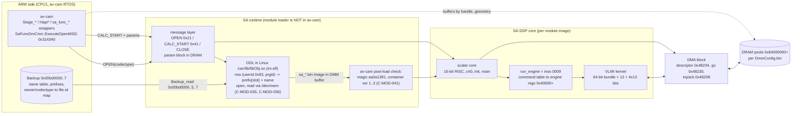

# 04 - SA-DSP, SA modules, idt_cam overlays

Catalogue of the SA-DSP (instruction set, bundle format, engine, container format), of every `sa_*.bin` (p8 `/usr/sabin`, p3 `/system/sabin`) and of the 35 `idt_cam.bin` overlays. Areas: `DSP`, `MOD`, `IDT`.

Conventions
- Schema and statuses: `00-index.md`. Static work only; nothing in this page was written to or run on the camera, except where an `E-` ID is cited (record in `06-experiment-log.md`).
- Offsets: module `+0x..` = file offsets; `idt_cam` offsets = file offsets inside `idt_cam.bin` (inner p3 offset `0x980e00`); av-cam addresses = file offsets (VA = `0xc3441000` + offset) unless a full `0xc3...` VA is given.
- Source shorthands: `WP:` = `WorkPersonal/reference/`, `NR:` = `nex3n-research/notes/`. "mine" in evidence = recomputed from the data on 2026-10-09 by the extraction pass and re-checked by the atlas editor where marked "re-checked".
- IDs of other areas are temporary and written `tmp:<ID>` (A- = system/boot/delivery extract, C- = backup/colour/tone extract, L = Linux recon extract); the agent that writes 01/02/03/07 renumbers them. Final IDs in this page are `C-DSP-`, `C-MOD-`, `C-IDT-`.
- Decision on Campaign A (07.10 interpretations of NOP bisection): revised 2026-10-09 after the independent review (R 4-B, 2-C): the stage labels are `refuted` (C-IDT-009); the observations stay `verified-hw` in C-IDT-008. One wording in 04/06/07: "observations verified-hw, interpretations refuted". The structural claim "idt_cam is one VLIW blob holding the whole stills pipeline" stays `refuted` (C-IDT-007).
- Integration 2026-10-09: extracts G (`_extract/G-q2-module-resolver.md`, resolver), H (`_extract/H-q31-yknr-dataflow.md`, yknr data flow) and R (`_extract/R-fable-review.md`) are folded in as C-MOD-035..C-MOD-051, C-DSP-034..C-DSP-036 (trace table §8).

## 1. Overview

Reading of the diagram (claims in brackets):
- The ARM side only sends a codectype in OPEN and a parameter block in CALC_START (C-MOD-004, C-MOD-020). The component that maps codectype to a file is the On-Demand Loader in Linux userland `libObj.so` (C-MOD-035); the av-cam → ODL hop is not traced (C-MOD-043). One module can be redirected to `/setting/` by one Backup byte (C-MOD-044, hypothesis, not run).
- The scalar core only configures (engine registers, DMA); pixels move by DMA between DRAM and the engine (C-DSP-020, C-DSP-033).
- `idt_cam.bin` (p3) is a different shape: 35 self-contained overlays with a stub that calls the entry, writes 0 to `0x48208` and sleeps (C-IDT-002). av-cam has no `idt_cam` string; the Loader2 load list names it (`C-BOOT-002`, C-IDT-020).

## 2. DSP: container, instruction set, bundle format, engine

### 2.1 Container format

## Module VLIW profiles (2026-10-17, static scan — fills the "module role" gap)

Every p8 processing module scanned for VLIW program count + op3 port-read / op5 store-channel histogram (port24
read heavily ⇒ luma-processing; port31 ⇒ chroma). Tool: 8-aligned bundle scan over `sabin_nex6/sa_*.bin`.

| module | size | #prog | top read-ports | top store-chans | luma/chroma | likely role (name + profile) |
|---|---|---|---|---|---|---|
| sa_apollo4 | 250 KB | 13 | 24×1290,7,16,17 | 0,18,8,6 | LUMA-heavy | **big early luma stage** — codectype 0x01, OPEN'd first; develop/demosaic or main filter candidate |
| sa_dfdet | 146 KB | 23 | 24×1509,0,31,2 | 0,18,24,1 | LUMA-heavy | **defect DETECTION** (p3 `sa_dfdet`); 23 programs, heaviest luma reads |
| sa_star | 474 KB | 10 | 24×877,7,0,2 | 0,20,1,6 | luma+chroma | STAR — largest; resize/enhance (conditional resize stage, C-PIPE-021) |
| sa_tbox | 77 KB | 5 | 24×409,7,2,4 | 0,1,31,2 | LUMA-heavy | TBOX = Miniature (tilt-shift blur) — luma-heavy blur |
| sa_kknr | 64 KB | 6 | 24×275,7,2,0 | 0,1,17,8 | luma+chroma | KKNR = face-skin NR (C-NR-008) |
| sa_frc2 | 61 KB | 5 | 24×277,31×245,0,16 | 0,31×328,8,15 | luma+chroma | FRC2 — high chroma (31) read+store; chroma-leaning |
| sa_yknr | 53 KB | 5 | 24×308,7,31,2 | 0,1,31,17 | luma+chroma | **YKNR = luma NR** (confirmed: luma store op5 a7→chan3) |
| sa_bdro2_bdex | 52 KB | 3 | 24×271,0,7,4 | 18,0,1,31 | LUMA-heavy | BDRO/BDEX = Bayer DR optimization/extension |
| sa_sftfcs | 43 KB | 3 | 24×280,31×124,7,0 | 0,1,3,31 | luma+chroma | Soft Focus effect |
| sa_defect | 36 KB | 5 | 24×150,2,0,7 | 0,1,7,8 | luma+chroma | defect pixel correction |
| sa_pbe_work | 30 KB | 7 | 24×281,31×72,2,7 | 0,1,18,25 | luma+chroma | **PBE = CHROMA processor** (confirmed: chan3=chroma; reads luma as guide) |
| sa_spica | 22 KB | 3 | 24×90,0,2,7 | 1,0,7,3 | LUMA-heavy | **SPICA = develop/resize** (confirmed C-PIPE-026; luma prog 0x41e0, chan3/7 candidates) |

Note: "port24 = luma" is verified for PBE/yknr; assumed for the rest (same platform). LUMA-heavy + large +
early-OPEN modules (apollo4, dfdet, star, bdro, tbox) are additional candidate luma-writing stages beyond SPICA —
relevant if the SPICA base-ISO probe fails. (A camera signature-probe confirms which writes the YC-canvas luma.)

### Module ROLES + still execution order (2026-10-17, DeepSeek synthesis on the profiles)

Inferred roles (name + VLIW profile + pipeline context; CONFIRMED ones marked):
- **apollo4** = raw→develop FRONT-END / multi-stage develop master (codectype 0x01, OPEN'd first, biggest, 13
  luma-heavy programs = sub-stages × mode/gain/quality variants). NOT the demosaic (that's in spica).
- **dfdet** = defect-pixel DETECTION (builds the defect map; raw/Bayer, 23 kernels across gains).
- **defect** + **bdro2_bdex** = defect CORRECTION/repair pair (Bayer domain; BDRO=mask optimize, BDEX=repair/dilate).
- **spica** = demosaic + DEVELOP/resize → writes YC canvas [CONFIRMED C-PIPE-026].
- **pbe_work** = CHROMA processor (luma as edge guide) [CONFIRMED].
- **frc2** = chroma false-color / fringe (zipper) correction (high chroma reads+stores; NOT frame-rate conversion
  — meaningless on a still).
- **yknr** = late LUMA NR [CONFIRMED], ISO-gated.
- **kknr** = chroma/skin NR (Soft Skin), face/skin-gated.
- **star** = SCALER/resize (polyphase, largest, many phase kernels); conditional, can overwrite YC canvas pre-encode.
- **tbox** = Miniature (tilt-shift) / **sftfcs** = Soft Focus — effect-gated, mutually exclusive.

**Most likely still execution order:** dfdet → defect/bdro (correct) → **apollo4** (develop front-end) → **spica**
(demosaic/develop → YC canvas) → **pbe_work** (chroma) → frc2 (chroma fix) → **yknr** (luma NR, ISO-gated) → kknr
(chroma/skin NR, gated) → tbox|sftfcs (effect-gated) → **star** (resize, conditional) → encode.
Always-on core = dfdet, defect/bdro, apollo4, spica, pbe_work, frc2. Gated = yknr(ISO), kknr(skin), tbox/sftfcs(effect), star(resize).

**Grain relevance:** the always-on LUMA writers (apollo4 develop, spica develop) are the ISO-independent injection
candidates (SPICA already the lead); frc2 is a 2nd chroma-grain option besides PBE.
**To CONFIRM (not inferable statically here):** the av-cam codectype→open-order table (open≠exec order); the op5
store-channel→buffer-name map (place each writer on the YC-canvas chain, verify STAR overwrite); the yknr/kknr gate
flags. [DeepSeek flagged these windows.]

### C-DSP-001: Every p8 `sa_*.bin` (32 files) and p3 `sa_dfdet.bin` starts with magic `aa0a1391`, has a u16 container version at +4 (1 for codec/zima/avc modules, 2 for processing modules and jpeg), a 12-byte tag at +0x14, and ends with a sum32le trailer equal to the sum of all preceding u32 words
- status: verified-code
- evidence: header scan of all 33 files; 33/33 sum32 trailers valid (re-checked by the editor on the 32 p8 files, 32/32); version 1 = 12 files (aaclcdec, aaclcenc_nr, ac3dec, dd51enc_nr, bd_lpcmdec, avce x2, avcd x2, zima x3), version 2 = 20 files (16 processing modules plus the four `sa_jpeg_*`)
- source: WP:sony-dsp-isa.md §1; WP:sony-dsp-generations.md "Формат SA-модуля"
- date: 2026-10-09
- relates: C-DSP-002, C-DSP-004; av-cam checks the magic and version on load (C-MOD-041)
- scope: SA-platform for the magic (X09: all 50 `sa_*.bin` of A7 II v4.01 and 58 of A7 III v4.01 start with `aa0a1391`); container version is per generation (NEX-6 1/2, A7 II 4, A7 III 5; C-DSP-025)

### C-DSP-002: Byte +9 of the container header is the codectype and byte +8 is a class (00 = processing/effect module, 01 = codec); p8 holds 16 processing and 16 codec-class modules
- status: verified-code
- evidence: catalog columns "class" and "codectype" (section 4). Processing: apollo4 01, dfdet 02, sweep_panorama 0a, kknr 0f, bdro2_bdex 10, fc_recog 13, defect 14, frc2 15, spica 16, tbox 17, sftfcs 18, pbe_work 19, star 1a, yknr 1c, shapep 21, test_intr_c0a 28. Codec: avce 0xc0/c1, avcd 0xc8/c9, aac/ac3/dd51/lpcm 0xd3-d8, jpeg enc/dec 0xe0/e1/e8/e9, zima 0xf0-f2. Byte +9 equals `ref` of the `0x00bd0002` map for 32/32 (C-MOD-006)
- source: WP:sony-dsp-generations.md table "+8 ID модуля"
- date: 2026-10-09
- relates: C-MOD-006

### C-DSP-003: The image table at +0x30 lists only the primary image(s) of a module; per-core images exist beyond it and are found only by scanning for descriptors `3d 00 xx b0 42 VV`
- status: verified-code
- evidence: table entries vs scan hits: sftfcs 1 vs 3 (0x100, 0x2c20, 0x6cc0), tbox 1 vs 4, star 1 vs 9, yknr 1 vs 4, frc2 1 vs 3, kknr 2 vs 5, apollo4 2 entries (same offset 0x200 twice) vs 7, dfdet 2 vs 8, bdro2_bdex 2 vs 3, spica 2 vs 3. Descriptor `w[2]` carries a core index in bits 8..15 (sftfcs 0x80002, 0x102, 0x202; tbox 0x80005, 0x105, 0x205, 0x305; star 0x80002, 0x10102 ... 0x10802). Statements about "the images of a module" taken from the +0x30 table undercount
- source: WP:sony-dsp-isa.md §1, §13.1 (the notes name the extra images but do not say the table omits them)
- date: 2026-10-09
- relates: C-DSP-004, C-MOD-027

### C-DSP-004: The descriptor version byte `VV` (descriptor +5) is 0x32 for most 3N modules, 0x31 for the four `sa_jpeg_*`, `sa_fc_recog` and `sa_test_intr_c0a`, and 0x34 for `idt_cam.bin` alone
- status: verified-code
- evidence: descriptor dump of all files; `ssboot.bin`, `ssboot_any.bin`, `sa_dfdet` = 0x32. The generations note gives 0x34 as the CXD90014 value, so `idt_cam` carries the later descriptor version
- source: WP:sony-dsp-generations.md ("Версия дескриптора VV"); NR:dsp-grain-campaign.md §3 ("v4 SA descriptor")
- date: 2026-10-09
- relates: C-IDT-004, C-DSP-025

### C-DSP-005: In a v2 descriptor `w[4]` is the code base (link address 0, entry at +8), `w[5]` the end of the loadable image, and `w[11]` is 0x682 in every module
- status: hypothesis
- evidence: note: literal-pool pointers hit prologues exactly with base `w[4]` (sftfcs 12/25, tbox 9/46, defect 14/103; 0 with `w[12]`). `w[11]` = 0x682 re-checked on all 86 descriptors found by pattern scan in p8 and p3 `sabin/` (0 exceptions). Base/entry semantics not re-checked
- source: WP:sony-dsp-isa.md §1
- date: 2026-10-06
- relates: C-DSP-006

### C-DSP-006: A module text begins with zeros, an entry stub (`sp`, `r14`, `r1` loaded from literals; `jsr` init; `jmp` main), then a table of u32 `id<<24 | value` entries (id 2..0x55) passed to a function as data; the vector table at +0x7c (24 entries, all 0x76) does not point to code
- status: hypothesis
- evidence: note states verified-code (sftfcs map: stub at 0x008, config table 0x01c-0x193); not re-checked
- source: WP:sony-dsp-isa.md §1, §6
- date: 2026-10-05
- relates: C-DSP-005

### 2.2 Scalar core

### C-DSP-007: The scalar core is a proprietary 16-bit little-endian RISC with 16 registers (r15 = SP, args r4-r7, return r0, callee-saved r8-r15), no delay slots, PC-relative literals (`5iiN` = ldr, `4ddN` = ldrh); its instruction table matches ma1co's SA-DSP SLEIGH spec, which covers all scalar code reachable in the 3N corpus except `0009`/`000a`
- status: hypothesis
- evidence: independent external spec (github.com/ma1co/SA-DSP, commit 322bc4a, 09.08.2021) agrees with the 3N-derived fingerprints; note reports a recursive static walk (`cfg.py`): 62 v2 images, 170,915 reachable halfwords, 7 undefined, all in command tables or data; walk not re-run. In the extraction pass the `sadis.py` disassembly (ma1co table) decoded all 35 idt_cam overlay stubs cleanly (`ldr sp; ldr r14; ldr r1; bl r1; ...; wfi; b`)
- source: WP:sony-dsp-isa.md §2, §14, §15.8; WP:sony-hack-prior-art.md §3
- date: 2026-10-06
- relates: C-DSP-008, C-DSP-009, C-DSP-030

### C-DSP-008: The first-pass reading of `C`/`D` opcodes as `bf`/`bt`, `2E` as "not equal", `01`/`0D` as 16-bit load/store and `008r` as logical shift right was wrong
- status: refuted
- evidence: sftfcs `0x1ba8`: `add r0,#2; cmp.eq r0,#18; bfc back` sums exactly 9 halfwords under ma1co semantics (`C` = `bfs`, `D` = `bfc`); `01`/`0D` = `ldrsb`/`strb` per ma1co and the 0x49002 sequence. Replaced by the ma1co table
- source: WP:sony-dsp-isa.md §15.8
- date: 2026-10-06
- relates: supersedes the opcode table in WP:sony-dsp-isa.md §2; supports C-DSP-007

### C-DSP-009: Instruction `0009` starts the engine with `r0` pointing at a command table (`run_engine` in the disassembler); `000a` is a sibling; both are absent from ma1co's spec and occur once per image wrapper (39 images)
- status: hypothesis
- evidence: structural only (wrapper = save r8-r14/lr; `mov r0,r4`; `0009`; restore). Raw `0009` halfwords in idt_cam overlays (upper bounds, data can mimic): 0x105d0 has 2, 0x2af60 has 5, 0xcbd0 2, 0x22460 3. Emulator log (note §20) showed `0009` firing twice per pass with r0 = 0x1c/0x98 (3x3) and 0x12c/0x1e8 (5x5); not re-run
- source: WP:sony-dsp-isa.md §0, §13.5, §15.8, §20
- date: 2026-10-06
- relates: C-DSP-021, C-IDT-019

### 2.3 VLIW bundles

### C-DSP-010: A VLIW bundle is 64 bits = one 12-bit slot S0 `[63:52]` plus four 13-bit slots S1..S4; the NOP bundle `0x1f70fb87dc3ee1f7` equals `0x1f7` in each of the five slots
- status: verified-code
- evidence: bit arithmetic on the NOP constant (mine): `(x>>52)&0xfff`, `(x>>39)&0x1fff`, `(x>>26)&0x1fff`, `(x>>13)&0x1fff`, `x&0x1fff` all give `0x1f7`. The decoders `sonygen/isa/{vliw,vdump,vengine,slots}.py` implement the same layout (`C-DSP-010`). The note's statistical derivation of the slot boundaries is not re-run; a zero zone of about 543 B near idt_cam `0x2e606` (`C-DSP-010`, "candidate for baked tables") is moot after C-IDT-001
- source: WP:sony-dsp-isa.md §13.0, §13.3; C-DSP-010
- date: 2026-10-09
- relates: C-DSP-012, C-DSP-014

### C-DSP-011: A VLIW program starts with the qword `0x0000080000000000` immediately followed by a NOP bundle; the p8 corpus has 189 such programs
- status: verified-code
- evidence: scan of all p8 `sa_*.bin` for 8-aligned header+NOP pairs gives exactly 189 (per-module counts in the catalog; 195 raw header matches if alignment and NOP are not required). Program length measured as bundles to the first zero qword: sftfcs 255/369/321 incl. header, tbox 387/174/255/375/375. idt_cam: 22 programs, 4,974 bundles (C-IDT-006)
- source: WP:sony-dsp-isa.md §13.0, §13.1
- date: 2026-10-09
- relates: C-IDT-006

### C-DSP-012: There is one bundle format (12 + 4x13 bits, bit-0 aligned); the earlier "families B and C" and the "+1-bit shifted format with tag 0x1934" are not separate formats
- status: hypothesis
- evidence: note section 16 (redone on the unfiltered corpus; "0x1934" was decimal 0x78E, an artefact of filtering). Not re-run
- source: WP:sony-dsp-isa.md §13.2 (old), §16.0-16.2
- date: 2026-10-06
- relates: C-DSP-013

### C-DSP-013: The first-pass bundle model "four 16-bit lanes" and the section 13.2 families B (modal bundle `0xf1c78f000701c3ee`) and C (almost all ones) as distinct encodings
- status: refuted
- evidence: section 16: the modal bundle is an ordinary A-bundle (loop body in sftfcs `0x2710-0x2758`), `8fff/bfff` bundles are a terminator (`7.31.31` in all slots), the minimal empty program is 4 bundles identical in all five audio modules
- source: WP:sony-dsp-isa.md §10 (old), §13.2, §16
- date: 2026-10-06
- relates: superseded by C-DSP-012

### C-DSP-014: Slot layout is `op3.a5.b5` with op3 a real opcode field; op0 = (a15, b23) is the idle slot, op7 = (a31, b31) is fill/terminator, op3 always reads r24, op4 always writes r19; destination is `b`, source `a` (favoured 95 vs 31 on one program)
- status: hypothesis
- evidence: note sections 17 and 23 (42,296 bundles; dataflow on the sftfcs blur program at text `0x2420`). Statistical, single-program evidence for dst = b; "8 op3 codes all used" (`C-DSP-010`). Not re-run
- source: WP:sony-dsp-isa.md §13.4, §17, §23
- date: 2026-10-06
- relates: C-DSP-015, C-DSP-010

### C-DSP-015: The arithmetic meaning of each op3 value is unknown; a symbolic-simulator reading (op7 = accumulate, op1/op2/op4 = multiply, r19/r1 = convolution accumulators) is consistent but unproven, and image-level input/output pairs cannot disambiguate it
- status: unknown
- evidence: note §25.2-25.3: simulator `vengine.py` gives a 9-leaf sum of products in r19; the pipeline uses register rotation; engine-internal state is DSP-local (0x40000+/0x48000+) and not ARM-addressable. The earlier "cannot be recovered from I/O" (§24) was retracted in §24.1 and §25.3 reverts to "observability wall"; take §25.3 as current. The only oracle (Soft Focus sharp/blur pair) exercises only mul/add/mov (`C-DSP-015`, hypothesis)
- source: WP:sony-dsp-isa.md §24, §24.1, §25 (NR:notes/sony-dsp-isa.md); C-DSP-015
- date: 2026-10-07
- relates: C-DSP-014

### C-DSP-016: VLIW bundles are byte-identical across generations (CXD4132 = CXD90014 = CXD90045)
- status: hypothesis
- evidence: note: windows of +-16 bundles around each NOP agree in 6 of 6 compared modules; 90014 vs 90045 module bodies are byte-identical (tbox, sftfcs, star, frc2, defect, lfnr, nlap, motionshot). Not re-run (needs the other firmwares in `sonygen/`)
- source: WP:sony-dsp-isa.md §13.0; WP:sony-dsp-generations.md "Похожесть модулей"
- date: 2026-10-06
- relates: C-DSP-024
- scope: SA-platform (claimed by the note; not re-run)

### C-DSP-017: Modules with no VLIW program at all are `sa_shapep`, the three `sa_zima_startup_*` and `sa_test_intr_c0a`; every other p8 module has at least one program
- status: verified-code
- evidence: aligned header+NOP count = 0 for those five and >= 1 for the other 27 (catalog); `sa_test_intr_c0a` has one odd-aligned false header match and 0 NOP bundles; `sa_bd_lpcmdec`, `sa_jpeg_dec_*`, `sa_jpeg_enc_1core` have exactly 1
- source: WP:sony-dsp-isa.md §11
- date: 2026-10-09
- relates: C-DSP-018, C-DSP-020

### C-DSP-018: `sa_frc2` and `sa_star` have no VLIW programs
- status: refuted
- evidence: frc2 has 5 programs and star 10 (mine); the original check looked only at the first image. The note corrected itself in §11
- source: WP:sony-dsp-isa.md §11 (old text)
- date: 2026-10-09
- relates: superseded by C-DSP-017

### 2.4 Engine, DMA, memory model

### C-DSP-019: The scalar launch function of an effect moves 9 (3x3) or 25 (5x5) 16-bit coefficients into engine registers `0x40000..0x40020` / `0x40000..0x40060`, then the dimension/stride registers (`0x40024+` / `0x40064+`), then calls `0009`; the engine register layout differs per program (yknr `0x40000..0x40028, 0x40038, 0x40100`; tbox `0x40000..0x40008, 0x40028..0x400c8`; spica reads 16 fields from the job struct; apollo4 has no 0x40000 literal)
- status: hypothesis
- evidence: static reading (§13.5) plus `saemu.py` runs (§20-22) that logged the writes; not re-run. Re-check: literals `0x40000..0x401ff` appear in idt_cam overlays 0x8fd0 (46 distinct), 0xcbd0 (19), 0x105d0 (7), 0x2af60 and 0x1f2d0 (10 each)
- source: WP:sony-dsp-isa.md §13.5, §20, §21, §22
- date: 2026-10-07
- relates: C-DSP-009, C-DSP-033, C-MOD-021, C-MOD-024, C-MOD-026, C-MOD-027

### C-DSP-020: The scalar core never touches pixels; no module has a per-pixel scalar loop over a frame buffer; pixels move by DMA between external DRAM (`0x84000000+` pools, per `DmmConfig.bin`) and the engine, and the DSP-local view (`0x12800`, `0x13700`, `0x40000+`, `0x48000+`) is not mapped in ARM physical memory
- status: verified-code (y3 instrumented); hypothesis (generalisation to other modules, not re-verified)
- evidence: instrumented saemu run of `sa_yknr.bin` desc@`0x9e60` (y3) shows 0 ldrb/strb/ldrh pixel accesses over 4.25M steps — all scalar traffic is 32-bit DMA-descriptor assembly (`0x9000`/`0x91f0`) + engine MMIO (`0x48xxx`) + stack (caveat: the emulator does not execute VLIW or move DMA bytes); supporting literal survey WP §11 (scalar code addresses only MMIO 0x48000-0x49xxx and 0x40000+), §19 (DmmConfig pools, `/proc/iomem`, remanence test), §25.3. The five-VLIW-free-modules "no frame-sized loop" generalisation is not re-verified; idt_cam overlays also carry scalar code not classified for per-pixel loops; no explicit failed ARM read of `0x40000+` is recorded (`C-SYS-006`, hypothesis)
- source: WP:sony-dsp-isa.md §0.2, §11, §19, §25.3; NR:dsp-grain-campaign.md §2; C-SYS-006; Phase-0 opus RE 2026-10-09 (Q-42)
- date: 2026-10-09
- relates: C-IDT-015, C-DSP-033, C-DSP-036, C-MOD-048, C-PIPE-022; Q-42
- scope: nex3n-fw1.00

### C-DSP-021: Command tables referenced by `0009` are arrays of u32 `[idx:8][value:24]` (71 tables in 30 images, indices fill 125 values of 0..124) and nothing (tables, scalar literals, descriptor fields) addresses the VLIW program explicitly
- status: hypothesis
- evidence: negative result of §15.9 (8 encodings of the header offset searched: 0 hits in tables, 9 unsystematic hits in literals, 0 in descriptors); not re-run. Probable reading: the loader places the VLIW program, the table sets parameter cells
- source: WP:sony-dsp-isa.md §13.5, §15.5, §15.9
- date: 2026-10-06
- relates: C-DSP-009; conflicts C-DSP-035 (scalar `bl` into the program body, H)

### C-DSP-022: Area `0x12800..0x128ff` of DSP-local memory is a common parameter block referenced by almost all modules (tbox, yknr, kknr, star, defect, pbe_work, dfdet, apollo4, avce)
- status: hypothesis
- evidence: literal-reference survey in the note (sftfcs does not write it; defect sets `0x40000 <- 0x12800`); not re-run
- source: WP:sony-dsp-isa.md §13.5, §22.1
- date: 2026-10-06
- relates: C-MOD-021

### C-DSP-023: JPEG zigzag, quantisation and Huffman tables live in `av-cam.bin` (zigzag at 0x5f0d8c, quant in zigzag order at 0x54afb2, DC Huffman at 0x54aa41), not in `sa_jpeg_*`; the SA JPEG modules drive a hardware coder
- status: hypothesis
- evidence: note §4 (searched `sa_jpeg_enc/dec_*` for the standard tables and DCT cosines: none). Not re-run. Zigzag appears only in `sa_avcd_*_zma` (0x37a0 / 0x58a0)
- source: WP:sony-dsp-isa.md §4
- date: 2026-10-05
- relates: C-MOD-029, C-JPEG-004

### C-DSP-033: The engine register aperture is `0x40000..0x401ff` (DSP-local); the DMA block is driven by descriptor register `0x48234`, go register `0x48230` and interrupt/ack register `0x48208`; other MMIO addresses seen in module scalar code are `0x48000`, `0x48100`, `0x48160`, `0x481c0`, `0x48200`, `0x49d00`, `0x48c08`
- status: hypothesis
- evidence: literals present (verified-code): `0x48234`, `0x48230` and `0x3ff80000` repeat around the DMA setup of overlay 0x105d0; overlay 0x299d0 builds four 16-byte descriptors per pass and then writes `0x48234`/`0x48230`/`0x48208` (C-IDT-017); all 35 idt_cam stubs write 0 to `0x48208` before `wfi` (C-IDT-002). The register roles (descriptor / go / irq) are the note's reading; the MMIO list is the generations note. Same MMIO map on CXD90014/90045 (C-DSP-024). Public analogue: the GPL CMPR coprocessor driver uses IPC/MBX/IMSR/CKEN/XRST registers in a different window `0xf5xxxxxx` (C-MOD-034); no match was shown
- source: WP:sony-dsp-isa.md §13.5, §22; WP:sony-dsp-generations.md §0; NR:dsp-grain-campaign.md §7
- date: 2026-10-09
- relates: C-DSP-019, C-DSP-020, C-IDT-002, C-IDT-010, C-IDT-017

### C-DSP-034: 2-D DMA descriptors of SA modules (16 B in local memory, chain ended by `{1, 0x40000000}`): w0 = external address & 0x3fffffff; w1 = flags | (local byte address >> 2), bit 31 = write; w2 = ((bytes per row − 1) << 16) | external row stride / 8; w3 = `0x01 00 RR RR` with RR = rows − 1 in both low bytes; 1-D transfers (kknr) use w2 = (nwords−1)<<16, w3 = 0
- status: hypothesis (consistent in four modules, not hardware-verified)
- evidence: yknr y3 apply tile `w2=00ff0500 w3=01000707` = 256 B × 8 rows at stride 10240 B; clipped corner window `00a70500 / 01003333`; P0 write `000f004f / 00100b0b`; sftfcs `007f04cc / 00801f1f`; kknr `265f0000` = 9824 B (= stride 0x2660 of C-MEM-005)
- source: H §1, §5 (H-DSP-001)
- date: 2026-10-09
- relates: C-DSP-033, C-IDT-010, C-IDT-017
- scope: CXD4132

### C-DSP-035: Scalar code calls into the body of a VLIW program directly (`bl` to literals 0x3180, 0x31b8, 0x3260, 0x32b8, 0x3408 inside yknr y0's program 0x30c0..0x36c0, mostly 8-byte aligned on the bundle grid), besides the `0009` command-table launch
- status: hypothesis
- evidence: y0 call sites 0x19b6, 0x1b94/0x1bbc, 0x1bb4/0x1bce, 0x1d7a, 0x1f5e, 0x1cac; program headers y0 0x30c0, 0x36c0, y1 0x2ab0, y2 0x2170, y3 0x2880; other cross-image targets unexplained
- source: H §5 (H-DSP-002)
- date: 2026-10-09
- relates: conflicts C-DSP-021 ("nothing addresses the VLIW program"); C-DSP-009, C-DSP-019
- scope: CXD4132

### C-DSP-036: The scalar side of yknr y3 spends ~267 emulated steps per 2 KB tile and kknr k0 ~100 steps per 9.8 KB row, so no per-pixel scalar loop exists in these paths
- status: verified-code (emulated step counts)
- evidence: emulated step counts (saemu, H §5): y3 4 254 419 steps / 15 912 tiles = 267.4 steps/tile (reproduced in saemu, desc@`0x9e60`, entry `0x3f4`); k0 333 298 / 3264 rows; s2 10 472 213 / 7854 tiles incl. `0009` bookkeeping
- source: H §5 (H-DSP-003); Phase-0 opus RE 2026-10-09 (Q-42)
- date: 2026-10-09
- relates: supports C-DSP-020; cost basis of C-PIPE-022
- scope: CXD4132

### 2.5 Generations and prior art

### C-DSP-024: The scalar ISA, entry-stub crt0 and DSP-local memory map are the same on CXD4132, CXD90014 and CXD90045; the `.bin` module format is shared with other Sony bodies
- status: hypothesis
- evidence: 80-93 % shared 16-byte shingles for same-named modules (3N vs a6000), same crt0 bytes `0f90 cdaf 8e95 de1e eb60`, same MMIO map (0x48000/0x48200/0x48100/0x48160/0x49d00/0x481c0/0x48c08). Not re-run (other firmwares not opened). Merged from `C-DSP-024` (hypothesis, "format/ISA shared with other Sony bodies")
- source: WP:sony-dsp-generations.md §0 and "Формат SA-модуля"; C-DSP-024
- date: 2026-10-04
- relates: C-DSP-016, C-DSP-025
- scope: SA-platform (claimed by the note; not re-run)

### C-DSP-025: Container version is 2 on CXD4132, 4 on CXD90014 and 5 on CXD90045 (codecs 1 on 4132), descriptor version 0x32 vs 0x34, vector count 24 / 54 / 60, core mask low byte 0x01-0x08 vs 0x0f / 0x1f
- status: hypothesis
- evidence: 3N half re-checked (container ver 1/2; VV 0x31/0x32; container +0x0c = 0x1xxxx observed, low u16 in {1,2,3,4,8}); the 90014/90045 half is from the note only. The meaning of container `+0x0c` (core mask?) is not established: observed values 0x10001, 0x10002, 0x10003, 0x10004, 0x10008, 0x20001, 0x20008, 0x30001, 0x50001, 0x80001. "One core" per `+0xc` conflicts with star (9 images) and apollo4 (7) (C-DSP-003)
- source: WP:sony-dsp-generations.md "Формат SA-модуля", hypotheses list
- date: 2026-10-09
- relates: C-DSP-004, C-DSP-024; container byte +4 confirmed for A7 II (4) and A7 III (5) by X09; av-cam of the 3N accepts 1..3, and 4 only with byte +0xc < 0x50 (C-MOD-041)
- scope: SA-platform

### C-DSP-026: Between CXD4132 and CXD90014 the DSP runtime/ABI was rebuilt (same-named module bodies match only 0.83-0.93), between CXD90014 and CXD90045 it was not (bodies byte-identical except the header)
- status: hypothesis
- evidence: shingle similarity table in the note (tbox 0.93, sftfcs 0.83, star 0.84, frc2 0.88, defect 0.90, kknr 0.79, jpeg_enc_1core 0.05, shapep 0.23, apollo4 vs apollo 0.22). Not re-run
- source: WP:sony-dsp-generations.md "Похожесть модулей"
- date: 2026-10-04
- relates: C-DSP-024

### C-DSP-027: NEX-6 and 3N share 28 of 32 common modules byte-for-byte (including pbe_work, tbox, sftfcs, star, apollo4); NEX-6 has nothing the 3N lacks except `apollo4_es10`, `zhitomi`, `zphdefdet`
- status: hypothesis
- evidence: note comparison of `out3n` vs NEX-6 1.03 unpack; not re-run. A second note says NEX-6 has separate NR/JPEG/SF modules the 3N lacks (conflict: the 3N p8 does have them, C-MOD-001)
- source: WP:sony-dsp-generations.md "Похожесть модулей"
- date: 2026-10-04
- relates: C-MOD-001

### C-DSP-028: No newer-generation module is a picture effect absent from the 3N; the modules the 3N lacks (nlap, smod, motionshot, replacer, cecil, dcv, lfnr, bayes_tracker, zphdefdet, zoom_nr, seg, drt/udrt, dtcf, staple, aed, aes_sha2, pcmcc, rotate90, fec_enc32) are tracking, NR, lens correction, segmentation, audio or crypto
- status: hypothesis
- evidence: judged from names and strings only (note). `nlap` as a separate contour-filter module whose 3N parameters travel inside `PBEH` to `sa_pbe_work` is explicitly a guess
- source: WP:sony-dsp-generations.md "Чего у 3N нет"
- date: 2026-10-04
- relates: C-MOD-025

### C-DSP-029: Transplanting a newer-generation module into the 3N is not feasible without hardware debugging, and whether the 3N loader rejects a v4/v5 header is not known
- status: unknown
- evidence: note: av-cam never sees the file (C-MOD-004), no header-field check found in av-cam; magic literal `0x412dc` is a message-object tag, not a header check
- source: WP:sony-dsp-generations.md "Загрузчик (ARM-сторона)", §0
- date: 2026-10-04
- relates: C-MOD-011

### C-DSP-030: Public prior art covers only the scalar core (ma1co/SA-DSP Ghidra plugin, about 90 opcodes incl. float ops; no VLIW); ma1co/qemu has CXD4132 but does not emulate the SA-DSP or ISP; no leaked SDK, symbols, GPL source or write-up of SA-DSP, `liro`, `sabin`, `idt_cam` or any `sa_*` module was found
- status: hypothesis
- evidence: search logs of 05.10.2026 and 09.10.2026 (GitHub API/code search, Wayback, forums, GPL tarballs of the 3N and the a7 IV: zero hits for `liro`, `sabin`, `zima`); not re-run by the editor. The only public statement is the OpenMemories hardware page (C-DSP-032)
- source: WP:sony-hack-prior-art.md §0, §3, §6; _extract/E-web-research.md A2, A3, "Searched but not found"
- date: 2026-10-09
- relates: C-DSP-007, C-DSP-032

### C-DSP-031: The Creative Look firmware of the a7 IV (CXD90057) cannot be unpacked with the keys in fwtool master; fwtool PR #52 (open) publishes two AES keys that would allow it, not tried
- status: unknown
- evidence: generations note says "No decrypter found"; prior-art/symbols notes say PR #52 contains the keys (the notes disagree). The public ILCE-7M4-RE repository has bootrom/eMMC dumps and no decryption key (E-extract F)
- source: WP:sony-dsp-generations.md (row 7M4); WP:sony-hack-prior-art.md §3; WP:nex3n-symbols-and-names.md §5; _extract/E-web-research.md F
- date: 2026-10-09
- relates: none

### C-DSP-032: The OpenMemories hardware page states publicly that the SA DSP core is integrated into the BIONZ SoC, shares memory with the ARM cores and executes "sabin" programs (32-bit CPU, 16 registers, custom instruction set); CXD4132 = "Opal/Avip", 3x ARM11 MPCore
- status: hypothesis
- evidence: external page opened by the web-research pass (https://openmemories.readthedocs.io/hardware.html); no new facts against our model; not re-opened by the editor. "3x ARM11" matches the updater kernel (3 CPUs, `C-SYS-003`) and not the normal kernel (2 CPUs, `C-SYS-001`)
- source: _extract/E-web-research.md A4
- date: 2026-10-09
- relates: C-DSP-030

## 3. MOD: Backup `0x00bd000x` tables and the av-cam interface

### 3.1 The tables (decoded from `~/nex3n-dump/work/sai/bk_post.txt`, re-checked by the editor)

| BKID | size | content | status |
|---|---|---|---|
| `0x00bd0000` | 3200 B = 100 x 32 | base file names; 88 non-empty slots (empty: 70, 78-80, 92-99); slot index = file-id | verified-code (C-MOD-007) |
| `0x00bd0001` | 512 B = 8 x 64 | directory prefixes: `/usr/sabin/`, `/system/sabin/`, `/system/lensbin_lensproperty/`, `/usr/`, `/usr/share/startbinary/`, `/usr/share/dspbin-mag/`, `/setting/`, `/usr/sabin/` | verified-code (C-MOD-008) |
| `0x00bd0002` | 800 B = 100 x 8 | **`[u16 file-id][u16 userid][u8 prgid][u8 dir_slot][u8 mem_class][u8 0]`** (corrected 2026-10-09; the earlier reading `[owner][u16 ref][u16 x]` merged prgid and dir_slot); row index = file-id; userid 0x93 -> prgid = codectype; SA modules dir_slot 0 | verified-code (C-MOD-006, layout C-MOD-036) |
| `0x00bd0003` | 64 B | ODL debug flags, gate byte 0 == `0xbd`; all zero = off (C-MOD-038) | verified-code (C-MOD-008, C-MOD-038) |
| `0x00bd0004` | 160 B | (size, DMM unit) pairs 4K..1M = buffer classes for mem_class 1 (max 1 MiB) | verified-code (C-MOD-040) |
| `0x00bd0005` | 64 B | two (size, unit) pairs = buffer classes for mem_class 2 (audio codecs, 320K/512K) | verified-code (C-MOD-040) |
| `0x00bd0006` | 3200 B | identical to `0x00bd0000` except slot 23 = `sa_apollo4_es10.bin`; the public Backup template calls it "MYSTERY_BIN_LIST_2" | verified-code (C-MOD-007) |
| `0x00bd0007` | 64 B | records `[u32 match][u32 bkid]` mapping Backup `0x003e0003` to the name table; 3N `0x003e0003 = 0x0301` -> `0x00bd0000` | verified-code (C-MOD-037) |

Owner histogram of `bd0002` (editor, 100 entries): 0x93 = 60 (modules), 0xb6 = 17 (dcv_psf_table + 16 spica taps, ref 0x10..0x1f), 0xbf = 3 (startsound, logo, wireless_power_logo), 0x69 = 3 (`*_MAGIC.bin`), 0x13b = 2 (psd.bin, dfe/dfe.bin), 0x3 = 2 (`DSC0000x.ARW`), 0xd = 1 (LensAberrationData), 0xd1 = 1 (sanmon_input), 0xffff = 11 (empty). Field `x` (old reading) = byte +5 dir_slot and byte +6 mem_class: mem_class 1 in 89 entries, 2 in 10 (audio codecs), 3 in 1 (row 78); dir_slot per C-MOD-036/C-MOD-039 (slots 0, 2..7 used, slot 1 unused). Owner = userid. Cross-body (X09): `0x00bd0002` exists in a6000 and A7 II Backup (1200 B = 150 rows), and the `sa_yknr` row 74 is byte-identical there: `4a00 9300 1c 00 01 00`.

**Redirect of one module (C-MOD-044, not run):** byte `8*file-id + 5` of `0x00bd0002` = dir_slot. For `sa_yknr` (file-id 74): offset 597, `00 -> 06` makes ODL open `/setting/sa_yknr.bin`; writing `00` back reverts.

Map owner 0x93: file-id (= slot in `bd0000`) and codectype (`ref`) for all 60 entries. "file in p8" = the named file exists in `/usr/sabin`; where it does, header byte +9 equals `ref` for 32/32.

| file-id (= slot) | base name (bd0000) | codectype ref | file in p8 | header +9 |
|---|---|---|---|---|
| 23 | sa_apollo4.bin | 0x01 | yes | 0x01 |
| 24 | sa_dfdet.bin | 0x02 | yes | 0x02 |
| 27 | sa_camdsp_clearvid.bin | 0x03 | no | - |
| 40 | sa_camdsp_bayer.bin | 0x04 | no | - |
| 28 | sa_dcv.bin | 0x05 | no | - |
| 41 | sa_one_shot_3d.bin | 0x06 | no | - |
| 29 | sa_kdz.bin | 0x07 | no | - |
| 30 | sa_pbe.bin | 0x08 | no | - |
| 31 | sa_dm_af_dirdet.bin | 0x09 | no | - |
| 32 | sa_sweep_panorama.bin | 0x0a | yes | 0x0a |
| 33 | sa_bfnr.bin | 0x0b | no | - |
| 42 | sa_nflash.bin | 0x0c | no | - |
| 38 | sa_boks.bin | 0x0d | no | - |
| 43 | sa_ssp.bin | 0x0e | no | - |
| 44 | sa_kknr.bin | 0x0f | yes | 0x0f |
| 34 | sa_bdro2_bdex.bin | 0x10 | yes | 0x10 |
| 35 | sa_contplus.bin | 0x11 | no | - |
| 36 | sa_deblurring.bin | 0x12 | no | - |
| 39 | sa_fc_recog.bin | 0x13 | yes | 0x13 |
| 51 | sa_defect.bin | 0x14 | yes | 0x14 |
| 52 | sa_frc2.bin | 0x15 | yes | 0x15 |
| 53 | sa_spica.bin | 0x16 | yes | 0x16 |
| 54 | sa_tbox.bin | 0x17 | yes | 0x17 |
| 55 | sa_sftfcs.bin | 0x18 | yes | 0x18 |
| 71 | sa_pbe_work.bin | 0x19 | yes | 0x19 |
| 72 | sa_star.bin | 0x1a | yes | 0x1a |
| 73 | sa_nflash2.bin | 0x1b | no | - |
| 74 | sa_yknr.bin | 0x1c | yes | 0x1c |
| 75 | sa_dm_af_movie.bin | 0x1d | no | - |
| 76 | sa_ddt.bin | 0x1e | no | - |
| 89 | sa_zphdefdet.bin | 0x1f | no | - |
| 90 | sa_zhitomi.bin | 0x20 | no | - |
| 91 | sa_shapep.bin | 0x21 | yes | 0x21 |
| 37 | sa_test_intr_c0a.bin | 0x28 | yes | 0x28 |
| 0 | sa_avce_performance_zma.bin | 0xc0 | yes | 0xc0 |
| 1 | sa_avce_quality_zma.bin | 0xc1 | yes | 0xc1 |
| 2 | sa_mpeg2e_wlpf_zma.bin | 0xc2 | no | - |
| 3 | sa_mpeg2e_minna.bin | 0xc3 | no | - |
| 78 | (empty slot) | 0xc4 | no | - |
| 4 | sa_avcd_performance_zma.bin | 0xc8 | yes | 0xc8 |
| 5 | sa_avcd_compatible_zma.bin | 0xc9 | yes | 0xc9 |
| 6 | sa_mpeg2d.bin | 0xca | no | - |
| 7 | sa_dd51enc.bin | 0xd0 | no | - |
| 8 | sa_aaclcenc.bin | 0xd1 | no | - |
| 9 | sa_bd_lpcmenc.bin | 0xd2 | no | - |
| 25 | sa_dd51enc_nr.bin | 0xd3 | yes | 0xd3 |
| 26 | sa_aaclcenc_nr.bin | 0xd4 | yes | 0xd4 |
| 10 | sa_ac3dec.bin | 0xd6 | yes | 0xd6 |
| 11 | sa_aaclcdec.bin | 0xd7 | yes | 0xd7 |
| 12 | sa_bd_lpcmdec.bin | 0xd8 | yes | 0xd8 |
| 13 | sa_mp3dec.bin | 0xd9 | no | - |
| 14 | sa_ac3enc_ac3dec.bin | 0xdc | no | - |
| 19 | sa_linear_phase.bin | 0xdf | no | - |
| 15 | sa_jpeg_enc_1unit.bin | 0xe0 | yes | 0xe0 |
| 16 | sa_jpeg_enc_1core.bin | 0xe1 | yes | 0xe1 |
| 17 | sa_jpeg_dec_1unit.bin | 0xe8 | yes | 0xe8 |
| 18 | sa_jpeg_dec_1core.bin | 0xe9 | yes | 0xe9 |
| 20 | sa_zima_startup_zma0.bin | 0xf0 | yes | 0xf0 |
| 21 | sa_zima_startup_zma1.bin | 0xf1 | yes | 0xf1 |
| 22 | sa_zima_startup_minna.bin | 0xf2 | yes | 0xf2 |

### C-MOD-006: Backup property `0x00bd0002` (800 B = 100 x `[u16 file-id][u16 owner][u16 ref][u16 x]`) maps codectype to file-id: for owner 0x93 the `ref` field equals byte +9 of the module header for all 32 `sa_*.bin` in p8; 60 entries have owner 0x93: 32 have a file in p8, 27 name a file absent from 3N flash, and one (file-id 78, ref 0xc4) has an empty name slot
- status: verified-code
- evidence: parsed `work/sai/bk_post.txt` (BKIDs `00bd0000..00bd0007`) and compared with p8 headers: 32/32 match, 0 mismatches (re-checked by the editor with the table above). The 27 absent names: sa_camdsp_clearvid (ref 3), camdsp_bayer (4), dcv (5), one_shot_3d (6), kdz (7), pbe (8), dm_af_dirdet (9), nflash (0xc), boks (0xd), ssp (0xe), bfnr (0xb), contplus (0x11), deblurring (0x12), nflash2 (0x1b), dm_af_movie (0x1d), ddt (0x1e), zphdefdet (0x1f), zhitomi (0x20) and 9 codecs (mpeg2e/mpeg2d/dd51enc/aaclcenc/bd_lpcmenc/mp3dec/ac3enc_ac3dec/linear_phase)
- source: WP:nex3n-sa-interface.md §1.2
- date: 2026-10-09
- relates: C-DSP-002, C-MOD-007; field layout `[owner][ref][x]` superseded by C-MOD-036 (`ref` = prgid | dir_slot<<8, `x` = mem_class); the codectype mapping stands
- scope: SA-platform for the table bytes (row 74 identical in `bk_6000.txt`, `bk_7m2.txt`, X09); semantics read in 3N `libObj.so` only

### C-MOD-007: Backup `0x00bd0000` is a table of 100 x 32-byte base file names with 88 non-empty slots (empty: 70, 78-80, 92-99); file-id equals the slot index (kknr 44, defect 51, frc2 52, spica 53, tbox 54, sftfcs 55, pbe_work 71, star 72, yknr 74, shapep 91, jpeg_enc 15/16, apollo4 23, dfdet 24, test_intr_c0a 37); `0x00bd0006` is identical except slot 23 (`sa_apollo4_es10.bin`)
- status: verified-code
- evidence: parsed table (re-checked: 88 non-empty; slot 23 differs). The WP copy of the ISA note says "86 base names" in §0-bis (the table has 88) and its §9 byte offsets (kknr 0x580, sftfcs 0x6e0, yknr 0x940, shapep 0xb60) match 32 x file-id. The public Backup.bin template (RomanHargrave gist, ILCE-BK4.bt) names `0x00BD0006` "MYSTERY_BIN_LIST_2" (other bodies) and names nothing else in `0x00bd` (`_extract/E-web-research.md` B2)
- source: WP:sony-dsp-isa.md §0-bis, §9; WP:nex3n-sa-interface.md §1.2
- date: 2026-10-09
- relates: C-MOD-006, C-MOD-009

### C-MOD-008: Backup `0x00bd0001` holds 8 directory prefixes of 64 bytes; `0x00bd0007` (64 B) = records `(1,3)->bd0000, (1,4)->bd0000, (0,3)->bd0006, (0,4)->bd0006`; `0x00bd0004` (160 B) = (size, id) pairs 4K..1M; `0x00bd0005` (64 B) = two (size, address) pairs; `0x00bd0003` (64 B) is all zero
- status: verified-code
- evidence: parsed values (prefix list in the table above; `bd0007` bytes `01 03 .. bd00 | 01 04 .. bd00 | 00 03 00 00 06 00 bd00 | 00 04 ...`). The meanings (revision selector for bd0007; load-buffer size classes for bd0004; purpose of bd0005) are the note's guesses and stay hypothesis; `bd0003` zero re-check by the editor
- source: WP:nex3n-sa-interface.md §1.2
- date: 2026-10-09
- relates: C-MOD-009; meanings now verified-code: bd0007 (C-MOD-037), bd0003 (C-MOD-038), bd0004/5 (C-MOD-040)

### C-MOD-009: The claim that av-cam builds the module path as `prefix (bd0001) + base name (bd0000)` is false: av-cam contains no code that reads any `0x00bd000x` BKID, and a "prefix + name swapped through `/setting/`" route for replacing a module does not exist
- status: refuted
- evidence: no 4-aligned u32 in `av-cam.bin` has a value in `0x00bd0000..0x00bd0007` (14 unaligned byte coincidences, 0 aligned; the note counts 12). The note additionally searched Thumb/ARM immediates, `movt`, `movs #0xbd; lsls #16`, `liro.ko` and the kernel with no hit; not repeated. The earlier statement ("the `0x00bd0000` references were random bytes", `C-MOD-009`) is the same result
- source: WP:nex3n-sa-interface.md §0 (correction); WP:sony-dsp-isa.md §9 and the footnote after §14; C-MOD-009
- date: 2026-10-09
- relates: supersedes the first part of WP:sony-dsp-isa.md §0-bis and §9 (still on its first screen as "most valuable result"); conflicts with that text

### C-MOD-010: Which component resolves file-id to path and chooses the directory slot is unknown, and so is whether pointing slot 6 (`/setting/`) at a user file would load it
- status: refuted (answered 2026-10-09)
- evidence: no resolver in av-cam, `liro.ko`, other kmods, kernel or p8 ELF libraries (note); `bd0002` has no directory-slot field; all owner-0x93 files live in `/usr/sabin`. Public hint: in Sony-PMCA-RE #597 `Backup_read` in av-cam is "a thunk using an address table outside av-cam.bin", so the lookup may run through an external table/IPC (`_extract/E-web-research.md` B1, other body, not verified on the 3N)
- source: WP:nex3n-sa-interface.md §0, §1.4; _extract/E-web-research.md B1
- date: 2026-10-09
- relates: answered by C-MOD-035 (ODL in `libObj.so`), C-MOD-036 (dir_slot IS in `bd0002`), C-MOD-044 (one-byte redirect); the evidence "no resolver in p8 ELF libraries" and "`bd0002` has no directory-slot field" were wrong (G §5: aligned `0x00bd000x` loaders exist only in `libObj.so`; R's "zero `sabin` strings" check is consistent: ODL builds paths from Backup, not from strings)
- scope: nex3n-fw1.00

### 3.2 av-cam side: OPEN, wrappers, failure paths

### C-MOD-003: `av-cam.bin` contains 20 call sites of `SaFuncDrvCmn::ExecuteOpenMSG` (function at file 0x314340) that pass a constant codectype: 0x01, 0x03, 0x04, 0x05, 0x06, 0x07, 0x0b, 0x0d, 0x0e, 0x0f, 0x10, 0x11, 0x16, 0x17, 0x18, 0x19, 0x1a, 0x1b, 0x1c, 0x1e; codectype 0x0a (sweep_panorama) is opened by a separate builder at 0x4dc16e
- status: verified-code
- evidence: BL table of `avx.py` (cache `litref.pkl`): 20 callers of 0x314340 at 0x1617c2, 0x161e32, 0x1626e6, 0x162eca, 0x163604, 0x38098c, 0x380f7e, 0x38191a, 0x3822c6, 0x382d86, 0x434dd6, 0x4355ea, 0x435af6, 0x436286, 0x4368ea, 0x4370ca, 0x43764e, 0x4ad66a, 0x4addfa, 0x4ae5be; the codectype read by a back-scan for `movs r2,#imm` within 60 bytes gives exactly the list (heuristic). The 0x4dc16e builder is from the note only
- source: WP:nex3n-sa-interface.md §1.1
- date: 2026-10-09
- relates: C-MOD-013, C-MOD-014

### C-MOD-004: The OPEN request carries only a codectype: message word [9] = 0x21 (OPEN), [8] = 0x14 (length), [0x11] = codectype, reply 0x22; there is no path, file-id or BKID in the message, and the code that answers OPEN (and loads the file) is not in av-cam
- status: hypothesis
- evidence: note: reading of `ExecuteOpenMSG` (0x314340); av-cam strings confirm the class and signature `ExecuteOpenMSG(unsigned char *, unsigned char)`, also `ExecuteCalcStartMSG`, `ExecuteCloseMSG` and `FUNCID_SA_LOAD`/`FUNCID_CORE_SA_LOAD ... codectype = %x` log strings (audio managers). Message layout and absence of a 0x22 builder not re-checked
- source: WP:nex3n-sa-interface.md §1.1
- date: 2026-10-05
- relates: C-MOD-009, C-MOD-010

### C-MOD-005: `av-cam.bin` carries `sa_func_*` wrapper strings for BDEX, BFNR, BOKS, CONTP, DCV, GOLFSHOT, KDZ, KKNR, LAXO, NFLASH, PBE, SFTFCS, SPICA, STAR, TBOX, YKNR (acquire/start/release/exit/preinit/init variants; DUALREC also present), `*_START_PARAM` types for BAYER, BDEX, BFNR, BGEST, BOKS, CLEARVID, GOLFSHOT, KDZ, KKNR, PBE, SPICA, SSP, STAR, YKNR, and `*_start_mbx.cha_mbx0..3` log strings for bdex, bfnr, boks, contp, dcv, DUALREC_BAYER, DUALREC_CLEARVID, kdz, laxo, pbe, sftfcs, spica, star, tbox; there are no such strings for apollo4, defect, frc2, shapep, fc_recog, dfdet, test_intr, sweep_panorama
- status: verified-code
- evidence: `strings av-cam.bin` with regexes `sa_func_[A-Za-z0-9]+_[a-z]+`, `[A-Za-z0-9]+_START_PARAM`, `[A-Za-z0-9_]+_start_mbx.cha_mbx0`; editor re-check of the wrapper histogram (SPICA 29, KKNR 16, DUALREC 16, TBOX 12, sftfcs 12, CONTP 12, PBE 11, YKNR 10, STAR 7, BFNR 7, NFLASH 6, LAXO 6, DCV 6, KDZ 4, BOKS 4, BDEX 4, GOLFSHOT 3, SFTFCS 1) and `strings | grep -c idt_cam` = 0. yknr has `sa_func_YKNR_*` and `YKNR_START_PARAM` but no `yknr_start_mbx` string
- source: WP:sony-dsp-generations.md "Загрузчик" (wrapper list, 18 for 3N); WP:sony-dsp-isa.md §5 (mbx strings)
- date: 2026-10-09
- relates: C-MOD-003

### C-MOD-011: There is no sum32, header-version or core-mask check on the ARM side, a size limit may be 1 MB (`bd0004`), and on OPEN failure av-cam logs and returns sequence result 2 (or 5 on START failure) with no CPU fallback; whether the real loader enforces any of this is unknown
- status: hypothesis
- evidence: note: failure path traced for Soft Focus (`Stage_SoftFocus` 0x3a9966 -> 0x3a9b80); magic literal at 0x412dc is a message-object tag. Not re-checked
- source: WP:nex3n-sa-interface.md §1.3
- date: 2026-10-05
- relates: C-DSP-029, C-MOD-010; CONFLICT with C-MOD-041 (verified-code: av-cam 0x41168 checks magic `aa0a1391` at literal 0x412dc and container version, returns 0xd on failure; the "message-object tag" reading of 0x412dc is contradicted); size part confirmed by C-MOD-040; the failure-path part stands; no sum32 check found (C-MOD-041). Kept as hypothesis, conflict in 07 §4
- scope: nex3n-fw1.00

### C-MOD-012: Nine present p8 effect modules have a constant OPEN site: apollo4 (0x01), kknr (0x0f), bdro2_bdex (0x10), spica (0x16), tbox (0x17), sftfcs (0x18), pbe_work (0x19), star (0x1a), yknr (0x1c); `sa_sweep_panorama` (0x0a) is opened via the separate builder
- status: verified-code
- evidence: intersection of the OPEN list (C-MOD-003) with the codectype column of the catalog
- source: WP:nex3n-sa-interface.md §5 (reverse picture)
- date: 2026-10-09
- relates: C-MOD-003, C-MOD-013

### C-MOD-013: Six present p8 processing modules have no constant OPEN site in av-cam: dfdet (0x02), fc_recog (0x13), defect (0x14), frc2 (0x15), shapep (0x21), test_intr_c0a (0x28); the 16 codec-class files have none either. The note says dfdet and defect use their own managers (`ZIT_SaOpen`, ZIMA/EncPin) so "no static OPEN" does not mean unused
- status: verified-code
- evidence: the OPEN list contains none of these codectypes (C-MOD-003). The "own manager" part is the note's (hypothesis); for frc2 the note says nothing
- source: WP:nex3n-sa-interface.md §5
- date: 2026-10-09
- relates: C-MOD-014, C-MOD-016

### C-MOD-014: av-cam opens eleven codectypes whose files are absent from 3N flash: 0x03 clearvid, 0x04 bayer, 0x05 dcv, 0x06 one_shot_3d, 0x07 kdz, 0x0b bfnr, 0x0d boks, 0x0e ssp, 0x11 contplus, 0x1b nflash2, 0x1e ddt; those wrapper paths are probably dead on the 3N
- status: verified-code
- evidence: OPEN list (C-MOD-003) minus codectypes present in p8; names from `bd0002`/`bd0000` (C-MOD-006); av-cam still has `sa_func_{DCV,KDZ,BFNR,BOKS,NFLASH,...}` wrappers (C-MOD-005). "Dead" is an inference (hypothesis)
- source: WP:nex3n-sa-interface.md §5
- date: 2026-10-09
- relates: C-MOD-003, C-MOD-006

### C-MOD-015: `sa_test_intr_c0a.bin` (codectype 0x28, 3,588 B) is the best candidate for a module that is never loaded: it prints `*** START !! ***` and `arg = %08x` of `*(0x481c0)`, has no OPEN site, no wrapper and no VLIW
- status: hypothesis
- evidence: structural (VLIW count 0, no OPEN site 0x28, no wrapper strings); note: printf strings in the module. "Never loaded" cannot be proven statically
- source: WP:nex3n-sa-interface.md §5; WP:sony-dsp-isa.md §2 (semantic anchors)
- date: 2026-10-05
- relates: C-MOD-013

### C-MOD-016: `sa_dfdet.bin` is the same file in p3 (`/system/sabin`) and p8 (`/usr/sabin`) and is used for ZIT detection (face detection); it must not be touched. The Loader2 load list (Backup `0x00FA0080`) names `\sabin\idt_cam.bin` and `\sabin\sa_dfdet.bin`
- status: hypothesis
- evidence: identical md5 `121522c4...` re-checked (C-MOD-001); the "used" and "face detection" part is the note's inference (ZIT string, own manager); the Loader2 list is `C-BOOT-002` (verified-code there)
- source: WP:nex3n-sa-interface.md §5; C-BOOT-002
- date: 2026-10-09
- relates: C-MOD-001, C-IDT-020

### C-MOD-017: av-cam hardcodes 18 full paths `/usr/sabin/spica_*_tap_step*.bin` (zoom, dualrec, still, magnifier_plus x c/y x step1/step2, but only `apsp` step2); these tables are not loaded through the codectype mechanism: `bd0002` lists only the 16 non-magnifier tables with owner 0xb6, ref 0x10..0x1f, and SPICA_START_PARAM receives the id pair (e.g. still step1 = 0x19/0x18)
- status: verified-code
- evidence: `strings av-cam.bin | grep ^/usr/sabin/spica_` = 18 strings (the two missing of 20 files are `apsp_c_tap_step1` and `apsp_y_tap_step1`, equal in content to step2); `bd0002` listing (C-MOD-006). The id pair in START_PARAM and the 0xff id for magnifier are the note's
- source: WP:nex3n-sa-interface.md §1.2, §5
- date: 2026-10-09
- relates: C-MOD-002, C-MOD-006

### 3.3 ODL: the resolver (integrated 2026-10-09 from extract G)

### C-MOD-035: The SA file-id → path resolver is the On-Demand Loader (ODL, component `SADriver-OnDemandLoader_131H` in p7 `config.spec`) in `/usr/lib/libObj.so` (class `InfraOnDemandLoader` / `Odl_Thread`), loaded into the appFw process `im.elf`: it reads `0x00bd0000..0x00bd0005` with `Backup_read`, builds `strncpy(prefix[slot], 64) + strncat(name[file-id], 32)`, `open()`s it, `fstat()`s the size, picks a DMM buffer class, then `open("/dev/mem")`, `mmap`s the buffer and `read()`s the file into it
- status: verified-code
- evidence: libObj.so literal pool 0x2606c4..0x2606d7 used by the table loader 0x260674; path build 0x4a7ba0..0x4a7c32 and 0x4a79ce..0x4a79fc; strings `19InfraOnDemandLoader` (0xeb287e), `[ODL][LOAD_PROG] <<< userid:0x%04x / prgid:0x%02x …` (0xe1933c); exports `odl_init/odl_res/odl_sus`; `im.elf` names `libObj.so`, `libIMDB.so`
- source: G §1 (G-MOD-001)
- date: 2026-10-09
- relates: answers C-MOD-010; supports C-MOD-009 (av-cam has no path builder); Q-2 (closed)
- scope: nex3n-fw1.00 (libObj code read on 3N only; the `0x00bd000x` tables exist with the same row bytes in a6000/A7 II Backup, X09)

### C-MOD-036: `0x00bd0002` rows are `[u16 file-id][u16 userid][u8 prgid][u8 dir_slot][u8 mem_class][u8 0]`; row index = file-id; ODL matches `u16[row+2] == userid` and `u8[row+4] == prgid`; for SA modules userid = 0x93, prgid = codectype, dir_slot = 0 (`/usr/sabin/`)
- status: verified-code
- evidence: lookup 0x4a8160 (loop of 100 rows, compare +4 with prgid, +2 with userid); accessor 0x4a8150 passes `u8[row+5]` to the prefix accessor 0x26062a; 0x4a815c returns `u8[row+6]` (buffer class at 0x783ada → 0x4337d8); decoded slots match real file locations (`logo.bin` slot 4, `LensAberrationData.bin` slot 2)
- source: G §1.2, §1.5 (G-MOD-002)
- date: 2026-10-09
- relates: corrects the field layout of C-MOD-006; Q-2
- scope: SA-platform for the row bytes (row 74 `4a00 9300 1c 00 01 00` identical in 3N, a6000, A7 II Backup, X09); the field semantics are read in 3N `libObj.so` only

### C-MOD-037: `0x00bd0007` maps the value of Backup `0x003e0003` to the name-table BKID (8 records `[u32 match][u32 bkid]`, default `0x00bd0000`); the 3N has `0x003e0003 = 0x0301`, so names come from `0x00bd0000` (slot 23 = `sa_apollo4.bin`), not `0x00bd0006`
- status: verified-code
- evidence: libObj 0x2605b0 (`Backup_read(0x003e0003)`), 0x26047e (scan of `0x00bd0007`); snapshot `003e0003 = 01030000`
- source: G §1.1 (G-MOD-003)
- date: 2026-10-09
- relates: makes the "revision selector" meaning of C-MOD-008 verified; C-MOD-007
- scope: nex3n-fw1.00

### C-MOD-038: `0x00bd0003` is the ODL debug block, gated by byte 0 == `0xbd`: byte 4 bit 0 mounts `/dev/ms1` (vfat, the card) on the slot-7 path for slot-7 loads; byte 0xa bit 4 (with byte 4 bit 0) forces every ODL file to slot 7 (load all sabin from the card); byte 0xa bit 0 ignores userid in the match; byte 9 bit 0 enables load-time statistics; other bits unknown; the snapshot value is all zero
- status: verified-code (flags 4.0, 0xa.0, 0xa.4, 9.0); unknown (other bits)
- evidence: gate 0x3c0344; 0x4d067c → mount at 0x4a7bd8/0x4a7b58, umount 0x4a7cd4/0x4a7768; 0x2604b0 → `strb 7,[req+5]` at 0x4a81ae; 0x260590 at 0x4a817a; 0x260654 around `read`
- source: G §1.1-1.4 (G-MOD-004)
- date: 2026-10-09
- relates: C-MOD-008; do NOT enable byte 0xa bit 4 (all modules from the card); C-SAFE-001 list candidate
- scope: nex3n-fw1.00

### C-MOD-039: dir_slot 7 (`/usr/sabin/`) is the card mount point (rows 47/48 `DSC0000x.ARW`, 49 `sanmon_input.bin`); dir_slot 6 (`/setting/`) is a production ODL source used by row 68 `psd.bin`, which `CameraOnDemandSaver.so` writes to `/setting/psd.bin`; slot 1 (`/system/sabin/`) is used by no row
- status: verified-code
- evidence: 0x4d069a returns prefix[7] as mount target; rows 47-49 slot 7; row 68 slot 6; `CameraOnDemandSaver.so` strings `/setting/psd.bin`, `/setting/`; all 89 non-empty rows decoded (G §1.5 table)
- source: G §1.3, §1.5 (G-MOD-005)
- date: 2026-10-09
- relates: C-PART-004, C-PART-013, C-MOD-044
- scope: nex3n-fw1.00

### C-MOD-040: The ODL load path does no content check: it requires a matching row, a successful `open`, `size + offset <= DMM unit size` (largest class 1 MiB for mem_class 1 from `0x00bd0004`, 512 KiB for mem_class 2 from `0x00bd0005`, 256 KiB for mem_class 3) and a full `read()`; errors 0xfb31..0xfb37, 0xfc21 (no unit type), 0xfc31 (`file size over!!`)
- status: verified-code
- evidence: 0x4337d8 (class choice), 0x4a74bc (`/dev/mem`, `mmap`, `read`, `LOAD_DONE`/`LOAD_ERROR`); "check for replace" 0x4a79a8 only re-opens to test existence
- source: G §1.4 (G-MOD-006)
- date: 2026-10-09
- relates: confirms the size part of C-MOD-011; C-MEM-003
- scope: nex3n-fw1.00

### C-MOD-041: av-cam validates a loaded SA image by magic `aa0a1391` (literal at file 0x412dc) and container version byte +4 ∈ {1,2,3}; 4 is accepted only with byte +0xc < 0x50; anything else returns 0xd to the caller; no sum32 check was found in this path
- status: verified-code (magic, version); hypothesis (no sum32 check anywhere: not searched exhaustively, SA-DSP runtime not examined)
- evidence: av-cam file 0x41168 (VA 0xc3482168), callers 0x499c8 / 0x49a82 (32-entry handle table); per-version descriptor parsers 0x40fb6 / 0x41090 copy fields, no summing loop
- source: G §2 (G-MOD-007)
- date: 2026-10-09
- relates: conflicts C-MOD-011 ("no header-version check", "0x412dc is a message-object tag"); narrows C-DSP-029 (a v5 header is rejected, v4 conditionally accepted)
- scope: nex3n-fw1.00

### C-MOD-042: ODL requests also come as `[ DESIGNATE FILE LOAD ]` (full path in the message, `strncpy(buf, msg_path, 0x60)`) and `[ MS_FILENAME LOAD ]` (kind 0x11, file name on the card); the hard-coded `/usr/sabin/spica_*_tap_step*.bin` paths of av-cam fit the designated kind
- status: verified-code (request kinds in libObj); hypothesis (spica uses the designated kind)
- evidence: libObj 0x4a7b00..0x4a7b90
- source: G §1.3 (G-MOD-008)
- date: 2026-10-09
- relates: C-MOD-017
- scope: nex3n-fw1.00

### C-MOD-043: An av-cam OPEN of codectype N reaches ODL as a `LOAD PROG ID` request with userid 0x93 and prgid N
- status: hypothesis
- evidence: 60 userid-0x93 rows with prgid = header codectype (32/32 present files); ODL logs userid/prgid; av-cam `ExecuteOpenMSG` (0x314340) sends the codectype to another task (0x3322d0); the hop from that task to the ODL message was not traced. REFINEMENT: the av-cam → ODL hop for YKNR is OPEN codectype `0x1c` at `sa_func_YKNR_acquire` `0x43709c` (VA `0xc387809c`): `0x4370c4 movs r2,#0x1c` / `0x4370ca bl 0x314340` (= `ExecuteOpenMSG`)
- source: G §1.5 (G-MOD-009); Phase-0 opus RE 2026-10-09 (Q-38)
- date: 2026-10-09
- relates: C-MOD-003, C-MOD-004; confirms C-MOD-012; Q-38
- scope: nex3n-fw1.00

### C-MOD-044: One SA module is pointed at `/setting/` by one Backup byte: `0x00bd0002` offset `8*file-id + 5` (dir_slot) set to 6; for `sa_yknr` (file-id 74) offset 597, `00 → 06` (row `4a00 9300 1c 00 01 00` → `4a00 9300 1c 06 01 00`), path `/setting/sa_yknr.bin`; changing a prefix in `0x00bd0001` is useless (slot 6) or redirects all 77 slot-0 files (slot 0, 3.9 MB, exceeds p2)
- status: hypothesis (derived from C-MOD-035, C-MOD-036, C-MOD-040, C-MOD-041; not run)
- evidence: p2 has ~1.4 MB free; `sa_yknr.bin` = 53,508 B; a missing or rejected file → ODL error 0xfb33 or av-cam 0xd → that OPEN fails → capture sequence error (C-MOD-011 failure path); writing the byte back from the updater reverts it (channel 1 does not depend on av-cam or ODL). PRECONDITION (C-MOD-045): the `0x00bd0002` dir_slot redirect does NOT take effect on the next OPEN; it activates only on ODL singleton (re)construction = cold appFw restart (zeroed .bss) OR odl_res after odl_sus/WBI-zero; reliable sequence = `bk w` + `bk s` + WBI zero + cold boot
- source: G TL;DR 6, §4 (G-MOD-010); Phase-0 opus RE 2026-10-09 (Q-36)
- date: 2026-10-09
- relates: answers the route part of C-MOD-010; precondition C-MOD-045 (singleton-only reread); first test = byte-identical stock copy (Q-37, Q-36); C-PIPE-022 (what to put in the copy)
- scope: nex3n-fw1.00

### C-MOD-045: libObj reads `0x00bd0002` exactly once, at ODL singleton construction (loader `0x260674` ← constructor `0x783d00` ← lazy getter `0x783a10` ← odl_init/odl_res); the per-OPEN and per-request paths read the cache / names, never `0x00bd0002`
- status: verified-code
- evidence: libObj.so (md5 `f9cb38da05a57226bdb64385ce4c84b6`, `safeboot/out3n/nflasha8_unpacked_unpacked/lib/libObj.so`) reads `0x00bd0000..5` once, at ODL singleton construction: loader `0x260674` (only reader of `0x00bd0002`; the constant appears once @ literal `0x2606c4`) called only from constructor `0x783d00` (@`0x783d22` via veneer `0x783ed4`) ← lazy getter `0x783a10` ← odl_init/odl_res when the singleton ptr (.bss `0x01060fb4`) is null. Per-OPEN lookup (`0x4a8160`, dir_slot accessor `0x4a8150` = `ldrb[row,#5]`, prefix `0x26062a`) reads the CACHE (obj+0x0000), not Backup; per-request loader `0x2605b0` (@`0x783a54`/`0x783aa4`) re-reads only names (`0x00bd0000`) + debug (`0x00bd0003`), NOT `0x00bd0002`. Lifecycle: odl_init = odl_res → `0x783a10`; odl_sus → destructor `0x783ce0` + zero `0x01060fb4`. CORRECTION: the old chain "…→0x3283cc→0x783ce1 (init)" was wrong — `0x783ce0` is the odl_sus DESTRUCTOR, not init; veneers found via ARM range-extension (abs-pointer scans gave 0 because callers use relative veneers)
- source: G §1.1 (G-MOD-011); Phase-0 opus RE 2026-10-09 (Q-36) — corrects earlier C-MOD-045 chain
- date: 2026-10-09
- relates: supersedes the earlier unknown C-MOD-045 chain; precondition for C-MOD-044; C-BOOT-017..019, C-BOOT-038 (WBI); Q-19, Q-36; caveat: odl_sus↔WBI-snapshot ordering is im.elf-side (Q-19); IMDB runtime registration (.init_array) not fully traced; practical workaround `bk w` + `bk s` + WBI zero + cold boot
- scope: nex3n-fw1.00

## 4. Catalogue of SA modules

Files: p8 `/usr/sabin/` (52 files = 32 modules + 20 raw tap tables), p3 `/system/sabin/` (4 files). 35 distinct DSP binaries = 32 p8 modules + `idt_cam` + `ssboot` + `ssboot_any`; `sa_dfdet.bin` is one file in both partitions. Columns computed from the files on 2026-10-09 (editor re-run of the extraction scan: sizes, class, codectype, descriptor scan, VLIW count, md5); "OPEN site" = codectype in the 20-site list of C-MOD-003; "wrapper strings" = `sa_func_*` family present in av-cam (C-MOD-005); role comes from names, strings and notes. Role status: `hypothesis` = name/strings/notes only, `unknown` = nothing established, nothing in this catalogue is verified on the camera as "the stage that writes the final picture".

Processing-class modules with a confirmed OPEN site and pixel-engine work (candidates for full-frame processing): sftfcs (Soft Focus), tbox (Miniature), yknr, kknr, pbe_work (NR/detail), spica (scaler/correction with tap tables), bdro2_bdex, star (role unknown), apollo4 (control only), sweep_panorama (stitch). Present without a constant OPEN site: defect (own manager per note), dfdet (detection), frc2, fc_recog, shapep, test_intr_c0a.

| part | file | size B | cont. ver | class (+8) | codectype (+9) | descriptors by scan (w[2] list) | VLIW programs | OPEN site in av-cam | wrapper strings | role (names/notes) | role status | md5[:8] |
|---|---|---|---|---|---|---|---|---|---|---|---|---|
| p8 | sa_aaclcdec.bin | 286212 | 1 | 01 | 0xd7 | 0 (-) | 7 | no | - | AAC-LC decoder | hypothesis | 1f246658 |
| p8 | sa_aaclcenc_nr.bin | 302596 | 1 | 01 | 0xd4 | 0 (-) | 16 | no | - | AAC-LC encoder (NR variant) | hypothesis | a3312768 |
| p8 | sa_ac3dec.bin | 327172 | 1 | 01 | 0xd6 | 0 (-) | 8 | no | - | AC-3 decoder | hypothesis | e2a39846 |
| p8 | sa_apollo4.bin | 250372 | 2 | 00 | 0x01 | 7 (2 102 202 302 402 502 602) | 13 | yes | - | control-register-only engine job (no 0x40000 coefficient aperture); role unknown | unknown | 83670dac |
| p8 | sa_avcd_compatible_zma.bin | 56452 | 1 | 01 | 0xc9 | 1 (2) | 8 | no | - | AVC decoder (ZMA), compatible | hypothesis | 276fbe53 |
| p8 | sa_avcd_performance_zma.bin | 37892 | 1 | 01 | 0xc8 | 1 (2) | 6 | no | - | AVC decoder (ZMA), performance | hypothesis | 7da7eb22 |
| p8 | sa_avce_performance_zma.bin | 178052 | 1 | 01 | 0xc0 | 1 (2) | 12 | no | - | AVC encoder (ZMA), performance | hypothesis | 9b21c282 |
| p8 | sa_avce_quality_zma.bin | 193156 | 1 | 01 | 0xc1 | 1 (2) | 12 | no | - | AVC encoder (ZMA), quality | hypothesis | 91eecade |
| p8 | sa_bd_lpcmdec.bin | 130564 | 1 | 01 | 0xd8 | 0 (-) | 1 | no | - | BD LPCM decoder | hypothesis | e9c33b03 |
| p8 | sa_bdro2_bdex.bin | 52484 | 2 | 00 | 0x10 | 3 (80002 80002 80002) | 3 | yes | sa_func_BDEX_* | BDRO2/BDEX (dynamic-range related by name; images BDEX_0, BDEX_1) | unknown | e55dfd66 |
| p8 | sa_dd51enc_nr.bin | 302596 | 1 | 01 | 0xd3 | 0 (-) | 20 | no | - | Dolby Digital 5.1 encoder (NR variant) | hypothesis | 8965cea9 |
| p8 | sa_defect.bin | 36356 | 2 | 00 | 0x14 | 1 (80002) | 5 | no | - | defect-pixel correction by name; engine params hard-coded | hypothesis | 23fd26a9 |
| p8 | sa_dfdet.bin | 146052 | 2 | 00 | 0x02 | 8 (80002 80002 2 2 2 2 80002 80002) | 23 | no | - | ZIT tools: histogram + detection (face detection per note) | hypothesis | 121522c4 |
| p8 | sa_fc_recog.bin | 18820 | 2 | 00 | 0x13 | 1 (5) | 4 | no | - | face recognition by name; no OPEN, no wrapper | unknown | d5547700 |
| p8 | sa_frc2.bin | 61188 | 2 | 00 | 0x15 | 3 (2 102 202) | 5 | no | - | unknown (name FRC2); no OPEN, no wrapper | unknown | 5835de18 |
| p8 | sa_jpeg_dec_1core.bin | 11268 | 2 | 01 | 0xe9 | 1 (3) | 1 | no | - | JPEG decoder driver, 1-core; use unknown | unknown | b4cca72c |
| p8 | sa_jpeg_dec_1unit.bin | 11652 | 2 | 01 | 0xe8 | 1 (3) | 1 | no | - | JPEG decoder driver, 1-unit; use unknown | unknown | 533ace6b |
| p8 | sa_jpeg_enc_1core.bin | 10884 | 2 | 01 | 0xe1 | 1 (3) | 1 | no | - | JPEG encoder driver, 1-core; use for stills unknown | unknown | 622f5811 |
| p8 | sa_jpeg_enc_1unit.bin | 17412 | 2 | 01 | 0xe0 | 1 (3) | 2 | no | - | JPEG encoder driver, 1-unit (HW coder; tables live in av-cam); use for stills unknown | unknown | 7ca24704 |
| p8 | sa_kknr.bin | 64260 | 2 | 00 | 0x0f | 5 (80002 80002 80002 80002 80002) | 6 | yes | sa_func_KKNR_* | noise reduction, chroma by name (KKNR_PRE, KKNR_KK1); luma/chroma split disputed | hypothesis | d2662f2c |
| p8 | sa_pbe_work.bin | 29956 | 2 | 00 | 0x19 | 2 (80002 80002) | 7 | yes | sa_func_PBE_* | PBE stage (NR/detail, params in PBEH; images PBE_MID, PBE_HIGH) | hypothesis | 234b70d9 |
| p8 | sa_sftfcs.bin | 43652 | 2 | 00 | 0x18 | 3 (80002 102 202) | 3 | yes | sa_func_SFTFCS_* / sftfcs_* | Soft Focus convolution; kernels from Backup 0x0003010a | hypothesis | c64ce801 |
| p8 | sa_shapep.bin | 2308 | 2 | 00 | 0x21 | 1 (5) | 0 | no | - | unknown; no VLIW, no OPEN, no wrapper | unknown | 57f32828 |
| p8 | sa_spica.bin | 22404 | 2 | 00 | 0x16 | 3 (80005 80005 80005) | 3 | yes | sa_func_SPICA_* | scaler/correction with tap tables (SPC_PRE, SPC_MAP) | hypothesis | e5907a0e |
| p8 | sa_star.bin | 473732 | 2 | 00 | 0x1a | 9 (80002 10102 10202 10302 10402 10502 10602 10702 10802) | 10 | yes | sa_func_STAR_* | unknown role; largest module, 9 core images | unknown | ce46c698 |
| p8 | sa_sweep_panorama.bin | 18436 | 2 | 00 | 0x0a | 2 (80005 80005) | 2 | separate builder 0x4dc16e | - | sweep-panorama stitch + rotate (STITCH, SROTATE) | hypothesis | 8f93cfad |
| p8 | sa_tbox.bin | 77444 | 2 | 00 | 0x17 | 4 (80005 105 205 305) | 5 | yes | sa_func_TBOX_* | Miniature (tilt-shift) block processing; params Backup 0x00030109 | hypothesis | 1c783c3c |
| p8 | sa_test_intr_c0a.bin | 3588 | 2 | 00 | 0x28 | 2 (20004 20004) | 0 | no | - | test module printing "*** START !! ***"; likely never loaded | hypothesis | d5ceefbb |
| p8 | sa_yknr.bin | 53508 | 2 | 00 | 0x1c | 4 (80002 80002 80002 80002) | 5 | yes | sa_func_YKNR_* | noise reduction (YKNR); luma-vs-chroma not settled | hypothesis | 54acf298 |
| p8 | sa_zima_startup_minna.bin | 2692 | 1 | 01 | 0xf2 | 1 (1) | 0 | no | - | ZIMA startup stub "minna" | hypothesis | b5e31285 |
| p8 | sa_zima_startup_zma0.bin | 2692 | 1 | 01 | 0xf0 | 1 (2) | 0 | no | - | ZIMA startup stub, core 0 | hypothesis | 3cfc2162 |
| p8 | sa_zima_startup_zma1.bin | 2692 | 1 | 01 | 0xf1 | 1 (3) | 0 | no | - | ZIMA startup stub, core 1 | hypothesis | 82d9abe4 |
| p3 | idt_cam.bin | 200384 | - | - | - | 7 (4 104 404 504 604 704 804) | 22 | n/a (no container) | - | 35 overlays, see section 5 | see C-IDT claims | 20b38683 |
| p3 | sa_dfdet.bin | 146052 | 2 | 00 | 0x02 | 8 (80002 80002 2 2 2 2 80002 80002) | 23 | no | - | ZIT tools: histogram + detection (face detection per note) | hypothesis | 121522c4 |
| p3 | ssboot.bin | 11216 | - | - | - | 1 (80001) | 1 | n/a (no container) | - | bare DSP image named by kernel cmdline cmpr.path (WBI compression firmware, per kemco.txt + GPL cmpr.c) | hypothesis | 38f21730 |
| p3 | ssboot_any.bin | 9552 | - | - | - | 1 (80005) | 1 | n/a (no container) | - | bare DSP image named by kernel cmdline cmpr.path2 | hypothesis | 12c01607 |

Columns not shown for width: tag at +0x14 (e.g. `SASFTFCS0.02`, `SA_YKNR_0x02`), container `+0x0c` (C-DSP-025), image-table entries (C-DSP-003), descriptor version `VV` (C-DSP-004; 0x32 for all processing modules except jpeg/fc_recog/test_intr = 0x31 and idt_cam = 0x34), sum32 trailer (valid for all 32 p8 modules and `sa_dfdet`; `idt_cam`, `ssboot*`, tap tables have none).

### 4.1 Raw spica tap tables (p8, 20 files, 38,400 B each, no container)

| file | md5[:8] | bd0002 (file-id, ref) | hardcoded `/usr/sabin/` path in av-cam |
|---|---|---|---|
| spica_apsp_c_tap_step1.bin | 52662d2d | 85, 0x1c | no |
| spica_apsp_c_tap_step2.bin | 52662d2d | 87, 0x1e | yes |
| spica_apsp_y_tap_step1.bin | 746f1f54 | 86, 0x1d | no |
| spica_apsp_y_tap_step2.bin | 746f1f54 | 88, 0x1f | yes |
| spica_dualrec_c_tap_step1.bin | b125cc81 | 61, 0x14 | yes |
| spica_dualrec_c_tap_step2.bin | b125cc81 | 63, 0x16 | yes |
| spica_dualrec_y_tap_step1.bin | af36d8e6 | 62, 0x15 | yes |
| spica_dualrec_y_tap_step2.bin | af36d8e6 | 64, 0x17 | yes |
| spica_magnifier_plus_c_tap_step1.bin | b324b95e | not listed | yes |
| spica_magnifier_plus_c_tap_step2.bin | 3b3be7ae | not listed | yes |
| spica_magnifier_plus_y_tap_step1.bin | aa9509c4 | not listed | yes |
| spica_magnifier_plus_y_tap_step2.bin | 4ae84c4f | not listed | yes |
| spica_still_c_tap_step1.bin | 22016228 | 81, 0x18 | yes |
| spica_still_c_tap_step2.bin | e7c496b9 | 83, 0x1a | yes |
| spica_still_y_tap_step1.bin | 178a2cc9 | 82, 0x19 | yes |
| spica_still_y_tap_step2.bin | 83082512 | 84, 0x1b | yes |
| spica_zoom_c_tap_step1.bin | 22016228 | 57, 0x10 | yes |
| spica_zoom_c_tap_step2.bin | e7c496b9 | 59, 0x12 | yes |
| spica_zoom_y_tap_step1.bin | 178a2cc9 | 58, 0x11 | yes |
| spica_zoom_y_tap_step2.bin | 83082512 | 60, 0x13 | yes |

### C-MOD-001: p8 `sabin/` holds 52 files: 32 `sa_*.bin` modules and 20 raw `spica_*_tap_step*.bin` tables; p3 `sabin/` holds 4 files (`idt_cam.bin`, `sa_dfdet.bin`, `ssboot.bin`, `ssboot_any.bin`); `sa_dfdet.bin` in p3 and p8 is the same file; there are 35 distinct DSP binaries. The 3N therefore does have separate NR (yknr, kknr, pbe_work), Soft Focus (sftfcs), Miniature (tbox), scaler (spica) and JPEG (`sa_jpeg_*`) SA modules; the earlier statement that "the whole stills develop pipeline is `idt_cam.bin`" is true only for the p3 `sabin/` directory
- status: verified-code
- evidence: directory listings of `~/nex3n-dump/safeboot/out3n/nflasha{8,3}_unpacked_unpacked/sabin/` (re-checked: 52 and 4 files; 32 p8 modules with valid sum32); md5 of both `sa_dfdet.bin` = `121522c4...`. The 3N-has-none statement (`NR:dsp-grain-campaign.md` §3, memory note 07.10, `C-PART-009`) is superseded
- source: WP:nex3n-sa-interface.md §5; NR:dsp-grain-campaign.md §3; C-PART-008, C-PART-009
- date: 2026-10-09
- relates: supersedes C-PART-009; C-IDT-007; C-DSP-027

### C-MOD-002: The tap tables are raw 38,400-byte files without container, header or trailer; of 20 files only 12 contents are distinct: `still` = `zoom` for all four (c/y x step1/step2), `apsp` step1 = step2 and `dualrec` step1 = step2 for both c and y, and the four `magnifier_plus` are all different
- status: verified-code
- evidence: md5 of all 20 (table 4.1): `spica_still_c_tap_step1` = `spica_zoom_c_tap_step1` = 22016228...; `apsp_c` step1 = step2 = 52662d2d...; `dualrec_y` step1 = step2 = af36d8e6...; magnifier hashes 3b3be7ae, 4ae84c4f, aa9509c4, b324b95e
- source: derived (extraction pass); consistent with WP:nex3n-sa-interface.md §1.2 (owner 0xb6 tables)
- date: 2026-10-09
- relates: C-MOD-017

### C-MOD-018: `ssboot.bin` (11,216 B) and `ssboot_any.bin` (9,552 B) in p3 are bare DSP images (no `aa0a1391` container, no image table, no sum32) with descriptor VV 0x32 and `w[2]` = 0x80001 / 0x80005; the kernel command line (`kemco.txt`, on p2) names them `cmpr.path=/system/sabin/ssboot.bin cmpr.path2=/system/sabin/ssboot_any.bin` next to `wbi_cmpr.*` and `wbimem=` parameters
- status: verified-code
- evidence: file headers and descriptor dump; `kemco.txt` re-checked by the editor: `cmpr.path=`, `cmpr.path2=`, `wbi_memclr=0x800050e8`, `wbimem=0x8000@0x80000000`, `0xE5000@0x82D90000` ... (the file is in the p2 unpack `nflasha2_unpacked/kemco.txt`; the extract cited the same path). Both files and `idt_cam.bin` contain the crt0 string `&$kq'${y` that the generations note gives for the shared module crt0
- source: NR:dsp-grain-campaign.md §3; WP:nex3n-sa-interface.md §1.4; WP:sony-dsp-isa.md §9
- date: 2026-10-09
- relates: C-MOD-019, C-MOD-034

### C-MOD-019: `ssboot*` are DSP firmware for the kernel's compressor coprocessor (CMPR cores) used to compress the warm-boot image (WBI snapshot in p5) and are not part of the picture pipeline
- status: hypothesis
- evidence: `cmpr.path`/`cmpr.path2` naming and `wbi_cmpr`/`wbimem` parameters in `kemco.txt` (C-MOD-018); the GPL kernel source `arch/arm/mach-cxd4132/cmpr.c` loads two firmware files named by `path`/`path2` into reserved RAM and starts them through an IPC/mailbox register (C-MOD-034; the log text "ERROR:WBI:cmpr.path is not specified" ties the files to the WBI boot path). No firmware code was read to confirm that the cores run SA-DSP code; the crt0 match with the SA modules suggests it
- source: derived from kemco.txt (extraction pass); _extract/E-web-research.md A1
- date: 2026-10-09
- relates: C-MOD-018, C-MOD-034

### C-MOD-034: The GPL kernel source of the NEX-3N contains the driver of three compressor coprocessor cores (`arch/arm/mach-cxd4132/cmpr.c`, `include/mach/cmpr.h`): module parameters `path`/`path2` name firmware files, `cmpr_load_file()` reads them into a reserved RAM area, the address goes into `CMN_IPC`, arguments through `MBX0..3`, status through `IMSR`/`IENR`, clock/reset through `CKEN`/`XRST`; it handles the LZPT (`TPZL`) container with 64 KiB blocks. No GPL source exists for `liro`, `sabin`, `zima` or the SA-DSP driver
- status: hypothesis
- evidence: the web-research pass downloaded `prodgpl.blob.core.windows.net/download/DI/NEX-3N/linux-kernel.tar.gz` (33.5 MB), read `cmpr.c`/`cmpr.h` and grepped the tree for `liro`, `sabin`, `zima` (0 hits); the tarball is not on this machine, so the editor could not re-read it. Register window: CMPR clock/reset `0xf50000b0..0xf5000330`, common block `0xf50a0000..0xf50c0000`; not the SA-DSP window
- source: _extract/E-web-research.md A1, A2
- date: 2026-10-09
- relates: C-MOD-019, C-DSP-033, C-DSP-030

### C-MOD-020: The Soft Focus path is `Stage_SoftFocus` (0x3a9898) / `HapiSFTFCS` (0xa6b82) -> `sa_func_SFTFCS_preinit` (0x1635d8, OPEN 0x18 at 0x163604) -> `sa_func_sftfcs_start` (0x1637ca) -> `ExecuteCalcStartMSG` ([9] = 0x41), with the param block at `bus(base)+0x80` holding three image-buffer addresses (+0x00/04/08), four kernel pointers (+0x0c..0x18), width +0x1c, height +0x20, stride +0x24, three level bytes +0x28/+0x2c/+0x34, and the DSP side imports them into a job struct with the same fields
- status: hypothesis
- evidence: note: av-cam reading (strings `Stage_SoftFocus`, `HapiSFTFCS`, `sa_func_sftfcs_*`, `SFTFCS_preinit` re-confirmed in `strings`; OPEN 0x18 at 0x163604 re-confirmed) and DSP function `0x1c38` reading; layout not re-checked. The runtime Soft Focus stage as a whole: `C-CTRL-002`, `C-CTRL-003`
- source: WP:nex3n-sa-interface.md §2.2; WP:sony-dsp-isa.md §15.1
- date: 2026-10-06
- relates: C-MOD-021, C-FX-015

### C-MOD-021: sftfcs DSP side checks its parameters and returns `0xeeee0001..09` on violation: width > 639 and a multiple of 16, height > 479 and a multiple of 8, stride a multiple of 16 and >= width, each of three level bytes <= 64 and their sum <= 64, buffer and kernel addresses 8-aligned, each 3x3 kernel sums to 256 (kernel B equals kernel A sum), each 5x5 kernel sums to 256
- status: hypothesis
- evidence: note: function `0x1b28` read with the ma1co table (`cmp.gtu`, `cmp.gts`, `cmp.nand`), thresholds re-derived in §15.8; not re-checked. Effect of a violation on the camera is unknown. Backup-side prohibition (`0x0003010a`) in `05-delivery-and-safety.md` (C-SAFE-002)
- source: WP:sony-dsp-isa.md §15.3, §15.10
- date: 2026-10-06
- relates: C-MOD-020, C-DSP-022, C-SAFE-002

### C-MOD-022: The Soft Focus run order is 3x3 once (kernels at 0x12800 then 0x12840, flag r5 = 0) and 5x5 twice (0x12880 then 0x128c0)
- status: hypothesis
- evidence: sequence of three calls `0xaac(K,0,0)`, `0xaac(K,1,1)`, `0xaac(K,1,2)` in image 1 (desc 0x2c20); an earlier version had it the other way round (polarity error, C-DSP-008); not re-checked
- source: WP:sony-dsp-isa.md §15.0, §15.2, §15.8
- date: 2026-10-06
- relates: C-DSP-008

### C-MOD-023: The three level bytes of Soft Focus are blend weights in 64ths (sum <= 64, rest = original) mapped to the three passes
- status: hypothesis
- evidence: only consistent with the <= 64 check and the pass count; the blend code was not found (§15.4). Alternatives H-A/H-B are in `C-FX-019`
- source: WP:sony-dsp-isa.md §15.3, §15.4
- date: 2026-10-06
- relates: C-MOD-021, C-FX-019

### C-MOD-024: `sa_tbox` (0x17) is the Miniature effect: it processes the frame in blocks (149 vs 256 `run_engine` calls at two synthetic sizes), its hard-coded engine registers are 0x40030..0x40054 with command-table dispatch `0x1c -> 0x68 (per block) -> 0xc4 -> 0x130`, and its params come from Backup `0x00030109` via `HapiTBOX` (0xa2852)
- status: hypothesis
- evidence: emulator runs (§21.2) and the HAPI reading (sa-interface §3); descriptor scan re-checked: 4 images (w[2] 0x80005, 0x105, 0x205, 0x305), 5 VLIW programs. Mapping TBOX -> Miniature rests on `Start_Miniature`/`HapiTBOX` strings (re-checked present) and codectype 0x17 opened at 0x1626e6 (re-checked)
- source: WP:nex3n-sa-interface.md §3; WP:sony-dsp-isa.md §21.2
- date: 2026-10-07
- relates: C-DSP-019, C-FX-022

### C-MOD-025: `sa_pbe_work` (0x19, images PBE_MID and PBE_HIGH) is the PBE stage (noise reduction / detail, parameters `nr_ihm.*`, `PBEM_BDRO`, `PBEM_RAW_MULTI` inside `PBEH`), not an art effect; in newer generations the same slot becomes `sa_smod`
- status: hypothesis
- evidence: strings-based inference in the note (`PBE_START_PARAM`, `pbe_start_mbx` strings re-confirmed to exist); role not tested. Slot conflict 0x19 pbe_work (4132) vs smod (7M2) from the generations note
- source: WP:sony-dsp-generations.md "Чего у 3N нет", ID conflicts
- date: 2026-10-04
- relates: C-DSP-028

### C-MOD-026: `sa_yknr` (0x1c, 4 images, 5 VLIW programs, wrapper `sa_func_YKNR_*`, `YKNR_START_PARAM`) is a noise-reduction module: its engine config loads 9 signed values (-8, 32, 16, 16, -2, -2, -16, -2, 0), counts/thresholds mostly 18/19, and a reciprocal LUT `65536*16/n` at `0x40078..0x400e0`; whether it works on luma or chroma is not established
- status: hypothesis
- evidence: emulator runs (§21.1, config function at text `0x1ccc`), not re-run; wrapper strings and OPEN 0x1c re-confirmed (C-MOD-003, C-MOD-005). The notes disagree on luma/chroma: ISA note §21.1 "luma/chroma", `film-effects-plan.md` "unknown", `backup-params.md` "luma-noise stage gated by NR level", §22.4 calls kknr chroma NR (Questions for 07, Q-1). Debug dump hooks exist for YKNR (C-MOD-032)
- source: WP:sony-dsp-isa.md §21.1; WP:nex3n-film-effects-plan.md lines 38-44, 211; WP:nex3n-backup-params.md §1.1
- date: 2026-10-07
- relates: C-NR-001, C-NR-007, C-NR-008, C-MOD-027; data flow: C-MOD-046..C-MOD-049; luma/chroma: C-NR-024 (still unknown)
- scope: CXD4132 (`sa_yknr.bin` byte-identical in NEX-6 v1.03, md5 `54acf298…`)

### C-MOD-027: `sa_kknr` (0x0f) has two named images KKNR_PRE and KKNR_KK1 plus three more core images (5 descriptors, 6 programs); `sa_apollo4` (0x01) has no 0x40000 coefficient aperture and only control-register writes (7 descriptors, 13 programs); `sa_defect` (0x14) has hard-coded engine parameters (`0x40000 <- 0x12800`, `0x4000c <- 0xff`, `0x40010 <- 0x17`); `sa_spica` (0x16, SPC_PRE/SPC_MAP) takes engine values from the job struct (16 word fields); `sa_star` (0x1a) and kknr have branch-gated coefficient loads that the synthetic emulator harness did not reach
- status: hypothesis
- evidence: counts of descriptors and programs re-checked (catalogue); engine-write maps from the note's emulator runs (§22.1-22.4), not re-run. Roles: KKNR = chroma NR by name and the note's NR text; apollo4, star, frc2, shapep roles unknown
- source: WP:sony-dsp-isa.md §22
- date: 2026-10-07
- relates: C-DSP-019, C-MOD-028

### C-MOD-028: The roles of `sa_star` (473,732 B, 9 core images, 10 VLIW programs), `sa_frc2` (3 images), `sa_shapep` (2,308 B, no VLIW), `sa_fc_recog`, `sa_bdro2_bdex` (BDEX_0/BDEX_1 images, wrapper `sa_func_BDEX_*`) and `sa_apollo4` are not established; only names (STAR, FRC2, SHAPEP, FC_RECOG, BDRO2/BDEX, APOLLO_4) exist
- status: unknown
- evidence: no note assigns a function; for star the command tables 0x180/0x1d/0x0 and engine regs `0x40000..0x4003c` are the only facts; `STAR_Debug_MSDump`/`BDRO_Debug_MSDump` strings exist (C-MOD-032)
- source: WP:sony-dsp-isa.md §22.4; WP:nex3n-sa-interface.md §5
- date: 2026-10-09
- relates: C-MOD-027, C-MOD-032

### C-MOD-029: The four `sa_jpeg_*` modules (enc/dec x 1unit/1core, 0xe0/0xe1/0xe8/0xe9) have a single VLIW program each (enc_1unit has 2), descriptor VV 0x31, and no constant OPEN site; whether the still-image encoder uses them is not known, because the stills JPEG path in av-cam is a handle-based message loop (`tsk46_jpeg`, handler 0xc347427a) driving a hardware encoder at `0xc35dcxxx`
- status: unknown
- evidence: catalogue (VLIW counts, VV, OPEN column); `NR:dsp-grain-campaign.md` §2 and `C-JPEG-001..010`, `C-JPEG-004` describe `tsk46_jpeg` taking the YC buffer by handle (experiments E-0050, E-0051). Source disagreement: one note says the DSP encodes (`sa_jpeg_enc`, zima cores), another that it is a separate hardware encoder not reachable through the SA-start mechanism
- source: NR:dsp-grain-campaign.md §2; WP:sony-dsp-isa.md §4; C-JPEG-002, C-JPEG-003
- date: 2026-10-09
- relates: C-DSP-023, C-JPEG-004

### C-MOD-030: Picture effects map to SA modules only for Soft Focus (`sa_sftfcs`, Backup `0x0003010a`) and Miniature (`sa_tbox`, `0x00030109`); HDR Painting and Rich-tone Mono go through `Start_Art_Effect` (0xa52b8) and `Start_Richtone_Monochrome` (0xa5ffa) with no direct `sa_func_*` call; Toy, Pop, Posterization, Retro, Soft High-key, Partial Color, HC Mono have no SA module or wrapper (probably ISP/YC only); Watercolor and Illustration have PARAMIDs but no module
- status: hypothesis
- evidence: note's reading of `libObj` `CamMsgConv` and the HAPI functions; effect names by menu order are explicitly a guess. Strings `Start_Miniature`, `HapiTBOX`, `HapiSFTFCS` re-confirmed present
- source: WP:nex3n-sa-interface.md §4; WP:sony-dsp-generations.md "Проверено и гипотезы"
- date: 2026-10-05
- relates: C-MOD-020, C-MOD-024, C-FX-013, C-ISP-005

### C-MOD-031: The 16 codec-class modules (AAC-LC dec / enc_nr, AC-3 dec, DD5.1 enc_nr, BD LPCM dec, AVC enc performance/quality, AVC dec performance/compatible, jpeg x4, zima x3) were not analysed beyond headers; the five audio modules have no `3d 00 xx b0 42` descriptor pattern (descriptor flags `3d 00 fd bf` and load address 0x45d00 per the note, not confirmed)
- status: unknown
- evidence: descriptor scan found 0 matches in `sa_aaclcdec`, `aaclcenc_nr`, `ac3dec`, `bd_lpcmdec`, `dd51enc_nr`, consistent with a different descriptor form; layout not parsed further
- source: WP:sony-dsp-isa.md §1 (last bullet)
- date: 2026-10-09
- relates: C-DSP-001

### C-MOD-032: av-cam contains a built-in buffer-dump subsystem to the card gated by a debug switch: `MSDumpYCTarRef`, `MSDumpSAAPL`, `STAR_Debug_MSDump`, `YKNR_Debug_MSDump`, `RAWDEV_DEBUG_MSDump`, `BDRO_Debug_MSDump`, `InitialMsDebug`; paths `/mnt/YC_FILE%04x.dat`, `/mnt/FILE%04x.dat`, `/mnt/cc_ms_log*.dat`; the gate is `Camera::...Senser::camdebug_get_file_switch_info` (log "off" when disabled)
- status: verified-code
- evidence: gate resolved — `Camera::...Senser::camdebug_get_file_switch_info` = av-cam file `0x2d4be` (VA `0xc346e4be`) returns `*(uint8_t*)(0xc3cb22a4+idx)`; 15-channel RAM switch array `0xc3cb22a4` (.bss, default 0=off), pointer table `0xc3ca04a0` (.data), scratch `0xc3ad7118` (+8 idx, +9 val). Channel map (CORRECTED 2026-10-09 by disasm of all 31 `bl 0xc346e4be` sites): byte `0xc3cb22a5` (idx1) = stage selector — ==4 → Stage_SACC @ `0xc361b088`/`0xc361b8ce` (dumps handle `[session+0x39d8]`, NOT proven = encode-input); ==2/3 → BDRO/BDeX; ==5 DebugMSOut, ==6 RAWDEV, ==7 TBOX, ==8 SoftFocus. STAR and YKNR dumps do NOT use this array — they have their OWN `.bss` flags (STAR byte `0xc3ac2003` bit0, YKNR byte `0xc3ac2020` bit0; the `YKNR_Debug_MSDump` string is only in the dump helper's error branch). byte `0xc3cb22ae` (idx0xa) ≠ 0 → MSDumpYCTarRef YC-target @ `0x397f80`. Strings: `MSDumpYCTarRef` file `0x5cc2b5`, `YKNR_Debug_MSDump` file `0x5cdb4d`, `/mnt/YC_FILE%04x.dat` file `0x2ff934` (VA `0xc3740934`). A RAM/senser poke is ruled out as the enable for a real capture (C-DLV-004); the SACC consumer ALSO gates on `[cap_obj+0x19]!=0` — now traced: `cap_obj` = `0xc3ac1f94` (.bss), byte `0xc3ac1fad`, a full-image scan finds 0 firmware writers / 1 reader → default 0 blocks the dump on a normal frame, so forcing idx1==4 alone is insufficient; both gates are removed by the narrow code patch C-DLV-022. TRACE 2026-10-10 (E-0068): forcing a consumer DOES fire `cam_util_debug_file_write` (`0xc37246a2`), which only posts `{FILE_NUM,ADR,SIZE}` to OS queue `0x012802f1`; the consumer writes to `/mnt`, which on the running imaging firmware is NOT the SD card (an empty ramfs dir; mounted to the card only in factory "Utility MS Mount" mode, `FsysMode+2==1`, mgr `0xc346da4c`). Normal capture writes the card via a relative `DCIM/…` fsys path, not `/mnt`. → the whole MSDump-to-card route is NON-VIABLE in retail (Q-10 CLOSED NO)
- source: WP:nex3n-safe-test-boot.md "НАХОДКА: штатный debug-дамп буферов на карту"; Phase-0 opus RE 2026-10-09 (Q-10)
- date: 2026-10-09
- relates: C-MOD-033 (refuted: not Backup-gated), C-MOD-001, C-MOD-048 (YKNR A/B); observability lever for Q-10, Q-31, Q-38, Q-40
- scope: nex3n-fw1.00

### C-MOD-033: The gate of the MSDump subsystem is controlled by a Backup bit (probably block `0x00030056`) and could be enabled with `bk w` to dump YC buffers to the card
- status: refuted
- evidence: the gate is NOT Backup-controlled: `camdebug_get_file_switch_info` = av-cam file `0x2d4be` (VA `0xc346e4be`) reads a .bss byte `*(uint8_t*)(0xc3cb22a4+idx)` through .data pointer table `0xc3ca04a0` (init image file `0x865b0`) — a RAM switch, not a Backup bit; Backup id `0x00030056` has 0 refs in the camdebug/MSDump/SACC code ranges
- source: WP:nex3n-safe-test-boot.md "НАХОДКА: штатный debug-дамп"; Phase-0 opus RE 2026-10-09 (Q-10)
- date: 2026-10-09
- relates: refuted by C-MOD-032 (gate resolved to a RAM switch); supersedes the `0x00030056` guess; C-SAFE-001, C-BK-008; Q-10; note `0x00bd0003` is the ODL debug block (C-MOD-038), not the MSDump gate
- scope: nex3n-fw1.00

### 4.2 Data flow of `sa_yknr`, `sa_kknr`, `sa_sftfcs` (integrated 2026-10-09 from extract H)

Method: the scalar code of each image run in an offline interpreter (`~/nex3n-dump/work/q31/`, `saemu.py` core with text mapped, C-TOOL-008) with a synthetic job 4912×3264 and buffers A = job[0], B = job[4], C = job[8] 64 MB apart; every DMA chain decoded at each go (`0x48230`). The VLIW engine is not executed: this is a map of DRAM traffic, not of arithmetic.

| module / image (descriptor off) | reads | writes | role | pixel write? |
|---|---|---|---|---|
| yknr y0 (0x100) | A: 1400 windows 128×96 px | C: maps P0..P2 | analysis | no |
| yknr y1 (0x3eb0) / y2 (0x75c0) | C | C: P3,P4 / P5,P6 | map → map | no |
| **yknr y3 (0x9e60)** | A: 15 912 tiles 128 px × 8 rows + P5/P6 windows | **B: same tiles, same offsets** | per-tile apply, out of place | **yes, full frame** |
| kknr k0 (0x400) | A: 3264 rows × 9824 B | A: same rows | row filter in place | yes |
| kknr k4 (0xe400) | A rows (reverse) | B rows | copy/filter | yes |
| kknr k1/k2 | A/C | C | analysis (incomplete) | not seen |
| sftfcs s2 (0x6cc0), control | A: 7854 tiles + 9 map windows | B: same tiles | Soft Focus apply | yes (known) |

### C-MOD-046: The `sa_yknr` job struct holds DRAM buffers A/B/C at +0/+4/+8 (8-byte aligned), width +0x10 (> 639, ×8), height +0x14 (> 479, ×8), row stride in pixels +0x18 (×8; descriptor stride = 2×), about 40 range-checked parameter words (+0x1c..+0x7c); +0x0c is copied but unused in every path run
- status: verified-code
- evidence: y0 text 0x1c8..0x3c6 (each check listed in H §2.1); varying +0x18 moves every external offset (5120 → 6000 px: 33 351 168 → 39 081 728 B), varying +0x0c does not
- source: H §2.1, §5 (H-MOD-001)
- date: 2026-10-09
- relates: C-MOD-026, C-MOD-021 (same checking style as sftfcs), C-DSP-022
- scope: CXD4132 (module byte-identical in NEX-6 v1.03: `sa_yknr` md5 `54acf298…`, `sa_kknr` `d2662f2c…`, `sa_sftfcs` `c64ce801…`; not on CXD90014: no `sa_yknr`, different `sa_kknr`/`sa_sftfcs`, X09)

### C-MOD-047: `sa_yknr` is a four-stage tile pipeline: y0 analyses A into 1/8-scale maps in C, y1 and y2 are map → map stages, y3 reads A plus maps P5/P6 and writes B
- status: verified-code (stage contents from the scalar DMA code); hypothesis (that the loader schedules y0→y1→y2→y3; the order follows from the map data dependencies)
- evidence: emulated DMA totals: y0 C W 0..0xbf9e8; y1 C R 0x278.., W 0xc1f80..0x1bb040; y2 C R 0x40a80.., W 0x1c4980..0x2418b0; y3 C R 0x1c4980.. and 0x205400..
- source: H §2, §5 (H-MOD-002)
- date: 2026-10-09
- relates: C-MOD-026, C-DSP-003, C-MOD-005, C-MEM-018
- scope: CXD4132 (module byte-identical in NEX-6 v1.03: `sa_yknr` md5 `54acf298…`, `sa_kknr` `d2662f2c…`, `sa_sftfcs` `c64ce801…`; not on CXD90014: no `sa_yknr`, different `sa_kknr`/`sa_sftfcs`, X09)

### C-MOD-048: Image y3 of `sa_yknr` writes the whole frame as 128 px × 8 row YUYV tiles into buffer job[4] (B), reading the same tiles from job[0] (A); for 4912×3264 that is 15 912 = 39 × 408 write chains at offsets identical to the reads; the local tile buffer read from A is the one written to B after the engine pass
- status: verified-code
- evidence: write builder y3 0x790..0x7f8 (`ldr r3,[r14,#4]` = B, `0x80000000` write flag, w3 `0x01000707`); go sites 0x6fe, 0x77e (3183×), 0x9ee; `A R 15912, B W 15912, off 0..0x1fce600`; 1448×640 → 960 tiles; strength fields do not gate the writes. CONFIRMED: the job layout (A/B/C @ +0/+4/+8, w `+0x10`, h `+0x14`, stride `+0x18`) is filled by av-cam `sa_func_YKNR_start` `0x437244`, matching C-MOD-046 (H-MOD-001); the emulated run of `sa_yknr.bin` desc@`0x9e60` entry `0x3f4` reproduces 15 912 writes to B(job[4]) and reads of A(job[0]) + C(job[8])
- source: H §2.4, §5 (H-MOD-003); Phase-0 opus RE 2026-10-09 (Q-38)
- date: 2026-10-09
- relates: C-MOD-026, C-MOD-046, C-DSP-020, C-MEM-005, C-ISP-006; whether stills run it and whether the encoder reads B: C-PIPE-021, Q-38
- scope: CXD4132 (module byte-identical in NEX-6 v1.03: `sa_yknr` md5 `54acf298…`, `sa_kknr` `d2662f2c…`, `sa_sftfcs` `c64ce801…`; not on CXD90014: no `sa_yknr`, different `sa_kknr`/`sa_sftfcs`, X09)

### C-MOD-049: Images y0, y1, y2 of `sa_yknr` never write A or B; their only DRAM writes go to the scratch buffer C (seven maps, ~2.4 MB for 4912×3264)
- status: verified-code
- evidence: y0 C W 1832 (A W 0, B W 0), y1 C W 600, y2 C W 902; write builders take their base only from the plane table at PAR+0x7c
- source: H §2.2-2.3, §5 (H-MOD-004)
- date: 2026-10-09
- relates: C-MOD-026, C-IDT-010 (same "statistics, no pixel write-back" signature), C-MEM-018
- scope: CXD4132 (module byte-identical in NEX-6 v1.03: `sa_yknr` md5 `54acf298…`, `sa_kknr` `d2662f2c…`, `sa_sftfcs` `c64ce801…`; not on CXD90014: no `sa_yknr`, different `sa_kknr`/`sa_sftfcs`, X09)

### C-MOD-050: `sa_kknr` image 0 (KKNR_PRE) filters whole 9824-byte rows in place in job buffer 0 (3264 reads, 3264 writes at identical offsets, one-row delay); image 4 copies rows buffer 0 → buffer 1 in reverse order; image 3 is an in-place tile pass with two map windows per tile; images 1 and 2 are analysis/map stages whose emulation did not complete
- status: verified-code (k0, k4 direction and count); hypothesis (k3 coverage); unknown (k1, k2)
- evidence: go sites k0 0xf5a/0x1038, k4 0xde0/0xe9e, k3 0x10ac/0x10ec/0x11b0/0x1364; job parse 0x23c (u16 width/height/stride at +8/+10/+12)
- source: H §3, §5 (H-MOD-005)
- date: 2026-10-09
- relates: C-MOD-027, C-NR-008 (KKNR runs only with faces → worse grain host)
- scope: CXD4132 (module byte-identical in NEX-6 v1.03: `sa_yknr` md5 `54acf298…`, `sa_kknr` `d2662f2c…`, `sa_sftfcs` `c64ce801…`; not on CXD90014: no `sa_yknr`, different `sa_kknr`/`sa_sftfcs`, X09)

### C-MOD-051: Control: `sa_sftfcs` image 2 has the same fingerprint as yknr y3 (A tiles + map windows read, the same tiles written to B; 7854 = 77 × 102 tiles); images 0 and 1 write only small planes in C; this validates the method on a module whose pixel output is visible in JPEGs
- status: verified-code
- evidence: `an5.py s2`: A R 7854, B W 7854, offsets 0..0x1e4a200; `0009` tables 0x1c/0x98/0x12c/0x1e8 as in C-MOD-022
- source: H §4, §5 (H-MOD-006)
- date: 2026-10-09
- relates: C-MOD-020..C-MOD-023, C-MOD-048
- scope: CXD4132 (module byte-identical in NEX-6 v1.03: `sa_yknr` md5 `54acf298…`, `sa_kknr` `d2662f2c…`, `sa_sftfcs` `c64ce801…`; not on CXD90014: no `sa_yknr`, different `sa_kknr`/`sa_sftfcs`, X09)

## 5. IDT: `idt_cam.bin` and its 35 overlays

`idt_cam.bin` (p3, 200,384 B = 0x30ec0, inner p3 offset `0x980e00`) is not one VLIW blob. It is a bare descriptor plus 35 self-contained overlays; each overlay is a small program (stub, scalar code, literal pool, data tables and, in 22 of 35, one VLIW kernel). Whether any overlay writes pixels is open (C-IDT-015); the best-understood overlay is `0x105d0`, a statistics service (C-IDT-010).

### C-IDT-001: `idt_cam.bin` (200,384 B) contains exactly 35 occurrences of the stub bytes `5f50 5e50 5150 b100` at file offsets 0x5a0, 0x670, 0x740, 0x8dc0, 0x8fd0, 0xb250, 0xcbd0, 0xf6c0, 0x105d0, 0x11280, 0x12cd0, 0x13b50, 0x14c40, 0x153c0, 0x15850, 0x173d0, 0x17dd0, 0x18650, 0x19d50, 0x1a770, 0x1c7f0, 0x1eec0, 0x1f2d0, 0x20ce0, 0x22460, 0x23b50, 0x249d0, 0x26650, 0x27e50, 0x299d0, 0x2af60, 0x2d1c0, 0x2d4e0, 0x2f140, 0x302c0; each is the start of a loadable overlay mixing scalar code, literal pools, data tables (e.g. the 65536/n reciprocal table) and VLIW kernels
- status: verified-code
- evidence: byte scan of the file (re-checked by the editor: 35 hits at the listed offsets; file size = descriptor word `w[6]` = 0x30ec0); overlay `0x105d0` read in full (`C-IDT-001`)
- source: NR:dsp-grain-campaign.md §7; C-IDT-001
- date: 2026-10-09
- relates: C-IDT-002, C-IDT-007

### C-IDT-002: Each overlay starts with the stub `ldr sp; ldr r14; ldr r1,=entry; bl r1; ldr r1,=0x48208; mov r2,#0; str r2,[r1]; nop; wfi; b -`, followed by words +0x18 = stack top, +0x1c = entry (link address), +0x20 = 0x48208; the link base of the overlay is `(entry & ~0xfff) + 0x10`; the entry lies at base + 0x24 for nine overlays (0x5a0, 0x670, 0x740, 0x8dc0, 0x153c0, 0x1eec0, 0x23b50, 0x2d1c0, 0x302c0) and later for the rest
- status: verified-code
- evidence: for all 35 overlays the first address printed by the disassembly equals `(entry & ~0xfff)+0x10` (35/35; groups: base 0x2010, 0x5010, 0x6010, 0x7010); table in section 5.1 recomputed by the editor from the file (stack, entry, base, entry file offset identical to the extract); stub text in `ov_105d0.txt` lines 1-12
- source: NR:dsp-grain-campaign.md §7; memory note `nex3n-firmware-hack-status.md` ("база = страница+0x10")
- date: 2026-10-09
- relates: C-IDT-001, C-DSP-033

### C-IDT-003: Stack tops and entries cluster by group: 0x5a0/0x670 (stack 0x4000/0x7000), 0x8dc0-0xcbd0 and 0xf6c0-0x105d0 (stack 0x2800-0x4000, base 0x2010), 0x11280-0x14c40 (stack 0x12000, base 0x7010), 0x153c0-0x19d50 (stack 0x8000), 0x1a770-0x1c7f0 (0xf000), 0x1eec0-0x1f2d0 (0x7fc0/0x7fb0), 0x20ce0-0x23b50 (0xe800), 0x249d0-0x299d0 (0xe000/0xdfa0, base 0x5010 or 0x6010), 0x2af60-0x302c0 (0x7000/0xb800); for 7 overlays (0x740, 0x8fd0, 0xcbd0, 0x15850, 0x18650, 0x1f2d0, 0x2af60) the link range (base + length) extends above the overlay's own stack top
- status: verified-code
- evidence: file offsets/stack tops `0x5a0/0x670`..`0x2af60` read from the idt_cam file (section 5.1); the "extends above its stack" flag is arithmetic on base + length-to-next-signature and may be an artefact of the length rule (length = distance to next stub, not a recorded size); meaning not established
- source: derived (extraction pass)
- date: 2026-10-09
- relates: C-IDT-005

### C-IDT-004: `idt_cam.bin` has no `aa0a1391` container header and no sum32 trailer; it begins with a bare descriptor (`3d 00 39 b0 42 34 0f 00`, `w[2]` = 4, `w[3]` = 0x820, `w[4]` = 0x260, `w[5]` = 0x820, `w[6]` = 0x30ec0, `w[7]` = 0x30e00, `w[11]` = 0x682, `w[16..18]` = 0x2000, 0x7000, 0x6000) and holds seven SA descriptors at 0x0, 0x880, 0xc80, 0x2700, 0x4600, 0x5b80, 0x7380 with `w[2]` = 0x4, 0x104, 0x404, 0x504, 0x604, 0x704, 0x804 (core index in bits 8..15; indices 2 and 3 absent)
- status: verified-code
- evidence: header and descriptor scan (catalogue column: 7 descriptors, VV 0x34); the six helper descriptors have `w[3]` = 0x3f0, 0x1a50, 0x1ef0, 0x1510, 0x17a0, 0x1970 and the standard MMIO tail 0x48000/0x48200/0x48100, like the small modules. All six lie inside the byte range 0x740..0x8dc0 that the next-signature rule attributes to a single "overlay 0x740". How the helper images relate to the 35 stub overlays is not established
- source: derived; NR:dsp-grain-campaign.md §3 says only "a v4 SA descriptor"
- date: 2026-10-09
- relates: C-DSP-004, C-IDT-005

### C-IDT-005: The overlay at 0x740 (0x8680 B by the next-signature rule, 34 KB, entropy 6.65, no VLIW program) is not a single overlay: it contains six core descriptors (C-IDT-004) and its link range exceeds its own stack top; its true extent and role are unknown
- status: hypothesis
- evidence: arithmetic and descriptor positions (C-IDT-003, C-IDT-004); nothing in the notes describes 0x740 beyond its row in the table of stubs
- source: derived (extraction pass)
- date: 2026-10-09
- relates: C-IDT-001, C-IDT-004

### C-IDT-006: 22 of the 35 overlays contain exactly one VLIW program (header `0x0000080000000000` + NOP, to the first zero qword) and 13 contain none; the 22 programs hold 4,974 bundles (39,792 B, about 40 KB), the longest being 0x2af60+0x1550 (397), 0x8fd0+0x15c0 (385) and 0x15850+0xf10 (357)
- status: verified-code
- evidence: header+NOP scan inside each overlay's byte range (re-run by the editor: 22 programs, 4,974 bundles, 39,792 B; per-program offsets in section 5.1). Overlays without VLIW: 0x5a0, 0x670, 0x740, 0x8dc0, 0xf6c0, 0x13b50, 0x14c40, 0x153c0, 0x1eec0, 0x23b50, 0x2d1c0, 0x2f140, 0x302c0
- source: derived; NR:dsp-grain-campaign.md §7 says overlays "mix scalar code, literal pools, data tables and VLIW kernels"
- date: 2026-10-09
- relates: C-DSP-011, C-IDT-007

### C-IDT-007: The VLIW share of `idt_cam` is about 40 KB, not about 148 KB; the claim that scalar code is `~0x820..0xa598` (control only) and one contiguous VLIW region `0xa598..0x2ea68` holds "the pixel math" of the whole stills pipeline (demosaic, WB, colour, NR, sharpen, tone to YC) is refuted
- status: refuted
- evidence: C-IDT-006: programs are separated by scalar code, literal pools and tables of 13 overlays that contain no VLIW; the first program header sits at 0xa590 (inside overlay 0x8fd0), matching the old "0xa598" start; the old end 0x2ea68 lies inside the last program region (0x2d4e0+0x1340 = 0x2e820, 255 bundles to 0x2f018). The conclusion that the NR and JPEG stages are idt_cam is also contradicted by the p8 modules (C-MOD-001)
- source: NR:dsp-grain-campaign.md §3 (superseded by §7); C-IDT-007; C-PART-009
- date: 2026-10-09
- relates: supersedes C-IDT-007; C-IDT-006; C-MOD-001

### C-IDT-008: NOP-fill observations on idt_cam ranges (07.10 and 09.10, each flashed with `current_p3` as the recovery image): `0x2d4e0..0x2e608` and `0x249d0..0x25fa8` normal frames; `0x13000..0x1c000` normal; `0x12520..0x13000` normal; `0x11280..0x12520` normal; `0x1c000..0x2ea68` normal image but "writing to memory card" never ends (battery pull, frame saved after reboot); `0xa598..0x1c000` hangs on focusing, lets one shoot, then dies (battery pull); `0xe800..0x13000` focus alive, black luma, dies after the shot; `0x10c00..0x13000` very bright, dies on a white screen; `0x10c00..0x12520` 2-4 stops over, not blown out, saving hangs
- status: verified-hw
- evidence: experiments E-0052..E-0058 (07.10) and E-0060..E-0062 (09.10); the observations are the owner's words and measurements of saved frames (see the records). These are observations only; the stage interpretations built on them are C-IDT-009 and are not established. Negative results (normal frames) are the robust kind; positive results come from NOP bundles executed as scalar code in ranges that mix code, pools and data (review item R-1)
- source: NR:dsp-grain-campaign.md §4, §7; C-IDT-008; D-extract E-0052..E-0062
- date: 2026-10-09
- relates: C-IDT-009, C-IDT-013, C-SAFE-007

### C-IDT-009: Campaign A map (07.10): first half `0xa598..0x1c000` = develop + live view/focus; second half `0x1c000..0x2ea68` = encode/write; `0xe800..0x10c00` ("e2a") = main luma write; `0x10c00..0x13000` ("e2b") = late luma tone/gain and grain target; "core19 0xf6c0 (450 bundles)" and "core25 0x11280 (586 bundles)" as VLIW cores
- status: refuted (2026-10-09; was hypothesis by editor decision)
- evidence: not established, review item R-1. A NOP bundle executed as scalar code (`dc3e` = `bfc`) is garbage with branches, and the ranges are byte ranges over overlays that mix scalar code, pools and data; 0xf6c0 has no VLIW program at all and 0x11280 has 207 bundles (C-IDT-006), so the "450/586 bundle cores" were not VLIW cores. The symptoms (hang, black frame, 2-4 stop over-exposure) remain valid observations (C-IDT-008); the e2b brightening has a better explanation in a corrupted statistics overlay (C-IDT-011, R-2). The extract of area B marked this `refuted`; kept `hypothesis` by editor decision (see page header). The overlay table (section 5.1) carries these labels in one column for traceability
- source: NR:dsp-grain-campaign.md §4 (original), §7 (correction); C-IDT-009; R 4-B, 2-C (positive symptoms also fit an engine hang from corrupted DMA setup `0x48234/0x48230`)
- date: 2026-10-09
- relates: C-IDT-008 (observations kept), C-IDT-011, C-PIPE-009; decision: observations verified-hw, interpretations refuted
- scope: nex3n-fw1.00

### C-IDT-010: Overlay 0x105d0 (base 0x2010, entry 0x21cc, stack 0x3800, 3,248 B) is a statistics service: a mailbox loop (DMA descriptor register 0x48234, go 0x48230, irq 0x48208), a parameter check at +0x348 and handler at +0x3c8 that DMA-reads lines into a double buffer (0x8000/0x8800), loads engine registers 0x40000..0x40058, runs a VLIW kernel per line, and exports five accumulators (0x40078..) plus 64 B to ARM through a write descriptor `0x80380000`; there is no pixel write-back
- status: verified-code
- evidence: full-read finding in `dsp-grain-campaign.md` §7 (`C-IDT-010`). Structural pieces re-checked in the disassembly: stub and entry, literal `0x80380000` present in this overlay only, literals 0x48234/0x3ff80000/0x40000000/0x48230 repeated around the DMA setup, 0x8000 and 0x40014/28/2c/30/50/78, two `0009` calls, one VLIW program of 163 bundles at file 0x10c80. "Statistics, no pixel write-back" is an interpretation of that reading, recorded by the author as read in full
- source: NR:dsp-grain-campaign.md §7; C-IDT-010
- date: 2026-10-09
- relates: C-IDT-011, C-DSP-033

### C-IDT-011: The 2-4 stop over-exposure of the NOP test `nope2b1` (0x10c00..0x12520) was caused by corrupting the literal pool or kernel of the 0x105d0 statistics overlay (wrong AE/DRO), not by removing a luma-write stage
- status: hypothesis
- evidence: note's explanation (R-2); consistent with C-IDT-010: the range starts at the VLIW program of 0x105d0 (0x10c80) and covers its tail plus the head of 0x11280, which is not used by stills (C-IDT-013). The logs `flash_nope2b1.log` exist; outcome and image were not re-read. Skipping an overlay is non-specific (C-IDT-016), so no experiment isolates 0x105d0 alone
- source: NR:dsp-grain-campaign.md §7
- date: 2026-10-09
- relates: C-IDT-010, C-IDT-009

### C-IDT-012: Overlay 0xf6c0 (3,856 B, base 0x2010, entry 0x20b8, stack 0x4000, no VLIW program) writes 2D blocks from local memory 0x9000; whether those blocks are an AE/AWB grid is a guess
- status: hypothesis
- evidence: note §7 plus re-check: literal `0x9000` appears 6 times, `0x9005`, `0x9014` once; DMA-descriptor construction `0x80280000 | (x>>2)` with `0x2f0000`/`0x300000` at file 0xff8e and 0x10130; `0x80100000` once. The write direction of `0x80xx0000` descriptors is inferred from the 0x105d0 export descriptor `0x80380000`. `C-IDT-012` calls the same finding verified-code for "writes 2D blocks"; the direction is only inferred, so the editor keeps hypothesis
- source: NR:dsp-grain-campaign.md §7; C-IDT-012
- date: 2026-10-09
- relates: C-IDT-010

### C-IDT-013: Overlay 0x11280 (6,736 B by the next-stub rule, base 0x7010, entry 0x7408, stack 0x12000) is not used by stills: NOP of its stub, scalar code and tables (`0x11280..0x12520`, E-0062) gives a normal frame, and NOP of the rest of the range (`0x12520..0x13000`, which covers the VLIW kernel at 0x12510..0x12b88 and the head of 0x12cd0, E-0061) also gives a normal frame
- status: verified-hw
- evidence: E-0062 (normal) and E-0061 (normal); the camera-side result is the owner's relay of 09.10 ("enter as is") and the flash logs prove the flashes. Caveats: one frame per test; the whole-overlay claim of the extract ("NOP the whole overlay") is exact only as the union of E-0061 and E-0062, since E-0062 stops 0x10 bytes into the VLIW program (editor arithmetic from the overlay table); review item R-1 (NOP as scalar code) weakens positive results, not this negative one
- source: NR:dsp-grain-campaign.md §7; C-IDT-012
- date: 2026-10-09
- relates: C-IDT-008, C-IDT-014

### C-IDT-014: A u16 reciprocal table `round(65536/n)` for n = 1 (65535), 2 (32768), 3 (21845)... of at least 199 entries sits at file 0x12272 (overlay 0x11280), with identical tables in overlay 0x299d0 (file 0x2a6e4) and overlay 0x2af60 (file 0x2c224)
- status: verified-code
- evidence: table at file `0x12272` (copies `0x2a6e4`, `0x2c224`): first 199 entries match `round(65536/n)` within 1; three copies by byte search (extraction pass)
- source: NR:dsp-grain-campaign.md §7
- date: 2026-10-09
- relates: C-IDT-013, C-MOD-026

### C-IDT-015: Whether any idt_cam overlay writes image pixels, or idt_cam on the 3N is purely a 3A/statistics engine with the pixels produced by fixed-function ISP blocks and the p8 SA modules, is open; the planned next step is an offline classification of all overlays by DMA pattern (per-line read + per-line write = pixel)
- status: unknown
- evidence: only 0x105d0 (statistics), 0xf6c0 and 0x299d0 were examined (their claims). Counted `0x3ff80000` read-descriptor literals per overlay range 1-8 (largest 0x1c7f0 = 6 copies, 0x20ce0 = 5); not a classifier. Tools: `~/nex3n-dump/work/nopcore/`. The question must now be asked together with the p8 modules (C-MOD-001)
- source: NR:dsp-grain-campaign.md §7; C-IDT-015
- date: 2026-10-09
- relates: C-DSP-020, C-IDT-016

### C-IDT-016: Skipping the stub (`bl r1` replaced by `nop`) of 0xf6c0, 0xcbd0 or 0x105d0 gives the same symptom each time (live view blinks at 1/4000 f/16, black screen at focusing for 0xf6c0 and 0xcbd0, saving hangs), so a skip proves only that the ARM waits for the overlay, not what it computes
- status: verified-hw
- evidence: E-0063, E-0064, E-0065 (09.10, images `p3_skip_{f6c0,cbd0,105d0}.bin`, builder `build_skipov.py`); the 105d0 record does not mention the black screen at focusing. The interpretation "ARM waits for completion" is a hypothesis; single-core NOP tests of 0x2d4e0 and 0x249d0 had no effect (C-IDT-008)
- source: NR:dsp-grain-campaign.md §4, §7; C-IDT-016
- date: 2026-10-09
- relates: C-IDT-015, C-IDT-008

### C-IDT-017: Overlay 0x299d0 (5,520 B, base 0x5010, entry 0x5aa4, stack 0xdfa0) contains one VLIW program of 141 bundles (header at file 0x2aa10), a DMA setup loop of four 16-byte descriptors per pass with row length field `0x27f0000`, source step 0x4b00 and local step 0x280 (640), and the reciprocal table of C-IDT-014 at file 0x2a6e4
- status: verified-code
- evidence: the loop at file 0x2a14e-0x2a208 adds r4 = ldrh 0x4b00 to the source and r5 = ldrh 0x0280 to the local address, 4 descriptors, then `0x48234`/`0x48230`/`0x48208` writes; literals 0x980000, 0x27f0000, 0xa00300; ldrh constants 0x0280 (640), 0x0140 (320), 0x00a0 (160), 0x00f0 (240), 0x0780, 0x0f00, 0x4b00, 0x04b0 appear in the same overlay (extraction pass)
- source: derived (task brief: "0x299d0 writes a picture 640 px wide")
- date: 2026-10-09
- relates: C-IDT-018, C-DSP-033

### C-IDT-018: Overlay 0x299d0 writes an image that is 640 pixels wide
- status: hypothesis
- evidence: the claim comes from the task brief of the extraction pass, no note contains it. Supported: 640-based geometry constants and a 640-byte-row DMA (C-IDT-017). Not supported: the transfer direction (descriptors carry the bus address masked with `0x3fffffff` first and a local address second, the same shape as the sftfcs read descriptors), the sample size (640 bytes per row is 640 px at 8 bit or 320 px at 16 bit) and what picture it is (preview / thumbnail / downscale)
- source: task brief 2026-10-09 (no note)
- date: 2026-10-09
- relates: C-IDT-017

### C-IDT-019: All 22 VLIW-bearing overlays contain at least one raw `0009` halfword (engine launch) and none of the 13 VLIW-free overlays does; the scalar part of an overlay is control/config only
- status: hypothesis
- evidence: raw `0009` halfwords per overlay: 0 in the 13 programless overlays, 1-5 in each of the 22 VLIW overlays (re-run by the editor, section 5.1 column; upper bounds, data can mimic the halfword). "Scalar part is config only" is the note's view for SA modules (C-DSP-020), not checked per overlay
- source: NR:dsp-grain-campaign.md §3 (old), §7
- date: 2026-10-09
- relates: C-DSP-009, C-DSP-020

### C-IDT-020: Nothing in the notes says who loads the idt_cam overlays or how, nor how the seven descriptors and the 35 stubs fit together; av-cam has no `idt_cam` string, while the Loader2 load list (Backup `0x00FA0080`) names `\sabin\idt_cam.bin`; the ARM-side route to an overlay is a mailbox with SAID/CmdCode/OsalID/ParamAddress
- status: unknown
- evidence: `strings av-cam.bin | grep -c idt_cam` = 0 (re-checked); Loader2 list `C-BOOT-002` (verified-code there); the mailbox fields are the note's. Whether Loader2 places the overlays itself and a later message selects one is not known
- source: NR:dsp-grain-campaign.md §7; NR:firmware-architecture.md lines 50-51; C-BOOT-002
- date: 2026-10-09
- relates: C-IDT-001, C-MOD-010, C-MOD-016

### 5.1 Overlay table (35 stub overlays)

Recomputed by the editor from `idt_cam.bin` (identical to the extract). All offsets are file offsets inside `idt_cam.bin`. "len" = distance to the next stub (or end of file), not a recorded size. "load base" = `(entry & ~0xfff) + 0x10` (35/35 against the disassembly). VLIW program = `header file offset (bundles incl. header)`. "Campaign A label" = which of the 07.10 labels the range overlaps (hypothesis, R-1; C-IDT-009). "NOP/skip tests": W = whole overlay inside the NOPed range, P = partial overlap; outcomes: E-0052/E-0053 normal; E-0054 write hang; E-0055 focus hang then dies; E-0056 normal; E-0057 black luma, dies; E-0058 very bright, dies; E-0060 2-4 stops over, save hangs; E-0061 normal; E-0062 normal; skips E-0063/64/65 = blink + hang. 0x105d0 = statistics (verified-code); 0x11280 not used by stills (verified-hw, E-0062).

| # | file off | len (to next stub) | stack +0x18 | entry +0x1c | load base | entry file off | VLIW prog: hdr off (bundles) | Campaign A label (R-1) | NOP/skip tests (W = whole overlay inside range, P = partial) | role | role status |
|---|---|---|---|---|---|---|---|---|---|---|---|
| 0 | 0x5a0 | 0xd0 | 0x4000 | 0x2034 | 0x2010 | 0x5c4 | none | - | - | tiny (208 B), entry at +0x24; role unknown | unknown |
| 1 | 0x670 | 0xd0 | 0x7000 | 0x6034 | 0x6010 | 0x694 | none | - | - | tiny (208 B), entry at +0x24; role unknown | unknown |
| 2 | 0x740 | 0x8680 | 0x8000 | 0x7034 | 0x7010 | 0x764 | none | - | - | NOT one overlay: range holds 6 helper-core descriptors (0x880..0x7380); link end 0xf690 exceeds stack top; extent/role unknown (C-IDT-004, C-IDT-005) | hypothesis |
| 3 | 0x8dc0 | 0x210 | 0x2800 | 0x2034 | 0x2010 | 0x8de4 | none | - | - | small (528 B); role unknown | unknown |
| 4 | 0x8fd0 | 0x2280 | 0x3800 | 0x2504 | 0x2010 | 0x94c4 | 0xa590 (385) | - | E-0055 P | role unknown | unknown |
| 5 | 0xb250 | 0x1980 | 0x4000 | 0x223c | 0x2010 | 0xb47c | 0xc260 (279) | 1st half | E-0055 W | role unknown | unknown |
| 6 | 0xcbd0 | 0x2af0 | 0x4000 | 0x22a4 | 0x2010 | 0xce64 | 0xeb20 (351) | 1st half+e2a | E-0055 W, E-0057 P, E-0064 skip | stub skip: same symptom as f6c0/105d0 (non-specific, C-IDT-016) | verified-hw (skip symptom only) |
| 7 | 0xf6c0 | 0xf10 | 0x4000 | 0x20b8 | 0x2010 | 0xf768 | none | 1st half+e2a | E-0055 W, E-0057 W, E-0063 skip | writes 2D blocks from local 0x9000; AE/AWB grid is a guess (C-IDT-012); stub skip non-specific (C-IDT-016) | hypothesis |
| 8 | 0x105d0 | 0xcb0 | 0x3800 | 0x21cc | 0x2010 | 0x1078c | 0x10c80 (163) | 1st half+e2a+e2b | E-0055 W, E-0057 W, E-0058 P, E-0060 P, E-0065 skip | statistics service: DMA-reads lines, 5 accumulators + 64 B exported to ARM, no pixel write-back (C-IDT-010); stub skip non-specific | verified-code |
| 9 | 0x11280 | 0x1a50 | 0x12000 | 0x7408 | 0x7010 | 0x11678 | 0x12510 (207) | 1st half+e2b | E-0055 W, E-0057 W, E-0058 W, E-0060 P, E-0061 P, E-0062 P | NOT used by stills: NOP of stub+scalar+tables (E-0062) and of the kernel tail (E-0061) both give normal frames (C-IDT-013); reciprocal table 65536/n at 0x12272 (C-IDT-014) | verified-hw |
| 10 | 0x12cd0 | 0xe80 | 0x12000 | 0x729c | 0x7010 | 0x12f5c | 0x135d0 (141) | 1st half+e2b | E-0055 W, E-0056 P, E-0057 P, E-0058 P, E-0061 P | role unknown | unknown |
| 11 | 0x13b50 | 0x10f0 | 0x12000 | 0x7150 | 0x7010 | 0x13c90 | none | 1st half | E-0055 W, E-0056 W | role unknown | unknown |
| 12 | 0x14c40 | 0x780 | 0x12000 | 0x72b4 | 0x7010 | 0x14ee4 | none | 1st half | E-0055 W, E-0056 W | role unknown | unknown |
| 13 | 0x153c0 | 0x490 | 0x8000 | 0x7034 | 0x7010 | 0x153e4 | none | 1st half | E-0055 W, E-0056 W | role unknown | unknown |
| 14 | 0x15850 | 0x1b80 | 0x8000 | 0x7316 | 0x7010 | 0x15b56 | 0x16760 (357) | 1st half | E-0055 W, E-0056 W | role unknown | unknown |
| 15 | 0x173d0 | 0xa00 | 0x8000 | 0x716c | 0x7010 | 0x1752c | 0x179a0 (99) | 1st half | E-0055 W, E-0056 W | role unknown | unknown |
| 16 | 0x17dd0 | 0x880 | 0x8000 | 0x70e8 | 0x7010 | 0x17ea8 | 0x183e0 (51) | 1st half | E-0055 W, E-0056 W | role unknown | unknown |
| 17 | 0x18650 | 0x1700 | 0x8000 | 0x7254 | 0x7010 | 0x18894 | 0x19440 (249) | 1st half | E-0055 W, E-0056 W | role unknown | unknown |
| 18 | 0x19d50 | 0xa20 | 0x8000 | 0x7164 | 0x7010 | 0x19ea4 | 0x1a320 (99) | 1st half | E-0055 W, E-0056 W | role unknown | unknown |
| 19 | 0x1a770 | 0x2080 | 0xf000 | 0x7138 | 0x7010 | 0x1a898 | 0x1c2d0 (137) | - | E-0054 P, E-0055 P, E-0056 P | role unknown | unknown |
| 20 | 0x1c7f0 | 0x26d0 | 0xf000 | 0x7280 | 0x7010 | 0x1ca60 | 0x1e3c0 (327) | 2nd half | E-0054 W | role unknown | unknown |
| 21 | 0x1eec0 | 0x410 | 0x7fc0 | 0x7034 | 0x7010 | 0x1eee4 | none | 2nd half | E-0054 W | role unknown | unknown |
| 22 | 0x1f2d0 | 0x1a10 | 0x7fb0 | 0x72dc | 0x7010 | 0x1f59c | 0x20170 (341) | 2nd half | E-0054 W | role unknown | unknown |
| 23 | 0x20ce0 | 0x1780 | 0xe800 | 0x7194 | 0x7010 | 0x20e64 | 0x21d60 (183) | 2nd half | E-0054 W | role unknown | unknown |
| 24 | 0x22460 | 0x16f0 | 0xe800 | 0x7144 | 0x7010 | 0x22594 | 0x23500 (165) | 2nd half | E-0054 W | role unknown | unknown |
| 25 | 0x23b50 | 0xe80 | 0xe800 | 0x7034 | 0x7010 | 0x23b74 | none | 2nd half | E-0054 W | role unknown | unknown |
| 26 | 0x249d0 | 0x1c80 | 0xe000 | 0x5988 | 0x5010 | 0x25348 | 0x26030 (173) | 2nd half | E-0053 P, E-0054 W | NOP of 0x249d0..0x25fa8 (E-0053) had no effect; not on stills path (C-IDT-008) | hypothesis |
| 27 | 0x26650 | 0x1800 | 0xe000 | 0x5910 | 0x5010 | 0x26f50 | 0x276b0 (123) | 2nd half | E-0054 W | role unknown | unknown |
| 28 | 0x27e50 | 0x1b80 | 0xdfa0 | 0x613c | 0x6010 | 0x27f7c | 0x28dd0 (351) | 2nd half | E-0054 W | role unknown | unknown |
| 29 | 0x299d0 | 0x1590 | 0xdfa0 | 0x5aa4 | 0x5010 | 0x2a464 | 0x2aa10 (141) | 2nd half | E-0054 W | DMA loop: 4 descriptors/pass, row field 0x27f, src step 0x4b00, local step 0x280 (C-IDT-017); reciprocal table at 0x2a6e4; "writes a 640-px picture" unverified (C-IDT-018) | verified-code (loop) / hypothesis (picture) |
| 30 | 0x2af60 | 0x2260 | 0x7000 | 0x5bc0 | 0x5010 | 0x2bb10 | 0x2c4b0 (397) | 2nd half | E-0054 W | holds reciprocal table 65536/n at 0x2c224 (C-IDT-014); 5 raw 0009 halfwords; role unknown | unknown |
| 31 | 0x2d1c0 | 0x320 | 0x7000 | 0x6034 | 0x6010 | 0x2d1e4 | none | 2nd half | E-0054 W | role unknown | unknown |
| 32 | 0x2d4e0 | 0x1c60 | 0x7000 | 0x5fe0 | 0x5010 | 0x2e4b0 | 0x2e820 (255) | 2nd half | E-0052 P, E-0054 P | NOP of 0x2d4e0..0x2e608 (E-0052) had no effect; not on stills path (C-IDT-008) | hypothesis |
| 33 | 0x2f140 | 0x1180 | 0xb800 | 0x5834 | 0x5010 | 0x2f964 | none | - | - | role unknown | unknown |
| 34 | 0x302c0 | 0xc00 | 0x7000 | 0x6034 | 0x6010 | 0x302e4 | none | - | - | role unknown | unknown |

Total VLIW: 22 programs, 4,974 bundles, 39,792 B.

## 6. Contradictions between sources and how they were resolved

| # | conflict | resolution |
|---|---|---|
| 1 | "3N has no separate NR/JPEG/Soft Focus SA modules; the whole stills pipeline is `idt_cam`" (`dsp-grain-campaign.md` §3, memory note 07.10, `C-PART-009`) vs p8 `sabin/` with `sa_yknr`, `sa_kknr`, `sa_sftfcs`, `sa_tbox`, `sa_pbe_work`, `sa_star`, `sa_spica`, `sa_jpeg_*`; av-cam OPEN sites and wrappers | the statement is true only for p3 `sabin/`; C-MOD-001 supersedes `C-PART-009` and C-IDT-007 refutes the single-blob model |
| 2 | size/layout of the idt_cam VLIW region (148 KB blob, "v4 descriptor") vs 35 overlays, 22 programs, about 40 KB, 7 descriptors | C-IDT-001, C-IDT-004, C-IDT-006, C-IDT-007 |
| 3 | Campaign A (§4) vs §7 (stage labels vs "overlays; NOP runs as scalar code") | C-IDT-008 (observations kept as verified-hw), C-IDT-009 (labels refuted 2026-10-09 after R 4-B; extract B and R agree) |
| 4 | "0x299d0 writes a 640-px picture": not in any note | C-IDT-017 (verified-code facts) and C-IDT-018 (hypothesis) |
| 5 | how av-cam finds a module (`prefix + name` from `0x00bd000x`) vs "OPEN carries only a codectype" | C-MOD-009 refuted, C-MOD-004, C-MOD-006 correct; the WP copy of the ISA note still carries the refuted claim on its first screen |
| 6 | small counts: "86 base names" vs 88; "100 entries"; spica tap ids "57-88" (only 57-64 and 81-88); 12 vs 14 unaligned `0x00bd000x` coincidences | C-MOD-007 (88 of 100 slots), C-MOD-017, C-MOD-009 |
| 7 | YKNR luma vs chroma, KKNR chroma | unresolved: C-MOD-026, C-NR-024 (DMA moves both YUYV lanes); 07 Q-31 |
| 8 | CXD90057 keys: "no decrypter" vs "keys in fwtool PR #52" | unresolved: C-DSP-031, Q-6 |
| 9 | container `+0x0c` as "core mask, one core" vs observed values and 9-image modules | C-DSP-025 (meaning unknown), C-DSP-003 |
| 10 | image count from the +0x30 table vs descriptor scan | C-DSP-003 |
| 11 | WP copy of the ISA note keeps superseded text (opcode table §2, 4-lane model §10, frc2/star "no VLIW" §11, families A/B/C §13.2) | C-DSP-008, C-DSP-012, C-DSP-013, C-DSP-018 |
| 12 | two copies of the ISA note differ (`NR:notes/sony-dsp-isa.md` 605 lines has §19-25; WP copy 460 lines) | the newer copy wins; §24 retracted by §24.1, §25.3 current (C-DSP-015) |
| 13 | who encodes the still JPEG: DSP (`sa_jpeg_enc`, zima) vs hardware encoder via `tsk46_jpeg` -> `0xc35dcxxx` | unresolved: C-MOD-029, Q-5 |
| 14 | `0x00bd0002` layout `[owner][u16 ref][u16 x]` (C-MOD-006) vs `[userid][u8 prgid][u8 dir_slot][u8 mem_class][u8 0]` (G) | resolved: C-MOD-036 (verified-code, libObj lookup 0x4a8160); C-MOD-006 keeps the codectype mapping |
| 15 | "no header-version check on the ARM side; 0x412dc is a message-object tag" (C-MOD-011, note) vs av-cam 0x41168 checks magic + version (G) | C-MOD-041 (verified-code) preferred; C-MOD-011 kept (hypothesis) for its failure path; 07 §4 |
| 16 | "resolver not in any image on disk" (C-MOD-010; R self-check: zero `sabin` strings) vs ODL in libObj (G) | resolved: C-MOD-035; ODL builds paths from Backup tables, so a strings search cannot find it |
| 17 | "nothing addresses the VLIW program" (C-DSP-021) vs scalar `bl` into the program body (H) | open: C-DSP-021 / C-DSP-035 |

## 7. Questions for 07

(Merged into `07-open-questions.md` on 2026-10-09: Q-1→Q-31, Q-2→Q-2, Q-4→Q-3, Q-5→Q-4, Q-10→Q-34, Q-11→Q-35; Q-3/Q-6/Q-7/Q-8/Q-9 answered or recorded here.)

- Q-1: YKNR vs KKNR: which is luma and which chroma noise reduction? (C-MOD-026, C-MOD-027; closes with the NR-1..NR-4 / YKNR window experiments, none executed.) 2026-10-09: DMA does not decide it (C-NR-024); KKNR k0/k4 are pixel stages (C-MOD-050).
- Q-2: Who maps codectype to a file and loads SA modules and idt_cam overlays, and does it check size, sum32 or header version? (C-MOD-010, C-MOD-011, C-IDT-020.) ANSWERED for SA modules 2026-10-09: ODL in libObj (C-MOD-035), size check only (C-MOD-040), av-cam checks magic + version (C-MOD-041); idt_cam is loaded by Loader2 (C-BOOT-002), C-IDT-020 stays open for the overlay mechanism.
- Q-3: Policy on Campaign A labels: RESOLVED 2026-10-09: `refuted` (C-IDT-009); observations verified-hw (C-IDT-008); 06 R-1 cross-reference.
- Q-4: Does any idt_cam overlay write pixels? Proposed experiment: offline DMA-pattern classification of all 35 overlays (read per line + write per line), then a targeted skip of a candidate. (C-IDT-015.)
- Q-5: Is `sa_jpeg_enc_*` involved in the still JPEG path, or is the encoder a hardware block driven only from av-cam `0xc35dcxxx`? (C-MOD-029; relates `C-JPEG-003`, `C-JPEG-004`.)
- Q-6: CXD90057 Creative Look keys: available through fwtool PR #52 or not? (C-DSP-031.)
- Q-7: (resolved by the 01 editor) extract records `A-PART-009` and `A-IDT-002` are superseded by C-MOD-001 / C-IDT-007; extract `B-MOD-009` was merged into C-MOD-009.
- Q-8: Provenance of "0x299d0 writes a 640-px picture" (C-IDT-018): the orchestrator's own static read on 09.10.2026 of the write descriptors in overlay `0x299d0` (`word2` = `0x27f0000` → 640 words and `0x13f0000` → 320 words; external stride `0x4b00` / `0x12c00`; literal flags `0x82780000`, `0x81380000`). Direction bit semantics and pixel size are not established → stays `hypothesis`.
- Q-9: `kemco.txt` was found in the p2 unpack (`nflasha2_unpacked/kemco.txt`) by the editor, while `C-PART-005` lists it among p3 files; 01 should check which partition holds it (C-MOD-018).
- Q-10: Do the CMPR coprocessor cores of `cmpr.c` (C-MOD-034) run SA-DSP code (same crt0 as the `ssboot*` files)? If yes, `ssboot*` are a second, tiny SA-DSP program family worth disassembling with `sadis.py` (C-MOD-019).
- Q-11: C-IDT-013: E-0062 stops 0x10 bytes into the VLIW program of 0x11280; the second half is covered only by E-0061. A single whole-overlay NOP of 0x11280..0x12cd0 would make the claim exact (cheap, recoverable).

## 8. Temporary ID to final ID

| temporary | final |
|---|---|
| B-DSP-001 | C-DSP-001 |
| B-DSP-002 | C-DSP-002 |
| B-DSP-003 | C-DSP-003 |
| B-DSP-004 | C-DSP-004 |
| B-DSP-005 | C-DSP-005 |
| B-DSP-006 | C-DSP-006 |
| B-DSP-007 | C-DSP-007 |
| B-DSP-008 | C-DSP-008 |
| B-DSP-009 | C-DSP-009 |
| B-DSP-010 | C-DSP-010 |
| B-DSP-011 | C-DSP-011 |
| B-DSP-012 | C-DSP-012 |
| B-DSP-013 | C-DSP-013 |
| B-DSP-014 | C-DSP-014 |
| B-DSP-015 | C-DSP-015 |
| B-DSP-016 | C-DSP-016 |
| B-DSP-017 | C-DSP-017 |
| B-DSP-018 | C-DSP-018 |
| B-DSP-019 | C-DSP-019 |
| B-DSP-020 | C-DSP-020 |
| B-DSP-021 | C-DSP-021 |
| B-DSP-022 | C-DSP-022 |
| B-DSP-023 | C-DSP-023 |
| B-DSP-024 | C-DSP-024 |
| B-DSP-025 | C-DSP-025 |
| B-DSP-026 | C-DSP-026 |
| B-DSP-027 | C-DSP-027 |
| B-DSP-028 | C-DSP-028 |
| B-DSP-029 | C-DSP-029 |
| B-DSP-030 | C-DSP-030 |
| B-DSP-031 | C-DSP-031 |
| A-IDT-008 | C-DSP-010 (bundle format) |
| A-IDT-009 | C-DSP-015 |
| A-MOD-001 | C-DSP-024 |
| E-web A4 | C-DSP-032 |
| B-IDT-009 / B-DSP-019 / B-DSP-024 (register roles) | C-DSP-033 (new) |
| B-MOD-001 | C-MOD-001 |
| B-MOD-002 | C-MOD-002 |
| B-MOD-003 | C-MOD-003 |
| B-MOD-004 | C-MOD-004 |
| B-MOD-005 | C-MOD-005 |
| B-MOD-006 | C-MOD-006 |
| B-MOD-007 | C-MOD-007 |
| B-MOD-008 | C-MOD-008 |
| B-MOD-009 | C-MOD-009 |
| B-MOD-010 | C-MOD-010 |
| B-MOD-011 | C-MOD-011 |
| B-MOD-012 | C-MOD-012 |
| B-MOD-013 | C-MOD-013 |
| B-MOD-014 | C-MOD-014 |
| B-MOD-015 | C-MOD-015 |
| B-MOD-016 | C-MOD-016 |
| B-MOD-017 | C-MOD-017 |
| B-MOD-018 | C-MOD-018 |
| B-MOD-019 | C-MOD-019 |
| B-MOD-020 | C-MOD-020 |
| B-MOD-021 | C-MOD-021 |
| B-MOD-022 | C-MOD-022 |
| B-MOD-023 | C-MOD-023 |
| B-MOD-024 | C-MOD-024 |
| B-MOD-025 | C-MOD-025 |
| B-MOD-026 | C-MOD-026 |
| B-MOD-027 | C-MOD-027 |
| B-MOD-028 | C-MOD-028 |
| B-MOD-029 | C-MOD-029 |
| B-MOD-030 | C-MOD-030 |
| B-MOD-031 | C-MOD-031 |
| A-MOD-002 | C-MOD-009 (merged) |
| A-MOD-003 | C-MOD-032 |
| A-MOD-004 | C-MOD-033 |
| E-web A1/A2 | C-MOD-034 |
| A-PART-008 (p8 sabin modules) | confirmed by C-MOD-001 |
| A-PART-009 | superseded by C-MOD-001 (see Q-7) |
| B-IDT-001 | C-IDT-001 |
| A-IDT-001 | C-IDT-001 |
| B-IDT-002 | C-IDT-002 |
| B-IDT-003 | C-IDT-003 |
| B-IDT-004 | C-IDT-004 |
| B-IDT-005 | C-IDT-005 |
| B-IDT-006 | C-IDT-006 |
| B-IDT-007 | C-IDT-007 |
| A-IDT-002 | C-IDT-007 |
| A-IDT-003 | C-IDT-008 |
| B-IDT-008 | C-IDT-009 |
| A-IDT-004 | C-IDT-009 |
| B-IDT-009 | C-IDT-010 |
| A-IDT-005 | C-IDT-010 |
| B-IDT-010 | C-IDT-011 |
| B-IDT-011 | C-IDT-012 |
| A-IDT-007 | C-IDT-012, C-IDT-013 |
| B-IDT-012 | C-IDT-013, C-IDT-014 |
| B-IDT-013 | C-IDT-015 |
| A-IDT-010 | C-IDT-015 |
| B-IDT-014 | C-IDT-016 (and C-IDT-008) |
| A-IDT-006 | C-IDT-016 |
| B-IDT-015 | C-IDT-017 |
| B-IDT-016 | C-IDT-018 |
| B-IDT-017 | C-IDT-019 |
| B-IDT-018 | C-IDT-020 |
| G-MOD-001 | C-MOD-035 |
| G-MOD-002 | C-MOD-036 (corrects C-MOD-006 layout) |
| G-MOD-003 | C-MOD-037 |
| G-MOD-004 | C-MOD-038 |
| G-MOD-005 | C-MOD-039 |
| G-MOD-006 | C-MOD-040 |
| G-MOD-007 | C-MOD-041 (conflicts C-MOD-011) |
| G-MOD-008 | C-MOD-042 |
| G-MOD-009 | C-MOD-043 |
| G-MOD-010 | C-MOD-044 |
| G-MOD-011 | C-MOD-045 |
| H-MOD-001 | C-MOD-046 |
| H-MOD-002 | C-MOD-047 |
| H-MOD-003 | C-MOD-048 |
| H-MOD-004 | C-MOD-049 |
| H-MOD-005 | C-MOD-050 |
| H-MOD-006 | C-MOD-051 |
| H-DSP-001 | C-DSP-034 |
| H-DSP-002 | C-DSP-035 |
| H-DSP-003 | C-DSP-036 |
| H-MEM-001 | C-MEM-018 (01) |
| H-NR-001, H-NR-002 | C-NR-024, C-NR-025 (02) |
| H-PIPE-001, H-PIPE-002 | C-PIPE-021, C-PIPE-022 (02) |
| H-TOOL-001 | C-TOOL-008 (05) |
| R 4-B | C-IDT-009 status → refuted |
