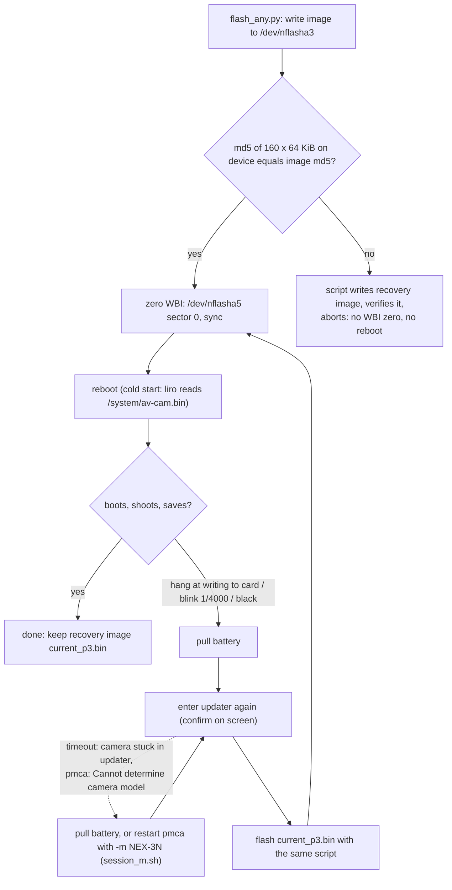

# 05 - Delivery channels and safety

What can be written where, how each write is verified and rolled back, which failures are known, and which writes are forbidden. Areas: `DLV`, `SAFE`, `TOOL`.

Conventions
- Schema and statuses: `00-index.md`. Experiments are `E-` IDs in `06-experiment-log.md`; review items `R-` are in the same file.
- Source shorthands: `WP:` = `WorkPersonal/reference/`, `NR:` = `nex3n-research/notes/`, `L§n` = section n of `_extract/L-linux-grain-recon.md` (static recon of 09.10.2026, no camera access), `E-web` = `_extract/E-web-research.md`.
- IDs of other areas are temporary and written `tmp:<ID>` (`A-` = system/boot/delivery extract, `C-` = backup/colour/tone extract); the agent that writes 01/02/03/07 renumbers them. Final IDs in this page are `C-DLV-`, `C-SAFE-`, `C-TOOL-`.
- This page documents risk; it does not authorise a write. Rules written in capitals are the owner's standing rules.

## 0. Current state of the camera (as of 2026-10-09)

| item | state | evidence |
|---|---|---|
| p3 `/system` | `current_p3.bin`, md5 `d7cca4469709a8b50bc5ad6efa34aa13` (identical to `work/tone/p3_fit.bin`): stock p3 plus film tone curve k0 (Contrast -3) in av-cam at `0x5b006a..0x5b0869` (1093 B differ from stock); no hooks, no grain, `idt_cam` stock | E-0022, E-0034, E-0066 (device md5 MATCH after the last restore); file md5 re-computed 2026-10-09 (C-SAFE-008) |
| p5 WBI | first sector zeroed by the last flash (E-0066) | C-DLV-009 |
| p8 `/usr` | stock; no p8 flash log exists in the experiment log (whether a modified p8 was ever written is stated inconsistently in the old notes, see C-DLV-012) | 06-experiment-log.md (no p8 entry) |
| p2 `/setting` | stock layout in the stock dump: `/setting/mode/` is an empty directory (no `dmode`), `/setting/updater/` has `comp` (0 B) and `dat4` (2 B); the empty `updater/mode` created on 05.10 was consumed at boot (E-0021); `gtest.bin` test files deleted (E-0034) | editor re-check of `nflasha2_unpacked`; E-0021, E-0034 |
| Backup colour | v5 written to `0x00030001` and mirror `0x00030008`: Standard native, Vivid = Portra 400, Portrait = House, Landscape = UltraMax 400, Sunset = Phoenix II | E-0020; `C-COL-033` |
| Backup `0x00030106` | ladder step 5 (+0xb6) RETURNED TO 80 (original) on 04.10; the old note still saying "32" and "A/B pending" is stale | E-0008, E-0009, R-8 |
| Backup other | the 16 `0x0107xxxx` flags tested on 04.10 were written back to the 3N values one by one; two mode flags `0x0051000f`, `0x00510014` and the checksum differ from the first read as a side effect of updater mode | E-0002, E-0007 |
| not executed | `v6_*` colour blobs, NR-1..NR-4, SH-1/2, PE-1, SF probes, `3007a` tone modes: prepared, never written | 06-experiment-log.md "Prepared but not executed" |
| Backup `0x00bd*` (ODL tables) | stock; never written; `0x00bd0003` all zero (debug off) | C-MOD-036, C-MOD-038 |
| boot-chain files on p2 | `/setting/mode/` empty (no `dmode`), no `/setting/env.txt`, no `/setting/sen/`; `kemco.txt` stock | F; C-BOOT-028..040 |
| live-read tools | senser scripts (`smem.py`, `sread.py`, `ssurvey2.py`, …) recovered 2026-10-09 from an old scratchpad into `~/nex3n-dump/work/scratch_rescue_f8f2a405/` (C-TOOL-009) | C-TOOL-005, C-TOOL-009 |

## 1. Channels

Verdict: ALLOWED = written many times, rollback proven; CONDITIONAL = works, extra care; DOES NOT DELIVER = works but the change does not survive; FORBIDDEN = owner's rule, no recovery known.

| # | channel | reaches | verdict | tool / script | procedure (details in section 2) | verification | rollback | known failures (section 3) | claims |
|---|---|---|---|---|---|---|---|---|---|
| 1 | Backup via updater shell (`bk r/w/s/patch`) | Backup properties incl. `0x0003xxxx` colour/tone/NR tables | ALLOWED for the blocks of C-SAFE-001/002 rules | `~/nex3n-dump/work/pmca/session.sh` (updatershell via FIFO `cmd`, output `live.log`, `run.py updatershell -d libusb`), pmca venv `~/nex3n-dump/work/pmca/venv`; block hex and originals in `~/nex3n-dump/work/bk/` | read `bk r <id>`, compare with `<id>_orig`, `bk w` (both banks where a twin exists), `bk s`, reboot | `bk r` after write equals written (tool prints Success with readback) | write the original bytes back per block; snapshots `~/nex3n-dump/Backup*.bin` | updater entry timeout; protected blocks rewrite the whole Backup (E-0002) | C-DLV-017, C-SAFE-001, C-SAFE-002, C-SAFE-008 |
| 2 | Backup via senser (serviceshell, AdjustControl `0x603`) | same Backup | CONDITIONAL (same store; used for reads) | pmca `serviceshell` | needs USB Mass Storage set explicitly | readback | as channel 1 | MTP reset after reboot | C-DLV-001, C-DLV-002 |
| 3 | `/setting` (p2, vfat rw) as files via senser FileControl or updater `/setting` mount | `/setting`: `Backup.bin`, `mode/`, `updater/`, `DmmConfig.bin`, `kemco.txt`; ODL slot-6 files (`/setting/<name>.bin`, C-MOD-039) | CONDITIONAL; boot-steering files: `kemco.txt` NEVER (C-BOOT-040); `mode/dmode` only exactly `"3\n"` or absent (C-SAFE-015); `env.txt` without `LD_*`/`PATH`/bare words (C-BOOT-034, C-LNX-012); `updater/mode` only as the planned insurance test (Q-39). Write from the updater shell, which does not depend on these files (C-BOOT-037) | senser `writeFile('/setting/...')` (scripts of the old scratchpad, not on disk, C-TOOL-005) | write, read back | readback MATCH (E-0034, E-0036) | delete / rewrite the file the same way | `/system`, `/usr`, `/android`, `/info`: error 130 | C-DLV-005, C-DLV-014..016 |
| 4 | RAM write (senser `writeMemory`, `/dev/mem`) | live DRAM incl. av-cam text (phys = VA - 0x40000000) | DOES NOT DELIVER | senser | n/a | readback MATCH inside the session | n/a (power cycle) | patch lost when service mode ends (3 confirmations); large writes into pipeline buffers drop the USB link | C-DLV-004 |
| 5 | p3 raw write, narrow (only inside av-cam, LZPT block table unchanged; 38 sectors 8849-8886) | `/system/av-cam.bin` regions (tone curve k0) | ALLOWED (done once, 05.10) | updater shell raw write; rollback `work/tone/p3_orig_sect_8849.bin`; no script/log survives (R-13: content inferred from a later live read, so this precedent is weaker than channel 6) | write only changed sectors, save WBI sector 0, zero WBI | live av-cam differs from stock only in the target range (E-0034) | rewrite `p3_orig_sect_8849.bin` + WBI zero | none recorded | C-DLV-010; preferred for any av-cam hook that fits inside av-cam sectors, because it leaves kernel/initrd untouched (R 6-C, C-DLV-011) |
| 6 | p3 raw write, whole partition (`flash_any.py`) | `/system`: `av-cam.bin`, `idt_cam.bin`, kernel, initrd | CONDITIONAL: 28 logged flashes, 0 bricks, but an interrupted write would hit kernel and initrd (C-DLV-011) | `~/nex3n-dump/work/pmca/flash_any.py  /dev/nflasha3 <recovery>`; images built by `~/nex3n-dump/work/nopcore/build_nopcore.py`, `build_skipov.py`, `~/nex3n-research/code/grain/build_set.py`; writer `~/nex3n-dump/work/lzpt_write.py` | build, verify offline, enter updater, flash, md5 whole partition, zero WBI, reboot | device md5 == image md5 (script); then shoot test frames | flash the recovery image `current_p3.bin` with the same script (E-0059, E-0066) | updater timeout, "writing to memory card" hang, missing `usb` module, fork-bomb of the LZPT writer | C-DLV-007, C-DLV-008, C-DLV-009, C-DLV-011, C-SAFE-003, C-SAFE-008, C-TOOL-001..003 |
| 7 | p5 WBI first sector zero (`dd if=/dev/zero of=/dev/nflasha5 bs=512 count=1`) | warm-boot snapshot | ALLOWED only as the last step of channel 5/6 | inside `flash_any.py` | after a verified p3 write | n/a | none needed (snapshot is rebuilt) | no control run without zeroing exists | C-DLV-009 |
| 8 | p8 raw write (`/usr`: `im.elf`, `bootin.elf`, libs, menu strings) | userland | FORBIDDEN | none | none | none | the notes disagree whether the updater would repair a bad p8 (C-SAFE-005 vs C-SAFE-006); never tested | n/a | C-DLV-012, C-DLV-013, C-SAFE-005, C-SAFE-006 |
| 9 | p1 (Loader2 + updater kernel), Loader2 config (Backup `0x00FA0080`), p4/p6/p7/p10/p12 (roles unknown) | boot chain | FORBIDDEN: not recoverable without opening the camera (jumper/UART) | none | none | none | none | n/a | C-BOOT-015, C-BOOT-021, C-SAFE-005 |
| 10 | Linux-side steering via p2 (`/setting/mode/dmode` + `/setting/env.txt` -> `putenv`, `LD_PRELOAD`) | env of the whole Linux boot tree | `LD_PRELOAD`: FORBIDDEN (frozen; a failed preload kills every exec, C-LNX-012, jumper-only recovery). `dmode="3\n"` + harmless `env.txt` (no `LD_*`): statically low risk (C-SAFE-015) but gives nothing for the goal without a preload | updater shell (`/setting` rw, C-DLV-019) | see section 5 | `/proc/<pid>/environ` via senser | `rm /setting/mode/dmode /setting/env.txt` from the updater + WBI zero + cold boot | any `'0'`/`k`/`d`/`e`/`g`/`l`/`w`/`s` in dmode = brick-level (C-BOOT-029, C-BOOT-030) | C-BOOT-028..034, C-LNX-012, C-SAFE-013, C-SAFE-015 |
| 11 | SA module from `/setting/` via ODL (one byte of `0x00bd0002`: dir_slot of the file-id → 6; file `/setting/<name>.bin`) | one `sa_*.bin` (e.g. `sa_yknr`) | NOT TESTED; CONDITIONAL (first test with a byte-identical stock copy, Q-37) | channel 1 (`bk w 00bd0002`) + channel 3 (file) | read `0x00bd0002`, save it, write the one byte, put the file, `bk s`, WBI zero, cold boot | ODL log / effect still works; for a modified copy: the frame | write the byte back (`00`) from the updater; the stock `/usr/sabin` copy is untouched | missing/rejected file → that module's OPEN fails → capture sequence error (C-MOD-044); when ODL re-reads the table is unknown (C-MOD-045) | C-MOD-035..045 |

Channel 4 never reaches a capture: leaving service mode or an auto power-off reboots the camera and reloads av-cam from flash (E-0033, E-0035). Channel 3 cannot write `/system` or `/usr` (E-0034, E-0036), which is why code delivery goes through channel 6.

## 2. Procedures

### 2.1 Backup write (channel 1)
1. Charged battery (C-SAFE-010). `pkill -9 -f ptpcamerad` before any libusb/MTP access (`session.sh` does it). Start `~/nex3n-dump/work/pmca/session.sh` (or `session_m.sh` for `-m NEX-3N`); the camera asks for confirmation on its screen (C-DLV-018).
2. `bk r <id>` and compare with the original (`~/nex3n-dump/work/bk/<id>_orig.txt`, e.g. `00030001_orig.txt`, `00030008_orig.txt`, `30106_orig.txt`).
3. `bk w <id> <hex>`; for blocks with a twin bank write both identically (`0x00030001` and `0x00030008`; `C-BK-004`). Blocks without a twin: `0x30033`, `0x30040`, `0x30049`, `0x3004a`, `0x30106`, `0x3007a`, `0x3010a` (`C-BK-005`).
4. Protected blocks (attribute 01) go through `bk patch`, which rewrites the whole Backup and changes the checksum and two mode flags as a side effect (E-0002).
5. `bk r` again (must equal what was written), `bk s`, leave the updater; reboot is needed before the values are certain to apply (`C-BK-002` says an immediate RAM copy exists for cached `0x0003` blocks, `C-BK-003` says a reboot is needed; the sources conflict, so reboot).
6. Rollback: write the original bytes of each touched block; keep a whole-file snapshot (`~/nex3n-dump/Backup_pre-*.bin`) taken before the session.

### 2.2 p3 raw write (channels 5/6)
1. Preconditions: charged battery; Power Save at 30 min (the 05.10 session stopped on flat batteries, C-SAFE-010); recovery image at hand: `~/nex3n-dump/work/nopcore/current_p3.bin` (md5 `d7cca446...`); image is exactly 10,485,760 B (padded with `0xFF`).
2. Build the image offline. Builders (`~/nex3n-dump/work/nopcore/`) take the clean film-curve av-cam `sys_avcam.bin` (md5 `58809e0255a34e21c077fe49935a7408`) and the inner FAT image `work/out3n/nflasha3_unpacked`, patch `idt_cam` (inner `0x980e00`) or av-cam (inner `0x8e00`), repack with `lzpt_write.write_lzpt`, pad, and assert after a decompress that the patch survives and the rest is unchanged. They must run under `if __name__ == "__main__":` (the LZPT writer uses a process pool, C-TOOL-001).
3. Flash from `~/nex3n-dump/work/pmca`: `SUDO_ASKPASS=./askpass.sh sudo -A env DYLD_LIBRARY_PATH=/opt/homebrew/lib venv/bin/python flash_any.py  /dev/nflasha3 <recovery>` (C-TOOL-002). The script enters the updater itself; confirm on the camera screen within 30 s.
4. The script pushes the image with `writeFile('/dev/nflasha3')`, runs `sync`, computes `dd if=/dev/nflasha3 bs=65536 count=160 | md5sum` (the whole 10 MiB partition) and compares. On mismatch it writes the recovery image, verifies it and aborts without WBI zero and without reboot. On match it zeroes the first sector of `/dev/nflasha5` and prints "Safe to reboot". It does not reboot the camera.
5. Reboot (cold start). Shoot test frames; judge with the saved JPEG, not the preview.
6. Rollback: the same script with `current_p3.bin` as image.
Flashes of this kind: E-0038..E-0066 (28 whole-partition p3 flashes including two restores), no brick (C-SAFE-003). The 28/0 record covers changes of av-cam / idt_cam *content*; the kernel/initrd bytes rewritten by every whole-partition flash were never the thing under test (R 6-C, C-SAFE-014).
7. Geometry rule for any canvas hook (C-PIPE-024): `YCC_FULL` is 4912 wide, stride `0x2660` (9824 B); the 4928-wide geometry belongs to per-stage session copies (C-MEM-005, C-MEM-009, R 4-F).

### 2.3 Reading and RAM (channel 4 and senser reads)
Set USB to Mass Storage explicitly, enter service mode, authenticate with the generic keys, `readMemory` (C-DLV-001, C-DLV-002). A read does not reboot the camera (C-DLV-003). The interactive terminal ends only by host-side SIGINT. After a session, a power cycle is needed for a clean re-entry.

## 3. Known failures and what to do

| symptom | cause / observation | action | evidence |
|---|---|---|---|
| updater entry not confirmed on the screen within 30 s | the script gives up, but the camera still goes to updater; the next pmca run cannot read the model: "Cannot determine camera model" (`Exception: Unknown error` after a failed `PULL` produced the same stuck state) | pull the battery and cold start (proven: E-0037, E-0056); alternative per note: restart pmca with `-m NEX-3N` (`session_m.sh`), not separately confirmed | E-0037, E-0056, `C-DLV-018` (C-DLV-018), C-SAFE-011 |
| after any reboot USB is MTP again | the USB mode resets to MTP/Auto; senser/service mode needs Mass Storage (set three times in one session) | set Mass Storage again; `pkill -9 -f ptpcamerad` before MTP calls | E-0027, C-DLV-002 |
| after a shot: "writing to memory card" never ends | a NOP/broken idt_cam build stalls the save | pull the battery; the pending frame is saved after the reboot ("after reboot it saved") | E-0054, C-SAFE-007 |
| live view blinks at 1/4000 f/16, black screen at focusing, saving hangs | an idt_cam overlay stub skipped (the ARM waits for the overlay) | flash `current_p3.bin` | E-0063..E-0065 |
| "hangs on trying to focus; lets me shoot; dies", black luma, white screen | NOP of ranges mixing scalar code, pools and data | battery pull, flash `current_p3.bin` | E-0055, E-0057, E-0058 |
| first flash attempt: camera not visible / switch to updater timed out | camera asleep, USB timeout, confirmation missed | repeat; the second attempt succeeded each time (E-0052, E-0056); earlier Backup attempts failed with USB timeouts (live15-18) | E-0012, E-0052, E-0056 |
| `ModuleNotFoundError: usb` | run from a scratchpad copy outside the pmca venv | run inside `~/nex3n-dump/work/pmca` with `venv/bin/python` | E-0060 |
| the builder spawns processes without end (fork bomb on macOS) | `lzpt_write` uses a multiprocessing pool; spawn start method | guard the entry point with `if __name__ == "__main__":` | E-0050, C-TOOL-001 |
| writeMemory of hundreds of KB into live buffers | USB link drops (reconnect window); redraw overwrites the data | do not write pipeline buffers; RAM patches do not deliver anyway | E-0030, C-DLV-004 |
| the patch is gone at the next shot | leaving service mode reboots the camera and reloads av-cam | deliver by flashing p3 | E-0032, E-0033, E-0035 |
| flat battery stops the session | no write possible mid-session | charge first | `C-SAFE-010` (C-SAFE-010) |
| `/system`, `/usr` files cannot be written | FileControl error 130; vfat mount of `/dev/nflasha3` fails (raw LZPT) | use the raw write (channel 6) | E-0034, E-0036, E-0037 |

## 4. Backup blocks: forbidden and conditional

### 4.1 NEVER TOUCH
| block | what | why |
|---|---|---|
| `0x00030002` | white-balance calibration of this body | per-unit calibration |
| `0x00bc0000`, `0x00bc0002`, `0x01320000` and everything `0x00bc*`, `0x0132*` | defect-pixel maps | per-unit calibration |
| every `0x0003` block with attribute 0x0a ("protected from reset") and 0x48/0x68/0xe8/0x60: `0x00030036/37/38` (sjob_LightLvAdj, lga_ave_*), `0x00030042/43`, `0x00030051..54`, `0x76..78`, `0x86`, `0x8f`, `0xa0`, `0xae`, `0x0102` | lens shading, sensor calibration | per-unit data (general tables carry attribute 0x08, `C-BK-007`) |
| `0x00030056` | shared debug block (forced ISO for the whole NR, log switches), read by dozens of modules | last resort only (C-MOD-033) |
| `0x00030024` | KKNR table (skin smoothing, per `C-NR-008`) | meaning not decoded |
| `0x0003004c` YKNR table fields | meaning not decoded | |
| `0x00FA0080` | Loader2 load list (bootloader data) | brick risk (C-SAFE-013, `C-BOOT-021`) |
| `0x00bd0001` (ODL directory prefixes) | slot 0 → `/setting/` redirects all 77 slot-0 files (3.9 MB, does not fit p2) | every SA module fails (C-MOD-044) |
| `0x00bd0003` byte 0 = `0xbd` with byte 0xa bit 4 | forces every ODL file to load from the card | all modules depend on the card (C-MOD-038) |
| `0x00bd0002` | allowed only: byte `8*file-id + 5` of one row (dir_slot 0 ↔ 6), after reading the whole block | C-MOD-044 |
| p2 files (not Backup): `kemco.txt`, `mode/dmode` (except `"3\n"`), `env.txt` with `LD_*` | kernel cmdline; boot stage; preload | brick-level (C-BOOT-029, C-BOOT-040, C-LNX-012) |

### 4.2 Written on the camera, camera kept working
`0x00030001` + `0x00030008` (colour; v1..v5, tag matrices, byte tests, zeroed hue record); `0x00030106` (one experiment, restored); the 16 `0x0107xxxx` flags (E-0003..E-0007); the p3 tone-curve region (channel 5). Designed but never run: NR-1..NR-4, SH-1/SH-2, PE-1, SF probes, tone modes 1/2, `v6*` (`C-NR-010`, `C-NR-011`, `C-NR-016`, `C-NR-022`, `C-FX-020`, `C-TONE-019`, `C-COL-034`).

### 4.3 Rules inside writable blocks
- `0x0003010a` (Soft Focus): touch only `+0x00..+0x08`. Never `+0x09` (forced level), `+0x42..+0x47` and `+0x84..+0x8B` (read by SPICA), never the four kernels (shared by 3 levels). DSP limits: each of the 4 kernels sums to exactly 256 else DSP error `0xeeee0008/09`; each level byte <= 64 and the three level bytes sum <= 64 else `0xeeee0004` (C-MOD-021). No bank B.
- `0x0003007a` (tone): do not write blind `+0xD2..+0xD6`, `+0xE0..+0xE3`, `+0xE6` (they feed hardware registers). In mode 2 do not override the base gamma (`+0xD9`, `+0xE7` must stay `FF`): an empty base row makes the capture path fall back to the Backup LUT (probably a dark linear frame). No bank B.
- Phoenix/Sunset slot (r4 of the colour block): the Q1/Q3/Q5 quads hold the marker `80 80 80 80`/zeros; later looks deliberately do not touch them.
- Do not combine `v6_phoenixsky` and `v6_kodakwarm` in one write.
- `0x30033` +0x00 (lens shading master gate) is described but not recommended; the menu item "Shading Comp." is safer.
- Rule of every plan: read first, compare with the original, write both banks where a twin exists, read back, original bytes are the rollback.
(from `C-FX-015..021`, `C-TONE-015..021`, `C-COL-035/037`; evidence level in C-SAFE-002)

## 5. Linux path (CPU0 userland) - risks (revised 2026-10-09 from extract F, static)

What the static reads found (nothing was written to the camera):
- `/sbin/init` opens `/setting/mode/dmode`; if the file exists (any content, even empty) it parses `/setting/env.txt` (`putenv` per `KEY=VAL`, `unsetenv` for a bare word, `#` comments) before forking anything (C-BOOT-028, C-BOOT-034).
- A `'0'` byte anywhere in `dmode` stops init after the mounts: no USB gadget kmods, no `sen.elf`, no `bootin.elf`; console is `ttynull`. No software recovery: jumper only (C-BOOT-029). So `"03"` is brick-level; the earlier recipe (C-BOOT-024, C-DLV-015) is refuted.
- Letters: `k` and `d` preload files that do not exist on p8 → every exec dies; `e` boots under Electric Fence; `g` runs bootin in the foreground and then `gdb`, which does not exist (C-BOOT-030, C-BOOT-031). bootin: last digit wins, default 3; `1`/`2` give no appFw (no UI, no pmca updater switch) (C-BOOT-031).
- `libsonyld.so` kills a process whose `LD_PRELOAD` fails to load (C-LNX-012): a bad preload in env.txt kills bootin, `sh`, im.elf and sen.elf at every cold boot.
- `sen.elf` is started by init only after a service-mode request wrote `/setting/sen/smode` = `"UU"` (C-BOOT-033); senser is not an independent safety net.
- Loader2 enters the updater on the jumper or on the existence of `\updater\mode` (first check, `comp` not read; C-BOOT-035); the updater boot ignores `dmode`/`env.txt` (C-BOOT-037). The E-0021 failure has two explanations (C-BOOT-036); the variant "delete `comp`, create `mode`" is the open insurance test (Q-39).
- WBI: with `0x00510023 = 2` every power-on with a valid snapshot is an ssboot and init does not run (C-BOOT-038, inference); a `dmode`/`env.txt` change acts only after a WBI-invalidating boot and can stay dormant (C-BOOT-039).

Whitelist (C-SAFE-015): `dmode` absent, or exactly `33 0a`. Any other content is forbidden.
Verdict: the Linux grain route (C-LNX-011) is FROZEN: its harmless first step is allowed but useless for the goal, and its useful step (preload) is brick-level until a userland-independent way back is shown (Q-39). `kemco.txt` is never touched (C-BOOT-040).

The p8 `im.elf` patch route (flag file `/setting/avtest`, redirect to `/setting/av-cam.bin`) is a design only and carries the p8 prohibition (C-DLV-013).

## 6. Rollback assets (checked 2026-10-09)

Off-machine copy (2026-10-09): iCloud Drive `nex3n-backup/` — full stock flash dump, bootloader dumps `boot/boot1`, `boot/bootrom`, stock and snapshot Backup files, `current_p3` (md5 `d7cca446…`) and its av-cam; verified against the 2026-10-04 `SHA1SUMS` (6/6 OK) plus an `MD5SUMS` manifest. Private, never published.

| asset | path | md5 / sha1 | use |
|---|---|---|---|
| recovery p3 (current) | `~/nex3n-dump/work/nopcore/current_p3.bin` (= `work/tone/p3_fit.bin`) | md5 `d7cca4469709a8b50bc5ad6efa34aa13` (re-computed) | restore after any p3 experiment |
| stock p3 | `~/nex3n-dump/safeboot/out3n/nflasha3` | md5 `37b9727627b91ebeefdc07dcde561036` (re-computed) | back to factory |
| clean film-curve av-cam | `~/nex3n-dump/work/nopcore/sys_avcam.bin` (6,554,072 B) | md5 `58809e0255a34e21c077fe49935a7408` (re-computed) | base of the NOP/skip builders |
| narrow-write sectors | `~/nex3n-dump/work/tone/p3_orig_sect_8849.bin`, `p3_new_sect_8849.bin`, `p5_sector0_before.bin` | md5 `186bf30ffef27869c60fd7deec82559e` (orig, re-computed), `921f2345...` (new, per E-0022) | rollback of the 05.10 tone write |
| full flash dump | `~/nex3n-dump/nex3n_v100_nflasha.bin` (267,911,168 B) | md5 `44606cb67517f523c8a1022618e6a38e` (re-computed), sha1 `ae8ff12d...` | everything stock |
| Backup first read | `~/nex3n-dump/Backup.bin` = `Backup.bak` | md5 `b476ec204c7ed0f410d64f10ea439372`, sha1 `0957fc10...` | first contact |
| Backup snapshots | `~/nex3n-dump/Backup_pre-write.bin` `c0d14de75767db585948f72363f7de4d`, `_pre-test1` `c0a052e1a5cecbc25626fe40a49d25ca`, `_pre-group1` `eae39fcfb1d8795d0dd3d15aee933e2c`, `_pre-group2` `8fe60b8941029765df4e2843a3a8233e`, `_pre-revert` `51850c51d0b5270bf0301d52b660d0b4`, `_post-revert` `fb270c83a7940f5623fc8cd99f759dbf`, `_pre-matrix` `314a63c0197a848cbba46fd6ebf0d68f` | all re-computed | per-block rollback source; none is byte-identical to `Backup.bin` (updater side effects, E-0002) |
| block originals | `~/nex3n-dump/work/bk/00030001_orig.txt`, `00030008_orig.txt`, `30106_orig.txt` | | write-back values |
| bootloader dumps | `~/nex3n-dump/boot/boot1`, `bootrom` | | read-only reference |

## 7. Claims

### 7.1 DLV: delivery

### C-DLV-001: Senser / service mode (PMCA-RE `serviceshell`) authenticates on the NEX-3N with the generic keys and gives live `readMemory(base,size)` / `writeMemory(base,data)` (PFUNC MemoryDump `0xff03`) on ARM physical memory, `FileControl` (`0xff01`: readFile/writeFile/deleteFile), Backup read/write/save (AdjustControl `0x603`) and a terminal
- status: verified-hw
- evidence: E-0027 (auth OK, readMemory of 64 KB, 4 MB and 24 MB, sweeps `0x84000000..0x90000000`), E-0029 (av-cam found at phys `0x83441000`), E-0030 (writeMemory reaches display RAM); scripts of the old scratchpad (C-TOOL-005)
- source: NR:live-memory-and-delivery.md "senser"; WP:nex3n-safe-test-boot.md "ПРОРЫВ", "ПОДТВЕРЖДЕНО ОПЕРАБЕЛЬНО"; C-DLV-001
- date: 2026-10-06
- relates: C-DLV-002, C-DLV-004

### C-DLV-002: Entering service mode requires USB = Mass Storage set explicitly (the USB mode resets to MTP/Auto after every reboot); after a session a clean re-entry needs a power cycle
- status: verified-hw
- evidence: E-0027 (Mass Storage had to be re-set three times in one session)
- source: WP:nex3n-safe-test-boot.md "ПОДТВЕРЖДЕНО ОПЕРАБЕЛЬНО"; C-DLV-002
- date: 2026-10-06
- relates: C-DLV-001

### C-DLV-003: senser `readMemory` does not reboot the camera (it returns to the shooting screen); the interactive terminal exits only host-side by SIGINT (the Ctrl-C byte is not forwarded)
- status: verified-hw
- evidence: E-0051 (senser read after a frame; the camera returned to shooting), E-0027
- source: C-DLV-003; memory note `nex3n-firmware-hack-status.md` (06.10)
- date: 2026-10-07
- relates: C-DLV-001

### C-DLV-004: A senser RAM patch (writeMemory over `Stage_SoftFocus`, or detour cave `0x83a011c0` + trampoline `0x83889772`) never survives to a capture: writing needs service mode, and leaving service mode (or auto power-off) reboots the camera and reloads the stock av-cam; confirmed three times
- status: verified-hw
- evidence: E-0032 (patch gone at the second frame, readback shows original bytes), E-0033 (no JPEG saved, read-back original, av-cam 64/64 stock), E-0035 (DSC09519 high-frequency ratio 1.01 = clean Soft Focus frame). Also: large writes into live buffers drop the USB link (E-0030). Whether the reload comes from the file or from a WBI restore is not distinguished (`C-DLV-004` question 5)
- source: NR:grain-hook.md §3; WP:nex3n-safe-test-boot.md §4b, §4e; C-DLV-004
- date: 2026-10-06
- relates: supersedes the early note "RAM delivery only by editing the file via FileControl"; C-DLV-005; generalised 2026-10-09 (EXP-1) to the MSDump `.bss` switch `0xc3cb22a5` — two stoppers: (A) no capture runs under a live senser/Mass-Storage session ("USB Mode" screen, E-0028/E-0030; no senser shutter command in pmca), (B) leaving the session reloads av-cam (E-0032/E-0033/E-0035) → the switch (default 0) cannot be poke-enabled for a real frame; the code route is C-DLV-022

### C-DLV-005: Senser `writeFile('/setting/...')` works (readback MATCH); `writeFile('/system/...')`, `/usr`, `/android`, `/info` fail with "Senser file control error 130"; direct replacement of `/system/av-cam.bin` through FileControl is impossible
- status: verified-hw
- evidence: E-0034 (`/setting/gtest.bin` OK and deleted; `/system/gtest.bin` error 130; `readFile('/system/av-cam.bin')` works, 6,554,072 B), E-0036 (probe of all mounts: only `/setting` OK)
- source: WP:nex3n-safe-test-boot.md §4d; NR:live-memory-and-delivery.md; C-DLV-005, C-PART-013
- date: 2026-10-06
- relates: refutes the plan "delivery = senser FileControl writeFile of av-cam" (SB §4b/§4c, early memory note); C-DLV-007

### C-DLV-006: The updater shell (OpenMemories `updaterShellCommand`, model fdat `NEX-3N.hdr`/`CXD4132.dat`) switches the camera to updater mode (confirmation on the camera screen) and gives a BusyBox-like root shell with `writeFile` (PUSH), `readFile` (PULL), `shell`, `info`, `bk`, `bootloader`, `bootrom`; `dd`, `md5sum`, `mount`, `cp` are present, `od`, `head`, `id` absent
- status: verified-hw
- evidence: E-0001 (info, pull of the whole block device, bk read), E-0007 (boot1/bootrom read), E-0023, E-0037 (`PULL /system/av-cam.bin` fails with `Unknown error`)
- source: NR:live-memory-and-delivery.md "updater shell"; WP:nex3n-firmware-hacking.md "Как подключаться к камере"; C-DLV-006
- date: 2026-10-06
- relates: C-DLV-007, C-DLV-019

### C-DLV-007: Raw partition write works: `writeFile('/dev/nflasha3', image)` flashes p3 although the file system layer is read-only
- status: verified-hw
- evidence: E-0038..E-0066 (28 whole-partition flashes with md5 verification of the device); E-0037 (`mount -t vfat /dev/nflasha3` -> `Invalid argument`: the device holds the raw LZPT image, not a mountable FAT)
- source: NR:live-memory-and-delivery.md "updater shell"; WP:nex3n-safe-test-boot.md §4f; C-DLV-007, C-PART-014
- date: 2026-10-07
- relates: C-DLV-008

### C-DLV-008: Flash pipeline (`flash_any.py  <device> <recovery>`): (1) build the image offline from the live `/system/av-cam.bin` and the inner p3 image (av-cam at inner `0x8e00`), `lzpt_write`, pad `0xFF` to 10,485,760 B, verify by decompress+compare; (2) updater `writeFile('/dev/nflasha3', img)`, `sync`, md5 of the whole partition (`dd if=/dev/nflasha3 bs=65536 count=160 | md5sum`), restore the recovery image on mismatch; (3) zero the WBI first sector; (4) reboot is left to the operator
- status: verified-hw
- evidence: the script text (re-read by the editor: matches this description, no reboot inside); md5 MATCH lines in 28 flash logs; builders assert the patch after decompress
- source: NR:live-memory-and-delivery.md "Flash pipeline"; WP:nex3n-safe-test-boot.md §4f, §4g; NR:dsp-grain-campaign.md §4, §6; C-DLV-008
- date: 2026-10-09
- relates: C-DLV-009, C-TOOL-002

### C-DLV-009: Zeroing the first sector of p5 (WBI) after a p3/p8 write is required: otherwise the old image is restored from the warm-boot snapshot instead of re-reading `/system/av-cam.bin`
- status: hypothesis
- evidence: every successful flash zeroed WBI first (E-0038..E-0066); no run without zeroing is recorded as a control. Consistent with the load chain: first cold boot reads the file, warm boots restore RAM from p5 (`C-BOOT-018`, itself a hypothesis); a hang plus power cycle returns to the stock file because a crash gives a cold start (`C-BOOT-020`, hypothesis)
- source: NR:firmware-architecture.md "Boot chain and WBI"; WP:nex3n-safe-test-boot.md §2; C-DLV-009
- date: 2026-10-06
- relates: C-BOOT-018, C-BOOT-019

### C-DLV-010: A narrow p3 write (only inside av-cam, LZPT block table unchanged, 38 sectors from sector 8849) is safe and works; the k0 film curve was written that way (rollback `work/tone/p3_orig_sect_8849.bin` + WBI reset); curve k14 would straddle two 64 KiB blocks (`k0 + 14 x 0x800`)
- status: verified-hw
- evidence: E-0022 (grey wedge DSC09509 vs DSC09510; black ~12/255); E-0034 (live av-cam differs from stock only in `0x5b006a..0x5b0869`, 1093 B). No flash log of this write survives (R-13); the fitting step changed the curve by +-1..2 units so that the 64 KiB block compresses to the identical size
- source: WP:nex3n-firmware-hacking.md "ИТОГ 05.10"; C-DLV-010
- date: 2026-10-05
- relates: C-DLV-011, C-TONE-022

### C-DLV-011: A full p3 rewrite as done by `flash_any.py` touches the whole partition including vmlinux and initrd, so an interrupted write is the real risk; mitigation is verify-before-reboot and restore in the same session
- status: hypothesis
- evidence: reasoning; no interrupted write occurred in 28 logged flashes (E-0038..E-0066). A bad av-cam (as opposed to a bad kernel) was always recovered (C-SAFE-003)
- source: NR:live-memory-and-delivery.md "Flash pipeline"; WP:nex3n-safe-test-boot.md §4f; C-DLV-011
- date: 2026-10-09
- relates: C-SAFE-003, C-SAFE-014

### C-DLV-012: A p8 string patch (`share/app/string_english.uxc`, e.g. "Sunset" -> "House " same length, or "Soft Focus" -> "Film Grain") was built offline; it differs from stock in about 140 sectors (9215-9354) because of LZPT repacking; string entry format `[u16 id][00][1e] UTF-8 \0` aligned to 4 B, offsets in 4-byte words, no checksum; "Sunset" id `0x69`, offset `0x2a8c`, 7-char slot. Whether a modified p8 was ever written to the camera is not established
- status: verified-code
- evidence: `share/app/string_english.uxc` string entry "Sunset" id `0x69` offset `0x2a8c`; built test p8 in `work/mod/`; no p8 flash log in the experiment log; the old notes disagree (LM: "the label was renamed", FH/SB: only a built image "House", ST: "flash tomorrow", FH 05.10: "Claude no longer prepares writes to firmware partitions")
- source: WP:nex3n-firmware-hacking.md "Что выяснено"; NR:live-memory-and-delivery.md "Flash pipeline"; NR:grain-hook.md §1; C-DLV-012
- date: 2026-10-05
- relates: C-DLV-013, Q-D

### C-DLV-013: Judged riskier and not done: patch `im.elf` to load `/setting/av-cam.bin` (flag `/setting/avtest`, `unlink`+`sync` before load, zero p5; the new string needs a code cave because `/setting/av-cam.bin` is 19 chars vs 18), redirect the Loader2 table at Backup `0x00FA0080`, serviceshell remount rw
- status: hypothesis
- evidence: design only (never built); p8 is read-only through FileControl (checked for `/system`; an `/usr/bin/im.elf` write is not recorded); a raw write of `/dev/nflasha8` is not recorded as tested
- source: WP:nex3n-safe-test-boot.md §3, §4d, §8; NR:grain-hook.md §3; C-DLV-013
- date: 2026-10-06
- relates: C-SAFE-009, C-SAFE-005

### C-DLV-014: `/sbin/init` parses `/setting/env.txt` (`set_oreore_env` -> `putenv()` per `KEY=VALUE` line, `#` comments skipped) before it forks `bootin.elf`, but only when `/setting/mode/dmode` contains the byte `'0'`; the same scan sets `LD_PRELOAD` to the tool libraries `/usr/tool/libkmcsup.so.2.0.0`, `libduma.so`, `libsonyefence.so` for the letters `k`, `g`/`d`, `e`; stock p2 has no `dmode` and no `env.txt`
- status: refuted (2026-10-09; the stock-p2 part and the putenv mechanism stand)
- evidence: L§3: full symbol table of `init` (not stripped), disassembly of `main` (0x90ad), `check_mode_file` (0x8c61), `set_oreore_env` (0x9c5d), `parse_and_set_env`, order `bl set_oreore_env` at 0x918a before `run_bg_process("/usr/bin/bootin.elf")` at 0x920c. Editor re-check: `strings` of `initrd.img_unpacked/sbin/init` show `/setting/mode/dmode`, `/setting/env.txt` and the three `LD_PRELOAD=` strings; the control flow itself was not re-disassembled; `nflasha2_unpacked/mode/` is an empty directory. Supersedes the earlier hypothesis `C-DLV-014` ("env.txt can influence target/dmode")
- source: L§3; C-DLV-014; C-BOOT-013; F §1.1
- date: 2026-10-09
- relates: C-DLV-015, C-SAFE-013; the gate ("only when dmode contains `'0'`") and the letter map are refuted by C-BOOT-028 (gate = file presence), C-BOOT-029 (`'0'` stops init), C-BOOT-030 (`g` ≠ libduma); the putenv part stands (C-BOOT-034)
- scope: nex3n-fw1.00

### C-DLV-015: A `/setting/mode/dmode` containing the two bytes `"03"` should make `init` take the env path (presence-only scan finds `'0'`) while `bootin.elf` (last matching digit wins) ends at stage `3` = full appFw, i.e. a normal boot with environment variables set
- status: refuted
- evidence: derived from the two independent byte scanners (L§3, `bootin.elf` function 0x9004-0x92c2); never tested on the camera. F §0, §1.1: a `'0'` anywhere makes init skip drivers2, sen.elf and bootin itself, so bootin's "last digit" never runs; `"03"` = kernel + idle shell, no USB (C-BOOT-029)
- source: L§3; F §0
- date: 2026-10-09
- relates: refuted by C-BOOT-029; replaced by C-SAFE-015 (`"3\n"`); C-DLV-014, C-DLV-016
- scope: nex3n-fw1.00

### C-DLV-016: `/setting/env.txt` plus a `dmode` with `'0'` is a p2-only way (no p3/p8 write, no WBI invalidation for the file itself) to set arbitrary environment variables, including `LD_PRELOAD`, for the Linux boot tree up to `im.elf` and the appFw process with `libObj.so`/`libmpr.so`; the custom rtld `/lib/libsonyld.so` honours `LD_PRELOAD`/`LD_LIBRARY_PATH`/`LD_BIND_NOW` (strings; the same mechanism is used for the tool libraries); a preload target on p2 has never been loaded; a still can be re-encoded in-process through `MprLib::DecodeStillOnMemory`/`EncodeStillOnMemory` (address/size API; no hardware codec call traced; `/dev/ldec` is an unexplored lead)
- status: hypothesis
- evidence: L§1-3 (exports of `libmpr.so` confirmed by symbol table; completion of a still write is an internal MPR event, no inotify import in the checked binaries; toolchain GCC 4.3.3 "Sony CE Linux", custom libc `libsonyc.so`, ELF interpreter `libsonyld.so`, so a static libc-free binary is the proposed build); everything about hooking is design
- source: L§1-4
- date: 2026-10-09
- relates: C-DLV-014, C-DLV-015, C-SAFE-013, C-MEM-008 (ARM-side grain does not reach the JPEG); premise corrected 2026-10-09: the env gate is the presence of `dmode` (C-BOOT-028) and the safe content is `"3\n"` (C-SAFE-015); a preload that fails to load is fatal for every exec (C-LNX-012) → route frozen
- scope: nex3n-fw1.00

### C-DLV-017: Backup writes (`bk w` / `bk patch`) return Success with readback verification and survive reboot; protected (attribute 01) blocks go only through `bk patch`, which rewrites the whole Backup; both banks must be written (`0x00030001` and `0x00030008`), then `bk s`
- status: verified-hw
- evidence: E-0002 (null write `01070937=00`: Success, only the checksum and two mode flags differ afterwards, camera "all ok"), E-0007 (16 flags written back individually, `bk r` equal), E-0010..E-0020 (matrices and hue tables written and observed)
- source: WP:nex3n-firmware-hacking.md "Как подключаться к камере", "Состояние камеры на ночь 04→05.10"; C-DLV-017, C-BK-016
- date: 2026-10-05
- relates: C-SAFE-001, C-SAFE-002

### C-DLV-018: Entering the updater from the running firmware asks for confirmation on the camera screen; if not pressed within 30 s the script gives up but the camera still goes to updater, after which pmca cannot read the model ("Cannot determine camera model") and needs `-m NEX-3N`, or a power cycle
- status: verified-hw
- evidence: session behaviour 04.10 (`C-DLV-018`); E-0037 (camera stayed in updater, "a power cycle fixed it"); E-0056 (updater-switch timeout, camera left in updater until battery pull). The `-m NEX-3N` workaround is the note's (`session_m.sh` exists); only the power cycle is recorded as having worked
- source: WP:nex3n-firmware-hacking.md "Как подключаться к камере"; C-DLV-018
- date: 2026-10-07
- relates: C-SAFE-011

### C-DLV-019: The updater-mode Linux is a recovery environment: only USB, storage, memstick, `dmm`, `mcmn_drv` and the MCMND daemon (Backup works) are up; the imaging/SA stack and av-cam are not up, `/system` is empty, `liro.ko` is absent from the updater `/kmod` and fails with unknown symbols when pushed (`Backup_nread*`), `/dev/mem` and `/dev/kmem` exist; `/setting` (nflasha2) is mounted vfat rw; the kernel reports 3 ARMv6 CPUs
- status: verified-hw
- evidence: E-0023 (read-only recon: mounts, `/proc/{partitions,iomem,cmdline,modules,kallsyms}`, `/dev`), E-0024 (`insmod /tmp/liro.ko`: `Unknown symbol Backup_nread`; kallsyms lack `Backup_write`, `acre_tsk`, `osal_snd_sync_msg`, `buddy_init_pool`, `loc_cpu`, `os_this_cpu`). The "zero-flash test route" `insmod liro.ko fn=/setting/av-cam.bin` from the updater (`C-BOOT-011`) is therefore refuted
- source: WP:nex3n-safe-test-boot.md "Live-разведка окружения апдейтера", "Пункт 2 проверен на железе"; C-LNX-010, C-BOOT-010
- date: 2026-10-06
- relates: C-DLV-020

### C-DLV-020: Changing what the SA engine or the av-cam RTOS does requires a raw write of p3 (or p8): the SA engine runs only under the full firmware (kernel symbols plus av-cam RTOS), RAM patches are lost (C-DLV-004), and `/system`, `/usr` are not writable as files (C-DLV-005)
- status: verified-hw
- evidence: C-DLV-019, E-0024, E-0032..E-0036; by elimination, not by a direct test of every alternative. The older claim "write of p3/p8 = irreversible brick" (`C-DLV-020` relates) is contradicted by C-SAFE-003. Linux userland is the possible exception (C-DLV-016, untested)
- source: WP:nex3n-safe-test-boot.md "Итог по стенду (решающий)"; C-DLV-020
- date: 2026-10-06
- relates: C-DLV-004, C-DLV-005, C-SAFE-003

### C-DLV-021: The NEX-3N does not support PlayMemories Camera Apps, so there is no Android/PMCA app route; the only code-execution routes are the updater shell, the service shell and the Linux side
- status: hypothesis
- evidence: fwtool `devices.yml` has `NEX-3N: arch CXD4132, model 0x31030022` without an `apps` key while NEX-5R/5T/6 have `apps: '1.1'` (read by the web-research pass; not re-fetched by the editor); Sony's support list (article 00289030) returned 403, so that half is a search snippet only
- source: E-web D1
- date: 2026-10-09
- relates: C-DLV-006

### C-DLV-022: MSDump of a late YC canvas (the SACC consumer's handle `[session+0x39d8]` — whether it is the encode-input is the EXPERIMENT's result, not assumed) is forced on a real capture by a code patch of the SACC consumer `0xc361b8ce`, delivered by a channel-6 p3 flash (the RAM/senser-poke enable does not survive to a capture, C-DLV-004)
- status: verified-code (patch site + gate analysis by disasm; the image was not built or flashed, so the dump effect is untested — hypothesis)
- evidence: consumer `0xc361b8ce` (file `0x1da8ce`, p3-inner `0x1e36ce`); outer gate `beq 0xc361b964` @ `0xc361b8d4` (file `0x1da8d4`, bytes `46 d0`) tests `[cap_obj+0x19]` (`cap_obj` literal `0xc3ac1f94` @ `0xc361b464`, `.bss`, byte `0xc3ac1fad`; full-image symbolic scan = 0 writers, 1 reader → default 0 blocks the dump); inner gate `cmp r0,#4; beq 0xc361b8f2` @ `0xc361b8de`/`0xc361b8e0` (file `0x1da8e0`, bytes `07 d0`); reader `bl 0xc346e4be` (file `0x2d4be`). Patch A `0x1e36d4` `46 d0`→`c0 46` (Thumb-1 NOP `mov r8,r8` — NOT the Thumb-2 `00 bf`: the av-cam core is Thumb-1 only, C-SYS-004, and the firmware's own NOP is `c0 46`, 694 occurrences; nops the outer gate, preserving `ldr r4,[r6]` the dump path needs), patch B `0x1e36e0` `07 d0`→`07 e0` (force idx1==4 → dump). Optional patch C `0x3b3bf4` `13 d0`→`c0 46` forces the SEPARATE YKNR before/after dump via its own `.bss` flag `0xc3ac2020` (handle `[session+0x39e2]`) → 5 bytes total, 3 snapshots/frame (post-SACC + pre/post-YKNR, ~92 MiB). Base = film-curve `sys_avcam.bin` (byte-identical to stock at both sites); delivery channel 6 (channel 5 narrow only if an offline recompress shows an unchanged LZPT block size); offline assert decompresses and checks exactly the 3 bytes changed. A twin SACC consumer at `0xc361b1e8` under the same flag is patched symmetrically only if both sites must fire
- source: Phase-0 opus RE 2026-10-09 (EXP-1 patch design, Q-10)
- date: 2026-10-09
- relates: resolves the "not fully traced" second gate of C-MOD-032; realises the code route of Q-10 (the RAM-poke route is ruled out by C-DLV-004); delivery C-DLV-008, C-DLV-011; verify-before-reboot C-DLV-010
- scope: nex3n-fw1.00

### 7.2 SAFE: safety and rollback

### C-SAFE-001: NEVER-TOUCH Backup blocks: `0x00030002` (white-balance calibration of this body), `0x00bc0000/0002` and everything `0x00bc*`, `0x01320000` and everything `0x0132*` (defect-pixel maps), all `0x0003` blocks with attribute 0x0a/0x48/0x68/0xe8/0x60 (lens shading and sensor calibration), `0x00030056` (debug block, last resort), `0x00030024` (KKNR), the YKNR table `0x0003004c`, and the Loader2 load list `0x00FA0080`
- status: hypothesis
- evidence: the owner's rule from block analysis; no experiment tests a violation (nothing was written to these blocks). The attribute rule (0x0a = protected from reset, per-unit data; general tables 0x08) is `C-BK-007`
- source: WP:nex3n-backup-params.md; WP:nex3n-film-effects-plan.md §0; WP:nex3n-morning-2026-10-06.md; README.md (research repo); C-SAFE-001; C-BK-007, C-BK-008
- date: 2026-10-04
- relates: C-SAFE-002, C-MOD-033

### C-SAFE-002: Sub-range prohibitions inside otherwise writable blocks: `0x0003010a` only `+0x00..+0x08` (never `+0x09`, `+0x42..+0x47`, `+0x84..+0x8B`, never the kernels; DSP checks: kernels sum to 256 else `0xeeee0008/09`, level bytes <= 64 and sum <= 64 else `0xeeee0004`); `0x0003007a` not blind `+0xD2..+0xD6`, `+0xE0..+0xE3`, `+0xE6`, and in mode 2 `+0xD9`, `+0xE7` stay `FF`; the Sunset slot marker quads untouched; `v6_phoenixsky` and `v6_kodakwarm` never in one write
- status: hypothesis
- evidence: plans and DSP-side checks from the ISA note (C-MOD-021); none of these writes was executed (06-experiment-log.md "Prepared but not executed"); the `+0x42..+0x47`/`+0x84..+0x8B` prohibition is "read by SPICA" per `C-FX-015..019`
- source: WP:nex3n-film-effects-plan.md appendix; WP:nex3n-symbols-and-names.md §7.2; WP:nex3n-night-extra.md §1.3, §2-3; WP:nex3n-colour-v6.md
- date: 2026-10-05
- relates: C-SAFE-001, C-MOD-021

### C-SAFE-003: A bad av-cam does not brick the camera: Linux and the updater path are on other partitions; a broken av-cam (Soft Focus stage replaced wholesale -> crash after the preview; diagnostic build; hung NOP builds; overlay skips) was always recovered by flashing the previous p3 image: 28 whole-partition p3 flashes (E-0038..E-0066) with zero bricks
- status: verified-hw
- evidence: E-0039 (photo not saved, power cycle), E-0054..E-0058, E-0060, E-0063..E-0065 (battery pull needed), restores E-0059 and E-0066 (device md5 MATCH). Each recovery needed a camera that still booted far enough to accept the updater request over USB (E-0055 "dies", alive after the battery pull). The claim "writing p3/p8 = irreversible brick" in the early memory note is contradicted for p3
- source: NR:live-memory-and-delivery.md "Flash pipeline"; NR:dsp-grain-campaign.md §6; NR:grain-hook.md §3; C-SAFE-003
- date: 2026-10-09
- relates: C-SAFE-014, C-SAFE-005, C-SAFE-006

### C-SAFE-004: The file flag `/setting/updater/mode` does not enter the updater: an empty `mode` created next to the existing `comp`, then battery pull and cold start, booted normally and the flag was consumed (`mode` absent after the boot)
- status: verified-hw
- evidence: E-0021 (live29/live30 logs). Conflicts with the Loader2 code reading (`C-BOOT-015`: the updater is entered by jumper or the file `\updater\mode`). Only one variant was tried (R-11): "delete `comp`, create `mode`" was not; the file content/format may be wrong
- source: WP:nex3n-firmware-hacking.md "05.10 — страховка через /setting/updater/mode НЕ работает"; C-SAFE-004
- date: 2026-10-05
- relates: C-SAFE-005, C-BOOT-015; the observation stands, the general conclusion is contested: Loader2 enters on existence of the file and does not read `comp` (C-BOOT-035), and both the updater (`comp` present → delete `mode*`) and the main firmware delete `mode*` (C-BOOT-036); Q-39
- scope: nex3n-fw1.00

### C-SAFE-005: If p8 breaks, the camera cannot be recovered programmatically (the updater is reached only by jumpers or the `\updater\mode` file, which only the main firmware or the updater can create); only opening the camera (jumper/UART) helps
- status: hypothesis
- evidence: Loader2 code reading (`C-BOOT-015`) plus the failed file-flag test (C-SAFE-004); no p8 failure test exists. Conflicts with C-SAFE-006
- source: WP:nex3n-firmware-hacking.md "Восстановление", "ИТОГ 05.10"; C-SAFE-005
- date: 2026-10-05
- relates: conflicts C-SAFE-006; Q-A; refined by C-BOOT-035/036 (the file route works by code, but needs a live process to create the file) and C-BOOT-033 (senser needs appFw's request)

### C-SAFE-006: A broken p8 `im.elf` patch keeps USB/updater access, because entering the updater is decided by Loader2 and the updater kernel lives on p1; p8 would be repaired by flashing p8 from the updater; fatal only for corruption of p1 (updater kernel + initrd) or Loader2
- status: hypothesis
- evidence: reasoning only, no p8 failure test; in tension with the observation that p3 (initrd + kernel) was rewritten 28 times without trouble while the note lists it as "fatal". The updater entry itself needs a firmware that still accepts the USB request (C-DLV-018), which a broken `im.elf` may prevent
- source: WP:nex3n-safe-test-boot.md §5; C-SAFE-006
- date: 2026-10-04
- relates: conflicts C-SAFE-005; Q-A; supported in part by C-BOOT-037 (updater boot independent of p8 userland files)

### C-SAFE-007: A hung build (NOP-ed or broken idt_cam) stalls the "writing to memory card" step; a battery-pull reboot clears it and flushes the pending frame; NOP and skip images are recoverable
- status: verified-hw
- evidence: E-0054 ("after reboot it saved", frame DSC09556 normal), E-0055, E-0057, E-0058 (battery pull needed), E-0063..E-0065; recovery E-0059, E-0066
- source: NR:dsp-grain-campaign.md §4; C-SAFE-007
- date: 2026-10-07
- relates: C-IDT-008, C-SAFE-003

### C-SAFE-008: Recovery images and hashes: stock p3 md5 `37b9727627b91ebeefdc07dcde561036`; current p3 `current_p3.bin` md5 `d7cca4469709a8b50bc5ad6efa34aa13`; clean film-curve av-cam `sys_avcam.bin` md5 `58809e0255a34e21c077fe49935a7408`; full flash dump md5 `44606cb67517f523c8a1022618e6a38e`; Backup snapshots and block originals as in section 6
- status: verified-code
- evidence: all md5 values re-computed by the editor on 2026-10-09 from the files named in section 6 (stock p3, `current_p3.bin`, `sys_avcam.bin`, the dump, `p3_orig_sect_8849.bin`, the eight Backup files)
- source: WP:nex3n-safe-test-boot.md "ПЛАН: прошивка дампера" Страховка; memory note `nex3n-firmware-hack-status.md` (09.10); C-SAFE-008
- date: 2026-10-09
- relates: C-SAFE-003, C-DLV-008

### C-SAFE-009: A one-shot test-boot harness (flag file `/setting/avtest` consumed with `unlink`+`sync` before loading, zero p5, `fn=/setting/av-cam.bin`, dmode=2 isolation, `bk w 00510023 00` to stop snapshots) would limit crash-loop risk
- status: hypothesis
- evidence: design only, never implemented; depends on unverified `C-BOOT-019` (Backup `0x00510023` gates snapshots), `C-BOOT-011` (refuted, C-DLV-019) and C-DLV-013
- source: WP:nex3n-safe-test-boot.md §3, §4, §8; C-SAFE-009
- date: 2026-10-04
- relates: C-DLV-013, C-SAFE-013

### C-SAFE-010: Write only with a charged battery and Power Save raised to 30 min; flat batteries stopped the 05.10 session; `pkill -9 -f ptpcamerad` before MTP/libusb calls
- status: hypothesis
- evidence: session anecdote (FH "Пауза 05.10"); `session.sh` contains the `pkill`
- source: WP:nex3n-firmware-hacking.md "Пауза 05.10"; C-SAFE-010
- date: 2026-10-05
- relates: C-DLV-018

### C-SAFE-011: Failure states of the updater entry: (a) confirmation not pressed within 30 s -> camera stays in updater and pmca reports "Cannot determine camera model"; (b) a failed `PULL` (`Exception: Unknown error`) leaves the camera in updater; both were cleared by a power cycle (battery pull); (c) the first flash attempt after a long idle fails ("camera not visible") and the retry works
- status: verified-hw
- evidence: E-0037, E-0052, E-0056, E-0012 (live15-18 USB timeouts); C-DLV-018
- source: WP:nex3n-firmware-hacking.md; NR:live-memory-and-delivery.md; D-extract
- date: 2026-10-07
- relates: C-DLV-018

### C-SAFE-012: Backup factory defaults are stored in the firmware installer and beside each property, and are re-applied on a factory reset, so a factory reset should undo experimental `0x0003xxxx` writes
- status: hypothesis
- evidence: web sources only (Sony-PMCA-RE issue #249, comment of 22.07.2021; the Backup.bin 010-template shows a `defaultValue` stored with each property); never tested on the 3N: the suggested check is to write one harmless `0x0003` byte, factory reset, read back
- source: E-web B2, B5
- date: 2026-10-09
- relates: C-SAFE-002

### C-SAFE-013: Whether the updater/senser remain reachable when `/setting/mode/dmode` selects kernel-only or LIRO-only boot, or when p2 contents are damaged, is not known; therefore `/setting/mode/dmode` and `/setting/env.txt` are NOT to be written until it is answered
- status: refuted (answered 2026-10-09 statically)
- evidence: see section 5 (points 1-4): `bootin.elf` last-digit-wins stage selection (0 kernel only, 2 LIRO, 3 full), updater entry needs a running firmware or jumper/`\updater\mode` (C-DLV-018, C-SAFE-004), `sen.elf` is forked after `bootin.elf` (`C-BOOT-006`), the L recon's "recoverable by overwriting dmode" assumes a reachable FileControl. A safe way to answer it would be a read-only study of what `sen.elf` needs to start
- source: L§3, L§5; WP:nex3n-safe-test-boot.md §6; F §2
- date: 2026-10-09
- relates: answered by C-BOOT-029 (`'0'`: no USB at all, jumper only), C-BOOT-031/C-BOOT-033 (stages 1/2: no appFw → no pmca updater switch; senser only if smode "UU" already exists), C-LNX-012 (bad preload: every exec dies), C-SAFE-015 (whitelist); C-DLV-014..016, C-SAFE-004, C-SAFE-005
- scope: nex3n-fw1.00

### C-SAFE-014: Recoverability of a p3 mistake depends on the camera still booting far enough to accept the updater request over USB (confirmation on the screen) after a battery pull; all 28 p3 flashes met that condition. A mistake in the kernel/initrd part of p3 or in p1/Loader2 has not been exercised
- status: hypothesis
- evidence: derived by the editor from C-DLV-018, C-SAFE-003, C-SAFE-005 and `C-BOOT-015`; no experiment covers a p3 kernel/initrd fault
- source: derived
- date: 2026-10-09
- relates: C-SAFE-003, C-DLV-011, C-SAFE-006

### C-SAFE-015: The only `dmode` contents that keep all four recovery channels (senser, pmca updater switch, Loader2 file/jumper, menu reset) are "file absent" and a full-boot form free of `0 k K d D e E g G l L w W s S` whose last digit, if any, is 3; the reference is `"3\n"` (`33 0a`, Sony `change_mode.sh 3`); `kemco.txt` is never touched
- status: verified-code (per C-BOOT-028..031); hypothesis for "keeps all channels" on hardware (never run)
- evidence: F §0 value table; C-BOOT-032
- source: F §0, §3 (F-SAFE-001)
- date: 2026-10-09
- relates: replaces the blanket ban of C-SAFE-013 by a whitelist; C-DLV-015 refuted; C-BOOT-039 (dormant risk); C-LNX-012 (env.txt must not carry `LD_*`)
- scope: nex3n-fw1.00

### C-SAFE-016: A failed ODL load or av-cam header rejection of a redirected module stops only that module's OPEN (capture sequence error) and is reverted by writing the `0x00bd0002` byte back from the updater; the updater and Backup channel do not depend on av-cam or ODL
- status: hypothesis (code reading; not run)
- evidence: C-MOD-040 (error codes 0xfb3x/0xfc2x), C-MOD-041 (0xd), C-MOD-011 failure path (sequence result 2), C-DLV-019 (updater has no imaging stack), C-BOOT-037
- source: G §4
- date: 2026-10-09
- relates: C-MOD-044, C-MOD-045 (when the table is re-read decides when the revert acts); channel 11
- scope: nex3n-fw1.00

### 7.3 TOOL: tools

### C-TOOL-001: `lzpt_write.py` is a byte-exact LZPT writer that reproduces stock p3 and p8; fwtool (ma1co) only reads LZPT. It uses a multiprocessing pool, so any caller must be under `if __name__ == "__main__":` or it spawns processes without end on macOS/Windows
- status: verified-code
- evidence: round-trip comparison with stock images (note); fork bomb observed on macOS/Python 3.14 (E-0050 caveat). Paths: `~/nex3n-dump/work/lzpt_write.py` and `~/nex3n-research/code/lzpt/lzpt_write.py` (identical, `diff` clean, 2026-10-09). `work/lzpt_verify.py`, `work/lzpt_tok.py`, `work/an_lzpt.py` are companions
- source: NR:firmware-architecture.md "LZPT"; NR:live-memory-and-delivery.md gotcha; WP:nex3n-safe-test-boot.md §4g; C-TOOL-001
- date: 2026-10-09
- relates: C-DLV-008

### C-TOOL-002: `flash_any.py` (raw flash of the updater device, md5 verification, restore on mismatch, WBI zero) is the delivery script; run it as `SUDO_ASKPASS=./askpass.sh sudo -A env DYLD_LIBRARY_PATH=/opt/homebrew/lib venv/bin/python flash_any.py  /dev/nflasha3 <recovery>` from `~/nex3n-dump/work/pmca`; the copy in `~/nex3n-research/code/grain/flash_any.py` is identical; `askpass.sh` shows a macOS password dialog; keystone from brew plus `DYLD_LIBRARY_PATH`; the Python binding on 3.14 needs `setuptools`
- status: verified-hw
- evidence: used 06-09.10.2026 (28 flashes); script text re-read by the editor (46 lines, libusb path `/opt/homebrew/lib/libusb-1.0.dylib` injected, `updaterShellCommand(complete=go)`)
- source: WP:nex3n-safe-test-boot.md §4g; NR:grain-hook.md "Tools"; C-TOOL-002
- date: 2026-10-09
- relates: C-DLV-008

### C-TOOL-003: Image builders: `~/nex3n-dump/work/nopcore/build_nopcore.py` (p3 with the clean film-curve av-cam and a NOP-ed idt_cam range; entry `build_nopcore.py <name>` with a table of named ranges), `build_skipov.py` (stub `bl r1` bytes `+6..+7` `b100` -> `0000` for chosen overlays), `~/nex3n-research/code/grain/build_set.py` and `~/nex3n-dump/filmgrain/build_set.py` (grain presets), `~/nex3n-research/code/isa/build_detour.py`; the encode-handler logger builder `build_difflog2.py` is not on disk any more
- status: verified-hw
- evidence: used on the camera 07-09.10.2026 (E-0050..E-0065); editor listing of the paths above; all builders assert decompress-after-repack integrity
- source: NR:dsp-grain-campaign.md §5, §7; memory note (09.10); C-TOOL-003
- date: 2026-10-09
- relates: C-IDT-008, C-IDT-016; `build_difflog2.py`, `build_multibuf.py`, `build_marker.py`, `build_grain_v2..v5.py` recovered (C-TOOL-009)

### C-TOOL-004: Static RE tools: `avgraph.py` (recursive Thumb call graph from task entries), `xref.py` (full-image BL xref; 30k targets, 168k call sites), `avx.py` + `litref.pkl` (call-site and literal tables used for the OPEN-site list), venv `~/nex3n-dump/.venv` with capstone 5.0.7; DSP side `~/nex3n-dump/sonygen/isa/{sadis,vliw,vdump,vengine,slots,saemu,cfg}.py`; Backup parsers `~/nex3n-dump/work/bkdump.py`, `~/nex3n-research/code/bkparams/`, `work/sai/bk_post.txt`
- status: verified-code
- evidence: tools present: `avgraph.py`, `xref.py`, `avx.py`+`litref.pkl` in `~/nex3n-research/code/{isa,sai,bkparams}`, `~/nex3n-dump/sonygen/isa/*.py`, `~/nex3n-dump/work/sai/` (editor listing)
- source: NR:grain-hook.md "Tools"; WP:nex3n-safe-test-boot.md §4; NR:dsp-grain-campaign.md §5; C-TOOL-004
- date: 2026-10-09
- relates: C-DSP-007

### C-TOOL-005: Camera access scripts: pmca is run from source through libusb (`/opt/homebrew/lib/libusb-1.0.dylib` injected into pyusb) with sudo, because the Sony macOS driver does not install; `~/nex3n-dump/work/pmca/session.sh` (`run.py updatershell -d libusb`, commands via FIFO `cmd`, output `live.log`; `session_m.sh` adds `-m NEX-3N`), `askpass.sh`, venv packages `pyusb pycryptodomex pyyaml asn1crypto certifi tlslite-ng axmlparserpy==0.0.4` (+ `numpy pillow scipy`). The senser scripts `smem.py <base> <size> <out>`, `ssurvey2.py`, `sread.py`, `sdump_multi.py`, `find_devsession.py`, `sfileread.py`, `swritefile.py`, `sfiletest.py` lived in the old scratchpad, which was cleaned: they are NOT on disk any more
- status: verified-hw
- evidence: sessions on macOS 27; editor listing of `work/pmca` (`session.sh`, `session_m.sh`, `askpass.sh`, `run.py`, `flash_any.py`, `venv`, `live.log`, `cmd`) and a failed search for the senser script names under `~/nex3n-dump` and `~/nex3n-research`
- source: WP:nex3n-firmware-hacking.md "Как подключаться к камере", "Уборка 05.10"; WP:nex3n-safe-test-boot.md §4a; C-TOOL-005
- date: 2026-10-09
- relates: C-DLV-001, C-DLV-006; the "NOT on disk any more" part is superseded by C-TOOL-009 (copies found in an older session scratchpad and rescued)

### C-TOOL-006: Reference firmware for comparison: official NEX-F3 v1.01 and NEX-6 v1.03 (`support.d-imaging.sony.co.jp/download/IMT/Update_NEXF3V101.exe`, `Update_NEX6V103.exe`; the DAT is stored raw in the exe, cut from the signature `\x89UFU\r\n\x1a\n`); unpack with `fwtool unpack -f nex3n_v100_nflasha.bin -o out3n`; the 05.10 cleanup removed downloaded firmware, unpacked trees and venvs (about 12 GB), to be re-downloaded; Sony released no update for the NEX-3N (only 1.00)
- status: verified-code
- evidence: `out3n` unpack tree exists at `~/nex3n-dump/safeboot/out3n` (re-created after cleanup), made by `fwtool unpack -f nex3n_v100_nflasha.bin`; NEX-F3/NEX-6 update exes per WP notes
- source: WP:nex3n-firmware-hacking.md "Где что лежит", "Уборка 05.10"; C-TOOL-006, C-PART-017
- date: 2026-10-05
- relates: C-DSP-027

### C-TOOL-007: SD card and MTP: the SD card mounts on the Mac as `/Volumes/Untitled` (`DCIM/100MSDCF`); MTP via gphoto2 needs `pkill -9 -f ptpcamerad` before each call; listing the current day's folder fails with `-103 File exists` (unsolved)
- status: verified-hw
- evidence: observed in sessions 04-05.10.2026; gphoto2 `-103 File exists` log
- source: WP:nex3n-firmware-hacking.md "Состояние камеры на ночь 04→05.10", "05.10 — плёночные стили"; C-TOOL-007
- date: 2026-10-05
- relates: C-SAFE-010

### C-TOOL-008: `saemu.py` leaves the module text out of data memory, so loads from code addresses (byte jump tables `ldrsb r1,[r4,r0]; add r1,r0; b r1`) return 0; with the text mapped (one line in `~/nex3n-dump/work/q31/trace.py`) the same runs complete; emulator-derived register maps made before the fix (C-DSP-019) were not re-run
- status: verified-code
- evidence: first y0 run took the table branch to 0x804 and executed `0x0008`; affected sites y0 0x7de, 0x153c, y1 0x20e, 0x754, y3 0x906
- source: H §1, §5 (H-TOOL-001)
- date: 2026-10-09
- relates: C-DSP-019, C-TOOL-004
- scope: nex3n-fw1.00

### C-TOOL-009: The senser live-memory and file scripts (`smem.py <base> <size> <out>`, `sread.py`, `ssurvey.py`, `ssurvey2.py`, `sdump_multi.py`, `find_devsession.py`, `sfileread.py`, `swritefile.py`, `sfiletest.py`, `sread_session*.py`, `swrite_detour.py`, `swrite_verify.py`, `sprobe.py`, `slow_survey.py`), the builders of E-0038..E-0058 and all `flash_*.log` / `live*.log` exist in the older session scratchpad `<scratch>/nexfw/pmca/` (volatile `/private/tmp`); 105 `*.py`, `*.sh`, `*.log` files were copied on 2026-10-09 to `~/nex3n-dump/work/scratch_rescue_f8f2a405/` (outside git). The scripts are 10-15 lines over `pmca.commands.usb.senserShellCommand` (`cam.readMemory(base,size,f)`), some with the libusb path hard-coded to `/opt/homebrew/lib/libusb-1.0.dylib`
- status: verified-code (files listed and read; not re-run)
- evidence: `find` for the eight names over `~/nex3n-research`, `~/nex3n-dump`, `/private/tmp/claude-501` and WorkPersonal: hits only in that scratchpad; `smem.py`, `sread.py`, `ssurvey2.py` read
- source: atlas-editor pass 2026-10-09
- date: 2026-10-09
- relates: supersedes the "not on disk" part of C-TOOL-005 and C-TOOL-003 (`build_difflog2.py`); the scratchpad also holds the 682 MB image set (`p3_*.bin`, `p8_filmgrain.bin`, `p8_stock.bin`, dumps) — not copied; 07 §2
- scope: nex3n-fw1.00

## 8. Questions for 07

(Merged into `07-open-questions.md` on 2026-10-09: Q-A/Q-D→Q-32, Q-B→Q-19, Q-C→Q-33, Q-E→Q-5, Q-F→Q-15, Q-G→Q-23, Q-H→Q-19/Q-5, Q-I→Q-16. Second pass 2026-10-09: Q-E answered statically (C-SAFE-013 closed, C-SAFE-015); Q-I answered (C-BOOT-040); new delivery questions Q-36, Q-37, Q-39 in 07.)

- Q-A: Conflict C-SAFE-005 (p8 breakage unrecoverable) vs C-SAFE-006 (p8 repairable from the updater). No safe test exists; policy stays "p8 forbidden". 07 should keep both open and not rank either above hypothesis.
- Q-B: Is the WBI zero strictly required (C-DLV-009)? No control run without zeroing exists; 07 may list it as a cheap, low-risk check only if someone wants to drop the step.
- Q-C: Does restarting pmca with `-m NEX-3N` rescue a camera stuck in updater (C-DLV-018), or is a battery pull always needed?
- Q-D: Was a modified p8 ever flashed (C-DLV-012)? The experiment log has no p8 entry; ask the owner, then fix the three conflicting old notes.
- Q-E: Updater/senser reachability under dmode 0/2 or damaged p2 (C-SAFE-013), including whether `sen.elf` starts independently of the appFw stage.
- Q-F: Does a Backup factory reset restore `0x0003xxxx` defaults (C-SAFE-012)? One harmless byte, one reset, one read-back would close it.
- Q-G: `C-BK-002` (value applies immediately to the RAM copy) vs `C-BK-003` (reboot needed): 02/03 should reconcile; section 2.1 assumes reboot.
- Q-H: `C-BOOT-005` and `C-BOOT-018` are hypotheses in the source (cold-boot load of av-cam by Linux; warm boot does not re-read the file) and are stated as facts in `firmware-architecture.md`; C-DLV-009 depends on them.
- Q-I: `kemco.txt` lives in the p2 unpack (see Q-9 of `04-dsp-modules.md`); `C-PART-005` lists it in p3.

## 9. Temporary ID to final ID

| temporary | final |
|---|---|
| A-DLV-001 | C-DLV-001 |
| A-DLV-002 | C-DLV-002 |
| A-DLV-003 | C-DLV-003 |
| A-DLV-004 | C-DLV-004 |
| A-DLV-005 | C-DLV-005 (A-PART-012 relates; PART keeps its own record) |
| A-DLV-006 | C-DLV-006 |
| A-DLV-007 | C-DLV-007 |
| A-DLV-008 | C-DLV-008 |
| A-DLV-009 | C-DLV-009 |
| A-DLV-010 | C-DLV-010 |
| A-DLV-011 | C-DLV-011 |
| A-DLV-012 | C-DLV-012 |
| A-DLV-013 | C-DLV-013 |
| A-DLV-014 | C-DLV-014 (upgraded with L§3; status hypothesis -> verified-code) |
| A-DLV-015 | C-DLV-017 |
| A-DLV-016 | C-DLV-018 (and C-SAFE-011) |
| A-DLV-017 | C-DLV-019 |
| A-DLV-018 | C-DLV-020 |
| L§3 (dmode "03") | C-DLV-015 (new) |
| L§1-4 (env.txt/LD_PRELOAD, libmpr) | C-DLV-016 (new) |
| E-web D1 | C-DLV-021 |
| A-SAFE-001 + C-extract A4 | C-SAFE-001 |
| C-extract A3 | C-SAFE-002 |
| A-SAFE-002 | C-SAFE-003 |
| A-SAFE-003 | C-SAFE-004 |
| A-SAFE-004 | C-SAFE-005 |
| A-SAFE-005 | C-SAFE-006 |
| A-SAFE-006 | C-SAFE-007 |
| A-SAFE-007 | C-SAFE-008 |
| A-SAFE-008 | C-SAFE-009 |
| A-SAFE-009 | C-SAFE-010 |
| D-extract E-0037/E-0052/E-0056 | C-SAFE-011 (new) |
| E-web B5 | C-SAFE-012 |
| L§3, L§5 | C-SAFE-013 (new) |
| editor | C-SAFE-014 (derived) |
| A-TOOL-001 | C-TOOL-001 |
| A-TOOL-002 | C-TOOL-002 |
| A-TOOL-003 | C-TOOL-003 |
| A-TOOL-004 | C-TOOL-004 |
| A-TOOL-005 | C-TOOL-005 |
| A-TOOL-006 | C-TOOL-006 |
| A-TOOL-007 | C-TOOL-007 |
| A-MOD-004 (gate of MSDump, `0x00030056`) | C-MOD-033 (in `04-dsp-modules.md`) |
| F-SAFE-001 | C-SAFE-015 |
| F-LNX-001 | C-LNX-012 (in `02-capture-pipeline.md`) |
| G §4 (failure/revert) | C-SAFE-016 |
| H-TOOL-001 | C-TOOL-008 |
| editor 2026-10-09 (scratchpad rescue) | C-TOOL-009 |

## Module /setting redirect byte map (2026-10-17) — flash ANY processing module

Byte `8*file-id + 5` of Backup `0x00bd0002` = the dir_slot; `0x00→0x06` makes ODL open `/setting/sa_<name>.bin`,
`0x06→0x00` reverts (C-MOD-044). Cross-verified: yknr=597, spica=429, pbe_work=573 (deliver scripts).

| module | file-id | byte | module | file-id | byte |
|---|---|---|---|---|---|
| jpeg_enc_1core | 15 | 125 | frc2 | 52 | 421 |
| jpeg_enc_1unit | 16 | 133 | spica | 53 | **429** |
| apollo4 | 23 | 189 | tbox | 54 | 437 |
| dfdet | 24 | 197 | sftfcs | 55 | 445 |
| bdro2_bdex | 34 | 277 | pbe_work | 71 | **573** |
| test_intr_c0a | 37 | 301 | star | 72 | 581 |
| kknr | 44 | 357 | yknr | 74 | **597** |
| defect | 51 | 413 | shapep | 91 | 733 |

Delivery: `deliver_setting.py` (yknr, OFF=597) / `deliver_spica.py` (OFF=429) / `deliver_pbe.py` templates in
`~/nex3n-dump/work/filmgrain/` — copy with the right OFF + `/setting/sa_<name>.bin` for any module. Checksum =
sum32 of body[:-4] at len-4 (all sa_* share this, C-DSP-001). Reversible; crashes → cold-boot.
