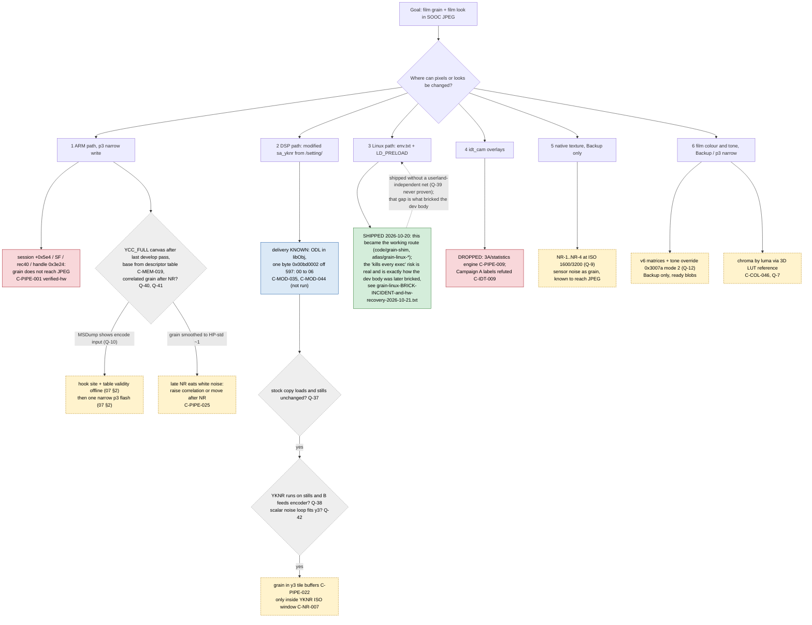

# 07 — Open questions, ranked

Goal used for ranking: **visible film grain and a film look straight out of the camera (SOOC JPEG)**,
with the camera kept recoverable. Q numbers are permanent IDs; the rank is the `rank` column of §2
(re-ranked 2026-10-09 after extracts F/G/H and review R). Each question lists what is known (claim IDs),
what closes it, risk, cost. The ranked table (§2) is the work plan.
Cost: S = offline hours or one Backup session, M = one p3 flash cycle or a day of static RE,
L = several days / new tooling.
Claims: `C-*` are defined in pages 01-05; experiments `E-*` and review items `R-*` in page 06; gaps `G-*` (there is no 08 page; see the rules in 00-index.md).

## 1. Decision tree: how to get grain and the film look into the JPEG (revised 2026-10-09)

Reading: branch 1 is open again: the developed canvas `YCC_FULL` was located but never written (C-PIPE-023),
and the old failures fit "wrong buffer" and "late NR smooths white noise" equally (C-PIPE-025); the grain
injection SITE is now found+verified (C-PIPE-024, C-PIPE-026) but the `YCC_FULL` base is handle-only on ARM
and its table-validity is not provable offline (C-MEM-020, C-MEM-012), so branch 1 waits on a live dump.
Branch 2 (DSP): delivery (Q-37) and the data-path are green — A==B in-place is now a confirmed fact and
YKNR's output is the shared YC canvas the encoder reads (C-PIPE-021) — BUT scalar grain injection into y3
is infeasible: the pixels are not scalar-addressable (engine aperture `0xf81400`, C-PIPE-022, Q-42); only a
VLIW term (Q-17) or a DMA-roundtrip remains. Branch 3 is frozen by F: the only safe `dmode` is `"3\n"` and
a preload failure is brick-level. Branch 4 is dropped. Branch 5 (native texture) needs no firmware write;
branch 6 (colour) is now CONFIRMED on camera — the chroma-by-luma lever is Backup block `0x00030004`/`0x00030005`
and it reaches the SOOC JPEG (E-0067, Q-7 CLOSED; C-COL-046 verified-hw), factory-reset-safe, no flash → the
colour half of the goal is essentially solved no-flash. MSDump (Q-10) is the shared observability precondition,
but the RAM-poke enable is RULED OUT (no capture runs under a live senser session; the `.bss` switch is lost on
reload, C-DLV-004) — it needs a narrow p3 code patch of the gate consumer `0xc361b8ce` (C-DLV-022, a whole-partition
flash) to observe the encode-input (settles Q-40) and YKNR A/B (Q-38/Q-31). So grain (branch 1) now gates on that
p3 observability flash.

## 1b. 2026-10-16 update — grain STAGES resolved (VLIW-injection route)

The DSP-VLIW grain route (reachable since E-0081/84) was mapped to the stage level this session (E-0090):
- **Q-31 (YKNR luma or chroma) → effectively RESOLVED:** the pipeline SPLITS. **PBE (`sa_pbe_work`) = CHROMA
  processor** — its only editable VLIW output is `chan3` (camera: store-0→desaturation); luma passes through
  untouched by its microcode (3 negative luma-register camera tests). **YKNR (`sa_yknr`) = LUMA processor** — its
  dominant clamp→store `clmp r8=clamp(r24)+st r8→chan18` (5 per-tile sites) = the luma plane (DeepSeek-confirmed;
  `luma-stage-yknr.md`). So: **luma grain → yknr chan18/r24; chroma grain → PBE chan3/r0.**
- **Grain injection point is now EXACT on both stages.** Chroma: `grain-chroma-solution.md`. Luma:
  `luma-stage-yknr.md` (verification module `sa_yknr_chan18test.bin` BUILT, ready to flash — confirms chan18=luma).
- **The remaining hard enabler = the per-frame-random SEED reaching the microcode** (for both). Design (DeepSeek):
  a scalar-advanced xorshift written into a free **command-table slot** (engine register-file image,
  `engine-command-table.md`) that the microcode reads; per-pixel spread comes from luma LSBs; luma-modulated by a
  parabola. This is the one piece gating per-frame-random grain — the new #1 open question for the VLIW route.
- **Reachability facts settled:** VLIW edits must be in the clean microcode region (module-specific: PBE ≥0x6000),
  else they corrupt the scalar orchestrator → crash. The engine OUT-DMA writes 2 planes in an r9-parity loop
  (rings 0x9800/0x9000), channel→plane binding runtime-opaque (DRAM). op2 `xf` = nonlinear transfer (not entropy).
- Flagged lead (don't lose): retargeting port24→port31 inside PBE luma pass 0x6310 gave FAINT per-column vertical
  lines (only positive luma-adjacent VLIW signal) — revisit (`pbe-engine-map.md`).
- Cross-refs: `06-experiment-log.md` E-0090, `pbe-engine-map.md`, `luma-stage-yknr.md`, `grain-chroma-solution.md`.
- Workflow: view test frames directly off the SD card (`/Volumes/Untitled/DCIM`) — don't rely on verbal reports.

## 1c. DeepSeek "tails" session (2026-10-17) — feeding blocked/open tails to free DeepSeek

Pattern: pick a DeepSeek-amenable tail → extract firmware bytes/disasm → feed DeepSeek data+question (NOT the raw
Q-list; it hallucinates without data). Runtime/HW facts still need the camera. Results:

- **T-1 command-table reverse (was BLOCKED-ALL-MODELS) → largely DECODED** (`engine-command-table.md`): Region-A =
  config that BUILDS the DMA ring; 4 `0x8000` slots (0x35/37/3c/48) = per-channel bases; 2 FLAG slots (0x3d/45) =
  OUT/action; 0x41=0x038009 = descriptor body (stride 0x380+id); input descriptor = base+stride(0x41)+count(0x34);
  REAL grain = add a ring entry {noise_tile, GO} + VLIW op3-read + op7-add; safest spare slots 0x39/3a/3b. Blockers
  left: free IN channel (4 shown) + SRAM staging (C-DSP-020).
- **Q-42 SEED / per-frame-random:** DeepSeek — the engine most likely PRE-LOADS the 0x40000 config block into GP
  registers at run_engine (coeff block → regs); a per-frame SEED goes into a FREE 0x40000 slot that maps to a
  kernel-unused register; source = LCG seeded from a free-running HW timer, stepped per frame. Needs the run_engine
  prologue (0x40000→reg map, likely HW → camera-confirm) + a free kernel register.
- **Q-3 SPICA luma store:** DeepSeek — output channel ids are likely MODULE-LOCAL (allocation order), so chan3 is a
  reasonable PRIOR (matches yknr) but not proof; chan3 = luma-out / chan7 = intermediate is low-moderate confidence.
  **Probe with a SIGNATURE (constant/ramp), not zero** (zeroing darkens both output and scratch; a signature that
  reaches the encoded luma is unambiguous). Decide statically if the store's destination-tile descriptor is visible.
- **Q-17 op5 two-bank:** DeepSeek confirmed — GP bank (op0/2/4/6/7) vs channel/output bank (op1-pack dst, op3-rd
  dst, op5-st src); inject into the GP source of the op1-pack that feeds the luma store, not the store's `a`.

### Remaining tails to feed DeepSeek (static-extractable, no camera)
- scalar per-pass base-patch routine → map each 0x8000 slot to its IN channel + is there a 5th IN (0x48220/28)?
  (finishes the REAL-grain noise-input path).
- op2 `xf` exact shape (abs/sq/LUT) — partly HW-gated.
- microcode-base: how run_engine(r0=table) reaches the VLIW program (the inline-after-ReginA bytes are the scalar
  wrapper, not VLIW — the real program is a NOP-delimited cluster; map the pointer).
### Camera-gated (DeepSeek can't close)
- channel→Y/U/V plane map (DRAM runtime); which store = luma (signature probe); the 0x40000→reg HW map; op2 xf LUT.

## 1d. DeepSeek RED-TEAM of our negatives (2026-10-17) — several are FALSE-NEGATIVE risk

Fed our key negative conclusions back to DeepSeek to catch premature "unreachable" calls. Verdicts (REOPENS doors):
- **N1 "2-channel wall" (E-0088) — FALSE-NEGATIVE risk HIGH.** Retargeting the luma/chroma mux only proves those
  muxes are load-bearing, NOT that only 2 inputs exist. The yknr 6-entry ring is counter-evidence. A valid test
  ADDS a channel without touching luma/chroma — never run. ⇒ **the noise-source may NOT be blocked.** Re-test:
  dump the yknr ring for free descriptor slots with a distinct channel-id + DRAM addr; read the PBE mux field bit
  width (multi-bit selector ⇒ a 3rd port index is addressable).
- **N4 "PBE can't inject luma" — FALSE-NEGATIVE risk HIGH, CIRCULAR with N2.** The r30/r13 "double" tests are
  GP-register edits; if N2 (scalar can't write pixels) holds they're guaranteed null regardless of luma — zero
  information. Only the mux retarget was informative (= N1, load-bearing port24). ⇒ **PBE-luma is NOT disproven.**
  Re-test: operate on the DATA PATH — repoint the luma OUTPUT descriptor to an alt buffer, or edit a PBE luma
  coeff/LUT.
- **N3 "op5 a7 ≠ GP reg" (E-0092) — FALSE-NEGATIVE risk HIGH.** The null (op7 r7+=r30 → no change) has unclosed
  confounds: the dead lane may not execute, r7 may be clobbered before the store, or op7's dst field may not alias
  op5's a-field. Re-test: put the op7 add in a PROVEN-LIVE lane (adjacent to a lane whose a-edit visibly changes
  output) and read the GP write through a proven-live consumer.
- **N5 "yknr useless at base ISO" — FALSE-NEGATIVE risk MED-HIGH, over-reach.** Null only proves no contribution
  at ISO200 DEFAULT config, not incapability. Re-test: force NR-level/ISO-window to the ISO800 value at base ISO,
  re-run the luma-store edit (= the "ungate yknr" path → universal luma via our confirmed yknr store).
- **N2 "scalar routes closed" (E-0085/86) — PARTLY robust, UNDER-PROVEN.** Both nulls may share one wrong
  address-derivation. Narrow the claim to "can't write the LIVE pixel SRAM," not "can't write pixels." Re-test:
  scalar sentinel-write to the exact address the active descriptor reads, read back after the pass.
- **N6 "no in-engine entropy" — OVER-REACH.** Missed per-pixel sources: ISP **dither/rounding blocks** (pseudo-
  random per pixel, no RNG), LFSR/LUT generators, frame-counter-seeded offsets, residual uninit SRAM/DMA varying
  per frame. Re-test: diff candidate blocks across two consecutive captures; grep for LFSR tap constants / dither.
- **Priority reopened tests (cheap, high-leverage):** (1) yknr ring free-slot + PBE mux field width (N1 → noise
  source + N4), (2) ungate yknr at base ISO (N5 → universal luma via the confirmed store). These two unblock the
  most. **Methodology note (owner's standing rule): we declared several "unreachable" prematurely — re-test before
  concluding.**

## 2. Ranked table (status and rank as of 2026-10-09)

status: open · narrowed (partly answered) · closed · frozen.

| Q | rank | status | question | value for goal | closes it | risk | cost |
|---|---|---|---|---|---|---|---|
| Q-10 | 1 | narrowed | Can MSDump dump the YC buffers (encode input, YKNR A/B) to the card (C-MOD-032/033)? | high (observability; settles Q-38/Q-40/Q-31) | gate decoded (RAM switch `0xc3cb22a4`, not Backup); RAM-poke ruled out (no capture under a live senser session, C-DLV-004) → 3-byte code patch of the SACC consumer `0xc361b8ce` (C-DLV-022), channel-6 p3 flash | p3 whole-partition (28/0, recoverable) | M |
| Q-9 | 2 | open | What do NR-1..NR-4 do to native noise texture (C-NR-010..013)? | high (grain substitute, no firmware) | Backup NR-1 then NR-3 at ISO 1600/3200, σL*/σC* | low (Backup, rollback bytes) | S |
| Q-7 | 3 | closed | Chroma by luminance through the 3D LUT reference (C-COL-046)? | high (film look) | CONFIRMED (E-0067): one-node Backup edit of `0x30004/5` reddens the grey wedge with a triangular Δa* peaking at Y'≈128 in 5/6 styles (Sunset uses another block) | none (Backup, reversible) | S |
| Q-40 | 4 | narrowed | Does correlated grain written into `YCC_FULL` after the last develop pass reach the JPEG (C-PIPE-024)? | very high | site found+verified (DistEncodeFULL entry off `0x3ac13a`, C-PIPE-026); table-validity not provable offline — blocked on a Q-10 live dump, then one narrow p3 flash | p3 narrow (do not flash blind) | M |
| Q-41 | 5 | deprioritized | Does spatially correlated grain survive where white noise did not (C-PIPE-025)? | low now | NOT at the old rec40 site (proven wrong buffer, uninformative — cannot separate "NR smooths" from "buffer discarded"); only meaningful on YCC_FULL, which needs Q-10 first | p3 narrow | M |
| Q-12 | 6 | open | Does the `0x3007a` tone override (mode 2 / mode 1) behave as read? | high (film tone in every style) | write T2-k0, shoot wedges | low (Backup) | S |
| Q-37 | 7 | open | Does a byte-identical stock `sa_yknr` in `/setting/` load through the dir_slot byte (C-MOD-044)? | high (unlocks DSP branch delivery) | one Backup byte + one p2 file + WBI zero + cold boot, shoot, revert | low-medium (that module's OPEN may fail; revertable) | S |
| Q-38 | 8 | narrowed | Does YKNR run on stills and is its buffer B the encoder input (C-PIPE-021, C-NR-007)? | high (DSP branch) | enable fully decoded + A==B confirmed; residual conditional-resize overwrite → MSDump of B (Q-10) | none / low | M |
| Q-31 | 9 | narrowed | YKNR luma or chroma (C-NR-024); KKNR role (C-MOD-050) | medium | NR-3 window test; MSDump A vs B | low | S |
| Q-6 | 10 | open | Which stage holds highlights above Y′≈200 (one frame, R-17)? | medium-high (film shoulder) | Standard c−3 at +1/+2 EV; mode-1 shoulder blob | low | S |
| Q-8 | 11 | open | Does a Picture Effect keep the style's film matrix? | medium | one chart frame | none | S |
| Q-20 | 12 | narrowed | Handle → DRAM; which buffer feeds the encoder (table route C-MEM-019) | medium | static read of table users; live dump at a late point | low | M |
| Q-3 | 13 | narrowed | Executors and order of the stages after YKNR (pbe_work, spica, bdro2_bdex, tbox, star) | medium | H harness over the remaining p8 modules | none | M |
| Q-19 | 14 | narrowed | Is WBI zeroing required (C-DLV-009)? `0x00510023` = 2 selects ssboot (C-BOOT-038) | medium (safety, all tests) | control: flash without zeroing, observe, then zero | low | S |
| Q-39 | 15 | open | Does `\updater\mode` without `comp` enter the updater (C-BOOT-035/036, E-0021)? | medium (userland-independent net) | create `mode`, remove `comp` from the updater shell, cold boot | low-medium (boot into updater; delete the file from the updater shell) | S |
| Q-4 | 16 | open | HW JPEG coder vs `sa_jpeg_enc_*` | low-medium now | trace `0xc35dcxxx` to MMIO | none / p3 logger | M |
| Q-14 | 17 | open | Mode → colour slot / curve index; writer of `[0xc3bad724]` | medium | senser live read per style | none | S |
| Q-15 | 18 | open | Does a factory reset restore stock `0x0003` blocks? | medium (safety, user guide) | one byte, reset, `bk r` | low | S |
| Q-23 | 19 | open | Backup write immediate vs after reboot | low | live read of RAM copy after `bk w` | low | S |
| Q-24 | 20 | open | Active Backup bank | low | live read `[0xc3c9f2dc]` | none | S |
| Q-28 | 21 | open | B&W and Toy colour slots | low | tag-matrix frames | none | S |
| Q-30 | 22 | open | Portrait k1 vs stored c+1 | low | `bk r` + wedge | none | S |
| Q-13 | 23 | open | Sunset AWB warm gain location | low-medium | static | none | M |
| Q-18 | 24 | open | Consumer of hue records; Q4/Q5 | low-medium | static | none | M |
| Q-17 | 25 | open | SA start protocol, VLIW op3 semantics | low now (scalar loop route avoids it) | `cmpr.c` compare, emulator | none | L |
| Q-11 | 26 | frozen | libmpr codec HW/SW | low (Linux route frozen) | static | none | M |
| Q-1 | 27 | frozen | Linux route (env.txt + LD_PRELOAD) | low until Q-39 | see §3 | brick-level at step 2 | S |
| Q-32 | 28 | narrowed | p8 history; p8 breakage recoverable? | low (safety) | menu label check; policy "p8 forbidden" | none | S |
| Q-21 | 29 | open | 2 vs 3 CPUs | low | `/proc/cpuinfo` via senser | none | S |
| Q-22 | 30 | open | Loader2 per-entry masks | low | static | none | S |
| Q-25 | 31 | open | `0xc3441000` cache alias | low | MMU read | none | M |
| Q-27 | 32 | open | Roles of p4, p6, p12 | low | dump / `/proc/partitions` | none | S |
| Q-29 | 33 | open | SA registers reachable from ARM | low | senser read | low | S |
| Q-33 | 34 | open | `-m NEX-3N` rescue | low (ops) | opportunistic | none | S |
| Q-34 | 35 | open | CMPR cores run SA-DSP code | low | `sadis.py` over `ssboot*` | none | S |
| Q-35 | 36 | open | exact C-IDT-013 | very low (branch 4 dropped) | one NOP flash | p3 | S |
| Q-42 | — | closed | Can a scalar per-pixel noise loop be added to yknr y3 (C-PIPE-022)? | — | INFEASIBLE: pixels not scalar-addressable (engine aperture `0xf81400`); answered by C-PIPE-022 (partial-refute), C-DSP-020 | — | — |
| Q-36 | — | closed | When does libObj (re)read the `0x00bd000x` tables (C-MOD-045)? | — | singleton reconstruct only (cold start or WBI-zero); answered by C-MOD-045 | — | — |
| Q-2 | — | closed | Who resolves SA file-id → path; can `/setting/` serve a module? | — | answered by C-MOD-035..C-MOD-044 | — | — |
| Q-5 | — | closed | Recovery after kernel-only boot / broken p2 / kemco; `\updater\mode` semantics | — | answered statically by C-BOOT-028..040, C-SAFE-015 | — | — |
| Q-16 | — | closed | Is p2 `kemco.txt` the kernel cmdline? | — | yes, C-BOOT-040 (never touch) | — | — |
| Q-26 | — | closed | Noise generator in p8 modules? | — | none in scalar code, C-NR-025 | — | — |

## 3. Questions in detail

### Q-1: Does the Linux route (`dmode` + `/setting/env.txt` + `LD_PRELOAD` from `/setting`) work? — answered 2026-10-20: YES, it shipped (code/grain-shim, grain-linux-stage4c-WORKS-auto-landing-2026-10-20.txt). Was FROZEN 2026-10-09 pending the recovery-net question (Q-39), never proven; that gap is what later bricked the dev body
- known: init parses env.txt whenever `dmode` exists (C-BOOT-028); `"03"` is brick-level (C-BOOT-029; C-BOOT-024, C-DLV-015 refuted); the only safe `dmode` is absent or `"3\n"` (C-SAFE-015); a preload that fails to load or crashes kills bootin, `sh`, im.elf and sen.elf (C-LNX-012); the effect acts only after a WBI-invalidating boot and can stay dormant (C-BOOT-039); libmpr API exists (C-LNX-001), codec backend unknown (Q-11).
- closes it: step 1 (`"3\n"` + `TESTVAR=hello`, written from the updater shell, WBI zero, cold boot, read `/proc/<pid>/environ`) is statically low-risk but gives nothing for the goal by itself; step 2 (any preload) is not to be run until a userland-independent way into the updater is shown (Q-39) and the shim is checked against sonyld (ELF flags, DT_NEEDED, symbol versioning).
- risk: step 1 low; step 2 brick-level (jumper/UART only).
- cost: S per step.
- claims: C-BOOT-028..034, C-BOOT-039, C-LNX-001, C-LNX-004, C-LNX-006, C-LNX-011, C-LNX-012, C-SAFE-015

### Q-2: Who resolves an SA file-id to a path, and can the `/setting/` directory slot serve a modified module (e.g. `sa_yknr`)? — CLOSED 2026-10-09 (static)
- answer: the On-Demand Loader in `/usr/lib/libObj.so` (process im.elf) reads `0x00bd0000..5`, matches (userid, prgid) in `0x00bd0002`, builds `prefix[row.dir_slot] + name[file-id]` and reads the file through `/dev/mem` (C-MOD-035, C-MOD-036); the dir_slot is byte +5 of the row (layout corrected, C-MOD-036 vs C-MOD-006); `/setting/` (slot 6) is a production source (C-MOD-039); ODL checks only existence and size (C-MOD-040); av-cam checks magic + container version (C-MOD-041); one byte redirects one module (C-MOD-044).
- residual questions: when ODL re-reads the tables (Q-36); whether a stock copy actually loads (Q-37); the av-cam → ODL hop (C-MOD-043).
- claims: C-MOD-010 (answered), C-MOD-011 (conflict), C-MOD-035..C-MOD-045, C-PART-008

### Q-3: Which engine writes the final full-frame luma, and which stages are ISP vs DSP?
- known: ARM writes never reach the JPEG (C-PIPE-001); idt_cam looks like the IDT/OPD 3A engine (C-PIPE-008, C-PIPE-009) with `0x105d0` = statistics (see C-PIPE-009) and non-specific skip symptoms (see C-IDT-016); executors for matrix, chroma, hue, NR, sharpen, Toy/Pop/Posterization are not identified (C-ISP-003, C-ISP-005..008); p8 modules `sa_yknr`, `sa_kknr`, `sa_pbe_work`, `sa_spica`, `sa_bdro2_bdex`, `sa_star` are opened by av-cam (see C-MOD-012); tone is a HW LUT (C-ISP-001).
- closes it: offline classification of every idt_cam overlay and p8 processing module by DMA descriptor pattern (per-line read + per-line write to the bus = pixel stage; read + small export = statistics), see C-IDT-015; map `Stage_*` names (C-PIPE-005) to OPEN sites; MSDump dumps per stage (Q-10).
- risk: none (offline).
- cost: M.
- claims: C-PIPE-005, C-PIPE-009, C-ISP-003, C-ISP-005..008

### Q-4: Who encodes the still JPEG — a HW coder behind `0xc35dcxxx` or `sa_jpeg_enc_*`?
- known: `tsk46_jpeg` → `0xc347427a` handles stills (C-JPEG-001, verified-hw); handler has no ARM YC address (C-JPEG-002); JPEG goes through `0xc35dcxxx`, not `ExecuteCalcStartMSG` (C-JPEG-003); tables live in av-cam (see C-DSP-023); `sa_jpeg_enc_*` have no constant OPEN site (C-JPEG-005).
- closes it: follow `0xc35dcde6`/`0xc35dc952` down to MMIO writes (HW) or to an OPEN of 0xe0/0xe1 through an own manager ("EncPin"/ZIMA, see C-PIPE-020); a detour logger at `0xc35dc952` recording arguments (handle, geometry) per call.
- risk: low (p3 flash route proven 10+ times, see C-SAFE-003).
- cost: M.
- claims: C-JPEG-001..006, C-MEM-012

### Q-5: Is the camera recoverable after a kernel-only boot, a broken p2 or a broken `kemco.txt`; how exactly does `\updater\mode` work? — CLOSED 2026-10-09 (static)
- answer: a `'0'` in `dmode` → no USB at all, jumper only (C-BOOT-029); stage 1/2 → no appFw, so no pmca updater switch, senser only if `smode` "UU" already exists (C-BOOT-031, C-BOOT-033); bad env preload → every exec dies (C-LNX-012); `kemco.txt` is the kernel cmdline, validated only by its magic → never touch (C-BOOT-040); Loader2 enters the updater on the jumper or the existence of `\updater\mode`, first check, `comp` not read (C-BOOT-035); the updater boot ignores `dmode`/`env.txt` (C-BOOT-037); `mode*` has two deleters (C-BOOT-036); menu reset: no evidence that it clears `/setting/mode/*`.
- residual: which explanation of E-0021 holds and whether the file route works without `comp` → Q-39.
- claims: C-BOOT-028..040, C-SAFE-013 (answered), C-SAFE-015, C-SAFE-004, C-SAFE-005

### Q-6: Which stage holds highlights above Y′≈200?
- known: film k0 is followed to Y′ 197, then the output stays ≥ base − 3..8 (C-TONE-024, verified-hw on one frame); not the makernote A/B field (C-TONE-025 refuted); no post-LUT YC job found (C-TONE-026).
- closes it: Standard c−3 at +1 and +2 EV (input vs level dependence), mode-1 shoulder blob `3007a_mode1_shoulder.hex` (C-TONE-019, C-TONE-027).
- risk: low (Backup, single bank, rollback blob exists).
- cost: S.
- claims: C-TONE-024..027

### Q-7: Is there any lever for chroma by luminance (film-like shadow/highlight desaturation)? — CLOSED 2026-10-09 (E-0067: lever works, 5/6 styles)
- known: hue records have no L dependence (C-COL-020 refuted, C-COL-021 narrowed); the HW 3D LUT has a Y axis with 5 nodes and is filled by `Create3DLUT` from a reference LUT `[obj+0xa0]` scaled by Level (C-COL-026); the reference LUT source is now FOUND = Backup block `0x00030004` (prim) / `0x00030005` (var), written to `obj+0xa0` by dispatcher `0x3d12f8` → the lever is a Backup write (C-COL-046). The conflict C-COL-021 vs C-COL-026 is resolved.
- closes it: one-node edit of Backup block `0x00030004` (1280 B, attr 08), node geometry as in C-COL-026 (`plane*405 + Ynode*81 + Cb_idx*9 + Cr_idx`), shoot a wedge; no flash.
- result (E-0067): a +dCr(+63) edit at the neutral node Y'≈128 of `0x30004`/`0x30005` reddens the grey wedge with a triangular Δa* peaking at Y'≈128-136 (Standard +13.9, Vivid +12.7, Portrait +10.1, Landscape +11.8, B&W +18.5) and ~0 at shadow/high in 5/6 styles → the CAP LUT DOES reach the stills JPEG; chroma-by-luma lever CONFIRMED (C-COL-046 → verified-hw). Residual closed. New open item: Sunset shows Δa*≈0 → it selects a different LUT block/variant (IDX≥2 / 2-D `0x30007`); find `[p8+0x4a]` per style to drive Sunset.
- predictions: prediction (b) holds — the reference is a `0x0003xxxx` Backup block, so a Backup write changes shadow/highlight chroma per Y node; cheapest route, factory-reset-safe.
- risk: none offline; Backup for the test (both banks, rollback bytes).
- cost: S.
- claims: C-COL-021, C-COL-026, C-COL-027, C-COL-046

### EXP-2 (Q-7): does the CAP 3D-LUT reach the stills JPEG? — neutral-axis chroma injection (pre-flight GO-WITH-CHANGES 2026-10-09)
- hypothesis: the HW 3D LUT filled by `Create3DLUT` from Backup `0x00030004`(prim)/`0x00030005`(var) (C-COL-046) is consumed on the stills/JPEG path. Stock LUT is 0 at every neutral node, so a grey patch at one Y band must gain a clean red cast iff the CAP LUT reaches the SOOC JPEG.
- edit: plane2(dCr)/Ynode2(Y'≈128)/neutral (Cb4,Cr4) → offset 1012 (`0x3F4`) = `0x00` → `0x3f` (+63); write BOTH `0x30004` and `0x30005` identically (runtime variant select `obj[0x4a]&0xf` via dispatcher `0x3d12f8`). `0x3f` stays in-range at any Level (max 63·7/8=55<64; the 7-bit field WRAPS not clamps; Level 0 = full gain). Optional stronger signal: same byte at offsets 931 (`0x3A3`, Ynode1) and 1093 (`0x445`, Ynode3).
- predicted: grey wedge step at Y'≈128 reddens, Δa* ~+14..+56, b* flat, PEAKING at Y≈128 and tapering ~linearly to 0 at Y≈64/Y≈192 (triangular luma fingerprint); shape style-independent. Measure with `ramp.py` (Cr on mid-grey steps, before/after, same style), not by eye.
- outcomes: (a) reaches JPEG as above; (b) faint cast = low Level, still confirms reach; (c) no cast at Y128 / shift elsewhere = wrong geometry. NULL (no change in any style) → record as "no effect via `0x30004/5` in styles X,Y,Z", NOT "LUT not on stills path": the dispatcher selects from THREE blocks (IDX 0→`0x30004`, 1→`0x30005`, 2→`0x30006` identity, ≥3 off; MODE2==1 → 2-D LUT `0x30007`) and the `[p8+0x4a]` selector source is not traced offline, so NULL is also consistent with the active style using IDX≥2 or a 2-D LUT. C-COL-046 stills-path consumption stays hypothesis.
- procedure: snapshot Backup (`Backup_pre-exp2.bin`); `bk r 00030004` & `00030005`, SAVE as `work/bk/00030004_orig.txt` / `00030005_orig.txt`, diff vs `bk_3n.txt` (must match byte-for-byte); `bk w` both with byte `0x3F4`=`0x3f` (hex exactly 1280 tokens); `bk r` read-back MATCH; `bk s`; reboot. Shoot a grey step-wedge in Standard/Vivid/Landscape/Sunset/Portrait, one frame each, manual exposure + preset WB, PLUS a pre-edit frame in EACH style first (camera is not stock: v5 in `0x30001/08`, k0 in p3 → call the reference "pre-edit", not stock).
- rollback: byte `0x3F4` → `0x00` in each block with its OWN stock bytes (blocks differ in 214 B). Channel = updater shell `bk w/s`; does NOT depend on av-cam/imaging, but (like every Backup write) needs the main firmware to boot far enough to reach the updater switch (C-DLV-018/C-SAFE-014). Factory reset is NOT counted as insurance (C-SAFE-012 = hypothesis).
- risk: low (Backup, attr 08, not in §4 forbidden, no twin bank). cost: S.
- claims: C-COL-026, C-COL-046, C-COL-027, C-BK-002, C-BK-003, C-BK-007

### Q-8: Does a Picture Effect keep the colour matrix of the selected style?
- known: exclusion is userland, av-cam has no fork (C-FX-014, hypothesis); HC Mono frames carry EXIF Standard (C-PIPE-010); untested (C-FX-029).
- closes it: one chart frame Soft Focus with Vivid (= Portra) selected vs Standard, compare chroma/hue.
- risk: none.
- cost: S.
- claims: C-FX-014, C-FX-024, C-FX-029, C-CTRL-019

### Q-9: What do NR-1..NR-4 do to native noise (cheapest grain substitute)?
- known: forced GHNR/GLNR condition (C-NR-003); designed writes NR-1..NR-4 (C-NR-010..013); NR level mapping unknown (C-NR-004).
- closes it: A0 reference (High ISO NR = Low), then NR-1 at ISO 1600/3200, measure σL*/σC*; then NR-2/3/4.
- risk: low (Backup, both banks, rollback bytes).
- cost: S.
- claims: C-NR-003, C-NR-004, C-NR-010..013

### Q-10: Can the built-in MSDump debug subsystem write YC buffers to the card? (rank 1) — CLOSED 2026-10-10: NO (MSDump-to-card non-viable in retail; use the pointer-leak route)
- result (E-0068, 2026-10-10): the A+B patch forcing the SACC consumer (idx1==4) flashed and verified (camera captured normally), but produced NO `.dat` on the card.
- trace (2026-10-10, root cause): the SACC branch DOES reach `cam_util_debug_file_write` (`0xc37246a2`), but that writer only packages `{FILE_NUM,ADR,SIZE}` and posts it to OS queue `0x012802f1`; the consumer writes to `/mnt`. On the running imaging firmware `/mnt` is NOT the SD card — it is an empty ramfs dir, mounted to the card ONLY in the factory "Utility MS Mount" mode (`FsysMode+2==1`, CAMERA_ADJ mode `0x15`, mgr `0xc346da4c`); normal capture writes the card via a RELATIVE `DCIM/…` path through fsys, not `/mnt`. ALL MSDump channels (SACC idx1==4, MSDumpYCTarRef idx0xa, FILE/cc_ms) converge on this same dead `/mnt` route. None of them dumps the encode-input anyway (SACC `[session+0x39d8]`, YCTarRef `[sp+0x370]`; encode-input `session[+0x3e24]`).
- answer: NO — the gate is a RAM `.bss` switch not Backup (C-MOD-032; C-MOD-033 refuted), but even forced, the write lands in the factory-only `/mnt` mount, so MSDump-to-card is non-viable in retail. Observability of the YCC_FULL encode-input base now moves to Q-40's POINTER-LEAK route: a p3 patch that resolves the base handle and leaks its value to a fixed `.bss` address, read by senser `readMemory` after a normal shot (feasible per E-0031/E-0027), NOT MSDump.
- known: strings `MSDumpYCTarRef`, `YKNR_Debug_MSDump`, `/mnt/YC_FILE%04x.dat`; channel map in C-MOD-032 (idx1 stage selector ==4 → SACC encode-input YC, ==2/3 → YKNR A/B). Not to be confused with the ODL debug block `0x00bd0003` (C-MOD-038).
- closes it: a code patch of the SACC consumer `0xc361b8ce` — patch A `0x1e36d4` `46 d0`→`c0 46` (Thumb-1 NOP; NOT `00 bf`, which is Thumb-2 — av-cam is Thumb-1 only, C-SYS-004; nops the outer `[cap_obj+0x19]` gate, keeping `ldr r4,[r6]`), patch B `0x1e36e0` `07 d0`→`07 e0` (force idx1==4 into the dump), optional patch C `0x3b3bf4` `13 d0`→`c0 46` (YKNR before/after dump) → 3 or 5 bytes; on the film-curve base, channel-6 whole-partition p3 flash (C-DLV-022); cold boot, shoot, pull `*.dat`.
- predictions: a `YC_FILE*.dat` of 4912×3264 YUYV (stride 0x2660) matching the JPEG names the encode input (settles Q-40); `YKNR_Debug_MSDump` shows A vs B of YKNR (settles Q-31, Q-38).
- risk: p3 whole-partition flash (28/0 bricks, C-SAFE-003, recoverable by re-flashing `current_p3.bin`); card space.
- cost: M (was S — the RAM-poke no-flash route is ruled out).
- claims: C-MOD-032, C-MOD-033, C-DLV-022, C-DLV-004, C-BK-008, C-BOOT-013

### Q-11: Are libmpr decode/encode hardware-backed and fast enough per frame?
- known: API exists (C-LNX-001); backend unresolved (C-LNX-009); `/dev/ldec` node exists (C-LNX-008).
- closes it: follow `MprLibCore::*` to `ioctl` numbers; time a decode/encode via the MPR text console (C-LNX-002).
- risk: none / low.
- cost: M.
- claims: C-LNX-001, C-LNX-002, C-LNX-008, C-LNX-009

### Q-12: Does the `0x3007a` tone override (mode 2 / mode 1) behave as read?
- known: modes decoded (C-TONE-016..018); blobs ready (C-TONE-019); never run.
- closes it: write T2-k0, shoot wedges in several styles and contrast values; then mode 1.
- risk: low; mode 1 also changes live view (C-TONE-018); do not touch `+0xD2..D6`, `+0xE0..E3`, `+0xE6` (C-TONE-021).
- cost: S.
- claims: C-TONE-015..021

### Q-13: Where is the Sunset AWB warm gain applied, and is it in Backup?
- known: R×1.4 G×1.06 B×0.6 under AWB only, before the matrix (C-COL-029, C-COL-030); not found (C-COL-031, C-CTRL-021).
- closes it: walk readers of camprm and CC index `+0x26` near WB users.
- risk: none. cost: M.
- claims: C-COL-029..031, C-CTRL-021

### Q-14: How does the colour mode map to the matrix slot and curve index, and who writes `[0xc3bad724]`?
- known: measured slots 0..4 (C-COL-003); global and read sites (C-CTRL-014); mode = value − 1 contradicts slots; item-ID hypothesis (C-FX-010).
- closes it: senser live read of `[0xc3bad724]` and camprm for each style (no flash).
- risk: none. cost: S.
- claims: C-COL-003, C-COL-028, C-CTRL-014, C-CTRL-016, C-FX-010

### Q-15: Does a factory reset restore stock `0x0003` blocks?
- known: public report for NEX-6 era (C-BK-021, hypothesis); attr 0x0a blocks are protected from reset (C-BK-007).
- closes it: change one harmless byte (e.g. a Standard hue byte by +1), factory reset, `bk r`.
- risk: low; a reset also clears owner settings. cost: S.
- claims: C-BK-007, C-BK-021

### Q-16: Is p2 `kemco.txt` the kernel command line? — CLOSED 2026-10-09
- answer: yes; the kernel accepts the RAM copy only with the `kemco` magic, else a built-in default (C-BOOT-040; C-BOOT-025 upgraded to verified-code). NEVER TOUCH. Whether the updater kernel also receives it is unknown (C-BOOT-037), not needed for the goal.
- claims: C-BOOT-002, C-BOOT-025, C-BOOT-040

### Q-17: How does av-cam start an SA module, and what do VLIW op3 codes compute?
- known: CMPR GPL driver gives a file-loaded coprocessor protocol (C-SYS-009); OPEN/START messages (see C-MOD-004, B-MOD-020); op3 semantics unknown (see C-DSP-015).
- closes it: compare start code with `cmpr.c` (IPC base, MBX0..3, IMSR/IENR, CKEN/XRST); emulator of known-output programs (Soft Focus convolution).
- risk: none. cost: L.
- claims: C-SYS-006, C-SYS-009

### Q-18: Who consumes the hue records `+0x100`, and why do Q4/Q5 act weaker?
- claims: C-COL-019, C-COL-027. closes: xref `Copy2DLUT` / `LutMode Change`. risk none, cost M.

### Q-19: Is WBI zeroing required, and what gates snapshot creation?
- known: Loader2 selects ssboot when `0x00510023 == 2` (3N value) with a valid WBI signature and RestReq 0 (C-BOOT-038); then RAM is restored and init (env.txt, dmode) does not run (inferred); ODL init also runs on WBI resume (`odl_res`, C-MOD-045).
- closes it: a control flash without zeroing p5 (expect the old image to keep running), then zero and reboot (do it on the next p3 flash).
- predictions: if WBI restore wins, the change of the control flash is invisible until the zero; if the change is visible at once, liro re-reads av-cam on every boot and C-DLV-009 is a precaution only.
- risk low, cost S.
- claims: C-BOOT-018, C-BOOT-019, C-BOOT-038, C-DLV-009

### Q-20: How is a buffer handle resolved to DRAM; which session buffer feeds the encoder?
- claims: C-MEM-009, C-MEM-011, C-MEM-012, C-JPEG-002. closes: before/after dumps around encode with the diff method (C-MEM-015); trace accessors. risk low, cost M.

### Q-21: Two or three CPUs?
- claims: C-SYS-001, C-SYS-003. closes: `/proc/cpuinfo` from the senser terminal on running firmware. risk none, cost S.

### Q-22: Loader2 per-entry boot-mode masks; is av-cam ever loaded by Loader2?
- claims: C-BOOT-003, C-BOOT-005. closes: decode `+0xc` of all 6 records. risk none, cost S.

### Q-23: Does a Backup write act at once or after reboot?
- claims: C-BK-002, C-BK-003, C-CTRL-022. closes: write through a path that does not reboot (senser AdjustControl, see C-DLV-001) and read the RAM copy `0xc3ac2b94`. risk low, cost S.

### Q-24: Which Backup bank is active?
- claims: C-BK-004. closes: senser read of `[0xc3c9f2dc]` and `+0xc`. risk none, cost S.

### Q-25: Is `0xc3441000` a non-cacheable alias, and is a D-cache flush needed before DSP reads?
- claims: C-BOOT-003, C-MEM-004. closes: MMU table read. risk none, cost M.

### Q-26: Does any p8 module contain a noise generator? — CLOSED 2026-10-09 (scalar code)
- answer: no classic PRNG in the scalar code of any picture module; the only hit is the audio `sa_aaclcdec` (C-NR-025). VLIW bundles and MMIO noise sources are not covered (stated as unknown in C-NR-025).
- claims: C-PIPE-004, C-NR-025

### Q-27: Roles of p4, p6, p12; do p9 and p13 exist?
- claims: C-PART-011, C-PART-012. closes: inspect dump partitions; `/proc/partitions` on running firmware. risk none, cost S.

### Q-28: Which matrix slots do B&W and Toy Camera use?
- claims: C-COL-004, C-FX-026. closes: tag-matrix frame (E-0011 method) in B&W and Toy. risk none, cost S.

### Q-29: Are SA registers reachable from ARM?
- claims: C-SYS-006, C-SYS-007. closes: senser read of candidate ranges on running firmware. risk low (bus fault), cost S.

### Q-30: Portrait curve k1 vs stored Portrait c+1
- claims: C-TONE-004, C-BK-012. closes: `bk r` of the Portrait triple and a wedge at known sliders. risk none, cost S.

### Q-31: Is YKNR luma or chroma NR, and what does KKNR do? (narrowed 2026-10-09)
- known: y3 writes the full YUYV frame tile by tile, both byte lanes (C-MOD-048, C-NR-024); y0..y2 only build 1/8-scale maps (C-MOD-049); KKNR k0/k4 are full-frame row passes, k3 a tile pass, but KKNR runs with faces (C-MOD-050, C-NR-008).
- closes it: NR-3 (close the `0x3004a` window) at ISO 800/3200 and compare σL* with σa*b* (07 §2); or `YKNR_Debug_MSDump` of A and B (07 §2).
- predictions: luma NR → closing the window raises σL* (×1.2 or more) with σC* about flat; chroma NR → σC* rises, σL* flat; both → both rise; no change → YKNR is not on the stills path at that ISO/mode (feeds Q-38).
- claims: C-MOD-026, C-MOD-027, C-NR-007, C-NR-024, C-MOD-048, C-MOD-050

### Q-36: When does libObj (re)read the `0x00bd000x` tables? — CLOSED 2026-10-09 (static)
- answer: libObj reads `0x00bd0002` exactly once, at ODL singleton construction (loader `0x260674` ← constructor `0x783d00` ← lazy getter `0x783a10` ← odl_init/odl_res); the per-OPEN lookup reads the cache and the per-request loader re-reads only names + debug, never `0x00bd0002` (C-MOD-045). So the dir_slot redirect does NOT act on the next OPEN — it needs a singleton reconstruct: a cold appFw start (zeroed .bss) or odl_res after odl_sus/WBI-zero.
- consequence: Q-37's precondition is tightened — a byte-identical copy test needs a WBI zero + cold boot, not a plain updater exit alone.
- claims: C-MOD-045, C-MOD-044, C-BOOT-038

### Q-37: Does a byte-identical stock `sa_yknr.bin` in `/setting/` load through the dir_slot byte?
- known: route by code reading (C-MOD-044); failure stops only that OPEN and is revertable (C-SAFE-016); PRECONDITION (C-MOD-045, Q-36): the redirect activates only on ODL singleton reconstruction, so the test needs a WBI zero + cold boot, not a plain updater exit alone.
- closes it: from the updater: save `0x00bd0002`, copy stock `/usr/sabin/sa_yknr.bin` to `/setting/sa_yknr.bin`, set offset 597 `00 → 06`, `bk s`, zero WBI, cold boot; shoot ISO 1600 frames with High ISO NR on; compare with the same frames before; then revert the byte, delete the file.
- predictions: route works → frames identical in statistics (stock code), no capture error; route broken (file not found / rejected / wrong row) → "capture error" or a missing YKNR effect (σL* jumps like NR-3) → revert; no effect at all and the file is never opened → tables not re-read (Q-36) or YKNR not on that path (Q-38).
- risk: low-medium (a failed YKNR OPEN may abort captures until reverted; revert path does not need av-cam).
- claims: C-MOD-035..C-MOD-045, C-SAFE-016

### Q-38: Does YKNR run on stills, and is its output buffer B the encoder input? — narrowed 2026-10-09 (advanced)
- known: enable fully decoded (0xd5760: off at NR level 0, off in modes {1,5,0x13,0x1A,0x1F,0x20}, else only inside the ISO window of `0x3004a`, with image-class and debug-override gates, C-NR-007); A==B in-place is now a confirmed fact — ARM passes job[0]==job[4] (C-PIPE-021) — and YKNR's output is the shared YC canvas read by `Stage_DistEncodeFULL` (C-PIPE-021, C-JPEG-002); the YKNR OPEN is codectype 0x1c at `sa_func_YKNR_acquire` (C-MOD-043). Residual: whether a conditional resize stage overwrites B before encode (data-driven).
- closes it: MSDump of A/B and the encode-input YC (Q-10) settles the conditional-resize residual.
- viability: a conditionally viable grain host but ISO/NR/mode/image-class-windowed (C-NR-007); scalar injection into y3 is infeasible (C-PIPE-022, Q-42).
- claims: C-NR-007, C-PIPE-021, C-PIPE-022, C-JPEG-002, C-MOD-043, C-MOD-048

### Q-39: Does `\updater\mode` without `comp` enter the updater (a userland-independent safety net)?
- known: Loader2 enters on existence only (C-BOOT-035); E-0021 had `comp` present and both the updater script and the main firmware delete `mode*` (C-BOOT-036); the updater script reads `/setting/updater/mode{1,2,3,6}`.
- closes it: from the updater shell: save `updater/` listing; delete `comp`, create `mode` (empty, then if needed one byte); exit; cold boot (battery pull).
- predictions: (i) camera boots into updater mode → net exists; delete `mode` and restore `comp` from the updater shell; (ii) boots normally and `mode` is gone → Loader2 FAT open failed or the main firmware deleted it first; retry with non-empty content; (iii) boots normally, `mode` present → Loader2 does not see the file (path/FAT reading wrong).
- risk: low-medium (an updater boot loop is broken from the updater shell, which is the normal Backup channel).
- claims: C-BOOT-015, C-BOOT-035, C-BOOT-036, C-SAFE-004, C-SAFE-005

### Q-40: Does grain added to `YCC_FULL` reach the JPEG? — narrowed 2026-10-10 (base IS register-available at the hook; IPC-dead-end resolved; white grain OK after YKNR)
- known: the canvas is located (C-MEM-005); grain can be WHITE at the encode hook (it is after YKNR, C-PIPE-025). KEY de-risk (EXP-4 design, fable 2026-10-10): at the `DistEncodeFULL` prologue `0xc37ed060` the descriptor `r4`=arg1 ALREADY holds the resolved plain base — `0xc37ed0ee` `ldr r0,[r4,#0x14]` puts the YCC_FULL encode-input base in r0, and `[r4+0x14]` flows into the encode-job (→ encoder id `0x560013`, acquire `0xc37ed13a`); geometry in `[r4+4..0xc]` (runtime width `0x1330`/stride `0x2660`). So the earlier "handle-only / IPC dead-end offline" (C-MEM-012/C-MEM-020) is RESOLVED for this site: a grain patch here gets base+stride directly from the descriptor, no IPC needed → grain-at-site is feasible (C-MEM-021).
- closes it (two steps, risk-tiered): (1) **Tier A, no-flash** — an E-0031-method senser re-scan after a normal shot re-fixes base+geometry (zero risk); (2) **Tier B, p3 flash** — EXP-4 pointer-leak: a detour at `0xc37ed0ee` (`60 69 20 ab`→`54 f4 07 fa`, bl cave `0xc3441500` file `0x500`, 40 B) stores `[r4+0x14]`+geometry+magic "EXP4" to BSS scratch `0xc3c8ea00`; shoot, senser-read the scratch → prove descriptor-base == scanned-base AND that the cave executes (de-risks the grain cave). Then EXP-5 writes white grain to `[r4+0x14]` at the same site.
- caveat: the cave's executability (MPU/NX) is not statically provable — the main residual risk; a non-RX cave crashes the camera (recoverable by reflashing `current_p3.bin`).
- result (E-0069, 2026-10-10): the leak patch was flashed; the detour is LIVE (phys `0x837ed0ee` = `54 f4 07 fa` in running av-cam) and captures ran fine → the cave EXECUTES (not NX) and the site is hit every still. The `.bss` scratch read zero only because service-mode entry re-zeros av-cam `.bss` (C-DLV-004 class) — so `.bss`-leak-via-senser is dead, but NOT needed. MECHANISM PROVEN: grain-at-site is feasible. Next (EXP-5): a grain cave at `0xc37ed0ee` writes noise into the Y bytes of the buffer at r0=`[r4+0x14]`; the result is read directly from the SOOC JPEG (no senser) → the `.bss` problem does not apply.
- result (E-0070, 2026-10-10): EXP-5 flashed (device md5 MATCH). NO grain reached the JPEG — per-row hMAD flat 0.50–0.55, no band, no step; captures ran fine (cave executes, no crash). Disasm: `[r4+0x14]` is marshalled into the encode-acquire IPC (`bl 0xc3701f08`, id `0x560013`), so it IS the encoder's input base — the failure is that the ARM CACHED write to the `0xC…` alias never reaches the HW/DSP coder (no cp15/flush on av-cam; Q-25), OR `[r4+0x14]` is a handle/secondary field. **C-MEM-021 operative claim REFUTED-hw.** Next: black-band tie-breaker (Y=0, same site) to test reach-vs-amplitude; then the uncached DRAM mirror alias (`0x90000000`→av-cam `0xD…`, C-MEM-002) or the YKNR-dispatch site where ARM holds the plain `DRAM_A+off` (C-PIPE-021).
- result (E-0071, 2026-10-10): EXP-6 two-band probe (±64) flashed (fable pre-flight GO; device md5 MATCH). Band A rows 0–119 via cached `0xC…`, band B rows 120–239 via uncached-mirror `0xD…`. **NEITHER band appeared, no crash** (hMAD 0.76–0.81 top, smooth, no step). Kills both escape hatches: not amplitude (±16/±64 both nil) and not cache-flush (uncached `0xD…` write, confirmed mapped/writable, also failed). ⇒ `[r4+0x14]` is the WRONG buffer (handle/secondary field, not the encode pixel canvas). **The DistEncodeFULL-descriptor site is DEAD for ARM grain (E-0070 + E-0071); C-MEM-021 fully refuted.** Pivot: the YKNR-dispatch site (C-PIPE-021) — the only ARM point holding the plain canvas base `DRAM_A+off`; inject after the YKNR DSP job completes, before `Stage_DistEncodeFULL` reads the shared YC canvas. Needs RE to find the post-completion ARM point.
- result (E-0072, 2026-10-10): EXP-7 wrote a solid Y=0 band at the YKNR PRE-dispatch point `0xc38782da` (r0 = plain canvas base, blx→cave, 0xC rows 0-99 / 0xD rows 100-199). ISO 200 frame: no band, no crash (YKNR gated OFF at low ISO, C-NR-007 → detour never fires). High ISO: **camera REBOOTS during processing** → when YKNR runs the detour FIRES and the write to the real canvas crashes. First ARM write to reach a REAL encode-path buffer (EXP-5/6 were harmless), but it crashes (hypotheses: 0xD mirror unmapped for the high canvas addr / watchdog / mid-setup race). CAMERA LEFT ON EXP-7 (restore `current_p3.bin` next session). Next: EXP-8 = small `0xC…`-only cached black band at the same site to isolate the crash cause and test whether a cached write reaches the JPEG; if writing mid-setup is itself fatal, move to a post-completion write (RANK-2 `0xc37ec530` + IPC resolver `0xc37560e4`) or the DistEncode post-resolution site (slot `0x39f0`).
- predictions: visible film-like grain in the JPEG → branch 1 delivers; grain present but HP-std ≈ 1 → a later NR pass smooths it (move later, raise correlation); nothing → the encoder reads another copy (then MSDump, Q-10) and only then is branch 1 closed.
- claims: C-PIPE-023, C-PIPE-024, C-PIPE-026, C-MEM-005, C-MEM-012, C-MEM-019, C-MEM-020, C-JPEG-002

### EXP-5 (grain band): white noise into YCC_FULL Y, top ~500 rows, at the DistEncodeFULL hook — EXECUTED 2026-10-10 (E-0070: NO grain — ARM cached write does not reach the JPEG)
- hypothesis: an ARM write of white noise into the Y bytes of the encode-input buffer `[r4+0x14]` at `0xc37ed0ee`, via the non-cacheable alias `(base & 0x3FFFFFFF)|0xC0000000` (how av-cam addresses buffers, C-MEM-004; CPU1 µITRON non-cacheable, C-SYS-002/004), reaches the SOOC JPEG. Site is after YKNR → white noise OK (C-PIPE-025); the detour+cave mechanism is proven live (E-0069).
- patch (clean base `sys_avcam.bin` md5 `58809e0255a34e21c077fe49935a7408`): detour `0x3ac0ee` `60 69 20 ab`→`54 f4 07 fa` (bl cave `0xc3441500`); cave 82 B at file `0x500`: xorshift32, loop over the first 500 rows (`500*0x2660`) Y even-bytes, noise −16..+15, clamp 0..255, write via the `0xc0…` alias, reproduce the 2 overwritten insns, `bx lr`. Image `p3_exp5_grain.bin` md5 `a3c3763c01922d8611157bd59c5da28f`, built + capstone-verified (only `[0x3ac0ee,+4)` and `[0x500,+82)` changed). Channel-6 flash; rollback `current_p3.bin` md5 `d7cca4469709a8b50bc5ad6efa34aa13`.
- predicted: grain in the top ~500 rows, clean below, sharp boundary → the ARM write reaches the JPEG; HP-std ~3-5 in the band vs ≲1.8 below (ratio ≥2-3×).
- failure modes / diagnostics: clean everywhere + no crash → cache (swap OR-const `0xC0000000`→`0x80000000`, ARM-phys alias) OR wrong buffer (→ live dump); grain everywhere / wrong geometry → wrong base/stride; capture hangs ("writing to card") → watchdog on 2.46M uncached writes → shrink band to ~200 rows; crash each frame → cave clobber bug → reflash. Tie-breaker: write Y=0 (black band) to separate "write reached" from "amplitude eaten".
- claims: C-PIPE-024 (hw-test), C-MEM-021, C-MEM-004, C-SYS-002, C-SYS-004, C-PIPE-025, C-PIPE-026, E-0069

### EXP-8 (crash-isolation): cached-`0xC`-only black band at the YKNR pre-dispatch site — PREPARED 2026-10-10 (built, ready to flash), follows the EXP-7 crash (E-0072)
- why: EXP-7 (E-0072) fires on the YKNR path at high ISO and REBOOTS the camera when it writes the real canvas (0xC band A rows 0-99 + 0xD band B rows 100-199). EXP-8 removes the `0xD` band and keeps ONLY the cached `0xC` band (rows 0-99, Y=0) — the one clean diff — to isolate the crash cause.
- patch (clean base `sys_avcam.bin` md5 `58809e02…`): SAME detour as EXP-7 — `0x4372da` `20 60 60 60`→`04 49 88 47` (`ldr r1,[pc,#0x10]; blx r1`), literal `0x4372ec` `01 22 00 21`→`01 15 44 c3` (`0xc3441501`); cave 44 B at file `0x500`: push{r0-r7}; r3=base&0x3FFFFFFF; r1=r3|`0xC0000000`; end=r1+`0xEFD80`(100×`0x2660`); loop `strb #0` even-bytes; pop; reproduce `str r0,[r4]`/`[r4,#4]`; `bx lr`. Image **`p3_exp8_yknr_c_only.bin` md5 `aa4269114ddc18aedebfab097faa9329`**, built + capstone-verified (only detour+literal+cave changed, idt intact). Rollback `current_p3.bin` `d7cca446…`. **Flash at HIGH ISO** (YKNR must run for the detour to fire); verify with a high-ISO shot (and shoot a low-ISO control = no band expected).
- decision tree on the high-ISO frame: (1) **no crash + black band rows 0-99** → a cached ARM write reaches the encoded JPEG AND the YKNR canvas IS the encode source → GRAIN MECHANISM FOUND (next: replace Y=0 with grain, scale up; white grain must go POST-YKNR or be correlated). (2) **no crash + NO band** → cached write doesn't reach the DSP (cache, Q-25) → need a mapped uncached path (the `0xD` mirror data-aborts at the high canvas addr → find the correct uncached alias / a cache-clean). (3) **still crashes** → writing the in-use canvas mid-YKNR-setup is itself fatal → abandon pre-dispatch; move to a POST-YKNR-completion write (C-PIPE-021 RANK-2 `0xc37ec530`, reconstruct base via IPC resolver `0xc37560e4`) or the DistEncode post-resolution site (slot `0x39f0`).
- pre-flight: NOT yet reviewed by a different model (do before flashing, per Tier-B rule) — but it is EXP-7 minus the `0xD` band (EXP-7 passed fable GO), so the delta is small.
- claims: C-NR-007, C-PIPE-021, C-MEM-002, C-MEM-021, E-0072

### Q-41: Does spatially correlated grain survive where white noise did not? — DEPRIORITIZED 2026-10-09 (rec40 is the wrong buffer)
- known: E-0045..E-0048 amplitude independence (C-PIPE-001); the late NR is now identified = YKNR (C-PIPE-025).
- note (C-PIPE-025 analysis): the old rec40 site = `session[+0x5e4]` is a PROVEN wrong buffer (C-MEM-007/008, C-PIPE-001) — it never reaches the JPEG, so correlated grain there fails for the same reason white did and does NOT separate "NR smooths" from "buffer discarded". The correlation question is only meaningful ON YCC_FULL, which first needs Q-10 (the base address). The Q-40 encode site sits AFTER YKNR, so grain there can be white anyway. Recommendation: skip Q-41, go to Q-10.
- claims: C-PIPE-001, C-PIPE-025

### Q-42: Can a scalar per-pixel noise loop be added to `sa_yknr` y3 within limits? — CLOSED 2026-10-09 (INFEASIBLE)
- answer: no. The y3 "slot" between the engine pass and the write-chain operates on DMA descriptors, not pixels; the scalar core makes 0 byte/halfword pixel accesses over the whole y3 run and the shared buffer is the engine DMA aperture `0xf81400`, not the scalar-addressable 2 KB tile buffers (C-PIPE-022 partial-refute, C-DSP-020, C-DSP-036). A DMA-roundtrip workaround breaks DMA-identity and costs ×38..×65 (C-PIPE-022).
- consequence (branch 2): the "scalar noise in y3" sub-path is dead; only a VLIW term (Q-17) or a DMA-roundtrip remains.
- claims: C-PIPE-022, C-DSP-020, C-DSP-036, C-MOD-048

## 4. Conflicts (two records kept) — updated 2026-10-09

| conflict | records | state | question |
|---|---|---|---|
| 2 vs 3 CPUs | C-SYS-001 / C-SYS-003 | open | Q-21 |
| updater by file flag: code vs test | C-BOOT-015, C-BOOT-035 / C-SAFE-004, E-0021 | narrowed: code confirmed, test has two explanations (C-BOOT-036) | Q-39 |
| Backup write immediate vs reboot | C-BK-002 / C-BK-003 | open (operational rule: reboot) | Q-23 |
| HW JPEG coder vs `sa_jpeg_enc` | C-JPEG-004 / C-JPEG-005 | open | Q-4 |
| colour slot by mode value vs item ID | C-CTRL-014 / C-FX-010 / C-COL-003 | open | Q-14 |
| Portrait curve vs slider default | C-TONE-004 / C-BK-012 | open | Q-30 |
| native-grain sweep scope | C-PIPE-004 | resolved for scalar code (C-NR-025) | Q-26 closed |
| ARM-side module check: none vs magic + version | C-MOD-011 (note, hypothesis) / C-MOD-041 (verified-code) | C-MOD-041 preferred; C-MOD-011 kept for its failure path | — |
| `0x00bd0002` field layout | C-MOD-006 / C-MOD-036 | resolved: C-MOD-036 | — |
| chroma by luma: none vs 3D LUT | C-COL-021 / C-COL-026 | resolved: C-COL-021 narrowed to hue records; lever = C-COL-046 (source verified-code = Backup `0x00030004`; stills-path consumption still hypothesis) | Q-7 |
| "ARM path closed" vs canvas never tried | C-PIPE-001 / C-PIPE-023 | resolved by narrowing C-PIPE-001; the global claim C-PIPE-023 is hypothesis | Q-40 |
| YKNR A vs B on stills | C-PIPE-021 | resolved: ARM passes A==B in-place (verified-code fact) | Q-38 |
| encode-input: static recovery vs live-only | C-MEM-012 / C-MEM-019 / C-PIPE-023 | site found (DistEncodeFULL off `0x3ac13a`); YCC_FULL base handle-only, table-validity needs a live dump (Q-10) | Q-40 |
| scalar in-place grain loop in y3: feasible vs infeasible | C-PIPE-022 / C-DSP-020 | resolved: infeasible — pixels not scalar-addressable (engine aperture `0xf81400`) | Q-42 |
| Campaign A labels: hypothesis vs refuted | C-IDT-009 | resolved: refuted, observations in C-IDT-008 | — |
| `dmode "03"` safe vs brick | C-BOOT-024, C-DLV-015 / C-BOOT-029 | resolved: refuted | — |
| VLIW program never addressed vs scalar `bl` into it | C-DSP-021 / C-DSP-035 | open | Q-17 |
| p8 breakage unrecoverable vs repairable | C-SAFE-005 / C-SAFE-006 | open; policy "p8 forbidden" | Q-32 |

## 5. Trace table (sources of questions)

Left column: temporary IDs. `A-*` = `_extract/A-system-boot-delivery.md`, `B-*` = `_extract/B-dsp-modules.md`, `L §n` / `E xn` = Linux recon / web extracts; a bare `C-<AREA>-<NNN>` in the **left** column is the temporary ID from `_extract/C-backup-colour-tone.md` (same prefix as final IDs — read it as extract C).

| question | from extract items |
|---|---|
| Q-1 | L §3, "Recommended path"; A-DLV-014 |
| Q-2 | B-MOD-010; B §5 item 2; E A3, B2 |
| Q-3 | A open q. 1; B-IDT-013; C §E, §F |
| Q-4 | A open q. 2; A Conflicts 3; B-MOD-029 |
| Q-5 | A open q. 6; A Conflicts 5; D R-11; L §5 |
| Q-6 | C §F; C-TONE-028 (extract) |
| Q-7 | C §F (chroma by luminance) |
| Q-8 | C-FX-031 (extract); C §D item 18 |
| Q-9 | C-NR-010..013 (extract) |
| Q-10 | A open q. 9 |
| Q-11 | L §1, step 4 |
| Q-12 | C-TONE-019 (extract); MOR |
| Q-13 | C §F; C-COL-032 (extract) |
| Q-14 | C §F; C §D item 8 |
| Q-15 | E B5; E follow-up 4 |
| Q-16 | new (P09 kemco.txt on p2) |
| Q-17 | E follow-up 1; B §5 item 1 |
| Q-18 | C §F |
| Q-19 | A open q. 4 |
| Q-20 | A open q. 10, 13 |
| Q-21 | A open q. 8 |
| Q-22 | A open q. 3 |
| Q-23 | C §D item 1; E B1 |
| Q-24 | C §F |
| Q-25 | A Conflicts 8 |
| Q-26 | A Conflicts 11 |
| Q-27 | A open q. 7 |
| Q-28 | C §D item 17; C-FX-028 (extract) |
| Q-29 | A open q. 12 |
| Q-30 | C §D item 6 |
| Q-31 (narrowed) | H §6, §8; 04 §7 Q-1 |
| Q-36 | G-MOD-011 |
| Q-37 | G §4 "Before a test"; G-MOD-010 |
| Q-38 | H §6 items 1-3; H-PIPE-001 |
| Q-39 | F §2 item 2(c), §4; R-11 |
| Q-40 | R findings 1-3, 3-A, 5-B |
| Q-41 | R 2-B, 5-B |
| Q-42 | H-PIPE-002, H §6 item 4 |

## 6. Trace table: extracts F / G / H / R → final IDs (integration 2026-10-09)

| extract item | final ID | page | effect |
|---|---|---|---|
| F-BOOT-001 | C-BOOT-028 | 01 | refutes gate of C-BOOT-022, C-DLV-014 |
| F-BOOT-002 | C-BOOT-029 | 01 | refutes C-BOOT-024, C-DLV-015; answers C-SAFE-013 |
| F-BOOT-003 | C-BOOT-030 | 01 | corrects letter map of C-BOOT-022 |
| F-BOOT-004 | C-BOOT-031 | 01 | confirms C-BOOT-023 |
| F-BOOT-005 | C-BOOT-032 | 01 | `"3\n"` reference |
| F-BOOT-006 | C-BOOT-033 | 01 | refines C-BOOT-006 |
| F-BOOT-007 | C-BOOT-034 | 01 | env grammar |
| F-BOOT-008 | C-BOOT-035 | 01 | confirms C-BOOT-015 |
| F-BOOT-009 | C-BOOT-036 | 01 | contests C-SAFE-004 conclusion |
| F-BOOT-010 | C-BOOT-037 | 01 | |
| F-BOOT-011 | C-BOOT-038 | 01 | refines C-BOOT-016/019 |
| F-BOOT-012 | C-BOOT-039 | 01 | |
| F-BOOT-013 | C-BOOT-040 | 01 | upgrades C-BOOT-025; closes Q-16 |
| F-LNX-001 | C-LNX-012 | 02 | freezes C-LNX-011 |
| F-SAFE-001 | C-SAFE-015 | 05 | replaces C-SAFE-013 ban by whitelist |
| G-MOD-001 | C-MOD-035 | 04 | answers C-MOD-010; closes Q-2 |
| G-MOD-002 | C-MOD-036 | 04 | corrects C-MOD-006 layout |
| G-MOD-003 | C-MOD-037 | 04 | |
| G-MOD-004 | C-MOD-038 | 04 | |
| G-MOD-005 | C-MOD-039 | 04 | |
| G-MOD-006 | C-MOD-040 | 04 | |
| G-MOD-007 | C-MOD-041 | 04 | conflicts C-MOD-011 |
| G-MOD-008 | C-MOD-042 | 04 | |
| G-MOD-009 | C-MOD-043 | 04 | |
| G-MOD-010 | C-MOD-044 | 04 | delivery of branch 2 |
| G-MOD-011 | C-MOD-045 | 04 | Q-36 |
| G §4 (failure/revert) | C-SAFE-016 | 05 | |
| H-MOD-001..006 | C-MOD-046..C-MOD-051 | 04 | |
| H-MEM-001 | C-MEM-018 | 01 | |
| H-DSP-001..003 | C-DSP-034..C-DSP-036 | 04 | C-DSP-035 conflicts C-DSP-021 |
| H-NR-001 | C-NR-024 | 02 | Q-31 narrowed |
| H-NR-002 | C-NR-025 | 02 | closes Q-26 |
| H-PIPE-001 | C-PIPE-021 | 02 | Q-38 |
| H-PIPE-002 | C-PIPE-022 | 02 | Q-42 |
| H-TOOL-001 | C-TOOL-008 | 05 | |
| R finding 1, 1-A | C-PIPE-001 narrowed; C-PIPE-023 | 02 | |
| R finding 2, 3-A | C-MEM-019, C-PIPE-024 | 01, 02 | Q-40 |
| R 2-B | C-PIPE-025; R-14 | 02, 06 | Q-41 |
| R 1-B, 4-A, 3-D, 5-D | C-COL-046; C-COL-021 narrowed | 02 | Q-7 |
| R 4-B, 2-C | C-IDT-009 → refuted; R-15 | 04, 06 | |
| R 2-A, 5-E | R-6 updated | 06 | re-shoot E-0049 (07 §2) |
| R 2-D | R-16 | 06 | |
| R 1-D | R-17 | 06 | |
| R 1-E | R-13 updated; 05 channel 5 caveat | 05, 06 | |
| R 4-F | 05 §2.2 item 7 (geometry rule) | 05 | |
| R 6-A | Q-1 frozen (with F) | 07 | |
| R 6-B | Q-19 re-ranked | 07 | |
| R 6-C | 05 §2.2 item 6 note; channel 5 preferred | 05 | |
| R 6-D, 6-E | 08 publication track rules (never `bk patch` for looks; stage a rollback before tone modes) | 08 | |
| R finding 4, 5-A | Q-10 rank 3 | 07 | |
| R 3-B | C-PIPE-004 relates; branch 5 promoted | 02, 07 | |
| R 3-E (video path) | backlog note | 07 | |
| Phase-0 opus RE 2026-10-09 (Q-10) | C-MOD-032, C-MOD-033 | 04 | gate resolved to RAM switch `0xc3cb22a4`; C-MOD-033 refuted (not Backup-gated) |
| Phase-0 opus RE 2026-10-09 (Q-36) | C-MOD-045, C-MOD-044 | 04 | reread is singleton-only; chain corrected (`0x783ce0` = destructor); C-MOD-044 precondition tightened; closes Q-36 |
| Phase-0 opus RE 2026-10-09 (Q-38) | C-PIPE-021, C-NR-007, C-MOD-043 | 02, 04 | A==B in-place fact; YKNR enable fully decoded; YKNR OPEN codectype 0x1c |
| Phase-0 opus RE 2026-10-09 (Q-40) | C-PIPE-026, C-PIPE-024, C-MEM-020, C-MEM-012, C-MEM-019, C-JPEG-002 | 01, 02 | dispatched pipeline mapped; site offline-checkable, base handle-only, needs a live dump |
| Phase-0 opus RE 2026-10-09 (Q-42) | C-PIPE-022, C-DSP-020 | 02, 04 | scalar in-place y3 loop infeasible (engine aperture `0xf81400`); closes Q-42 |
| Phase-0 opus RE 2026-10-09 (Q-7) | C-COL-026, C-COL-046 | 02 | reference 3D-LUT source found = Backup block `0x00030004` |
